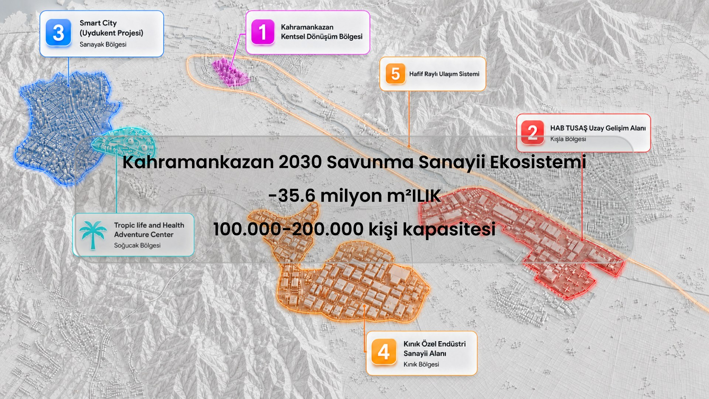
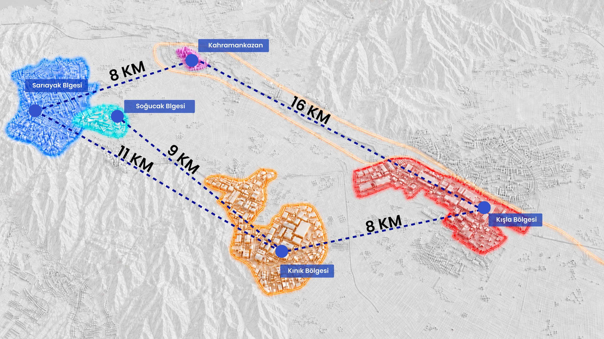
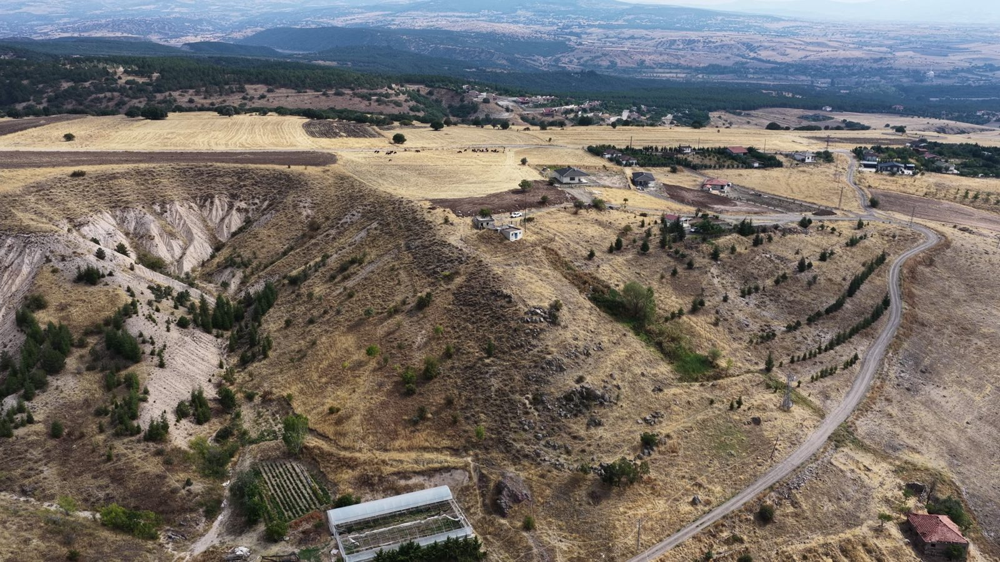
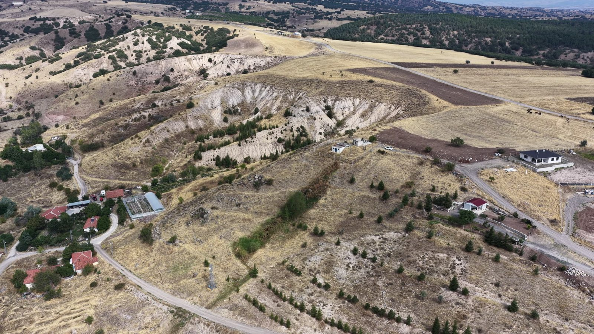
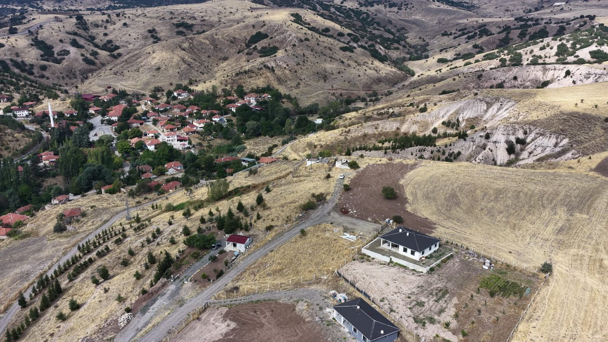
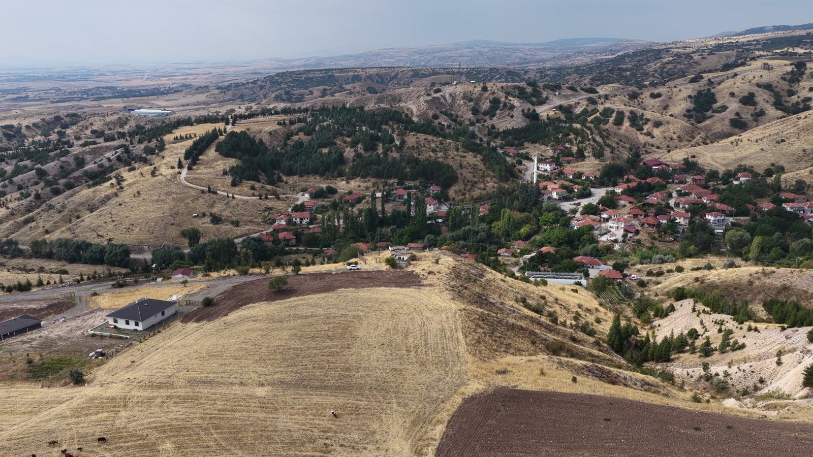
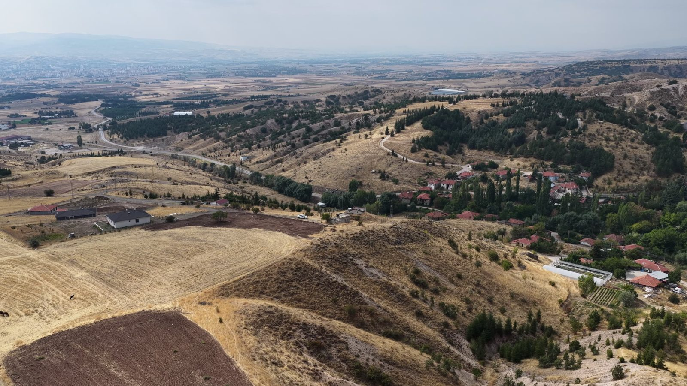
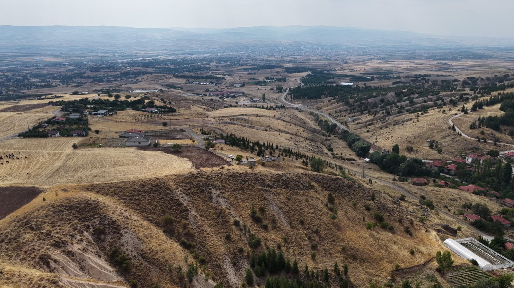
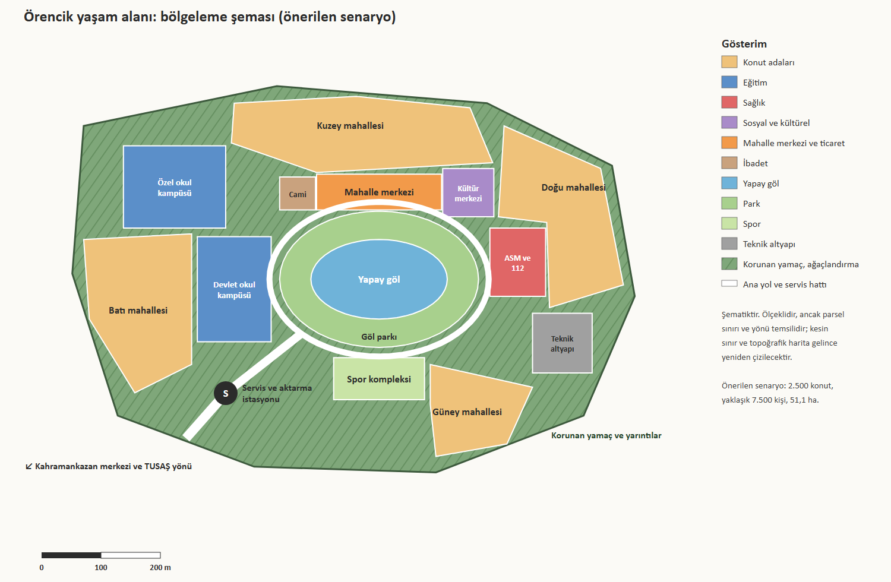

# Kahramankazan Uydukent fizibilitesi

Sarıayak'ta savunma ve havacılık sanayi çalışanları için akıllı bir yaşam alanı

Belen & Partners · Ekim 2026

**Taslak**

## 1. Yönetici özeti

**Tek cümlelik mesaj:** Kahramankazan Sarıayak Mahallesi'ndeki 51,1 hektarlık Hazine arazisi, okul kampüsleri, sağlık merkezi, yapay gölü ve sanayi bölgelerine ekspres hattıyla, savunma ve havacılık sanayi çalışanlarının ailece yaşamayı seçeceği yaklaşık 7.500 kişilik akıllı bir yaşam alanına, Kahramankazan Uydukent'e dönüştürülebilir.

Sarıayak Mahallesi'ndeki 511.000 m²'lik Maliye Hazinesi arazisi, platolara yerleşen dört mahallede **2.500 konut ve yaklaşık 7.500 kişi** için uygundur; arazinin yaklaşık **%20'si yamaç ve yarıntı olarak korunur** (bölgenin arazi tipine dayalı varsayım; parsel topoğrafyasıyla kesinleşecek), merkezde **2,5 ha'lık bir yapay göl**, iki okul kampüsü, sağlık merkezi ve mahalle merkezi yer alır. Uydukent, proje ekibinin "Kahramankazan 2030 Savunma Sanayii Ekosistemi" vizyonunun yaşam alanı bileşenidir; vizyondaki 35,6 milyon m² ve 100.000–200.000 kişilik kapasite ekosistemin bütününe aittir, bu parsele değil. Arazi satın alınmayacak; Cumhurbaşkanlığı'ndan istenen, Hazine arazisinin savunma sanayi çalışanlarına yönelik bir yaşam alanı olarak değerlendirilmesi kararıdır. Toplam yatırım 2026 fiyatlarıyla, KDV ve arazi hariç **yaklaşık 12,5 milyar TL** (aralık 9,9–15,9 milyar TL), bunun **yaklaşık 3,3 milyar TL'si** altyapı, devlet okulları, sağlık, göl, park, akıllı şehir ve ulaşım gibi kamu ve ortak kullanım kalemleridir. Uydukent sanayi bölgelerine en yakın nokta değildir: proje ekibinin bölge görseline göre Kınık'a 11 km, HAB ve Kışla bölgesine Kınık üzerinden yaklaşık 19 km (hesap) uzaktadır; Eryaman ve Yenikent ise TUSAŞ tesis alanına daha yakındır (OSM'ye göre kuş uçuşu 11,7 ve 9,1 km). Kazanç koridordadır: işe gidiş Ankara'nın sıkışık Batıkent–Susuz–Eryaman koridorundan çıkıp ilçe içindeki Uydukent–Kınık–HAB koridoruna, mesaiye bağlı **13 elektrikli otobüslük Uydukent Ekspres**'e geçer. Şehir dışında olmanın diğer sorunları için çözüm de ilk konut teslimiyle aynı gün çalışacak biçimde planlandı: eğitimde devlet ve özel okul kampüsleri, sağlıkta yerinde aile sağlığı merkezi, 112 istasyonu ve poliklinik ile yaklaşık 8 km uzaktaki Kahramankazan Devlet Hastanesi, sosyal yaşamda göl, park, kültür ve spor tesisleri. Ölçülebilen ulaşım faydası yılda **40–127 milyon TL**'dir ve kamu payını tek başına geri ödemez; asıl gerekçe stratejiktir: 12. Kalkınma Planı savunma sanayii istihdamını **2022'deki 81,1 binden 2028'de 158 bine** çıkarmayı hedefliyor ([12. Kalkınma Planı, Tablo 22](https://www.sbb.gov.tr/wp-content/uploads/2023/12/On-Ikinci-Kalkinma-Plani_2024-2028_11122023.pdf)) ve SSB Stratejik Planı yurt dışına ya da başka sektörlere geçen deneyimli personelin kaybını resmi bir tehdit olarak yazıyor ([SSB 2024–2028 Stratejik Planı](https://www.ssb.gov.tr/storage/img/stratejik-plan-2024-2028.pdf)). Kararı en çok etkileyebilecek teyitler, Sarıayak parselinin koordinatı, sınırı ve topoğrafyası ile bölgede görülen teraslı ağaçlandırmanın parselde bulunup bulunmadığı ve hukuki statüsüdür.

### Beş göstergede Kahramankazan Uydukent

| Arazi | Konut | Nüfus | Toplam yatırım | Sanayi bölgelerine süre |
|:---:|:---:|:---:|:---:|:---:|
| **51,1 ha** | **2.500** | **~7.500 kişi** | **~12,5 milyar TL** | **ekspresle <35 dk** |
| Sarıayak, Maliye Hazinesi; ~%20'si korunan yamaç ve yarıntı (varsayım) | önerilen senaryo; aralık 2.000–3.000 konut | hane büyüklüğü 3,0 kişi (varsayım) | 2026 TL, KDV ve arazi hariç; aralık 9,9–15,9 milyar TL | Uydukent–Kınık–HAB/Kışla, ~19 km (hesap); kapıdan kapıya hedef |

### Şehir dışında olmanın sorunları ve çözümleri

| Sorun | Çözüm | İlk gün | Sonra |
|---|---|---|---|
| Ulaşım: HAB/Kışla Kınık üzerinden ~19 km, raylı bağlantı yok | Uydukent Ekspres (13 elektrikli otobüs, mesaiye bağlı, garantili koltuk); ilçe merkezine (8 km) ring hat; tek ulaşım uygulaması | Ekspres, ring hat, aktarma istasyonu | Öncelikli otobüs koridoru (3–6 yıl); talep yeterse ekosistemin planlanan hafif raylı sistemine bağlantı (6–12 yıl) |
| Eğitim: aileler Ankara'daki okullardan vazgeçmekte zorlanır | Devlet okul kampüsü (~32 derslik) ve iki dilli özel kampüs (~25 derslik; anaokulundan liseye, güçlü akademik program); en uzak konut okula ~500 m | Kreş, anaokulu, ilkokul | Özel kampüsün üst kademeleri |
| Sağlık: hastaneye uzaklık, acil erişim | Yerleşimde ASM, 112 istasyonu ve poliklinik; hastane için yaklaşık 8 km uzaktaki Kahramankazan Devlet Hastanesi (2022); tele-sağlık | ASM ve 112 istasyonu | Poliklinik kapsamının genişlemesi |
| Sosyal yaşam: "yatak odası kent" riski | 2,5 ha yapay göl ve 3,5 ha göl parkı; mahalle merkezi, kültür merkezi, cami, spor; yamaç parkurları; topluluk programları | Mahalle merkezi, pazar, gölün ilk etabı | Kültür merkezi ve spor kompleksi |
| Veri güvenliği: sakinlerin çoğu savunma çalışanı | Yerli veri altyapısı, asgari veri, KVKK'ya ek güvenlik denetimi | Fiber, akıllı sayaç, operasyon merkezi | Dijital ikiz |

### Cumhurbaşkanlığı'ndan istenen karar

Bu rapor tek bir karar istiyor: **Sarıayak'taki 511.000 m²'lik Hazine arazisinin savunma sanayi çalışanlarına yönelik bir yaşam alanı olarak değerlendirilmesi.** Konutlar satılık ve herkese açık olacak; savunma ve havacılık sanayi çalışanları öncelikli olacak. Kimin yapıp satacağı, yani uygulama modeli, bu raporun konusu değildir. Karar verildikten sonra ilk iş, Bölüm 12'deki karar kapılarında sıralanan teyitlerin tamamlanmasıdır: Sarıayak parselinin koordinatı, sınırı ve halihazır haritası; parselin topoğrafyası ve olası ağaçlandırma alanlarının 6831 sayılı Kanun karşısındaki statüsü; jeoteknik etüt; imar durumu; Milli Savunma Bakanlığı ve Sivil Havacılık Genel Müdürlüğü'nün parsel koordinatlarıyla uçuş ekseni ve gürültü görüşü; ASKİ, Başkent EDAŞ ve Başkentgaz'ın kapasite görüşleri ve savunma sanayi çalışanlarına bir ön talep anketi.

## 2. Projenin tanımı, amacı ve kapsamı

### Bir mahalle değil, bir yaşam alanı önerisi

Proje alanı, Ankara'nın Kahramankazan ilçesine bağlı Sarıayak Mahallesi'ndedir. Arazi 511.000 m² (51,1 ha) büyüklüğünde ve Maliye Hazinesi mülkiyetindedir. Proje ekibinin bölge görseline göre Sarıayak, Kahramankazan merkezine yaklaşık 8 km, Kınık'a yaklaşık 11 km uzaklıktadır (Bölüm 7.1). Parselin koordinatı ve sınırı henüz elimizde olmadığı için mesafeler görseldeki değerler ve hesaplar, bölgeleme şeması da haritaya oturtulmamış ölçekli bir diyagramdır.

Kahramankazan Uydukent, savunma ve havacılık sanayinin beyaz yakalı çalışanlarına, özellikle mühendislere yönelik ama herkese açık bir yaşam alanıdır; kapalı bir site değildir. Konutlar satılık olacak, herkes alabilecek, savunma ve havacılık sanayi çalışanları öncelikli olacak. Dünyadaki örnekler, tek işverene bağlı kapalı yerleşimlerin kriz dönemlerinde kırılgan, açık ve karma yerleşimlerin daha dayanıklı olduğunu gösteriyor (Bölüm 4).

### Kahramankazan 2030 savunma sanayii ekosistemi

Uydukent tek başına düşünülmüş bir proje değildir. Proje ekibinin "Kahramankazan 2030 Savunma Sanayii Ekosistemi" vizyonu, ilçede birbirine bağlı beş bileşen ve bir sağlık ve yaşam merkezi tanımlıyor; Uydukent bu bütünün yaşam alanı bileşenidir. Aşağıdakiler **proje ekibinin vizyonudur; bileşenlerin statüsü ve rakamların kaynağı teyit edilecek.**

| No | Bileşen | Bölge | Uydukent ile ilişkisi |
|---|---|---|---|
| 1 | Kahramankazan Kentsel Dönüşüm Bölgesi | Kahramankazan merkezi | Uydukent'e ~8 km; ring hat ile bağlanır; ilçe hizmetleri |
| 2 | HAB TUSAŞ Uzay Gelişim Alanı | Kışla | Uydukent Ekspres'in varış noktası; Kınık üzerinden ~19 km (hesap) |
| 3 | Smart City (Uydukent Projesi) | Sarıayak | Bu rapor |
| 4 | Kınık Özel Endüstri Sanayii Alanı | Kınık | Uydukent'e ~11 km; ekspres hattın ara durağı |
| 5 | Hafif Raylı Ulaşım Sistemi | Kahramankazan'dan Kışla yönüne | Talep yeterse Aşama 2'de bağlantı (Bölüm 9.4) |
| – | Tropic Life and Health Adventure Center | Soğucak | Görselde Uydukent'in komşusu; Kınık'a ~9 km; sağlık ve sosyal yaşam odağı olabilir (teyit edilecek) |

Görseldeki **35,6 milyon m² ve 100.000–200.000 kişi kapasitesi ekosistemin bütününe aittir; 51,1 ha'lık Uydukent'e değil.** Uydukent'in rakamları değişmez: 2.500 konut, yaklaşık 7.500 kişi. Bu ayrım ilk brifteki "yaklaşık 100 bin kişi" sorusunu da çözüyor: o büyüklük ekosistemin ölçeğidir. Bileşenlerin, özellikle Kınık Özel Endüstri Sanayii Alanı ile hafif raylı sistemin, resmi plan durumu bu çalışmada araştırılmadı (Ek A).

*Görsel 1. Kahramankazan 2030 Savunma Sanayii Ekosistemi: proje ekibinin vizyon görseli. 35,6 milyon m² ve 100.000–200.000 kişi kapasitesi ekosistemin bütününe aittir; bileşenlerin statüsü ve rakamların kaynağı teyit edilecek.*

### Dört amaç

Projenin amaçları proje ekibinin ilk brifinden geliyor ve bu raporda dört başlıkta toplandı. **Birincisi, nitelikli çalışanları çekmek ve tutmak:** savunma ve havacılık sanayinin mühendislerine, aileleriyle birlikte yaşamak isteyecekleri bir yer sunmak. **İkincisi, trafiği başka bir koridora almak:** Batıkent–Susuz–Eryaman hattındaki sabah ve akşam pikini azaltmak. Bunun yolu mesafeyi kısaltmak değil, yolculuğu kentin sıkışık koridorundan çıkarıp ilçe içindeki Uydukent–Kınık–HAB koridoruna, ekspres bir otobüs hattına taşımaktır. **Üçüncüsü, şehir dışında yaşamın sorunlarını çözmek:** eğitim, sağlık, sosyal yaşam ve ulaşım. **Dördüncüsü, Kahramankazan'ı ve ekosistemi dengeli büyütmek:** 2025'te 63.143 kişilik ilçeye ([ATO, Rakamlarla Ankara 2026](https://www.atonet.org.tr/Uploads/Birimler/Internet/Flash%20Tan%C4%B1t%C4%B1m%20Alan%C4%B1/2026-04-15-RakamlarlaAnkara/2026-04-14-Rakamlarla-Ankara.pdf)) yaklaşık 7.500 kişilik, hizmetleri ilçeyle paylaşan ve ilçeye yeni hizmet getiren bir yaşam alanı eklemek.

### Kapsam: yalnızca yaşam alanı

Proje ekibinin 23 Ekim 2026 kararlarıyla alan programı **yalnızca yaşam alanını** içerir: konut, okullar, yapay göl ve sosyal tesisler, sağlık birimleri, spor, ibadet, teknik altyapı ve mahalle ticareti. Çalışma alanı, ofis ya da teknopark yoktur; iş yerleri ekosistemin sanayi bölgeleridir: Kışla'daki HAB TUSAŞ Uzay Gelişim Alanı ve Kınık'ta öngörülen özel endüstri alanı. Master plan düzeyinde alan programı tablosu ve soyut, ölçekli bir bölgeleme şeması hazırlandı (Bölüm 8). Finans tarafında rapor konut dahil toplam yatırımı, kamu ve ortak kullanım payını ve ölçülebilen kamu faydasını verir (Bölüm 11).

Arazi satın alınmayacağı için arazi bedeli hesaplanmadı; satış fiyatı, alıcı finansmanı ve uygulama modeli (kimin yapacağı ve satacağı) bu raporun konusu değildir. 51,1 ha'nın kapasitesi yoğunluğa göre yaklaşık 6–19 bin kişidir; rapor bu aralığın alt yarısında 7.500 kişilik bir senaryo öneriyor (Bölüm 8).

### Yöntem ve dayanaklar

Rapor beş kaynağa dayanıyor: politika belgeleri, saha koşulları, birim maliyetler, fayda parametreleri ve örnekler için hazırlanan on araştırma notu ile önceki turun on beş notu; proje ekibinin ekosistem ve mesafe görselleri ile 22 Eylül 2026'da bölgede (Örencik çevresinde) çektiği 4K drone videosu (5 saniyede bir alınan karelerden altısı seçildi); koordinatörün alan programı, yatırım ve fayda hesapları; resmi standartlar, yani MPYY Ek-2 ([Resmî Gazete, 17.05.2017](https://www.resmigazete.gov.tr/eskiler/2017/05/20170517-2-1.pdf)), MEB eğitim yapıları kılavuzu ve 2026 yapı yaklaşık birim maliyetleri ([Hukukihaber, tebliğ metni](https://www.hukukihaber.net/mimarlik-ve-muhendislik-hizmet-bedellerinin-hesabinda-kullanilacak-2026-yili-yapi-yaklasik-birim-maliyetleri-hakkinda-teblig)); ve Belen & Partners'ın, başta Kahramankazan'da tasarladığı TAI Ankara Lodgings konut mahallesi olmak üzere, kendi deneyimi (Bölüm 14).

Doğrulanmamış her rakam metinde "teyit edilecek", "varsayım" ya da "hesap" olarak işaretlendi. Notların birbiriyle çeliştiği yerlerde iki değer de yazıldı. Önceki çalışmalar arazinin Örencik Mahallesi'nde olduğu varsayımıyla yapılmıştı; proje ekibi 23 Ekim 2026'da arazinin Sarıayak'ta olduğunu bildirdi. Bu nedenle Örencik'e özgü mesafe ve uçuş ekseni hesapları çıkarıldı, drone görüntüleri bölgenin arazi tipini gösteren görünümler olarak kullanıldı (Ek B). Raporun kurgusu çözüm önceliklidir: her sorun çözümüyle birlikte anlatılır; ayrıntılı veri sınırları ve açık noktalar eklerde toplanmıştır.

## 3. Politika uyumu

### Plan "savunma çalışanına konut" demiyor, ama dört ayrı yerden aynı hedefe işaret ediyor

12. Kalkınma Planı'nda savunma sanayi çalışanlarının barınmasına ya da lojmanına ilişkin açık bir madde yoktur; 2026 Cumhurbaşkanlığı Yıllık Programı da böyle bir tedbir içermiyor ("lojman" kelimesi yalnızca turizmle ilgili bir tedbirde geçiyor). Buna karşın plan, Uydukent önerisinin dört ayağını ayrı ayrı destekliyor: nitelikli insan kaynağı, sanayi ile yaşam alanı ilişkisi, akıllı ve dirençli yerleşim ve ulaşım ile yerleşimin birlikte planlanması. Uyum dolaylıdır ama güçlüdür.

En doğrudan dayanak **Madde 430**'dur: "İmalat sanayiine uygun yatırım yerlerinin yaşam alanlarına erişilebilirlik, beşeri ve sosyal imkânlar gözetilerek geliştirilmesi" ([12. Kalkınma Planı, ASO kopyası](https://www.aso.org.tr/raporlar/122024.pdf)). Kışla'daki HAB TUSAŞ Uzay Gelişim Alanı ile proje ekibinin vizyonunda Kınık'ta öngörülen özel endüstri alanı bu maddenin tarif ettiği türden yatırım yerleridir; Uydukent ise onlara aynı ilçede erişilebilir bir yaşam alanı önerisidir. İkinci dayanak savunma sanayii başlığıdır: **Tedbir 520.3** sektörün artan nitelikli insan kaynağı ihtiyacını karşılamak için eğitim altyapısının güçlendirilmesini isterken, **Tablo 22** sektör istihdamını 2022'deki 81,1 binden 2028'de 158 bine çıkarmayı hedefliyor. Bu, plan dönemi sonunda yaklaşık 77 bin ek nitelikli çalışan demektir (hesap). Planın 46. maddesi de nitelikli insan kaynağına erişimin güçlendirilmesini ve "beyin göçü gibi sorunlarla mücadele edilmesi"ni öncelikler arasında sayıyor.

Üçüncü dayanak şehirleşme bölümüdür: **Madde 850** yaşam kalitesi yüksek, yeşil, dijital, akıllı ve dirençli yerleşimleri temel amaç sayıyor; **Tedbir 853.2** mahalle kültürünü, aidiyeti ve "insan odaklı, akıllı, yeşil, güvenli, iklim dirençli ve kimlikli şehir öğeleri"ni öne çıkarıyor; **Madde 857** akıllı şehir uygulamalarında yerli ürün istiyor. Dördüncü dayanak ulaşımdır: **Tedbir 884.2** mekânsal planlarla ulaşım planlarının bütüncül ele alınmasını, **Madde 885** toplu taşımada önce otobüsün, yetersiz kalan koridorlarda raylı sistemin kullanılmasını öngörüyor ve raylı sistem için eşik veriyor: tramvayda en az 7.000, hafif raylıda 10.000, metroda 15.000 yolcu/saat-tek yön. Uydukent Ekspres'in sabah pikinde yaklaşık 875 yolcu taşıyacağı düşünüldüğünde (Bölüm 11), bu madde otobüsle başlama kararını doğrudan destekliyor.

2026 Yıllık Programı savunma sanayii istihdamını 2024'te 99,0 bin, 2025'te 108,9 bin (tahmin) ve 2026 hedefi olarak 119,8 bin veriyor; 520.3'ün alt tedbirleri arasında "savunma sanayii ekosistemi için insan kaynağına yönelik ihtiyaç analizleri" de var ([2026 Yıllık Programı](https://www.sbb.gov.tr/wp-content/uploads/2025/10/2026-Yili-Cumhurbaskanligi-Yillik-Programi.pdf)). Hazine arazisinin konut amacıyla değerlendirilmesinin emsali de aynı programda: İlk Evim Arsa Projesi kapsamında 235 bin hak sahibine ait arsaların tahsisi. SSB'nin 2024–2028 Stratejik Planı Hedef H3.5'te "deneyimli insan kaynağının sektöre kazandırılması için politikalar geliştirilmesi"ni yazıyor ve "yurt dışına veya farklı sektörlere geçiş yapan insan kaynağı sonucunda kazanılmış tecrübenin kaybı"nı tehdit sayıyor ([SSB Stratejik Planı, s.46 ve s.93](https://www.ssb.gov.tr/storage/img/stratejik-plan-2024-2028.pdf)). Uydukent bu tehdide işveren desteğiyle değil, yaşam koşullarıyla verilen bir yanıttır.

Akıllı şehir tarafında, Eylül 2026 tarihli bir Cumhurbaşkanlığı Genelgesi ile 2030 Ulusal Akıllı Şehirler Stratejisi ve Eylem Planı'nın yürürlüğe girdiği, önceliklerin veri yönetimi, hizmet entegrasyonu ve dijital güvenlik olduğu bildiriliyor ([Habertürk](https://www.haberturk.com/gundem/ulusal-akilli-sehirler-stratejisi-hakkinda-genelge-resmi-gazete-de-3913529)); numaralı eylem atfı resmi metinden teyit edilecek.

### Politika uyum matrisi

| Politika belgesi | Madde / hedef | Ne diyor (özet) | Uydukent'teki karşılığı |
|---|---|---|---|
| 12. Kalkınma Planı | m.520.3, Tablo 22 (istihdam 81,1 bin → 158 bin) | Sektörün nitelikli insan kaynağı ihtiyacı karşılanacak | Nitelikli personelin bölgede yerleşmesi ve kalması; nitelikli devlet ve özel okul kampüsleri |
| 12. Kalkınma Planı | m.430 | Sanayi yatırım yerleri yaşam alanlarına erişilebilirlik, beşeri ve sosyal imkânlar gözetilerek geliştirilecek | HAB ve Kınık sanayi alanlarına aynı ilçede bağlı yaşam alanı |
| 12. Kalkınma Planı | m.850, 853.2, 857 | Akıllı, yeşil, dirençli, mahalle kültürlü yerleşim; akıllı şehirde yerli ürün | Dört mahalle, göl ve park merkezli kimlik, yerli akıllı şehir altyapısı |
| 12. Kalkınma Planı | m.373, 862, 862.4 | Konut arzı artırılacak; talep veriye dayalı analizle belirlenecek | 2.500 konutluk yeni arz; savunma sanayi çalışanlarına ön talep anketi |
| 12. Kalkınma Planı | m.884.2, 885 | Yerleşim ve ulaşım birlikte planlanacak; önce otobüs, eşik aşılınca raylı | Uydukent Ekspres ilk gün; öncelikli koridor sonra; ekosistemin hafif raylı sistemine bağlantı ancak eşik aşılırsa |
| 12. Kalkınma Planı | m.891.1 | Ankara–Konya–Mersin hattında savunma sanayii | Kahramankazan 2030 ekosistemi için yaşam altyapısı |
| 12. Kalkınma Planı | m.880.5, 881–882 | Yağmur suyu hasadı ve gri su için mevzuat; sıfır atık; döngüsel ekonomi | Göl ve peyzaj suyu yağmur suyu ve ileri arıtılmış atıksudan; sıfır atık tasarımı |
| 2026 Yıllık Program | 520.3 alt tedbirleri; istihdam 119,8 bin | İnsan kaynağı programları ve ihtiyaç analizleri | Çalışan yerleşimi için talep ve ihtiyaç analizi |
| 2026 Yıllık Program | İlk Evim Arsa (235 bin hak sahibi); 862.1 (100 bin sosyal konut) | Hazine arazisinin konut amaçlı kullanımı | Hazine arazisinin yaşam alanı olarak değerlendirilmesi için politika emsali |
| 2026 Yıllık Program | 853.2, 885.4 | Kentsel tasarımda akıllı ve yeşil öğeler; Akıllı Ulaşım Sistemleri 2025–2030 Eylem Planı | Tek ulaşım uygulaması, akıllı sinyalizasyon, sensörler |
| SSB Stratejik Planı 2024–2028 | H3.5; s.46 tehdit tespiti | Deneyimli personeli sektöre kazandırma; tecrübe kaybı tehdidi | Çalışanı ailesiyle birlikte bölgede tutan yaşam koşulları |
| 2030 Ulusal Akıllı Şehirler Stratejisi (Eylül 2026 genelgesi) | Veri yönetimi, entegre hizmet, dijital güvenlik | Standartlara dayalı, birlikte çalışabilir sistemler | Yerli veri merkezi, asgari veri, savunma çalışanı verisi için ek güvenlik (numaralı eylem teyit edilecek) |

Matrisin en güçlü satırları 520.3, 430, 850–857, 862 ve 885'tir. Sunumda politika uyumu "plan bu sorunları çözmeyi hedefliyor; Uydukent bunların birleştiği yerde duruyor" diye anlatılmalı. 2027 Yıllık Programı ve 2027–2029 Orta Vadeli Program yayımlanmış olabilir; sunumdan önce yeniden taranmalı.

## 4. Dünyada ve Türkiye'de benzer uygulamalar

### Yeni yerleşimler imkân olmadığı için değil, imkânlar geç geldiği için zorlanıyor

Bu bölüm "bunlar yapılıyor" sorusuna yanıt veriyor: işverenlerin, kamu kurumlarının ve planlı kentlerin eğitim, sağlık, sosyal yaşam, topluluk yönetimi ve ulaşım için yaptıkları. Her örnekte yer, yıl, ölçek, yapılan iş, kaynaklı bir sayı ve Uydukent için çıkan ders verildi. Örneklerin çoğu Uydukent'ten büyüktür; bu yüzden aktarılan şey ölçek değil, yöntemdir. Dünya örneklerinin fotoğrafları telif nedeniyle kullanılmadı.

Tüm örneklerden çıkan ortak ders şudur: başarısız yeni yerleşimlerin neredeyse hepsinde konut ve iş hazırdı, ama okul, mahalle ticareti, buluşma yeri ve araçsız ulaşım geç geldi. Sejong'da 2013'te kente taşınan memurların yaklaşık %23'ü günde 5 saate varan gidiş-dönüş yapıyordu ve bir kısmı okul endişesiyle ailesini Seul'de bırakmayı planlıyordu ([JoongAng Daily](https://www.koreajoongangdaily.com/korea/sejong-move-splits-families-hits-marriage-prospects/10731647)). Başarılı örneklerde ise okul, göl ve köy merkezi ilk sakinlerle birlikte açıldı. Uydukent'in aşamalama mantığı (Bölüm 12) bu derse dayanıyor.

### 4.1 Eğitim: işverenler okulu ya kurdu ya da kamu okulunu güçlendirdi

İşverenlerin eğitimdeki rolü iki biçimde görülüyor. Birincisi çalışanın çocuğuna doğrudan hizmet veren işveren okuludur: Toulouse Uluslararası Okulu bunun en net örneği. İkincisi, işverenin kamu sistemine kaynak aktardığı ya da bölgeye açık bir okul kurduğu modeldir: Everett ve Embraer. Türkiye'de bunun karşılığı MEB ile şirketler arasındaki mesleki ve teknik Anadolu lisesi protokolleri ve TÜBİTAK'ın Deneyap atölyeleridir.

| Örnek (yer, yıl) | Ölçek | Ne yapıldı | Sonuç ve sayı | Uydukent için ders |
|---|---|---|---|---|
| International School of Toulouse (Fransa, 1999) | ~490–500 öğrenci, 2,5–18 yaş, 30'dan fazla milliyet | Airbus'ın talebiyle, uluslararası hareketli çalışanların çocukları için kuruldu; IB ve IGCSE programları | Colomiers'deki devlet lisesindeki uluslararası bölümler ve aynı kompleksteki Alman okuluyla birlikte çalışıyor ([Wikipedia: IST](https://en.wikipedia.org/wiki/International_School_of_Toulouse)) | Özel okul ile devlet okulu rakip değil, yan yana kurulan iki kampüs |
| Chadwick International (Songdo, Güney Kore, 2010) | Açılışta ~260–280, bugün ~1.500 öğrenci | Konut ve iş alanı dolmadan açıldı; kademeler yıl yıl eklendi, 11. sınıf 2014'te | 2013–14'te 780 öğrenci, 2021–22'de ~1.300 ([Chadwick: History](https://www.chadwickinternational.org/about/a-rich-history); [Wikipedia](https://en.wikipedia.org/wiki/Chadwick_International)) | Kademeli açılış: önce kreş, anaokulu ve ilkokul, sonra üst kademeler |
| Boeing ve Everett okulları (Washington, ABD, 2012 ve sonrası) | Hibe ve laboratuvar ölçeği | Everett okul vakfına 26.000 USD STEM hibesi; WSU Everett kampüsüne 250.000 USD ve "Boeing Innovation Studio" laboratuvarı | K-12 STEM eğitimine 6 milyon USD yatırım (tarih belirsiz) ([Everett SD belgesi](https://docushare.everett.k12.wa.us/docushare/dsweb/Get/Document-41892/2012%2011.01%20Boeing%20grant%20for%20STEM.pdf); [KING5](https://king5.com/article/news/education/boeing-invests-6m-in-local-stem-education/281-323230707)) | Sanayi ile okul arasında ölçülebilir iş birliği: laboratuvar, mentorluk, staj |
| Colégios Embraer (São José dos Campos ve Botucatu, Brezilya, 2002–) | Yılda 720 genç | Tam gün lise; yemek, ulaşım, malzeme ve üniforma; öğrencilerin %80'i tam burslu | 5.500'den fazla mezun (kurum beyanı) ([Instituto Embraer](https://embraer.com/instituto-embraer/colegios-embraer/pt/)) | Şirketlerin eğitime katkısı bölgeye açık bir kamu yararı olabilir |
| Lake Nona okulları (Orlando, ABD) | Laureate Park İlkokulu ~893, Lake Nona Ortaokulu ~1.474, Lake Nona Lisesi ~3.518 öğrenci | Kurumsal tıp kümesinin çevresinde kamu ilkokul, ortaokul ve lise zinciri | Bölgedeki Eagle Creek İlkokulu 786 kapasiteye karşı ~1.000 öğrenciyle açıldı ([GreatSchools](https://www.greatschools.org/florida/orlando/18885-Laureate-Park-El); [GrowthSpotter](https://www.growthspotter.com/?p=8150)) | Yeni yerleşimde talep kapasiteyi aşabilir; okul binaları büyümeye açık tasarlanmalı |
| TUSAŞ Şehit Hakan Gülşen MTAL (Kızılcahamam, Ankara, 2019) | LGS ile öğrenci alıyor; pansiyonda 26 ilden öğrenci (2021) | MEB ile TUSAŞ arasında Temmuz 2019 protokolü: staj, atölye ve laboratuvar desteği, burs, uygun mezunlara istihdam | Okul TUSAŞ'ın adını aldı ([MEB](https://www.meb.gov.tr/meb-ve-tusas-mill-muharip-ucagi-ile-agir-sinif-taarruz-helikopterini-hayata-gecirecek-teknisyenler-yetistirecek/haber/18952/tr)) | Şirket ile MEB arasında staj ve burs protokolleri Türkiye'de uygulanıyor |
| ASELSAN MTAL (Ankara) | İlk yıl 119 öğrenci | MEB okulu; şirketle iş birliği protokolü, burs, staj | Savunma sanayinde kanıtlanmış model ([Hürriyet](https://www.hurriyet.com.tr/egitim/aselsan-mesleki-ve-teknik-anadolu-lisesi-egitime-basladi-41328328)) | Şirketler okul yönetmeden de staj, burs ve mentorlukla katkı verebilir |
| Deneyap Teknoloji Atölyeleri (Türkiye, 2019–) | 2022 sınav turunda 50 atölyeye 6.803 öğrenci | TÜBİTAK ve ortak kurumların ücretsiz, sınavla seçilen teknoloji atölyeleri | Bir yılın başvurusu 182.800 ([TÜBİTAK](https://tubitak.gov.tr/tr/haber/deneyap-turkiye-teknoloji-atolyeleri-icin-42-ilde-sinav-yapildi)) | Okul kampüsünde bir Deneyap atölyesi ve açık makerspace |

Songdo'nun dersi de buraya aittir: Chadwick'in kapasitesi 2.100 iken öğrenci sayısı 2021–22'de yaklaşık 1.300'de kaldı. Uluslararası okul tek başına aileleri çekmiyor; yerel velinin güveni için nitelikli Türkçe eğitim veren bir devlet okulu şarttır.

### 4.2 Sağlık: birinci basamak sahada, hastane bölgede, acil erişim güvencede

Sağlık örneklerinin dersi, 7.500 kişilik bir yerleşimin kendi hastanesine ihtiyaç duymadığı, ama birinci basamağın yürüme mesafesinde ve hastaneye erişimin kesintisiz olması gerektiğidir. Sejong bunun tersini yaşadı: kentteki tek acil tıp merkezi, Chungnam Ulusal Üniversitesi Sejong Hastanesi, 1 Eylül 2024'ten itibaren yetişkinlere gece acil hizmetini durdurdu; 15 uzmandan 4'ü daha istifa etmişti ve acil hastalar Daejeon, Cheongju ve Cheonan'a yönlendirildi ([Kyunghyang](https://www.khan.co.kr/en/article/202409051732257)).

| Örnek (yer, yıl) | Ölçek | Ne yapıldı | Sonuç ve sayı | Uydukent için ders |
|---|---|---|---|---|
| Sejong (Güney Kore, 2024) | Tek acil tıp merkezi | Uzman kaybı ve personel krizi | Yetişkin gece acil hizmeti durdu; hastalar komşu kentlere yönlendirildi ([Kyunghyang](https://www.khan.co.kr/en/article/202409051732257)) | Tek hastaneye bağımlılık risk; 112 istasyonu sahada, birden fazla hastaneye erişim planı |
| Nemours Çocuk Hastanesi, Lake Nona (Orlando, 2012) | 397 milyon USD; açılışta 95, bugün 130 yatak | Hastane kümenin kurumsal çıpası olarak önce geldi; aileler tasarım ve işe alım süreçlerine katıldı | Hastaneye bağlı ~740 m²'lik birinci basamak merkezi sonradan eklendi ([Wikipedia: Nemours Florida](https://en.wikipedia.org/wiki/Nemours_Children%27s_Hospital,_Florida)) | Küçük mahalle sağlık merkezi ile bölgesel hastane birbirini tamamlar |
| 112 yanıt süresi | Kentsel bölgede hedef 10 dakikanın altı, kırsalda 30 dakikanın altı | Planlama hedefi, bağlayıcı norm değil | ([Medipol dergisi](https://www.medipol.edu.tr/sites/default/files/document/SD_48_38-39.sayfalar_Fatih_Kirklar.pdf)) | Yerleşimdeki 112 istasyonu kentsel hedefi garanti eder |

### 4.3 Sosyal yaşam: göller ve parklar mahallenin buluşma yeri oluyor

Başarılı yapay göllerin neredeyse tamamı çok işlevli tasarlandı: yağmur suyu ve taşkın dengeleme, su arıtma (sulak alan) ve rekreasyon aynı yapıda. Göl tek başına bir kent kurmuyor; çevresindeki programlama (pazar, kafe, yürüyüş, etkinlik) ve yaya erişimi belirleyici oluyor. Ölçek farkını da baştan söylemek gerekir: aşağıdaki göllerin çoğu 10–450 ha arasında; Uydukent'in gölü 2,5 ha'dır. Bu yüzden Uydukent gölü bir "gezi ve tekne gölü" değil, çevresinde yürünen, su oyunlarının ve gösterilerin yapıldığı bir mahalle gölüdür.

| Örnek (yer, yıl) | Ölçek | Ne yapıldı | Sonuç ve sayı | Uydukent için ders |
|---|---|---|---|---|
| Reston, Lake Anne Village Center (Virginia, ABD, 1963–67) | Köy merkezi 17 ha; Reston'un dört yapay gölünün toplamı ~50,6 ha | Göl kıyısında market, kafe ve konutla birlikte ilk köy merkezi | 2017'de ABD Tarihi Yerler Ulusal Kaydı'na girdi; cumartesi çiftçi pazarı ve festivaller ([Wikipedia: Lake Anne](https://en.wikipedia.org/wiki/Lake_Anne_Village_Center); [Reston Now 2022](https://www.restonnow.com/2022/12/15/reston-association-explores-creation-of-lakes-focused-equity-group/)); göllerin alg bütçesi 2020'de ~17.000 USD, iskele ve kanal taraması ~1,1 milyon USD ([Reston Now 2021](https://www.restonnow.com/2021/04/06/reston-association-to-spend-more-on-lake-management-in-2021/); [Connection](https://m.connectionnewspapers.com/news/2020/mar/17/facelift-lake-anne-dock-reston/)) | Göl ile mahalle merkezi tek bir yer olarak tasarlanmalı; yıllık bakım küçük, ama birkaç yılda bir tarama bütçesi gerekir |
| Columbia, Maryland (ABD, 1966–74) | Kittamaqundi ~11 ha (1966), Elkhorn ~15 ha (1974), Wilde Lake ~9 ha; ayrıca 41 gölet | Her göl bir köyün çıpası; Elkhorn çevresinde 3,2 km halka patika | Kimyasal yerine dört su bitkisi biçme makinesiyle bakım ([Columbia Association](https://columbiaassociation.org/blog/open-space/celebrating-lakes-appreciation-month/)) | Kimyasalsız, bitki dengeli bakım; gölün çevresi bir yürüyüş halkası |
| Willen Lake (Milton Keynes, İngiltere, 1970'ler) | İki havzada ~40 ha su yüzeyi | Ouzel Nehri taşkınına karşı yağmur suyu dengeleme gölü olarak yapıldı | Parks Trust yılda 1 milyonun üzerinde ziyaretçi bildiriyor (sayım yok) ([Wikipedia: Willen Lake](https://en.wikipedia.org/wiki/Willen_Lake); [Parks Trust](https://theparkstrust.com/find-a-park/willen-lake)) | Göl bir altyapıdır; yağmur suyu sistemiyle birlikte gerekçelenir |
| Lake Ginninderra (Canberra, Avustralya, 1974) | 105 ha; havza 9.800 ha | Göl girişinde çökeltme alanı ve sulak alan tamponu | Sulak alanlarda alg riski sürüyor ([ACT City Services](https://www.cityservices.act.gov.au/city-living/recreation/waterways/lakeginninderra)) | Göl girişine çökeltim havuzu ve sulak alan bandı |
| Putrajaya sulak alanı (Malezya, 1997–99) | 24 hücreli ~197–200 ha sulak alan, ~400 ha göl | Yağmur suyu sulak alanda arıtılıp göle veriliyor; hedef temaslı rekreasyon kalitesi | Göl alanının yaklaşık yarısı kadar arıtma alanı ([UTM kaydı](https://libmast.utm.my/Record/upm.eprints-9414)) | Göl çevresinde bir arıtma bandı ayrılmalı |
| Hammarby Sjöstad (Stokholm, 1990'lar–2010'lar) | ~9.000 daire hedefi | Göl çevresinde dönüşüm, hafif raylı bağlantı, çevresel hedef ve izleme sistemi | Bina kaynaklı sera gazı 1990 tabanının %40–46 altında (2008 çalışması); KTH: izlenemeyen hedefler tutmadı ([Wikipedia: Hammarby](https://en.wikipedia.org/wiki/Hammarby_Sj%C3%B6stad)) | Sürdürülebilirlik hedefleri sayaçla izlenmeli |

Türkiye ve Ankara'dan örnekler, Uydukent gölü için en yakın derslerdir, çünkü iklim aynıdır.

| Örnek (yer, yıl) | Ölçek | Ne yapıldı | Sonuç ve sayı | Uydukent için ders |
|---|---|---|---|---|
| Göksu Parkı (Eryaman, Etimesgut; 2003) | Park 50,8 ha; gölet 12,4–14,1 ha (kaynaklar çelişiyor) | Eski Susuz Göleti; tekne, kano, spor sahaları, restoranlar, sinema; giriş ücretsiz | Temmuz 2021'de suyun rengi bozuldu, ABB "su teknik niteliğini yitirdi" dedi; Nisan 2022'de sakinler sorunun sürdüğünü bildirdi; sakinlerin saydığı nedenler: köprü yerine menfezsiz beton geçit (sirkülasyon kesildi), çevre tesislerden atık, istilacı kaplumbağa, temizlenmeyen sazlık ([Hürriyet 2022](https://www.hurriyet.com.tr/yerel-haberler/ankara/goksuya-acil-mudahale-sart-42050851); [Yeni Ankara](https://www.yeniankara.com.tr/etimesgut/goksu-parki-nerede-neler-var-ankara-etimesgutta-gezilecek-yerler-ve-aktiviteler-125348)) | Sirkülasyon, biyolojik arıtma, sediment tutucu ve tek bir yetkili işletici baştan tasarlanmalı |
| Sazova Bilim Kültür ve Sanat Parkı (Eskişehir, 2008) | ~40 ha park; gölet ~2,5 ha (zayıf kaynak) | Gölet çevresinde masal şatosu, bilim merkezi, planetaryum, hayvanat bahçesi; sponsorlu çekim noktaları | Masal Şatosu'na hafta sonu 5–6 bin ziyaretçi (park çalışanı beyanı) ([Wikipedia: Sazova](https://en.wikipedia.org/wiki/Sazova_Park); [Milliyet](https://milliyet.com.tr/tatil/galeri/eskisehir-gezilecek-yerler-2021-eskisehir-mutlaka-gezilmesi-gereken-yerlerin-listesi-6210018)) | Uydukent ölçeğindeki bir gölet de bilim ve çocuk programlarıyla çekim merkezi olabilir |
| Mogan Gölü (Gölbaşı, Ankara) | Doğal göl, özel çevre koruma bölgesi | Rekreasyon alanı | Atıksu ve tarımsal akış nedeniyle pH, askıda katı madde, azot ve fosfor sınırları aşılmış (2011 tezi) ([Selçuk Üniversitesi](https://acikerisim.selcuk.edu.tr/items/d5c68a04-01d2-4083-a57d-07fde39f5008/full)) | Kuru karasal iklimde besin tuzu yükü göl kalitesinin ana riski |

Göl dışında sosyal yaşamın ikinci çıpası bir kütüphane ve kültür merkezidir: Helsinki'deki Oodi ilk yılında 2,88 milyon ziyaret aldı ([Oodi](https://oodihelsinki.fi/en/central-library-oodis-first-year-has-been-a-success/)), Aarhus'taki Dokk1 7 ayda 1 milyondan fazla ziyaretçiye ulaştı ([Fortune](https://fortune.com/2016/08/20/dokk1-aarhaus-public-library)). Uydukent'in kültür merkezi bu ölçekte değildir, ama aynı işlevi görür.

### 4.4 Topluluk yönetimi: göl ve parkı kim işletiyor?

Mahalle gölü olan planlı kentlerin ortak noktası, kamusal alanı tek bir kurumun işletmesidir: Reston ve Columbia'da yaklaşık 60 yıldır sakinlerin finanse ettiği bir birlik, The Woodlands'te kuruluştan 19 yıl sonra kurulan özel statülü bir yerel yönetim, Japonya'da belediye, şirketler ve üniversitelerin ortak yönetim şirketi. Göksu Parkı ise sorumluluğun dağıldığı bir modelin bedelini gösteriyor.

| Örnek | Kuruluş | Yapı | Sayı | Uydukent için ders |
|---|---|---|---|---|
| Reston Association (Virginia) | Kentle birlikte (Reston 1964) | Parklar, ortak alanlar, göller ve patikalar; her konut standart aidat öder | Reston 2020 nüfusu 63.226 ([Wikipedia: Reston](https://en.wikipedia.org/wiki/Reston,_Virginia)) | Kamusal alanın sürekli bakımı için güvenceli bir gelir |
| Columbia Association (Maryland) | Kentle birlikte (ilk köy 1967) | Kâr amacı gütmeyen sakin birliği; aidat konut değerine bağlı | FY2019'da gelirin ~%54'ü aidattan, kalanı üyelik ve program gelirinden ([CA](https://columbiaassociation.org/annual-charge/)) | Aidatın yanında tesis ve program gelirleri |
| The Woodlands Township (Teksas) | 1993 | 7 üyeli seçimli kurul; çöp, park, itfaiye hizmetleri | 2020'de 114.436 kişi ([Wikipedia](https://en.wikipedia.org/wiki/The_Woodlands,_Texas)) | Yönetim kademeli kurulabilir |
| The Parks Trust (Milton Keynes) | – | Hayır kurumu; göl ve parkları kamu bütçesinden bağımsız işletiyor | Willen Lake dahil ([Parks Trust](https://theparkstrust.com/find-a-park/willen-lake)) | Vakıf modeli |
| UDCK Town Management (Kashiwa-no-ha, Japonya) | 18 Ocak 2019 | Belediye, ticaret odası, Mitsui Fudosan, demiryolu şirketi, Tokyo ve Chiba üniversiteleri | Beş sakin programı: şehir yapım okulu, üniversite bağlantısı, pazar, kasaba kulübü ([MLIT](https://www.mlit.go.jp/toshi/pdf/UDCK.pdf)) | Belediye, sanayi firmaları ve sakin temsilcilerinin ortak işletmesi |

Uydukent için önerilen yapı Bölüm 9.3'tedir: göl, park ve ortak tesisleri tek bir yetkili işletmecinin, belediye, sanayi firmaları ve sakin temsilcilerinden oluşan bir kurulun gözetiminde yönetmesi.

### 4.5 Savunma ve havacılık çevresindeki yaşam alanları

Savunma ve havacılık şirketlerinin çevresinde çalışan konutu için en sık görülen iki şey, ulaşımın geç gelmesi ve işveren servisinin yükü taşımasıdır. Türkiye'de ise savunma sanayi çalışanlarına yönelik duyurulmuş bir TOKİ protokolü, kooperatif ya da toplu lojman programı kamuya açık kaynaklarda bulunamadı. Bu bir boşluktur; Uydukent bu boşluğu doldurabilecek bir öneridir. Kaynakla desteklenmediği için "ilk" iddiasında bulunulmamalıdır.

| Örnek (yer, yıl) | Ölçek | Ne yapıldı | Sonuç ve sayı | Uydukent için ders |
|---|---|---|---|---|
| Toulouse ve Blagnac (Airbus, Fransa) | Havalimanı bölgesinde ~71.000 iş (Airbus, ATR, Safran dahil) | İşverenler arası mobilite planı; Airbus fabrikalarından geçen otomatik metro (Toulouse Aerospace Express) | Çalışanların %65'i bireysel araçla, %12'si toplu taşımayla geliyor; ~27 km, 21 istasyonlu, 2,7 milyar €'luk metronun açılışı 2025'ten 2028'e kaydı ([UIA COMMUTE](https://portico.urban-initiative.eu/uia/making-transitions-affordable-all/commute); [Railway Technology](https://www.railway-technology.com/projects/toulouse-aerospace-express-tae/)) | Raylı sistem geç geliyor; ilk günden işverene bağlı ekspres servis gerekli |
| Boeing Everett (Washington, ABD) | Boeing–Everett çalışanlarından 12.000'i hat boyunca oturuyor (2017) | Swift Green Line BRT; Seaway Transit Center Boeing ana girişinin karşısında; vanpool | 73 milyon USD, Mart 2019'da açıldı; hafta içi 10 dakikada bir ([Wikipedia: Swift Green Line](https://en.wikipedia.org/wiki/Swift_Green_Line); [Community Transit](https://www.communitytransit.org/busservice/boeing); [Swift Green Line infografiği](https://t4america.org/wp-content/uploads/2017/04/Swift-Green-Line-Infographic.pdf)) | İşyeri kapısında aktarma noktası ve sık sefer |
| TUSAŞ Kahramanmaraş (2023 sonrası) | İlk aşamada 100–250, ileride 500–600 çalışan (kaynaklar çelişiyor) | SSB Başkanı: şirketler yatırım yerlerinin hemen yanında çalışan konutu oluşturacak | Konutun inşa durumu teyit edilmedi ([Ekonomi Gazetesi](https://www.ekonomigazetesi.com/sektor-haberleri/savunma-sanayi/kahramanmaras-depremin-ardindan-savunma-destegi-ile-hayata-donuyor-14230)) | Sektörde üretim tesisi ile çalışan konutu birlikte düşünülüyor |
| Lake Nona Medical City (Orlando, ABD) | ~650 akre yaşam bilimleri kümesi | Kurumlar hibe ve arsayla çekildi; Laureate Park mahallesi küme çalışanları için planlandı | ~12.000 sakin, sahada 5.000 çalışan ([Florida Trend](https://www.floridatrend.com/article/22907/tavistocks-role-in-developing-rural-florida/)) | Kurumsal çıpa ile yakın konut birlikte |

Kahramankazan'ın kendisi de bir örnek sayılmalı: 2022'de Belen & Partners olarak tasarladığımız TAI Ankara Lodgings konut mahallesi 400.000 m²'de 1.500 konut ve yürüme mesafesinde okul, sağlık ocağı, kütüphane ve spor tesisleri içeriyor (Bölüm 14).

### 4.6 Ne ters gitti, nasıl önlenir

| Örnek | Ne oldu | Neden | Uydukent'te önlem |
|---|---|---|---|
| Sejong (Güney Kore, 2012) | 2020'de kent içi yolculukların %45,4'ü araçla, %7,3'ü otobüsle (hedef %70 toplu taşıma); 2024'te ticari boşluk %25,7 ([SNU Quill](https://snuquill.com/article/170/)) | Ticaret ve eğlence dağınık; aileler okul endişesiyle eski kentte kaldı | Mahalle merkezi ve okullar ilk etapta; yürüme mesafesi 500 m |
| Songdo (Güney Kore) | Hedef 300 bine karşı ~100–167 bin sakin; sakinler mahalle sıcaklığı olmadığını, insanlarla çoğunlukla çevrimiçi gruplarla tanıştıklarını anlatıyor ([Pacific Standard](https://psmag.com/news/finding-community-in-the-worlds-smartest-city/)) | Seul'e 60 dakikanın üstünde ulaşım, ofis talebinin gelmemesi, 10 şeride varan geniş yollar ([JLL](https://research.jllapsites.com/songdo-city-future/)) | İşe sabit ve kısa ulaşım; dar, yaya öncelikli mahalle sokakları; fiziksel buluşma yerleri |
| Masdar (BAE) | 50.000 sakin hedefine karşı ~5.000 sakin (2023 civarı) ([Wikipedia: Masdar](https://en.wikipedia.org/wiki/Masdar_City)) | İş ve konut dengesi kurulamadı | Talep savunma ve havacılık kümesine bağlı; etaplar ön talep verisine göre açılır |
| Tsukuba (Japonya, 1963) | 1970–80'lerde aileler asfaltsız yollar ve tarlalar karşısında kültür şoku yaşadı; hızlı tren ancak 2005'te geldi ([Wikipedia: Tsukuba](https://en.wikipedia.org/wiki/Tsukuba,_Ibaraki)) | Kent araca göre kuruldu, kentsel yaşam sonradan düşünüldü | Altyapı, peyzaj ve ulaşım ilk konuttan önce |
| Wolfsburg ve Toyota City | Wolfsburg nüfusu 1973'te 131.971, 2025'te 129.813; Toyota City'de 2008–09 krizinde iş bulma bürosu günde 1.000 kişi karşıladı ([Wikipedia: Wolfsburg](https://en.wikipedia.org/wiki/Wolfsburg); [Maclean's](https://macleans.ca/general/toyota-city-slumps-along-with-its-namesake/)) | Tek işverene bağımlılık | Herkese açık, karma bir yerleşim; sosyal yaşamın finansmanı tek işverene bağlı değil |
| Batıkent (Ankara, 1983 sonrası) | İlk iskân 516 konutla başladı; metro (M1) ancak 1997'de geldi; Eryaman ve Çayyolu metroları 2014'te açıldı ([Wikipedia: Ankara Metro](https://en.wikipedia.org/wiki/Ankara_Metro); [Batıkent: Kuram, Kurucu, Uygulama](https://www.kitapyurdu.com/kitap/batikent-kuram-kurucu-uygulama/714225.html)) | Raylı sistem yerleşimle birlikte gelmedi; ilk iskândan yaklaşık 14 yıl sonra açıldı (tarihler farklı kaynaklardan; çıkarım) | Raylı sistem beklenmez; ilk günden ekspres otobüs |
| Erdemir lojmanları (Karadeniz Ereğli, 1962–65) | Uydu kent olarak planlanan, ilk prefabrik konut adaları; lojmanlar 2019'dan itibaren satıldı ([Büyükyıldırım, Bilgi Üniversitesi tezi](https://openaccess.bilgi.edu.tr/items/2ba86991-2420-4866-88e0-6b3bb299207f)) | Konut işverene aitti; özelleştirme ve politika değişikliğiyle lojman modeli sona erdi | Mülkiyetli ve herkese açık konut daha dayanıklı |

### 4.7 Uydukent'e aktarılan dersler

| Ders | Dayandığı örnekler | Raporda nerede uygulandı |
|---|---|---|
| Okul, kreş ve sağlık birimi ilk konutla aynı gün açılır | Sejong, Songdo, Chadwick | Bölüm 9.1, 9.2 ve 12 (Aşama 0) |
| Devlet okulu ile özel okul yan yana kurulur; uluslararası okul tek başına yetmez | Toulouse, Songdo | Bölüm 8 ve 9.1 |
| İşveren okulu yönetmek zorunda değildir; laboratuvar, mentorluk ve protokolle katkı verir | Boeing, Kızılcahamam MTAL, ASELSAN MTAL | Bölüm 9.1 |
| Okul binaları talebin kapasiteyi aşmasına göre büyüyebilmeli | Lake Nona | Bölüm 9.1 |
| Göl bir altyapıdır: yağmur suyu, arıtma ve rekreasyon birlikte tasarlanır | Willen, Ginninderra, Putrajaya | Bölüm 9.3 |
| Gölün su kalitesi tasarımla başlar, tek bir işletmeciyle sürer | Göksu, Mogan, Reston, Columbia | Bölüm 9.3 |
| Göl ile mahalle merkezi tek bir yer olarak tasarlanır | Reston Lake Anne, Sazova | Bölüm 8 |
| Ulaşım ilk günden işverenin mesaisine bağlanır; raylı sistem eşik aşılınca gelir | Toulouse, Boeing Everett, 12. Kalkınma Planı m.885 | Bölüm 9.4 |
| Ulaşım hedefleri ölçülür ve izlenir | Stanford, Hammarby | Bölüm 9.4 ve 9.5 |
| Yerleşim herkese açık ve karma olur; tek işverene bağlanmaz | Wolfsburg, Toyota City, Erdemir | Bölüm 2 ve 10 |

## 5. Bölge: Ankara, Kahramankazan ve savunma-havacılık kümesi

### 63 bin kişilik bir ilçede 13–17 bin çalışanlı bir havacılık yerleşkesi

Kahramankazan, 2004'ten beri Ankara Büyükşehir sınırları içinde, 48 mahalleli bir ilçedir; adı 2016'da "Kazan"dan "Kahramankazan"a değişti ([İlçe Tarım Müdürlüğü Brifingi 2017](https://ankara.tarimorman.gov.tr/BelgelerArsiv/Kahramankazan%20Brifing%202017.docx)). Nüfusu 2017'de 51.764, 2022'de 59.123 ([Wikipedia: Kahramankazan](https://en.wikipedia.org/wiki/Kahramankazan)) ve 2025'te 63.143 kişidir ([ATO, Rakamlarla Ankara 2026](https://www.atonet.org.tr/Uploads/Birimler/Internet/Flash%20Tan%C4%B1t%C4%B1m%20Alan%C4%B1/2026-04-15-RakamlarlaAnkara/2026-04-14-Rakamlarla-Ankara.pdf)). İlçe büyük ölçüde Akıncı Ovası üzerinde, kuru tarımın ağırlıklı olduğu, ortalama rakımı yaklaşık 890 m olan bir alandır; Ankara kent merkezine yaklaşık 45 km uzaklıktadır.

Kümenin merkezi, proje ekibinin ekosistem görselinde Kışla bölgesinde "HAB TUSAŞ Uzay Gelişim Alanı" olarak gösterilen alandır: TUSAŞ'ın Kahramankazan yerleşkesi ve ona bitişik Ankara Uzay ve Havacılık İhtisas Organize Sanayi Bölgesi (HAB OSB). Yerleşkenin toplam alanı yaklaşık 5 milyon m², kapalı alanı 186 bin m² olarak bildiriliyor ([Yeni Ankara, Aralık 2025](https://www.yeniankara.com.tr/kahramankazan/kahramankazandan-uzaya-tusasin-stratejik-uretim-ussu-143999)). TUSAŞ'ın çalışan sayısı kaynağa göre değişiyor: Ocak 2023'te 13.000 (6.000'i mühendis) ([Defence Turkey](https://defenceturkey.com/news/tusas-savunma-basini-bulusmasindan-notlar-ve-izlenimler)), Ocak 2024'te Genel Müdür'e göre "17 bine yakın" (7.000 mühendis, 6.000 teknisyen) ([SavunmaSanayiST](https://x.com/SavunmaSanayiST/status/1744634385326829922)). 2025–2026 için resmi bir rakam bulunamadı; bu rapor 13–17 bin aralığını kullanıyor (teyit edilecek). Büyümenin yönü ise açık: Ocak 2022'de açılan mühendislik merkezi 65.000 m² ve 2.300 kişi kapasitelidir ([Savunmasanayist](https://www.savunmasanayist.com/tusasin-kritik-tesislerinin-acilisi-gerceklestirilecek/)); şirketin 2034 için 12 milyar dolarlık ciro hedefi açıklandı ([NTV](https://www.ntv.com.tr/ntvpara/tusasin-10-yillik-plani-kaana-uluslararasi-ilgi-artti,UJYlU9jyVEuFERrRi5qFOQ)).

HAB OSB, SSB, Ankara Sanayi Odası, SASAD ve Ankara Valiliği ortaklığıyla kurulan 730 ha'lık bir ihtisas bölgesidir (400 ha sanayi, 100 ha Ar-Ge, 100 ha yeşil alan); hedef yaklaşık 6 milyar dolar yatırım ve 15 bin istihdamdı ([Memurlar.net, 2018](https://www.memurlar.net/haber/729410/uzay-ve-havacilik-icin-6-milyar-lik-yatirim.html?amp=1)). Ocak 2022'de 152 sanayi parselinin 150'si tahsisliydi ([CNN Türk](https://www.cnnturk.com/ekonomi/hab-osbde-15-bin-kisiye-istihdam-saglanacak-1696790)); bugünkü fiili istihdam bilinmiyor. TUSAŞ'ın 13–17 bin çalışanı ile HAB OSB'nin planlanan 15 bin kişilik kapasitesi birlikte, Kahramankazan'da 30 binin üzerinde nitelikli istihdam senaryosuna işaret ediyor (hesap; HAB OSB'nin gerçekleşmesi teyit edilecek).

| Küme bileşeni | Ölçek | Durum | Uydukent'e etkisi |
|---|---|---|---|
| TUSAŞ Kahramankazan yerleşkesi | ~5 milyon m²; 13–17 bin çalışan, ~6–7 bin mühendis | Büyüyor; 2026 resmi çalışan sayısı teyit edilecek | Hedef kitlenin büyük kısmı; Uydukent Ekspres'in varış noktası (Kışla) |
| HAB OSB | 730 ha; hedef 15 bin istihdam, ~300 işletme | Ocak 2022'de parsellerin büyük kısmı tahsisli; fiili istihdam bilinmiyor | İkinci hedef kitle; Uydukent Ekspres'in varış noktası (Kışla) |
| Gazi Üniversitesi TUSAŞ Kazan Meslek Yüksekokulu | Kahramankazan, Aydın Mahallesi; Uydukent'e uzaklığı teyit edilecek | OSM kaydı var ([OSM](https://www.openstreetmap.org/way/1084175275)) | Staj, atölye ve sürekli eğitim ortağı |
| Kahramankazan Devlet Hastanesi | ~150 yatak (kaynaklar 150 ile 190 arasında çelişiyor); 2022'de açıldı | Faal | Yerleşimin hastanesi; Uydukent'e ~8 km (Bölüm 9.2) |
| Kınık Özel Endüstri Sanayii Alanı | Kınık; Uydukent'e 11 km (görsel) | Proje ekibinin 2030 vizyonunda; statüsü teyit edilecek | Uydukent Ekspres'in ara durağı |
| Hafif raylı sistem | Kahramankazan'dan Kışla yönüne (görsel) | Proje ekibinin vizyonu; resmi proje kaydı bu çalışmada bulunamadı | Talep yeterse Aşama 2'de bağlantı |

### Ankara tarafı: sıkışık bir koridor, gecikmiş raylı sistem ve kurak bir yıl

Ankara'dan kümeye giden ana yol Ankara Çevre Yolu–Kahramankazan bölünmüş yoludur; 3x3 şeride çıkarıldı, ama 2026'da hâlâ yol yapım kapamaları yaşanıyor ([Türkgün, 11 Nisan 2026](https://www.turkgun.com/gundem/kgm-yol-durumu-bulteni-11-nisan-2026-hangi-yollar-kapali/368923)). Karayolları verisine göre Ankara–Sincan–Yenikent kesimlerinde günde 100 binin üzerinde araç geçiyor ([Mynet, KGM 2024 verisi](https://finans.mynet.com/haber/detay/ekonomi/bakan-uraloglu-tasit-hareketliligi-verilerini-degerlendirdi/508904/)). Kahramankazan'a raylı sistem ulaşmıyor: Başkentray'ın Sincan–Yenikent uzantısı Haziran 2026'da %96,9 tamamlanmıştı, yolcu hizmeti Yenikent-2'de bitiyor ve Kazan Soda kolu yalnızca yük hattıdır ([DHA, 23 Temmuz 2026](https://www.dha.com.tr/yerel-haberler/ankara/bakan-uraloglu-sincan-osb-kazan-soda-demiryolu-2914658)). Proje ekibinin 2030 vizyonunda Kahramankazan'dan Kışla yönüne bir hafif raylı sistem yer alıyor; bir emlak haberi de bölgede "planlanan raylı sistem bağlantıları"ndan söz ediyor, ama resmi bir proje adı ya da takvim bu çalışmada bulunamadı ([Yeni Ankara, Nisan 2026](https://www.yeniankara.com.tr/kahramankazan/ankaranin-yeni-altin-aksi-belli-oldu-kahramankazanda-gayrimenkul-patlamasi-164626)). EGO hatları seyrektir: 556-1 günde birkaç sefer ([EGO](https://www.ego.gov.tr/hareketsaatleri?hat_no=556-1)), 502-2 Kahramankazan–Eryaman hafta içi yaklaşık 10 sefer yapıyor ([EGO](https://www.ego.gov.tr/tr/duyuru/7266/5022-kahramankazan-eryaman-1-2-istasyonu-hatti-guzergahi-yeniden-duzenlenmistir)); çalışanlar fiilen işveren servisine ve özel araca bağlı (çıkarım). ABB'nin yeni Sürdürülebilir Ulaşım Ana Planı ihalesi 17 Eylül 2026'da yapılacaktı ve 15.000 haneli bir anket içeriyor ([Bizim Ankara](https://www.bizimankara.com.tr/abb-ankara-surdurulebilir-ulasim-ana-plani-icin-17-eylulde-ihaleye-cikacak)); bu, Uydukent–Kınık–HAB koridorunu ve ekosistemin hafif raylı sistemini plan sürecine girdi olarak vermek için bir fırsattır.

Bölgenin bir de su gerçeği var. Ankara'nın barajlarına 2025'te 182 milyon m³ su girdi (uzun dönem ortalaması 350–400 milyon m³); 8 Ocak 2026'da aktif doluluk %1'e inmişti ve kentin yaklaşık 200 günlük suyu kalmıştı ([BirGün, 10 Ocak 2026](https://www.birgun.net/haber/su-krizi-derinlesiyor-ankara-nin-200-gunluk-suyu-kaldi-683121)). Bu, yapay gölün şebeke suyuyla doldurulamayacağı anlamına geliyor; çözümü Bölüm 9.3'te.

Bölgedeki konut talebi için kaynaklı bir veri yok. Yerel haberler, TUSAŞ ve HAB OSB kaynaklı nitelikli istihdamın yüksek standartlı konut ihtiyacı doğurduğunu ve alıcıların güvenlikli site, sağlam zemin, hazır altyapı ve raylı sisteme hızlı erişim istediğini yazıyor, ama yöntem belirtmiyor ([Yeni Ankara, Ağustos 2026](https://www.yeniankara.com.tr/kahramankazan/ankarada-mustakil-yasamin-yeni-rotasi-kahramankazan-incek-ve-cayyoluna-rakip-oldu-178225)). Savunma sanayi çalışanlarının bugün nerede oturduğu da bilinmiyor; trafik hedefi proje ekibinin Batıkent–Susuz–Eryaman pik gözlemine dayanıyor. İki veri de savunma sanayi çalışanlarına işverenlerle birlikte yapılacak bir ön talep anketiyle kapatılmalıdır (Ek A).

## 6. Yer seçimi: neden Sarıayak

### Uydukent en yakın nokta değil, en uygun koridorda

Uydukent Kınık'a 11 km, HAB ve Kışla bölgesine Kınık üzerinden yaklaşık 19 km (hesap) uzaktadır; OSM'ye göre Eryaman (11,7 km) ve Yenikent (~9 km) TUSAŞ tesis alanına daha yakındır. Bu yüzden gerekçe "en yakın nokta" olamaz. Gerekçe şudur: Uydukent aynı ilçededir; işe gidiş Batıkent–Susuz–Eryaman koridoruna girmeden, ilçe içindeki Uydukent–Kınık–HAB koridorunda mesaiye bağlı bir ekspres hatla yapılır; yerleşimin askeri yasak bölgenin dışında kalması beklenir (teyit edilecek); ve Uydukent ekosistemin sanayi bileşenlerine hizmet eden yaşam alanıdır. Eryaman'dan taşınan bir çalışanın yolu kısalmayabilir, ama kentin en sıkışık kesiminden çıkar ve sabit bir süreye bağlanır.

Tablo Uydukent'i üç seçenekle karşılaştırıyor: (A) bir şey yapmamak, yani çalışanların Batıkent, Eryaman ve Sincan'da oturmaya devam etmesi; (B) HAB'a bitişik, üsse 5 km'den yakın bir saha; (C) Başkentray'ın yeni ucunda, Sincan Yenikent'te bir saha. Mesafeler Bölüm 7.1'dendir; değerlendirmeler bizim çıkarımımızdır; B ve C için mülkiyet araştırılmadı.

| Ölçüt | (A) Bir şey yapmamak | (B) HAB'a bitişik saha | (C) Yenikent | **Uydukent (Sarıayak)** |
|---|---|---|---|---|
| Arazi ve mülkiyet | Yeni arazi yok | Belirsiz; askeri alan ve OSB ile iç içe | Belirsiz, kentsel parseller | **511 bin m², tek malik Hazine; kamulaştırma gerekmez** |
| Askeri yasak bölge ve mania | Etkilenmez | 2. derece bölge içinde: her yapıya komutanlık izni, yükseklik sınırı | Sınıra yakın olabilir (~9 km) | **HAB'a ~19 km; yasak bölgenin dışında olması beklenir (teyit edilecek)** |
| Üssün ve sanayi alanlarının büyüme alanı | Etkilenmez | Konut, genişleme alanını daraltır | Kısmen | **Korunur; konut stratejik tesisin etrafını sarmaz** |
| Batıkent–Susuz–Eryaman piki | Sürer ve büyür | Azalır | Azalır (Susuz kullanılmaz) | **Azalır; yolculuk ilçe içindeki Uydukent–Kınık–HAB koridoruna geçer** |
| Sanayi bölgesine uzaklık | TUSAŞ tesis alanına ~12–17 km (Eryaman 11,7; Batıkent 16,9; OSM, kuş uçuşu) | 5 km'den az | ~9 km (OSM) | Kınık 11 km, HAB ~19 km (görsel ve hesap; dezavantaj, ekspres hatla telafi edilir) |
| Raylı erişim | Var (metro, Başkentray) | Yok | Var (Başkentray) | Bugün yok; ekosistemde planlanan hafif raylı sisteme bağlanır (vizyon; teyit edilecek) |
| Mevcut kent hizmetleri | Tam | Yok, sıfırdan | Sincan hizmetleri | **İlçe merkezi 8 km: devlet hastanesi, liseler, belediye** |
| İlçe kalkınması | Etkisi yok | İzole yerleşke riski | Sincan'a eklenir | **Kahramankazan'ı ve 2030 ekosistemini dengeli büyütür** |
| Akıllı şehir için zemin | Yok | Kısıtlı | Kısıtlı | **Boş ve tek malikli arazi: fiber, enerji ve veri altyapısı baştan kurulur** |
| Ekosistemdeki yeri | – | Sanayi alanının parçası | Ekosistemin dışında | **2030 ekosisteminin yaşam alanı bileşeni** |

### Yedi avantaj

**Hazır kamu arazisi.** 511 bin m²'lik tek malikli Hazine arazisi kamulaştırmasız değerlendirilebilir; ulaşım bağlantısı, göl, yeşil kuşak ve altyapı baştan bütüncül planlanır.

**Ekosistemin yaşam alanı.** 2030 vizyonunda HAB ve Kışla, Kınık özel endüstri alanı, ilçe merkezindeki kentsel dönüşüm ve hafif raylı sistem birlikte düşünülüyor; Uydukent bu bütünün konut, okul ve sosyal yaşam ayağıdır (Bölüm 2).

**Stratejik tesisi koruyor.** 2565 sayılı Kanun'un uygulama yönetmeliğindeki 2. derece bölge tesis sınırından 5 km (gerektiğinde 10 km), ICAO'nun engel sınırlama yüzeyleri ise pist şeridinden yaklaşık 6 km uzağa kadar uzanır ([Askeri Yasak Bölgeler Yönetmeliği](https://www.lexpera.com.tr/mevzuat/yonetmelikler/askeri-yasak-bolgeler-ve-guvenlik-bolgeleri-yonetmeligi--83-5949); [ICAO MID sunumu](https://www2023.icao.int/MID/Documents/2017/Aerodrome%20Safeguarding%20Workshop/1-2-Overview%20of%20ICAO%20requirements-regulations-PANS%20and%20GM.pdf)). HAB ve Kışla'ya yaklaşık 19 km uzaklık, her iki sınırın da dışında kalmayı olası kılıyor; kesin durum parsel koordinatlarıyla MSB'den teyit edilecek.

**Trafiği başka bir koridora alıyor.** Ekspres hatla Uydukent'te oturan küme çalışanlarının işe gidişi Batıkent–Susuz–Eryaman kesiminden çıkar; sabah pikinde yaklaşık 560 otomobil (Bölüm 11). Bu koridoru tek başına çözmez, ama model kümenin diğer firmalarına yayıldıkça etki büyür.

**İlçeye yaslanıyor.** İlçe merkezine yaklaşık 8 km uzaklıktaki Uydukent, ring hatla devlet hastanesine, liselere ve belediye hizmetlerine bağlanır; ilçeye de okul, göl, park ve kültür tesisi kazandırır. Mevcut bir ilçe merkezine yaslanmak, Sejong ve Songdo'daki "yatak odası kent" riskine karşı bir güvencedir.

**Manzaralı platolar ve yeşil kuşak.** Bölgedeki drone görüntüleri platolardan ovaya geniş bir manzara ve yamaçlarda teraslı ağaçlandırma gösteriyor (Bölüm 7.9); parselde de benzer bir arazi tipi varsa bu iki özellik yaşam alanına kimlik kazandırır (teyit edilecek).

**Yerli akıllı şehir vitrini.** Savunma çalışanlarının verisini yurt içinde ve yüksek güvenlik standardıyla yöneten bir yaşam alanı, 12. Kalkınma Planı'nın yerli ürün vurgusuyla (m.857) uyumlu bir örnek olur.

### Zayıf noktalar ve hazır yanıtlar

| Sorulabilecek soru | Yanıt |
|---|---|
| Sanayi bölgelerine mesafe Eryaman'dan uzun değil mi? | HAB ve Kışla'ya Kınık üzerinden ~19 km (hesap); Eryaman ve Yenikent daha yakın. Amaç yolculuğu sıkışık kent koridorundan çıkarıp sabit süreye bağlamak: mesaiye bağlı Uydukent Ekspres, kapıdan kapıya 35 dakikanın altı hedefiyle; süre sahada ölçülecek. |
| Ankara'ya raylı bağlantı yok. | Uydukent'in talebi raylı eşiğin çok altında (~875 pik yolcu; tramvay eşiği 7.000 yolcu/saat). Önce otobüs; talep yeterse ekosistemin planlanan hafif raylı sistemine bağlantı. Ankara'da kalanlar için Yenikent aktarması. |
| Uçuş ekseni ve gürültü? | ~19 km uzaklık yasak bölge ve mania yüzeylerinin dışını olası kılıyor; eksenle ilişki ve gürültü parsel koordinatlarıyla MSB ve SHGM'den teyit edilecek. |
| Arazi düz değil mi? | Bölgede platolu ve yarıntılı bir arazi tipi var; plan yapılaşmayı platolarda tutuyor, ~%20'yi koruyor. Parselin topoğrafyası halihazır harita ve etütle kesinleşecek. |
| Yamaçlarda ağaçlandırma varsa? | Parselde ağaçlandırma olup olmadığı ve 6831 sayılı Kanun karşısındaki statüsü en kritik teyitlerden; platoları da etkiliyorsa program yeniden hesaplanır (karar kapısı 1). |
| Ankara kuraklık yaşıyorken göl doğru mu? | Göl şebekeden beslenmez: yağmur suyu ve ileri arıtılmış atıksu, şebeke yalnızca acil durumda; göl aynı zamanda yağmur suyu dengeleme havzasıdır. |
| İlk brifteki 100 bin kişi nerede? | O büyüklük 2030 ekosistem vizyonuna ait (100.000–200.000 kişi); 51,1 ha'nın kapasitesi 6–19 bin kişi, öneri 7.500 kişi. |
| Talep var mı? | TUSAŞ'ta 13–17 bin çalışan, HAB OSB'de planlanan 15 bin istihdam var; 1.750 küme çalışanı küçük bir pay. Talep yine de ön anketle ölçülecek. |
| Hastane yetecek mi? | Kahramankazan Devlet Hastanesi ~150 yataklı, 2022'de açıldı, ~8 km uzakta; yerleşimde ASM, 112 ve poliklinik var; kapasite Sağlık Bakanlığı ile değerlendirilecek. |
| Sarıayak'taki mevcut yerleşim ne olacak? | Parselin çevresindeki mevcut yerleşim ve kullanıcılar (teyit edilecek) korunur; yollar, parkurlar ve donatılar ortak kullanılacak biçimde bağlanır. |

## 7. Saha analizi

### 7.1 Konum ve uzaklıklar: ilçe merkezine 8 km, Kınık'a 11 km, HAB'a ~19 km

Proje ekibinin bölge görseli ekosistemin bileşenleri arasındaki mesafeleri veriyor. Görsel ölçeksiz bir perspektiftir; yol mesafesi mi kuş uçuşu mu olduğu belirtilmemiştir (teyit edilecek) ve değerler parsel için değil, Sarıayak bölgesinin noktası için geçerlidir.

*Görsel 2. Proje ekibinin bölge görseli; ölçeksiz perspektif, mesafeler görseldeki değerlerdir.*

| Bağlantı | Mesafe (km) | Kaynak |
|---|---:|---|
| Sarıayak – Kahramankazan merkezi | 8 | Görsel |
| Sarıayak – Kınık | 11 | Görsel |
| Soğucak – Kınık | 9 | Görsel |
| Kınık – Kışla (HAB) | 8 | Görsel |
| Kahramankazan merkezi – Kışla (HAB) | 16 | Görsel |
| Sarıayak – HAB/Kışla, Kınık üzerinden | ≈19 | Hesap (11 + 8) |
| Sarıayak – HAB/Kışla, Kahramankazan merkezi üzerinden | ≈24 | Hesap (8 + 16) |

Görseldeki 16 km'lik Kahramankazan–Kışla değeri, OSM koordinatlarından hesaplanan 16,9 km'lik Kahramankazan merkezi–TUSAŞ tesis alanı kuş uçuşu mesafesiyle uyumludur; bu, görseldeki değerlerin doğru büyüklükte olduğunu destekliyor. Sanayi alanını merkez alan OSM karşılaştırması da geçerlidir (kuş uçuşu, Haversine; hesap; nokta OSM'deki tesis alanının merkezidir ([OSM: TUSAŞ](https://www.openstreetmap.org/way/1184888130))).

| Nokta | TUSAŞ tesis alanına kuş uçuşu (km, OSM) |
|---|---:|
| Kahramankazan merkezi | 16,9 |
| Saray | 4,5 |
| Susuz | 8,5 |
| Batıkent metro istasyonu | 16,9 |
| Eryaman | 11,7 |
| Yenikent (Başkentray'ın yeni ucu) | 9,1 |

İki tablo birlikte şunu gösteriyor: Eryaman ve Yenikent sanayi alanına daha yakındır; ama Uydukent kent içi koridorlardan ayrıdır ve HAB'a giden yolculuk ilçe içinde kalır. İlçe merkezi ve Kahramankazan Devlet Hastanesi yaklaşık 8 km uzaktadır (hastaneye özgü mesafe ölçülmedi).

### 7.2 Ulaşım: bugün özel araç ve servis, yarın ekspres hat

Bugün Kahramankazan'a raylı sistem ulaşmıyor ve EGO hatları günde birkaç ile on sefer arasında çalışıyor (Bölüm 5). Önerilen Uydukent Ekspres güzergâhı Uydukent–Kınık–HAB/Kışla eksenidir, yaklaşık 19 km (hesap); ilçe merkezi üzerinden alternatif yaklaşık 24 km'dir (hesap). Kapıdan kapıya 35 dakikanın altı bir **hedeftir**, ölçülmüş süre değildir; yol mesafesi, durak sayısı ve aktarma düzeni belli olunca sahada ölçülmelidir. Ring hat Uydukent'i 8 km uzaktaki ilçe merkezine bağlar. Vizyondaki hafif raylı sistem Kahramankazan'dan Kışla yönüne uzanıyor; Uydukent bu hatta yer almıyor, bağlantı ring hatla ve ileride talep yeterse bir uzantıyla kurulabilir (teyit edilecek). Saha içinde düğüm noktası, şemada güneybatı girişindeki servis ve aktarma istasyonudur (Bölüm 8).

### 7.3 Plan durumu: üst ölçekli plan boşluğu ve parsel ölçeğinde bilinmeyenler

Ankara'nın üst ölçekli planı bugün belirsizdir. 2017'de onaylanan 1/100.000 ölçekli Ankara İl Çevre Düzeni Planı 2020'de mahkeme kararıyla iptal edildi ([ÇŞB plan açıklama raporu, Mayıs 2026](https://webdosya.csb.gov.tr/v2/ankara/2026/05/Plan-A-klama-Raporu-20260506144057.pdf)); 2050 hedefli yeni plan 31 Ocak 2026'da tanıtıldı ama henüz onaylanmadı ([Karar](https://www.karar.com/sehir-haberleri/ankaranin-2050-hedefli-cevre-duzeni-plani-tanitim-toplantisiyla-2025672)). Sarıayak'taki parseli kapsayan alt ölçekli bir plana ilişkin bilgi bu çalışmada bulunamadı. Parselin plan statüsü imar durumu yazısıyla ABB, Kahramankazan Belediyesi ve Çevre, Şehircilik ve İklim Değişikliği Bakanlığı'ndan alınmalıdır. Yeni yerleşim büyük olasılıkla 1/5000 nazım ve 1/1000 uygulama imar planıyla mümkün olacak; plan süreci ve itiraz riski ayrı bir risk kalemidir (Bölüm 13). Ekosistem vizyonunun bütünü için de üst ölçekli plan kararı gerekecektir.

Arazinin tarımsal niteliği de teyit edilmelidir. İlçe genelinde kuru tarım ağırlıklıdır: 270 bin dekarı aşan tarım alanının yalnızca yaklaşık 29 bin dekarı sulanıyor ([Brifing 2017](https://ankara.tarimorman.gov.tr/BelgelerArsiv/Kahramankazan%20Brifing%202017.docx)); Sarıayak parselinin arazi kullanım kabiliyeti sınıfı bilinmiyor. Kasım 2024'te ilan edilen Büyük Ova Koruma Alanları listesinde Ankara'dan yalnızca Türkhöyük ve Acıkuyu ovaları var ([TRT Haber](https://www.trthaber.com/haber/cevre/28-ova-buyuk-ova-koruma-alani-ilan-edildi-888286.html)); Sarıayak'ın bu sınırların dışında olduğu koordinatlarla doğrulanmadı. 4 Nisan 2026'da yürürlüğe giren Tarım Arazilerinin Korunması ve Kullanılması Hakkında Yönetmelik mutlak, özel ürün, dikili ve sulu tarım arazilerinde genel konut amaçlı dönüşüme izin vermiyor; kuru marjinal arazide valilik yolu işliyor ([Alomaliye, RG 4.4.2026](https://www.alomaliye.com/2026/04/04/tarim-arazilerinin-korunmasi-ve-kullanilmasi-hakkinda-yonetmelik/)). Bölgedeki drone görüntülerinde platolar buğday tarlası olarak kullanılıyor; bu yüzden arazi sınıfı karar kapısı 1'in bir parçasıdır.

### 7.4 Deprem: Ankara ortalamasının üstünde olabilir, parsel sorgusu şart

AFAD'ın 2018 deprem tehlike haritasından Kahramankazan'a özgü bir değer bu çalışmada alınamadı. Akademik bir olasılıksal çalışma (475 yıllık tekrarlanma, 50 yılda %10 aşılma) "Kazan" için 0,30–0,35 g, Çankaya, Sincan ve Yenimahalle için 0,20–0,25 g yer ivmesi bandı veriyor ([Özmen ve Erkan 2014, Turkish Journal of Earth Sciences](https://journals.tubitak.gov.tr/earth/vol23/iss4/7/)); bu, ilçenin Ankara ortalamasının üzerinde olabileceğini düşündürüyor, ancak çalışmadaki "Kazan"ın Kahramankazan olduğu doğrulanmadı. Uzmanlara göre Ankara için ana tehlike kent dışındaki faylardır (Kuzey Anadolu Fayı'nın Bolu–Gerede kesimi yaklaşık 80–100 km, Tuzgölü ve Keskin fayları) ([Gazete Vatan](https://www.gazetevatan.com/gundem/ankara-da-deprem-olmazdi-nereden-cikti-bunlar-1272318)). Tasarım değerleri parsel koordinatıyla AFAD Türkiye Deprem Tehlike Haritası'ndan alınmalı ve TBDY 2018'e göre jeoteknik etütle değerlendirilmelidir; "orta tehlike" gibi bir ifade bu sorgudan önce kullanılmamalıdır.

### 7.5 İklim: soğuk kış, kurak yaz, düşük yağış

Kahramankazan iç Anadolu iklimindedir: yazlar sıcak ve kurak, kışlar soğuk; yağış kış ve bahara yoğunlaşıyor, yıllık yağış 350–450 mm, nispi nem yaklaşık %60, yıl içindeki en yüksek ile en düşük sıcaklık farkı 44,1 °C ([Brifing 2017](https://ankara.tarimorman.gov.tr/BelgelerArsiv/Kahramankazan%20Brifing%202017.docx)). MGM'nin Ankara il istatistiklerinde ocak ortalaması yaklaşık 0,4 °C, ağustos ortalaması yaklaşık 23,6 °C görünüyor; ikinci bir MGM tablosu ocak için 0,9 °C veriyor, yani iki tablo uyuşmuyor ([MGM](https://mgm.gov.tr/veridegerlendirme/il-ve-ilceler-istatistik.aspx/Ankara)). Hakim rüzgâr yönü ve hızı, donlu gün sayısı ve buharlaşma için istasyon verisi bu çalışmada alınamadı.

Tasarım için sonuçlar: güneye yönlenen bloklar, kış rüzgârına karşı bitki perdeleri, yarı kapalı yaya yolları ve kapalı buluşma mekânları; göl ve park yazın serinletici bir mikroklima yaratır, buharlaşma kaybı ise göl tasarımının ana girdisidir (Bölüm 9.3). Hakim rüzgâr doğrulanmadığı için rüzgâr koridoru yönü belirtilmedi.

### 7.6 Topoğrafya, zemin, taşkın ve heyelan: bölgede platolar ve yarıntılar, parselde teyit

İlçe brifingindeki "düz ova" tanımı ovanın kendisi için geçerlidir; bölgede çekilen drone görüntüleri ovanın çevresindeki tepelik arazide düz tarla platoları, dik yamaçlar ve derin erozyon yarıntıları gösteriyor (Bölüm 7.9). Sarıayak parselinin bu arazi tipinin neresinde kaldığı bilinmiyor; ilçe rakımı ortalama ~890 m, yer yer 1.350 m. Parsel için yükseklik modeli, eğim haritası ve halihazır harita gerekir.

Bölgedeki açık renkli, çıplak ve oyulmuş yamaçlar Neojen yaşlı marn, kil ya da jipsli birimlere benziyor. Ankara Büyükşehir Belediyesi'nin doğal yapı raporu Ankara çevresinde jips, çamurtaşı ve marn ardalanmalı Neojen formasyonları tanımlıyor ([ABB, Doğal Yapı raporu](https://s.ankara.bel.tr/files/9313/4726/7119/4-dogal-yapi.pdf)); bu birimlerin Sarıayak parselinde bulunduğu doğrulanmadı, yani bu bir hipotezdir. Hipotez doğruysa jips çözünmesi ve çökme, sülfatlı zemin, şişen kil ve düşük kesme dayanımı tipik risklerdir (genel mühendislik bilgisi); göl tabanı için sızdırma ve çökme riski de doğar. Zemin etüdü yerleşim düzeninden önce yapılmalıdır.

Taşkın için Sarıayak'a özgü bir DSİ kaydı bulunamadı; ilçenin tek belirgin akarsuyu Ova Çayı'dır. Bölgede yarıntılar ve vadiler yağmur suyunu topluyor: göl için bir fırsat, sediment için bir risk. Heyelan envanteri de bulunamadı; Ankara'da 1950–1999 arasında raporlanan 702 afet olayının %51'i heyelandı, ama olaylar Altındağ, Kalecik ve Mamak'ta yoğunlaşıyor, Kazan öne çıkmıyor ([ABB, Doğal Yapı](https://s.ankara.bel.tr/files/9313/4726/7119/4-dogal-yapi.pdf)). Mevzuatta tek bir "azami yapılaşabilir eğim" hükmü bulunamadı; yaygın uygulama %0–10 eğimi elverişli, %10–20'yi ek maliyetle yapılabilir, %20–30'u ancak sekili yerleşimle mümkün, %30 üstünü yapılaşma dışı sayıyor (kaynaksız uygulama bilgisi; plan notlarından teyit edilecek).

### 7.7 Altyapı: bağlantı kapasitesi teyit edilecek, su en kritik girdi

Kahramankazan'a özgü ASKİ şebeke kapasitesi, atıksu arıtma tesisi, Başkent EDAŞ trafo merkezi ve Başkentgaz kapsamı bilgisi kamuya açık kaynaklarda bulunamadı. Ankara geneline bakıldığında İvedik atıksu arıtma tesisi kapasite sınırındadır; ASKİ Tatlar atıksu arıtma tesisi, içme suyu ve su kaybını azaltma projelerinden oluşan yaklaşık 500 milyon dolarlık üç projeyi duyurdu ve hedefleri arasında arıtılmış suyun yeniden kullanımı da var ([Habertürk](https://www.haberturk.com/aski-den-500-milyon-dolarlik-yatirim-3906878)). Mevzuat da bu yönde: büyükşehir belediyeleri arıtılan atıksuyun en az %10'unu tarım, rekreasyon ve benzeri yeniden kullanım için değerlendirmekle yükümlüdür, ulusal 2030 hedefi %15'tir ([ASKİ Meclis Kararı](https://aski.gov.tr/Yukle/Dosya/MeclisKarar/962%20-17.07.2026.pdf); [Ensonhaber](https://www.ensonhaber.com/gundem/murat-kurum-aritilmis-atik-sularin-kullanim-alanini-genislettik)).

Bölgedeki drone görüntülerinde enerji nakil hattı direkleri ve stabilize yollar görülüyor. Sarıayak parselinde benzer bir hat varsa güzergâhı yerleşim düzenini etkileyebilir; MEB mevzuatı okulların orta ve yüksek gerilim hatlarından en az 100 m uzakta olmasını istiyor ([Takvim](https://www.takvim.com.tr/egitim/egitim-kurumlarinin-acilmasina-duzenleme-3383459)). Başkent EDAŞ ve TEİAŞ'tan hat bilgisi, ASKİ, Başkent EDAŞ ve Başkentgaz'dan bağlantı kapasite görüşü alınmalıdır. Alan programı teknik altyapıya (trafo, su deposu, atık toplama, operasyon merkezi) 0,94 ha ayırıyor.

### 7.8 Uçuş ekseni ve askeri kısıtlar: yasak bölgenin dışında olması beklenir, parsel koordinatıyla teyit

Mürted havaalanı (ICAO kodu LTAE) yaklaşık 40,079 K / 32,566 D koordinatındadır; pist 03/21 yönünde ve yaklaşık 3.350 m uzunluğundadır ([SkyVector](https://skyvector.com/airport/LTAE/Ankara-Murted-Airport)). Askeri Yasak Bölgeler ve Güvenlik Bölgeleri Yönetmeliği'ne göre 1. derece yasak bölge tesis dış sınırından 100–400 m, 2. derece bölge bunun ardından 5 km (gerekirse 10 km) sürer ve bu bölgede her yapı için yetkili komutanlığın izni gerekir ([Lexpera](https://www.lexpera.com.tr/mevzuat/yonetmelikler/askeri-yasak-bolgeler-ve-guvenlik-bolgeleri-yonetmeligi--83-5949)). ICAO'nun varsayılan değerlerine göre iç yatay yüzeyin yarıçapı 4 km (yaklaşık 45 m yükseklik sınırı), konik yüzeyin dış sınırı pist şeridinden yaklaşık 6 km'dir ([ICAO MID](https://www2023.icao.int/MID/Documents/2017/Aerodrome%20Safeguarding%20Workshop/1-2-Overview%20of%20ICAO%20requirements-regulations-PANS%20and%20GM.pdf)).

Uydukent'in Kışla ve HAB bölgesine yaklaşık 19 km (hesap) uzaklığı, 2. derece bölgenin ve ICAO yüzeylerinin dışında kalmasını olası kılıyor. Pistin uzatma ekseniyle ilişki ve gürültü etkisi ise parsel koordinatları olmadan hesaplanamaz; önceki çalışmalarda Örencik için yapılan eksen hesabı Sarıayak için geçerli değildir. Konu gürültü ve algı riski olarak açık tutuldu: Ankara Valiliği zaman zaman test uçuşlarında ses hızının aşılabileceği uyarısı yapıyor ([NTV](https://www.ntv.com.tr/turkiye/ankara-valiliginden-yuksek-ses-uyarisi,kVqiFTFJA0qf7-bbuCKIjw)); gürültü mevzuatının havaalanı sınır değerlerinin askeri meydanlara uygulanıp uygulanmadığı doğrulanmadı ([FAOLEX](https://faolex.fao.org/docs/pdf/tur164383.pdf)). Önlem: parsel koordinatları gelince yasak bölge, mania ve eksen ilişkisi MSB ve SHGM'den, gizlilik gereği genel düzeyde, görüş alınarak hesaplanır (teyit edilecek); gerekirse okul, sağlık ve konut eksenden uzak tarafa yerleşir, cephelerde akustik önlem değerlendirilir.

### 7.9 Drone saha tespitleri: bölgeden görünüm

Proje ekibi 22 Eylül 2026 sabahı bölgede, Örencik çevresinde 2 dakika 19 saniyelik bir 4K drone videosu çekti; videodan 5 saniyede bir kare alındı (28 kare) ve altısı seçildi. Görüntüler Sarıayak parselini doğrudan göstermiyor; ilçenin ova çevresindeki tepelik arazisinin tipini, yani Uydukent'in büyük olasılıkla karşılaşacağı koşulları gösteriyor. Aşağıdaki tespitler bu nedenle bölge için yapılmıştır ve Sarıayak parseli için teyit maddeleridir.

*Görsel 3. Bölgeden görünüm: derin bir erozyon yarıntısı, açık renkli çıplak yamaçlar (marn, kil ya da jipsli birim görünümü) ve eşyükselti teraslarına dikilmiş genç çam sıraları.*

*Görsel 4. Bölgeden görünüm: yamaçlarda teraslı ağaçlandırma, bir enerji nakil hattı direği, stabilize yollar ve platoda yeni müstakil evler.*

*Görsel 5. Bölgeden görünüm: vadide eski Örencik köyü (cami, kiremit çatılı evler, kavaklar), platoda biçilmiş buğday tarlaları ve yeni villalar; arka planda yarıntılı tepeler.*

*Görsel 6. Bölgeden görünüm: tepe üstündeki geniş ve görece düz tarla platosu; bu arazi tipinde yerleşime en uygun bölüm.*

*Görsel 7. Bölgeden görünüm: platodan Kahramankazan ovasına açılan panoramik manzara, vadiden inen yol ve ağaçlandırılmış tepeler.*

*Görsel 8. Bölgeden görünüm: yamaç ve ova; geniş görüş alanı.*

| No | Bölgede görülen | Sarıayak parseli için anlamı ve teyit |
|---|---|---|
| 1 | Topoğrafya düz değil: platolar, dik yamaçlar, derin yarıntılar | Parselin topoğrafyası halihazır harita ve eğim analiziyle belirlenecek; yerleşim düzeni buna göre kurulur |
| 2 | Yapılaşmaya uygun kısım tepe üstü platolar | Konut adaları platolarda; yamaçlar yeşil kuşak (varsayım) |
| 3 | Yamaçlarda eşyükselti teraslarında genç çam sıraları | Parselde ağaçlandırma olup olmadığı ve 6831 sayılı Kanun karşısındaki statüsü teyit edilecek; plan yamaçları zaten "korunan yamaç" olarak ayırıyor |
| 4 | Açık renkli, çıplak, oyulmuş yamaçlar | Olası marn, kil ya da jipsli birim; zemin etüdü ve jeoteknik rapor şart; göl tabanında geçirimsizlik |
| 5 | Vadide eski köy, platoda dağınık yeni evler ve seralar | Parselin çevresindeki mevcut yerleşim teyit edilecek; yeni yaşam alanı onunla bağlantılı tasarlanır |
| 6 | Enerji nakil hattı direkleri ve stabilize yollar | Parselde hat olup olmadığı Başkent EDAŞ ve TEİAŞ'tan sorulacak; okullar hattan en az 100 m |
| 7 | Platolardan ovaya geniş manzara | Parselde benzer manzara varsa konut adaları ona yönlendirilir; yamaçlarda seyir noktaları |
| 8 | Yarıntılar ve vadi yağmur suyunu topluyor | Göl yağmur suyu toplama sistemiyle birlikte tasarlanır; girişte çökeltim havuzu |

Bölge tespitlerinin alan programına etkisi bir varsayım olarak yansıtıldı: 51,1 ha'nın yaklaşık %20'si (10 ha) korunan yamaç ve yarıntı olarak ayrıldı; kesin oran Sarıayak parselinin topoğrafik haritası ve eğim analiziyle belirlenecek. Konut adaları platolara, göl ve park daha alçak ve korunaklı bir bölüme yerleştirildi. Konut yoğunluğu, parselin topoğrafyası netleşince yeniden hesaplanacak.

### 7.10 Saha analizinin özeti

| Konu | Bulgu | Sonraki adım |
|---|---|---|
| Konum | Sarıayak; ilçe merkezine 8 km, Kınık'a 11 km, HAB'a ~19 km (görsel ve hesap) | Parsel koordinatı ve sınırı; yol mesafeleri |
| Ulaşım | Raylı yok, EGO seyrek; ekosistemde hafif raylı vizyonu | Güzergâh ve süre ölçümü; işverenlerle servis takvimi |
| Plan | Üst ölçekli ÇDP iptal; 2050 planı onaysız; parsel planı bilinmiyor | İmar durumu yazısı; Bakanlık ve ABB ile ön görüşme |
| Tarım arazisi | İlçe kuru tarım ağırlıklı; parselin sınıfı bilinmiyor | Arazi sınıfı ve Büyük Ova sınırı teyidi |
| Topoğrafya ve zemin | Bölgede plato, yamaç, yarıntı; olası jipsli ya da marnlı zemin | Halihazır harita, eğim analizi, zemin etüdü |
| Ağaçlandırma | Bölgede yamaçlarda teraslı genç çam | Orman İşletme Müdürlüğü ve Milli Emlak kayıtları (en kritik teyitlerden) |
| Altyapı | Kapasite bilgisi yok; bölgede enerji hattı var | ASKİ, Başkent EDAŞ, Başkentgaz, TEİAŞ görüşleri |
| Uçuş ekseni | HAB'a ~19 km; yasak bölge ve mania dışında olması beklenir | Parsel koordinatıyla MSB ve SHGM görüşü |

## 8. Alan programı ve bölgeleme şeması

### Önerilen senaryo: 2.500 konut, yaklaşık 7.500 kişi

Alan programı koordinatörün hesabıdır ve Mekânsal Planlar Yapım Yönetmeliği Ek-2'nin donatı standartlarına dayanıyor. Hesabın varsayımları şunlardır:

- Brüt alan 51,1 ha. Parsel sınırı yok; şema ölçekli ama sınır ve yön temsili.
- Hane büyüklüğü 3,0 kişi. Konut başına ortalama brüt inşaat alanı 120 m² (ortak alanlar dahil).
- Korunan yamaç ve yarıntılar 10 ha (bölgedeki drone görüntülerine dayalı varsayım; Sarıayak parselinin topoğrafik haritasıyla kesinleşecek).
- Yapay göl su yüzeyi 2,5 ha (proje ekibi: 2–3 ha, arazinin içinde), çevresinde 3,5 ha park.
- Spor kompleksi 1,0 ha; mahalle parkları ve çocuk bahçeleri 2 m²/kişi.
- Donatılar MPYY Ek-2'nin 75.001–150.000 nüfus kademesindeki kişi başı değerlerle hesaplandı (ihtiyatlı seçim): eğitim 6,5; sağlık 1,5; sosyal-kültürel 1,0; ibadet 0,5; teknik altyapı 1,25 m²/kişi. Kademe, ilçe projeksiyon nüfusuyla teyit edilmeli: Kahramankazan 2022'de 59.123 kişiydi; yeni yerleşimle birlikte 0–75.000 kademesinde kalabilir, o zaman bazı değerler düşer.
- Mahalle merkezi ve ticaret 1,2 ha; yollar, otopark, servis ve aktarma istasyonu brüt alanın %20'si.
- Öğrenci oranları (1.000 kişi başına; genç aile varsayımı): kreş ve anaokulu 45, ilkokul 60, ortaokul 55, lise 45.

Üç senaryo hesaplandı:

| Gösterge | 2.000 konut | 2.500 konut | 3.000 konut |
|---|---:|---:|---:|
| Nüfus (kişi) | 6.000 | 7.500 | 9.000 |
| Net konut alanı (ha) | 15,0 | 13,1 | 11,2 |
| Konut inşaat alanı (m²) | 240.000 | 300.000 | 360.000 |
| Net konut adasında emsal | 1,60 | 2,29 | 3,21 |
| Net yoğunluk (konut/ha) | 133 | 191 | 268 |
| Brüt yoğunluk (konut/ha) | 39 | 49 | 59 |
| Kişi başı yeşil alan (m²) | 30,3 | 24,7 | 20,9 |

Önerilen senaryo 2.500 konuttur. Gerekçesi denge: 2.000 konutta yeşil alan cömerttir ama okul, sağlık ve ekspres hat gibi ortak hizmetler daha az kişiye yayılır; 3.000 konutta net adalarda emsal 3,21'e çıkar, yani korunan yamaçlar ve gölle birlikte çok yüksek bloklar gerekir ve kişi başı yeşil alan 20,9 m²'ye düşer. 2.500 konutta net adalardaki 2,29 emsal, orta yükseklikte bloklarla karşılanabilir: örneğin %30 taban oturumuyla ortalama 7–8 kat (hesap, örnek değer; gerçek kat yüksekliği zemin, manzara ve plan kararlarıyla belirlenecek). Brüt yoğunluk 49 konut/ha, Belen & Partners'ın 2022'de Kahramankazan'da tasarladığı TAI Ankara Lodgings'in yaklaşık 37,5 konut/ha'lık yoğunluğunun biraz üstündedir.

| Kullanım | Alan (ha) | Pay (%) |
|---|---:|---:|
| Korunan yamaç ve yarıntılar (ağaçlandırma, yürüyüş) | 10,00 | 19,6 |
| Yapay göl (su yüzeyi) | 2,50 | 4,9 |
| Göl çevresi park | 3,50 | 6,8 |
| Spor kompleksi | 1,00 | 2,0 |
| Mahalle parkları ve çocuk bahçeleri | 1,50 | 2,9 |
| Eğitim (anaokulu, ilkokul, ortaokul, lise) | 4,88 | 9,5 |
| Sağlık (ASM, 112, poliklinik) | 1,12 | 2,2 |
| Sosyal ve kültürel tesisler | 0,75 | 1,5 |
| İbadet | 0,38 | 0,7 |
| Teknik altyapı (trafo, su deposu, atık, operasyon merkezi) | 0,94 | 1,8 |
| Mahalle merkezi ve ticaret | 1,20 | 2,3 |
| Yollar, otopark, servis ve aktarma istasyonu | 10,22 | 20,0 |
| Konut adaları (net) | 13,12 | 25,7 |
| **Toplam** | **51,10** | **100,0** |

Tablonun okunuşu basit: arazinin yaklaşık dörtte biri konut adası, beşte biri korunan yamaç, beşte biri yol ve ulaşım, kalan üçte biri göl, park, okul, sağlık, spor ve mahalle merkezidir. Göl, göl parkı, mahalle parkları, spor ve korunan yamaçlar birlikte 18,5 ha, yani arazinin %36'sıdır (hesap).

### Okullar: 1.540 öğrenci, 57 derslik, iki kampüs

| Kademe | Öğrenci |
|---|---:|
| Kreş ve anaokulu (3–5) | 338 |
| İlkokul (6–9) | 450 |
| Ortaokul (10–13) | 412 |
| Lise (14–17) | 338 |

Önerilen senaryoda yaklaşık 1.540 öğrenci vardır. Derslik başına 30 öğrenci (anaokulunda 20) ile bu, yaklaşık 57 derslik eder. Öneri iki kampüstür:

- **Devlet okul kampüsü (2,2 ha):** anaokulu, ilkokul ve ortaokul bir arada; yaklaşık 32 derslik.
- **Özel okul kampüsü (2,4 ha):** iki dilli, anaokulundan liseye, güçlü akademik programlı; yaklaşık 25 derslik.
- **Kreş:** konut adalarının zemin katlarında ve mahalle merkezinde.

Devlet lisesi bu kampüslerde yer almıyor. MPYY'nin yürüme mesafesi ilkeleri lise için yaklaşık 2.500 m öngörüyor ([MPYY, Resmî Gazete 14.06.2014](https://www.turmob.org.tr/arsiv/mbs/resmigazete/29030-28987-1.docx)); ilçe merkezindeki liseler yaklaşık 8 km uzakta olduğu için bu mesafe karşılanmıyor. Devlet lisesi ihtiyacı bu nedenle okul servisi ve ring hatla ilçe liselerinden karşılanır; MEB yerinde bir devlet lisesi isterse eğitim alanı yeniden hesaplanır (teyit edilecek). Derslik sayısı MEB'in 30 öğrenci planlama esasına, anaokulu sınıfları 20–25 kişilik sınıf esasına dayanıyor ([MEB Eğitim Yapıları Asgari Tasarım Standartları Kılavuzu](https://canakkale.meb.gov.tr/meb_iys_dosyalar/2023_11/07141045_21_egitim_yapilari_asgari_tasarim_standartlari_kilavuzu_2015.pdf)).

### Bölgeleme şeması: dört mahalle, ortada göl

Şemanın yerleşim mantığı şöyledir:

- **Konut:** dört mahalle (Kuzey, Batı, Doğu, Güney), platolarda ve manzaraya yönelik.
- **Merkez:** yapay göl ve göl parkı; kuzey kıyısında mahalle merkezi, kültür merkezi ve cami; doğuda ASM ve 112 istasyonu; güneyde spor kompleksi.
- **Okullar:** göl parkının batısında iki kampüs; konutlara yürüme mesafesinde (en uzak konut yaklaşık 500 m).
- **Ulaşım:** güneybatı girişinde Uydukent Ekspres ve Kahramankazan ring hattı için servis ve aktarma istasyonu; göl parkının çevresinde halka yol.
- **Yeşil kuşak:** korunan yamaçlar ve yarıntılar alanın çevresini sarıyor; ağaçlandırma korunuyor, yürüyüş parkurları ve seyir noktaları ekleniyor.

*Görsel 9. Kahramankazan Uydukent bölgeleme şeması (önerilen senaryo: 2.500 konut, yaklaşık 7.500 kişi, 51,1 ha). Şematiktir ve ölçeklidir; parsel sınırı ve yön temsilidir. Kesin sınır ve Sarıayak parselinin topoğrafik haritası gelince yeniden çizilecektir.*

Şemadaki alanlar programla uyumludur: konut 13,9 ha, eğitim 4,6 ha, göl 2,4 ha, park 3,6 ha, mahalle merkezi 1,3 ha, sağlık 1,1 ha, spor 1,1 ha, teknik altyapı 1,0 ha. Küçük farklar çizimin yuvarlamasından gelir. Şemanın yön temsili olduğu bir kez daha vurgulanmalı: parsel koordinatları gelince uçuş ekseni ve gürültüyle ilişki hesaplanacak (Bölüm 7.8) ve gerekirse yerleşim, okul ve sağlık tesisleri eksenden uzak tarafta kalacak biçimde yeniden düzenlenecektir. Şemadaki ok Kahramankazan merkezi ve sanayi bölgeleri yönünü temsil eder.

### Ölçek karşılaştırması

| Karşılaştırma | Alan | Konut ve yoğunluk | Not |
|---|---|---|---|
| Kahramankazan Uydukent (önerilen senaryo) | 51,1 ha | 2.500 konut; brüt 49 konut/ha | Göl 2,5 ha; korunan yamaç 10 ha |
| TAI Ankara Lodgings (Belen & Partners, 2022) | 400.000 m² (40 ha) | 1.500 konut; brüt ~37,5 konut/ha | Kahramankazan'da konut mahallesi (Bölüm 14) |
| Göksu Parkı (Eryaman) | 50,8 ha | – | Uydukent'in tamamı kadar bir alan yalnızca park; gölet 12–14 ha |

## 9. Yaşam alanının bileşenleri

Bu bölüm, şehir dışında olmanın beş sorununa verilen yanıtları aynı yapıda anlatıyor: hedef, çözümler, akıllı şehir katmanı ve kimin ne zaman yapacağı. Hedefler ve süreler bizim önerimizdir; dayandıkları veriler önceki bölümlerde ve eklerdedir. "İlk gün", ilk konut teslimiyle aynı gün demektir (Aşama 0); "3–6 yıl" Aşama 1, "6–12 yıl" Aşama 2'dir (Bölüm 12).

### 9.1 Eğitim: hiçbir aile okul yüzünden Ankara'da kalmasın

**Hedef.** Her konuta yaklaşık 500 m içinde kreş, anaokulu ve ilkokul; yaklaşık 1.000 m içinde ortaokul. Bu mesafeler MPYY'nin yürüme mesafesi ilkeleriyle aynıdır: çocuk bahçesi, aile sağlığı merkezi, kreş, anaokulu ve ilkokul için yaklaşık 500 m, ortaokul için yaklaşık 1.000 m, lise için yaklaşık 2.500 m ([MPYY, Resmî Gazete 14.06.2014](https://www.turmob.org.tr/arsiv/mbs/resmigazete/29030-28987-1.docx)). Kreş ve ilk kademeler ilk konutla aynı gün açık olmalı. Sejong'da ailelerin okul endişesiyle eski kentte kalması ve Songdo'da okulun gecikmesi, bu hedefin neden pazarlık konusu olmadığını gösteriyor (Bölüm 4).

**Çözümler.**

1. **İki kampüs yan yana.** Göl parkının batısında devlet okul kampüsü (2,2 ha; anaokulu, ilkokul ve ortaokul; ~32 derslik) ve özel okul kampüsü (2,4 ha; iki dilli, anaokulundan liseye, güçlü akademik programlı; ~25 derslik); toplam ~57 derslik ve 1.540 öğrenci (Bölüm 8). Devlet okulu nitelikli Türkçe eğitimin, özel kampüs iki dilli ve uzun gün seçeneklerinin güvencesidir; Toulouse'da uluslararası okul ile devlet lisesi de yan yana çalışıyor.
2. **Okul ile sanayi arasında gönüllü bağ.** Kümedeki mühendislerin gönüllü mentorluğu ve bilim günleri okul etkinliklerini zenginleştirir. Boeing'in Everett'teki laboratuvar bağışı ve STEM hibeleri, şirketlerin okul işletmeden katkı verebileceğini gösteriyor; bu katkı okulların programını belirlemez, destekler.
3. **Açık okul.** Kampüslerin spor salonları, kütüphaneleri ve atölyeleri akşamları ve hafta sonları mahalleye açılır. Bu, okul arsasını yalnızca öğretim saatlerinde değil, bütün gün kullanılan bir mahalle varlığına çevirir.
4. **Kreşler konutun içinde.** Kreşler konut adalarının zemin katlarında ve mahalle merkezinde yer alır. Yürürlükteki yönetmelik, 150'den fazla kadın çalışanı olan işyerlerine 0–6 yaş için bakım yurdu yükümlülüğü getiriyor ve ortak yurt ya da yetkili yurtlarla anlaşmaya izin veriyor ([RG 16.08.2013, sayı 28737; TES-İş kopyası](https://www.tes-is.org.tr/assets/view/userfile/EMZ%C4%B0RME%20ODALARI%20VE%20%C3%87OCUK%20YURTLARI%20HAKKINDA.pdf)). Uydukent kreşleri bu nedenle kümedeki işverenler için ortak kreş olarak da çalışabilir (öneri; işverenlerle görüşülecek). Çalışma Bakanlığı'nın Ekim 2026 tarihli taslağı henüz yürürlükte değildir.
5. **Kademeli açılış ve büyüme payı.** İlk yıllarda talep küçük yaşlarda yoğunlaşır; bu yüzden önce kreş, anaokulu ve ilkokul açılır, kademeler yıl yıl eklenir (Chadwick örneği). Lake Nona'da bir ilkokulun kapasitesini aşarak açılması, kampüslerin büyümeye açık tasarlanmasını gerektiriyor; geçici dönemde modüler sınıflar kullanılabilir.
6. **Yükseköğretim ve ilçe bağı.** Kahramankazan'daki Gazi Üniversitesi TUSAŞ Kazan Meslek Yüksekokulu ile yetişkinler için sürekli eğitim programları (uzaklık teyit edilecek). Yaklaşık 8 km uzaktaki ilçe merkezinin devlet liseleri ile ring hat ve okul servisi üzerinden bağlantı.

**Akıllı şehir katmanı.** Okul kampüsünde bir Deneyap atölyesi ve açık makerspace; sanayi mühendislerinin gönüllü mentorluk yaptığı bir platform; okul servislerinin takibi; her derslikte fiber ve uzaktan eğitim altyapısı. Çocuklara ilişkin veriler asgari düzeyde tutulur ve okul sistemlerinin dışına çıkmaz.

**Kim ve ne zaman.**

| Kurum | Rolü | İlk gün | 3–6 yıl |
|---|---|---|---|
| MEB ve Ankara İl Milli Eğitim Müdürlüğü | Devlet okul kampüsü; derslik ve öğretmen planlaması | Kreş ve anaokulu, ilkokulun ilk sınıfları | Ortaokulun tamamlanması; gerekirse ek derslik |
| Özel okul yatırımcısı | Özel okul kampüsü | Anaokulu ve ilk kademeler | Lise kademesi |
| Savunma ve havacılık sanayi firmaları | Gönüllü mentorluk, bilim etkinlikleri, laboratuvar bağışı | Mentorluk platformu | Okul etkinliklerine süreklilik |
| TÜBİTAK | Deneyap atölyesi | Başvuru | Atölyenin açılması |
| Gazi Üniversitesi | MYO ile sürekli eğitim | Protokol | Ortak programlar |

Yatırım tablosunda devlet okul kampüsü 192–227 milyon TL (baz 198), özel okul kampüsü 150–178 milyon TL (baz 155) olarak yer alıyor (Bölüm 11).

### 9.2 Sağlık: birinci basamak yerleşimde, hastane ilçede, acil erişim güvencede

**Hedef.** Birinci basamak sağlık hizmeti yürüme mesafesinde (aile sağlığı merkezi için yaklaşık 500 m); 112 için kentsel hedef olan 10 dakikanın altı; hastane hizmeti için ilçedeki devlet hastanesine hızlı ve kesintisiz erişim.

**Mevcut durum.** Proje ekibinin "şehir hastanesi" olarak andığı yeni hastane, kaynaklara göre Kahramankazan Devlet Hastanesi'dir; ilçede bu adla başka bir hastane kaydı bulunamadı. **Kahramankazan Devlet Hastanesi 2022'de açıldı ve yaklaşık 150 yataklıdır; kaynaklar 150 ile 190 arasında çelişiyor.** Sağlık Bakanlığı Sağlık Yatırımları Genel Müdürlüğü, ilçeye tam teşekküllü, 150 yataklı, tek ve çift kişilik odalı yeni bir devlet hastanesi yapıldığını duyurdu ([SYGM](https://sygm.saglik.gov.tr/TR-36034/kahramankazana-150-yatakli-devlet-hastanesi.html)). Hastanenin tarihçe sayfasına göre hastane 21.02.2022'de hizmete açıldı; 45 poliklinik, 7 ameliyathane, 10 üniteli diyaliz, 7 yataklı palyatif servis, yoğun bakım ve 4 küvözlü yenidoğan yoğun bakım ünitesi var; 40 yataklı fizik tedavi servisi 2022'den beri eski Hamdi Eriş binasında çalışıyor ([Hastane tarihçe sayfası](https://kahramankazandh.saglik.gov.tr/TR-19590/tarihcemiz.html)). Bu sayfa doğrudan açılamadı, bilgiler arama özetinden alındı ve 190 yatak ifadesi doğrulanamadı. Hastane ilçe merkezindedir; Uydukent'e uzaklığı, proje ekibinin görselindeki Sarıayak–Kahramankazan merkezi değeriyle yaklaşık 8 km'dir (hastaneye özgü mesafe ölçülmedi).

Kapasite için kaba bir kontrol yapılabilir. Türkiye'de yatak oranı yaklaşık 3,12/1.000 kişidir ([TBMM önergesi](https://cdn.tbmm.gov.tr/KKBSPublicFile/D28/Y4/T7/WebOnergeMetni/48d77b17-d696-4c72-a682-e76cc985769c.pdf)); bu oranla 63 bin kişilik ilçe yaklaşık 197, Uydukent'in 7.500 kişisiyle birlikte yaklaşık 220 yatak eşdeğerine karşılık gelir (hesap). Yani mevcut hastane ilçenin bugünkü ihtiyacına yakın ölçektedir; Uydukent'in eklediği yük küçüktür (yaklaşık 23 yatak eşdeğeri, hesap) ama ilçenin büyümesiyle birlikte Sağlık Bakanlığı'nın kapasite planlamasına girdi olarak verilmelidir.

**Çözümler.**

1. **Yerleşimde sağlık birimleri (1,12 ha; yaklaşık 2.500 m² bina).** Aile sağlığı merkezi, 112 istasyonu ve poliklinik bir arada, göl parkının doğusunda. Türkiye'de aile hekimi başına ortalama nüfus 3.072 kişi olduğu için ([HSGM](https://hsgm.saglik.gov.tr/media/attachments/2025/04/30/egitim-aile-hekimligi-birimlerine-nufus-aktarimi-1.pdf)) 7.500 kişi yaklaşık 2–3 aile hekimi birimine karşılık gelir (hesap). Poliklinik, uzman günleri ve çocuk ile kadın sağlığı gibi sık ihtiyaçlar için kullanılır; kapsamı nüfus arttıkça genişler. Eczane mahalle merkezinde yer alır.
2. **Acil erişim yerleşimin içinde.** 112 istasyonunun sahada olması, yerleşimin kentsel 10 dakika hedefini karşılamasını sağlar. Sejong'da tek acil merkezin 2024'te gece hizmetini durdurması, acil hastaların hangi hastanelere yönlendirileceğinin baştan planlanması gerektiğini gösteriyor: Kahramankazan Devlet Hastanesi ve Ankara'daki üçüncü basamak hastaneler (Keçiören'deki Etlik kampüsü 2022'de açıldı ([CNN Türk](https://www.cnnturk.com/turkiye/etlik-sehir-hastanesi-yarin-hizmete-aciliyor-1841686)); Kahramankazan'dan mesafesi ve süresi doğrulanmadı).
3. **Hastaneye ulaşım.** Kahramankazan ring hattı Uydukent'i yaklaşık 8 km uzaktaki ilçe merkezine ve devlet hastanesine sık seferle bağlar; uygulamadaki randevuya bağlı servis yaşlılar ve çocuklu aileler için kapıdan alır.
4. **Hastane için arsa ayrılmıyor.** Hastane hizmeti ilçeden alındığı için 51,1 ha'lık arazide hastane arsası ayrılmadı; bu alan göl, okul ve parka kaldı.

**Akıllı şehir katmanı.** Tele-sağlık ve uzaktan takip; randevu ile ulaşımın aynı uygulamada birleşmesi; 112 için doğru adresleme ve ambulans yolu bilgisi. Sağlık verisi Sağlık Bakanlığı sistemlerinde kalır; yaşam alanı platformu sağlık verisi tutmaz.

**Kim ve ne zaman.** Sağlık Bakanlığı ve Ankara İl Sağlık Müdürlüğü (ASM, 112 istasyonu, poliklinik ve personel); Kahramankazan Belediyesi ve ABB (ring hat). İlk gün: aile sağlığı merkezi ve 112 istasyonu. Poliklinik kapsamı nüfus arttıkça genişler. Yatırım tablosunda ASM, 112 istasyonu ve poliklinik 53–85 milyon TL (baz 66) olarak yer alıyor.

### 9.3 Sosyal yaşam ve yapay göl: göl, mahalle merkezi ve yeşil kuşak tek bir sistem

**Hedef.** Yerleşim bir "yatak odası kent" olmasın: aileler ilk yıldan itibaren buluşacak yer, etkinlik ve doğa bulsun. Göl, şebeke suyuna yük olmadan beslensin ve suyu ilk günden temiz kalsın.

**Yapay göl.**

Göl arazinin içinde, mahalle merkezinin güneyinde, 2,5 ha su yüzeyiyle (proje ekibinin aralığı 2–3 ha) ve çevresinde 3,5 ha göl parkıyla tasarlanır. Bölgedeki drone görüntülerinde görülen arazi tipinde göl ve park, platolara göre daha alçak ve korunaklı bir bölüme yerleşir; yarıntılar ve vadiler yağmur suyunu bu yöne toplar (Sarıayak parselinde teyit edilecek). Gölün doğal bir su kaynağı yoktur; tamamen yapay bir göl olacaktır.

Su bilançosu kabaca şöyledir (hepsi hesap ve varsayım; MGM ve DSİ verisiyle teyit edilecek):

| Kalem | Değer | Dayanak |
|---|---|---|
| Göl hacmi (ilk dolum) | ~50.000 m³ (aralık 30.000–75.000) | 2,5 ha × ~2 m ortalama derinlik (aralık 2–3 ha × 1,5–2,5 m) |
| İlk dolumun Ankara'nın günlük tüketimine oranı | ~%3,6 | Günlük tüketim ~1,4 milyon m³ ([BirGün](https://www.birgun.net/haber/su-krizi-derinlesiyor-ankara-nin-200-gunluk-suyu-kaldi-683121)) |
| Net buharlaşma kaybı | ~12.500–17.500 m³/yıl | Göl buharlaşması 900–1.100 mm/yıl ve yağış ~390 mm varsayımı (kaynaksız) |
| Arazide toplanabilecek yağmur suyu | ~80.000–120.000 m³/yıl | 51,1 ha × ~0,39 m yağış ≈ 199.000 m³; akış katsayısı 0,4–0,6 |

İki sonuç çıkıyor. Gölü şebeke suyuyla doldurmak Ankara'nın 2025–2026 kuraklığında hem pratik hem itibar açısından yanlış olur: 2025 son 50 yılın en kurak yılıydı ve bazı mahallelerde günde birkaç saatlik kesintiler uygulandı ([L'Orient Today](https://today.lorientlejour.com/article/1490988/record-drought-hits-ankara-as-water-shortages-continue.html)). Arazinin kendi yağmur suyu ise ortalama bir yılda buharlaşma kaybını karşılayacak büyüklüktedir, ama yıllar arası değişkenlik yüksektir ve tek başına güvence vermez.

Bu yüzden önerilen su kaynağı üç katmanlıdır:

1. **Yağmur suyu ve yüzey akışı hasadı.** Çatılar, yollar ve yarıntılardan gelen yağmur suyu toplanır; göl aynı zamanda sitenin yağmur suyu dengeleme havzası olarak çalışır (Willen Lake örneği). Bu, gölün maliyetinin bir kısmını altyapı olarak gerekçelendirir.
2. **İleri arıtılmış atıksu.** Takviye suyu, ASKİ'nin atıksu arıtma tesisinden geri kazanılmış su ya da yerleşimin kendi ileri arıtma ünitesiyle sağlanır; hangisinin seçileceği ASKİ ile birlikte belirlenecek. Bu tercih mevzuatla uyumludur: büyükşehir belediyeleri arıtılan atıksuyun en az %10'unu yeniden kullanım için değerlendirmekle yükümlüdür ve 12. Kalkınma Planı yağmur suyu hasadı ile gri suyun yeniden kullanımı için mevzuat altyapısını öngörüyor (m.880.5).
3. **Şebeke yalnızca acil durumda.** Şebeke bağlantısı yalnızca yangın, bakım ya da olağanüstü durumlar için tutulur.

Göksu Parkı bu tasarımın en önemli yerel dersidir (Bölüm 4.3): 12–14 ha'lık gölet 2021–22'de su kalitesini kaybetti ve sakinlerin saydığı nedenler tasarım ve işletme kaynaklıydı: kesilen sirkülasyon, çevre tesislerden gelen atık, temizlenmeyen sazlık ve istilacı tür. Uydukent gölü Göksu'nun yaklaşık beşte biri büyüklüğünde olduğu için suyun yenilenmesi daha da kritiktir. Bu nedenle aşağıdakiler ilk günden tasarımın parçasıdır:

| Önlem | Neden | Dayandığı örnek |
|---|---|---|
| Sirkülasyon: pompa, menfez ve havalandırma; ölü köşe bırakmayan göl biçimi | Durgun suda renk bozulması ve oksijen düşüşü | Göksu |
| Biyolojik arıtma: göl girişinde sulak alan ve bitkili arıtma bandı | Besin tuzu ve alg kontrolü | Putrajaya, Mogan |
| Sediment tutucu: yarıntılardan gelen suyun girişinde çökeltim havuzu | Bölgede yarıntılar sediment taşıyor (drone) | Lake Ginninderra |
| Geçirimsizlik: geomembran ve zemin etüdü | Olası jipsli ve marnlı zemin; sızdırma ve çökme | Bölüm 7.6 |
| Atıksu ayrımı: kıyıdaki kafe ve tesislerin atıksuyu göle karışmaz | Göksu'da çevre tesis atığı | Göksu |
| Kimyasalsız bakım: su bitkisi biçme, sazlık yönetimi | Oksijen dengesi | Columbia, Reston |
| Kış ve yaz işletmesi: donma, buharlaşma ve seviye takibi | Karasal iklim | Bölüm 7.5 |
| Tek yetkili işletmeci ve yıllık bakım bütçesi; birkaç yılda bir tarama | Sorumluluğun dağılması Göksu'da sorunu uzattı | Reston, Göksu |
| Kıyı güvenliği: sığ ve eğimli kenarlar, çocuk güvenliği | Aileler ve çocuklar için güvenli kullanım | – |

**Gölün çevresi ve diğer sosyal bileşenler.**

1. **Mahalle merkezi (1,2 ha; yaklaşık 12.000 m² ticaret ve hizmet).** Gölün kuzey kıyısında market, kafe, eczane, haftalık pazar ve kışa uygun yarı kapalı bir meydan; Lake Anne'deki gibi göl ile merkez tek bir yer.
2. **Kültür merkezi, kütüphane ve atölyeler (yaklaşık 3.000 m²).** Kitap, atölye, sergi, makerspace ve çocuk programları bir arada; ilçede kütüphane bulunmadığı eski bir kaynakta not edilmişti ([Vikipedi](https://tr.wikipedia.org/wiki/Kahramankazan)), yani tesis ilçeye de hizmet eder.
3. **Spor kompleksi (1,0 ha).** Yaklaşık 3.000 m²'lik spor salonu ve açık sahalar; okul spor tesisleri akşamları mahalleye açık.
4. **Göl parkı ve mahalle parkları (5 ha).** Göl çevresinde yürüyüş halkası, oyun alanları, amfi ve festival alanı; mahallelerde çocuk bahçeleri.
5. **Korunan yamaçlar (10 ha).** Parselde ağaçlandırma varsa korunur; yamaçlara yürüyüş parkurları, seyir noktaları ve ek ağaçlandırma eklenir. Bölgede görülen plato manzarası parselde de varsa bu parkurların ana değeri olur.
6. **İbadet (0,38 ha).** Mahalle merkezinin yanında bir cami; hayırsever ya da dernek eliyle yapıldığı için yatırım tablosuna alınmadı.
7. **Topluluk programları.** Yeni gelen ailelere karşılama; havacılık, robotik, astronomi ve bisiklet kulüpleri; bir topluluk koordinatörü. Eşler için CERN'in eş ve partner programı gibi bir kariyer masası ([CERN HR](https://hr.web.cern.ch/spousepartner-job-search-and-integration)) ve okul, kreş, sağlık ve ticarette yerel istihdama öncelik. Sazova'da olduğu gibi bilim ve çocuk programları küçük bir göleti de çekim merkezine çevirir.
8. **Mevcut yerleşimle bağ.** Sarıayak'taki mevcut yerleşim ve kullanıcılar (teyit edilecek) ile yollar, yürüyüş parkurları ve donatılar ortak kullanılacak biçimde bağlanır.

**Akıllı şehir katmanı.** Topluluk ve etkinlik platformu, tesis rezervasyonu ve kulüp takvimi. Gölde çözünmüş oksijen, sıcaklık, bulanıklık ve seviye sensörleri; yağmur suyu ve geri kazanılmış su sayaçları; peyzajda nem sensörlü akıllı sulama. Hammarby'nin dersi burada da geçerli: izlenmeyen hedef tutmaz, bu yüzden su ve göl göstergeleri yıllık olarak raporlanır. Songdo'nun dersi de: çevrimiçi gruplar fiziksel buluşma yerlerinin yerini tutmaz; platform bu yerleri doldurmak için vardır.

**Kim ve ne zaman.** Göl, park ve ortak tesislerin işletmesinde ilke, tek bir yetkili işletmecinin sorumlu olmasıdır; işletmeci belediye, sanayi firmaları ve sakin temsilcilerinden oluşan bir kurulun gözetiminde çalışabilir (UDCK, Parks Trust ve Columbia Association örnekleri). Kurumlar: Kahramankazan Belediyesi ve ABB (park ve kültür), ASKİ (su temini ve geri kazanılmış su), Gençlik ve Spor Bakanlığı (spor), savunma ve havacılık sanayi firmaları (programlar ve sponsorluk). İlk gün: mahalle merkezi, pazar alanı, gölün ilk etabı, yürüyüş parkuru ve geçici kültür birimi. 3–6 yıl: kültür merkezinin ve spor kompleksinin tamamlanması. Yatırım tablosundaki ilgili kalemler: yapay göl 55–165 milyon TL (baz 110), göl parkı ve mahalle parkları 124–185 (baz 155), korunan yamaçlar 20–45 (baz 30), kültür merkezi 53–79 (baz 68), spor kompleksi 116–169 (baz 145).

### 9.4 Ulaşım ve trafik: mesafe değil, süre ve koridor

**Hedef.** Uydukent'ten HAB/Kışla ve Kınık sanayi alanlarına kapıdan kapıya 35 dakikanın altında, garantili ve sabit süreli ulaşım; Batıkent–Susuz–Eryaman koridorunun sabah ve akşam pikinde ölçülebilir bir azalma. Önerilen senaryoda bu azalma her yönde yaklaşık 560 otomobildir (Bölüm 11).

**Çözümler.**

1. **Uydukent Ekspres.** İlk günden mesai saatlerine bağlı, garantili koltuklu elektrikli otobüsler. 2.500 hanede hane başına 1,4 çalışanla 3.500 çalışan sakin, bunların en az yarısı küme çalışanı, yani 1.750 kişi (varsayım; ilk brif). Ekspres payı %50 ile sabah pikinde ~875 yolcu; 12 m otobüs başına ~85 yolcu ve %15 yedekle **13 otobüs**. Güzergâh Uydukent'teki servis ve aktarma istasyonundan Kınık'a (11 km), oradan HAB ve Kışla bölgesine (8 km) ulaşır; toplam yaklaşık 19 km (hesap; yol mesafesi ölçülecek). İşletme sanayi işverenleriyle servis sözleşmesi modeliyle yürür. 12 m elektrikli otobüs ortalama 1,15 kWh/km tüketiyor (soğukta %14 fazla) ([Sustainable Bus](https://sustainable-bus.com/news/electric-bus-consumption-energy-report-viriciti)); yerli bir modelin menzili ~500–530 km ([Karsan e-ATA 12](https://www.karsan.com/en/electric-bus/e-ata-12)), yani günlük iki pik seferi için depo şarjı yeterlidir.
2. **Kahramankazan ring hattı.** Uydukent'i yaklaşık 8 km uzaktaki ilçe merkezine, devlet hastanesine ve liselere bağlayan sık seferli hat; ekspresle aynı istasyonda buluşur ve ilçe merkezinde ekosistemin planlanan hafif raylı sistemiyle aktarma noktası olabilir.
3. **Yerleşim içinde yürüme önce.** Okullar, ASM ve mahalle merkezi yürüme mesafesinde; mahalle sokakları dar ve yaya öncelikli, göl parkının çevresinde bir halka yol. İleride mahalle içi çağrılı küçük elektrikli servis.
4. **Koridor aşamalı büyür, raylı bağlantı eşiğe bağlıdır.** 3–6 yıl içinde Uydukent–Kınık–HAB koridorunda otobüse öncelik veren şerit ve kavşaklar; koridor baştan raylı sistem standardında ayrılır, çünkü Ottawa örneği sonradan dönüştürmenin pahalı olduğunu gösteriyor ([Planetizen](https://planetizen.com/node/71026)). 6–12 yıl içinde, talep yeterse, ekosistemin Kahramankazan'dan Kışla yönüne planlanan hafif raylı sistemine bağlantı kurulur (proje ekibinin vizyonu; teyit edilecek). 12. Kalkınma Planı tramvay için en az 7.000, hafif raylı için 10.000 yolcu/saat-tek yön eşiği veriyor; Uydukent'in tek başına ürettiği ~875 pik yolcu bu eşiğin çok altındadır. Raylı bağlantının gerekçesi bu yüzden Uydukent değil, ekosistemin bütünüdür.
5. **Ankara tarafı için tamamlayıcı hat.** Ankara'da oturmaya devam eden çalışanlar için Başkentray'ın Yenikent ucundan sanayi alanına (OSM'ye göre TUSAŞ tesis alanına kuş uçuşu ~9 km) mesaiye bağlı bir aktarma servisi önerilir. Böylece koridorun pikine iki yönden etki edilir: Uydukent'e taşınanlar koridordan çıkar, Ankara'da kalanlar Susuz koridoruna girmeden trene biner.
6. **Talep yönetimi ve ölçüm.** Sanayi işverenleriyle 15–30 dakikalık kademeli mesai başlangıcı; ekspres kullananlara öncelikli park ve teşvik. Stanford örneğindeki gibi hedef ölçülür: ekspres payı, koridordan çekilen araç ve yolculuk süresi her yıl sayılır ([Stanford](https://transportation.stanford.edu/about-us/stanford-and-general-use-permit)).

**Akıllı şehir katmanı.** İşverenlerin mesai takvimleri, ekspres, ring hat, EGO ve Başkentray tek bir uygulamada: koltuk rezervasyonu, gerçek zamanlı varış bilgisi ve talebe göre sefer. Koridorda otobüse öncelik veren akıllı sinyalizasyon; referans olarak Konya'nın 14 akıllı kavşak projesinin bütçesi 494.260 avrodur ([Gazete Vatan](https://www.gazetevatan.com/galeri/konyada-trafigi-bitirecek-mujde-geldi-tam-14-noktada-basliyor-2344298)). Sefer planlaması kişisel olmayan, anonimleştirilmiş yolculuk verisiyle yapılır. Sistem, 2026 Yıllık Programı'ndaki Akıllı Ulaşım Sistemleri 2025–2030 Eylem Planı ile uyumlu kurulur.

**Kim ve ne zaman.**

| Kurum | Rolü | İlk gün | 3–6 yıl | 6–12 yıl |
|---|---|---|---|---|
| Savunma ve havacılık sanayi işverenleri | Mesai verisi, servis sözleşmesi, kademeli mesai | Ekspres hat işletmesi | Ekspresin ekosistemin diğer sanayi alanlarına genişlemesi | – |
| ABB ve EGO | Ring hat, koridor, durak ve sinyalizasyon | Ring hat | Otobüse öncelikli koridor | Hafif raylı sisteme bağlantı, eşik aşılırsa |
| Kahramankazan Belediyesi | Yerleşim içi yollar ve yaya ağı | Servis ve aktarma istasyonu | Mahalle içi çağrılı servis | – |
| Karayolları ve Ulaştırma ve Altyapı Bakanlığı | Uydukent–Kınık–HAB yolu kapasitesi ve güvenliği | Kavşak düzenlemeleri | Koridor iyileştirmesi | – |
| TCDD | Yenikent aktarması | Aktarma servisi için durak | – | – |

Yatırım tablosunda Uydukent Ekspres (13 elektrikli otobüs ve şarj deposu) 385–524 milyon TL (baz 452), servis ve aktarma istasyonu ile duraklar 20–45 milyon TL (baz 30) olarak yer alıyor.

### 9.5 Akıllı şehir altyapısı ve veri güvenliği: sorunlara hizmet eden, verisi yurt içinde kalan bir sistem

**Hedef.** Akıllı şehir bileşenleri gösteriş için değil, bu raporun çözdüğü sorunlar için kurulur: ulaşım, eğitim, sağlık, sosyal yaşam, enerji ve su. Sakinlerin önemli bir kısmı savunma çalışanı olacağı için konum, kamera ve ulaşım verileri karşı istihbarat açısından hassastır; bu veriler yurt içinde, asgari ölçüde ve denetimli tutulur. Sistemler yerli ürünlerle ve birlikte çalışabilir standartlarla kurulur (12. Kalkınma Planı m.857; 2030 Ulusal Akıllı Şehirler Stratejisi'nin dijital güvenlik önceliği).

**Çözümler.**

1. **Altyapı.** Her binaya fiber; elektrik, su ve ısı için akıllı sayaç; akıllı aydınlatma; sıfır atık ilkesine göre atık toplama (12. Kalkınma Planı m.882.1).
2. **Enerji.** Çatı güneş enerjisi ve depolama, Ankara kışına uygun bina kabuğu, elektrikli araç ve ekspres şarjı; bölgesel ısıtma ayrıca incelenir.
3. **Su.** Yağmur suyu hasadı, geri kazanılmış su ağı (göl ve peyzaj için) ve şebeke kaçaklarının sayaçla izlenmesi.
4. **Çevre izleme.** Göl kalitesi, hava kalitesi ve gürültü sensörleri. Gürültü izleme, uçuş ekseniyle ilişki teyit edilene kadar ayrıca önemlidir: ölçülen veri hem tasarımı hem sakinlerin güvenini destekler.
5. **Operasyon merkezi ve dijital ikiz.** Teknik altyapı alanında bir operasyon merkezi; planlama, inşaat ve işletme tek bir BIM tabanlı modelde.
6. **Veri güvenliği kuralları.** Veri yurt içindeki yerli bir veri merkezinde tutulur; yalnızca hizmet için gereken veri toplanır; kamera, konum ve ulaşım verisi anonimleştirilir ve saklama süreleri tanımlanır; erişimler kayıt altına alınır; KVKK'ya ek bir güvenlik denetimi uygulanır; veri üçüncü taraflara lisanslanmaz. Kurallar savunma ve havacılık sanayi firmalarının güvenlik birimleriyle birlikte yazılır.
7. **İzleme ve raporlama.** Enerji, su, ekspres payı, yolculuk süresi ve göl kalitesi göstergeleri her yıl yayımlanır; Hammarby'de izlenemeyen hedefler tutmadı.

**Akıllı şehir katmanı.** Ulaşım, eğitim, sağlık, topluluk ve enerji hizmetleri tek bir yaşam alanı platformunda buluşur; sakin tek bir uygulama kullanır, veriler ise hizmete göre ayrı ve gerektiği kadar tutulur. Platformun mimarisi birlikte çalışabilir standartlara göre kurulur ve Ankara Büyükşehir Belediyesi'nin sistemleriyle entegre olabilir.

**Kim ve ne zaman.** Altyapı (fiber, sayaç, sensör) yapımla birlikte döşenir; operasyon merkezi ve platform ilk konutla çalışır; dijital ikiz işletme döneminde (3–6 yıl) tam kullanıma geçer. Kurumlar: Kahramankazan Belediyesi ve ABB, Başkent EDAŞ, ASKİ, yerli teknoloji firmaları, sanayi firmalarının güvenlik birimleri. Yatırım tablosunda akıllı şehir sistemleri 100–225 milyon TL (baz 150) olarak yer alıyor; bu, konut başına 40–90 bin TL'lik kaynaksız bir varsayıma dayanıyor ve teklif alınarak kesinleşmelidir.

## 10. Savunma sanayi için faydalar: çalışanları çekme ve tutma

### İstihdam hedefi bir yaşam altyapısı gerektiriyor

Savunma sanayii, 12. Kalkınma Planı döneminde istihdamını 2022'deki 81,1 binden 2028'de 158 bine, yani yaklaşık 77 bin kişi artırmayı hedefliyor (hesap); 2026 Yıllık Programı'nın ara hedefi 119,8 bindir. Aynı dönemde SSB, deneyimli personelin yurt dışına ya da başka sektörlere geçmesini resmi bir tehdit sayıyor. Sorun yalnızca mühendis yetiştirmek değil, yetişmiş mühendisi ve ailesini sektörün bulunduğu yerde tutmaktır.

Bilgi işçilerinin nerede oturacağına ilişkin araştırmalar, konut maliyetinin yanında işe gidiş süresini ve çevrenin niteliğini belirleyici sayıyor ([Frenkel ve diğerleri](https://independent.academia.edu/AFrenkel)); Sejong ve Songdo da okulun ve sosyal yaşamın aile kararındaki ağırlığını gösteriyor. Uydukent'in faydası işverenin vereceği bir destekten değil, yaşam koşullarının kendisinden gelir.

| Fayda | Nasıl sağlanıyor | Nasıl ölçülür |
|---|---|---|
| Aileyle taşınma kararını kolaylaştırmak | Okul, kreş, sağlık, göl ve sosyal tesisler ilk konutla aynı gün; yerleşim herkese açık ve karma | Yerleşimde oturan küme çalışanı ve hane sayısı |
| Zamanı geri vermek | Uydukent Ekspres; günde 20–50 dakika kazanç (varsayım, baz 35 dakika) | Ekspres payı, kapıdan kapıya süre |
| Öncelik | Konutlar herkese açık satılık; savunma ve havacılık sanayi çalışanları öncelikli | Öncelik hakkını kullanan çalışan sayısı |
| Deneyimli personeli tutmak | Ailenin, çocukların okulunun ve topluluğun bölgede kök salması | İşveren verisiyle ayrılma oranı (işverenlerle birlikte) |
| Gelecekteki mühendis hattı | Nitelikli okul kampüsleri, Deneyap atölyesi, gönüllü mentorluk | Mezunların sektöre ve meslek programlarına yönelimi |
| Eşlerin işi | Kariyer masası; okul, kreş, sağlık ve ticarette yerel istihdam önceliği | Eş istihdamı anketi |

### Ölçek: küçük bir mahalle, tekrarlanabilir bir model

Önerilen senaryoda yerleşimde yaklaşık 1.750 küme çalışanı yaşayacak (varsayım). Bu, TUSAŞ'ın bugünkü 13–17 bin çalışanının yaklaşık %10–13'üne ve 2022–2028 arasında hedeflenen yaklaşık 77 bin ek istihdamın yaklaşık %2,3'üne karşılık gelir (hesap). Uydukent tek başına sektörün konut sorununu çözmez; ama işe yaradığı gösterilirse aynı model, kümenin diğer firmaları ve başka yerleşimler için tekrarlanabilir. Bu yüzden ilk etaptan itibaren göstergeler ölçülmeli ve yayımlanmalıdır: kaç küme çalışanının taşındığı, ekspres payı, yolculuk süresi, okulların doluluğu ve çalışan memnuniyeti.

Talep tarafı henüz ölçülmedi. Savunma sanayi çalışanlarının bugün nerede oturduğu, kaçının ailesiyle taşınmayı düşündüğü ve hangi konut tipini istediği bilinmiyor. Bu yüzden savunma sanayi çalışanlarına işverenlerle birlikte bir ön talep anketi ve ön kayıt, Bölüm 12'deki karar kapılarından biridir. Bir mühendisin ayrılmasının işverene maliyeti (işe alma, yetiştirme, kayıp üretkenlik) için kaynaklı bir veri bulunamadı; bu kalem kamu faydası hesabına katılmadı.

## 11. Yatırım tutarı ve kamu faydası

### Toplam yaklaşık 12,5 milyar TL, kamu ve ortak kullanım payı yaklaşık 3,3 milyar TL

Yatırım tutarı ve kamu faydası koordinatörün hesabıdır. Birim değerler araştırma notlarından, 2026 yapı yaklaşık birim maliyetleri Çevre, Şehircilik ve İklim Değişikliği Bakanlığı tebliğinden alındı; kaynağı olmayan her değer "varsayım" diye işaretlidir. Tutarlar 2026 TL, KDV hariç ve arazi bedeli hariçtir; arazi Hazine'nindir ve satın alınmayacaktır. Hesap önerilen senaryo içindir: 2.500 konut, yaklaşık 7.500 kişi.

**Yatırım tablosu (milyon TL)**

| Kalem | Düşük | Baz | Yüksek | Kamu ve ortak kullanım | Dayanak |
|---|---:|---:|---:|:---:|---|
| Konutlar | 6.315 | 7.935 | 10.170 | hayır | 300.000 m² × ÇŞİDB 2026 yaklaşık birim maliyeti (III-B 21.050 / IV-A 26.450 / IV-B 33.900 TL/m²) |
| Kentsel altyapı (yol, su, kanalizasyon, yağmur suyu, elektrik, doğalgaz, fiber) | 1.190 | 1.587 | 1.984 | evet | konut maliyetinin %15–25'i (duyarlılık aralığı; Türkiye'ye özgü TL/ha verisi bulunamadı) |
| Devlet okul kampüsü (yaklaşık 32 derslik) | 192 | 198 | 227 | evet | derslik başına 6,0–7,1 milyon TL (Gemlik 16 derslik 2026, Nazilli anaokulu 2025) |
| Özel okul kampüsü (yaklaşık 25 derslik) | 150 | 155 | 178 | hayır | aynı birim; özel okul yatırımcısı |
| ASM, 112 istasyonu ve poliklinik (yaklaşık 2.500 m²) | 53 | 66 | 85 | evet | 2.500 m² × ÇŞİDB 2026 birim maliyetleri |
| Kültür merkezi, kütüphane ve atölyeler (yaklaşık 3.000 m²) | 53 | 68 | 79 | evet | Bursa Yıldırım 2025 (≈17.800 TL/m²) 2026'ya %27 artışla |
| Spor kompleksi (spor salonu yaklaşık 3.000 m² ve açık sahalar) | 116 | 145 | 169 | evet | Aydın Efeler 2025 ≈30.400, Bursa 2024 ≈34.900 TL/m² (2026'ya taşındı); açık sahalar park birim maliyetiyle |
| Yapay göl (2,5 ha; kazı, geçirimsizlik, kenar, sirkülasyon ve arıtma, yağmur suyu toplama) | 55 | 110 | 165 | evet | metraj tahmini ≈4.400 TL/m² su yüzeyi, ±%50 (Türkiye'de gölet birim fiyatı bulunamadı) |
| Göl parkı ve mahalle parkları (5 ha) | 124 | 155 | 185 | evet | Kelkit Millet Bahçesi Aralık 2024 ≈2.480 TL/m², 2026'ya taşındı |
| Korunan yamaçlar: yürüyüş parkurları, seyir noktaları, ek ağaçlandırma (10 ha) | 20 | 30 | 45 | evet | hafif peyzaj varsayımı (kaynaksız) |
| Mahalle merkezi ve ticaret (yaklaşık 12.000 m²) | 253 | 317 | 407 | hayır | 12.000 m² × ÇŞİDB 2026 birim maliyetleri |
| Akıllı şehir sistemleri (fiber, akıllı sayaç, sensörler, platform, operasyon merkezi) | 100 | 150 | 225 | evet | konut başına 40–90 bin TL varsayımı (kaynaksız) |
| Uydukent Ekspres: 13 elektrikli otobüs (12 m) ve şarj deposu | 385 | 452 | 524 | evet | 12 m e-otobüs 480–600 bin EUR (Karsan 2024 ihalesi, 2022 analist tahmini), depo için +%15–25, kur 53,7 |
| Servis ve aktarma istasyonu, duraklar | 20 | 30 | 45 | evet | varsayım (kaynaksız) |
| Ara toplam | 9.026 | 11.399 | 14.487 | | |
| Proje, etüt, müşavirlik ve beklenmeyen giderler (%10, varsayım) | 903 | 1.140 | 1.449 | | |
| **Toplam yatırım** | **9.929** | **12.539** | **15.936** | | |
| **Kamu ve ortak kullanım payı (%10 dahil)** | **2.540** | **3.291** | **4.106** | | |

Toplam yatırım baz senaryoda yaklaşık **12,54 milyar TL**'dir (aralık 9,93–15,94); konut başına yaklaşık 5 milyon TL eder. Kamu ve ortak kullanım kalemleri (altyapı, devlet okulları, sağlık, kültür ve spor, göl ve parklar, akıllı şehir, ulaşım) yaklaşık **3,29 milyar TL**'dir (aralık 2,54–4,11); bu, toplamın %26'sıdır. Konut, özel okul ve ticaret yatırımları satış ve işletme gelirleriyle karşılanan kalemlerdir. Kamu ve ortak kullanım kalemlerinin bir kısmı (site içi altyapı, göl ve parklar, akıllı şehir) uygulama modeline göre konut bedeline yüklenebilir; bu rapor uygulama modelini tartışmıyor. Cami yatırımı (yaklaşık 1.500 m²) genelde hayırsever ya da dernek eliyle yapıldığı için tabloya alınmadı.

Tablonun dayandığı emsallerin kaynakları şunlardır: 2026 yapı yaklaşık birim maliyetleri ([Hukukihaber](https://www.hukukihaber.net/mimarlik-ve-muhendislik-hizmet-bedellerinin-hesabinda-kullanilacak-2026-yili-yapi-yaklasik-birim-maliyetleri-hakkinda-teblig)); Gemlik'te iki 16 derslikli ilkokul için yaklaşık 96 ve 99 milyon TL (2026) ([Bursa Hakimiyet](https://www.bursahakimiyet.com.tr/bursa/bursa-gemlik-te-195-milyon-tl-lik-iki-yeni-okulun-insaati-basladi-1678922)); Nazilli'de 4 derslikli anaokulu (2025; ilan bedeli kaynaklarda 28,28 ile 28,96 milyon TL arasında farklı) ([ÇŞB Aydın ilanı](https://webdosya.csb.gov.tr/db/aydin/duyurular/-lan-metn--son-20250902092442.pdf)); Bursa Yıldırım'da 8.891 m²'lik pazar, gençlik merkezi ve kütüphane yapısı için yaklaşık 158,4 milyon TL (2025) ([Bursa Hakimiyet](https://www.bursahakimiyet.com.tr/amp/bursa/bursa-yildirim-belediyesi-nden-133-milyon-tl-lik-ihale-iste-kazanan-firma-1457632)); Aydın'da 9.200 m²'lik 3.000 kişilik spor salonu için 280 milyon TL (2025) ([Karar](https://www.karar.com/sehir-haberleri/aydin-buyuksehir-belediyesi-mimar-sinan-kapali-spor-salonu-insaati-1945685)); Bursa'da 18.720 m²'lik spor salonu için yaklaşık 653,4 milyon TL (2024) ([Bursa Hakimiyet](https://www.bursahakimiyet.com.tr/haberleri/maliyet)); Kelkit millet bahçesi için yaklaşık 2.480 TL/m² (Aralık 2024) ([Sözcü](https://www.sozcu.com.tr/42-bin-nufuslu-ahlata-42-milyonluk-millet-bahcesi-wp6632948)); Karsan'ın 38 adet 10 m elektrikli otobüs satışı (17,8 milyon EUR, 2024) ([DonanımHaber](https://www.donanimhaber.com/karsan-dan-romanya-ya-665-milyon-tl-lik-elektrikli-otobus-satisi--182942)). Bu haberlerin çoğunda KDV durumu ve yaklaşık maliyet ile sözleşme bedeli ayrımı belirtilmemiştir.

En büyük belirsizlikler dört tanedir: konutun yapı sınıfı (kat yüksekliğine göre III-B ile IV-B arası), altyapı oranı, zemin koşulları (bölgedeki drone görüntüleri: yarıntılı, olası jipsli zemin; jeoteknik etüt gerekir) ve 2026 sonrası maliyet artışı. TÜİK inşaat maliyet endeksi yıllık %25–30 artıyor (Ağustos 2026'da %29,59) ([Alomaliye](https://www.alomaliye.com/2026/10/09/insaat-maliyetleri-yuzde-29-59-artti/)); bu yüzden tablo 2026 fiyatlarıyla okunmalı ve her etapta güncellenmelidir.

### Ekspres hattın boyutu: 13 elektrikli otobüs

- Çalışan sakin: 2.500 hane × 1,4 çalışan = 3.500 kişi (varsayım). En az yarısı savunma ve havacılık kümesinde: **1.750 kişi** (ilk brif).
- Ekspres payı %50 ile sabah pikinde yaklaşık 875 yolcu; 12 m otobüs başına yaklaşık 85 yolcu, %15 yedekle **13 otobüs**.
- Elektrikli otobüs tüketimi 1,15 kWh/km (Hollanda verisi, soğukta +%14); işletme sanayi işverenleriyle servis sözleşmesi modeliyle.

### Ölçülebilen yıllık kamu faydası: 40–127 milyon TL

Varsayımlar şunlardır: 220 iş günü; Batıkent–Susuz–Eryaman koridorundan gelen çalışanın Uydukent Ekspres ile günde 20–50 dakika (baz 35) kazandığı; zaman değeri 200 TL/saat (yüksek senaryoda mühendis için 350); otomobil payı %40'tan %25'e iner; araç doluluğu 1,25; tek yön 25 km (önceki konum için yapılmış varsayım; Sarıayak için duyarlılık Ek B'de); 7 L/100 km; benzin 80,6 TL/L; 162 g CO2/km; karbon 82,4 EUR/t. Zaman değeri, doluluk ve otomobil payları kaynaksız varsayımdır. Kaynaklı çıpalar: 2024'te saatlik ortalama işgücü maliyeti 248,1 TL ([Habertürk, TÜİK](https://www.haberturk.com/abde-iscilik-maliyetleri-4-1-artti-3873770-ekonomi)), Ulaştırma ve Altyapı Dergisi'ndeki bir çalışmada trafikte bir dakikanın değeri 0,94–12,44 TL ([Takvim](https://www.takvim.com.tr/ekonomi/2026/07/22/trafikte-zaman-kaybi-cuzdanlari-yakiyor)), Ankara'da benzin Ekim 2026'da 84,90 TL/L iken 4,30 TL indirimle yaklaşık 80,60 TL/L ([Dünya](https://www.dunya.com/enerji/akaryakit-fiyatlarinda-son-durum-benzin-motorin-ve-lpgye-zam-indirim-var-mi-19-ekim-2026-haberi-844370)) ve AB emisyon ticaret sisteminde Aralık 2026 vadeli karbon fiyatı 82,40 EUR/t ([S&P Global](https://www.spglobal.com/energy/en/news-research/latest-news/natural-gas/100526-european-carbon-prices-drop-to-7-week-low-as-market-eyes-upcoming-policy-agenda)).

| Fayda | Düşük | Baz | Yüksek |
|---|---:|---:|---:|
| Kazanılan zaman (milyon TL/yıl) | 26 | 45 | 112 |
| Yakıt tasarrufu (milyon TL/yıl) | 13 | 13 | 13 |
| Önlenen CO2 (milyon TL/yıl) | 1,7 | 1,7 | 1,7 |
| **Toplam (milyon TL/yıl)** | **40** | **60** | **127** |
| 30 yıllık bugünkü değer, reel %5 (milyar TL) | 0,62 | 0,92 | 1,95 |

- Batıkent–Susuz–Eryaman koridorundan sabah ve akşam pikinde çekilen otomobil: yaklaşık **560 araç** (her yönde). KGM 2024 verisine göre Ankara–Sincan–Yenikent kesimlerinde günlük 100 binin üzerinde araç var; bu tek başına koridoru çözmez, ama aynı modelin başka savunma firmalarına yayılmasıyla etki büyür.
- Önlenen otomobil yolculuğu: yılda yaklaşık 2.310 bin araç-km, 374 ton CO2.
- İnşaat döneminde yıllık ortalama yaklaşık **617 kişilik** şantiye istihdamı (TOKİ 2021 oranı: 36,5 milyar TL'de 70 bin kişi ([Para Dergi](https://paradergi.com.tr/is-dunyasi-kulis/2022/02/23/toki-42-bin-yeni-konut-ihale-edecek)), maliyet artışıyla düzeltildi; varsayım). Yan sektörlerle daha fazla.

İki sayı karıştırılmamalı: 560 araç, Uydukent'e taşınan küme çalışanlarının bugün Batıkent–Susuz–Eryaman koridorunu kullanan otomobilleridir ve taşınmayla hepsi o koridordan çıkar; önlenen 2.310 bin araç-km ise otomobil payının %40'tan %25'e inmesinden, yani yoldan tamamen çekilen yaklaşık 210 otomobilden gelir (hesap). Ekspres otobüslerin elektrik tüketiminden doğan emisyon düşülmedi; elektrikli otobüsün yolcu başına emisyonu otomobilin yaklaşık onda biridir (hesap; 2022 tüketim noktası emisyon faktörü 0,474 tCO2/MWh ([ETKB](https://enerji.gov.tr//Media/Dizin/EVCED/tr/%C3%87evreVe%C4%B0klim/%C4%B0klimDe%C4%9Fi%C5%9Fikli%C4%9Fi/EmisyonFaktorleri/2022_Uretim_Tuketim_EF.pdf))).

### Değerlendirme: ölçülen fayda alt sınırdır, asıl gerekçe stratejiktir

- Ölçülebilen ulaşım faydaları tek başına kamu ve ortak kullanım payını geri ödemez: 30 yıllık bugünkü değer, kamu payının yaklaşık %19–59'u kadar. Bu bir alt sınırdır; zaman tasarrufunun koridordaki diğer sürücülere etkisi, kaza ve bakım maliyetleri, sağlık ve eğitime erişim, belediye gelirleri ölçülmedi.
- Asıl gerekçe stratejik: 12. Kalkınma Planı savunma sanayii istihdamını 2022'deki 81,1 binden 2028'de 158 bine çıkarmayı hedefliyor (Tablo 22). SSB Stratejik Planı 2024–2028 deneyimli personelin yurt dışına ya da başka sektörlere geçmesini resmi bir tehdit olarak yazıyor. Bu insanlar için yaşanabilir, eğitim ve sosyal olanakları olan bir yaşam alanı, istihdam hedefinin altyapısıdır. Bir mühendisin ayrılmasının işverene maliyeti (işe alma, yetiştirme, kayıp üretkenlik) bu hesaba katılmadı; kaynaklı veri bulunamadı.

Ölçülmeyen faydalar nitel olarak şöyle özetlenebilir:

| Ölçülmeyen fayda | Neden önemli | Nasıl ölçülebilir |
|---|---|---|
| Deneyimli personelin bölgede kalması | SSB'nin resmi tehdit tespiti; istihdam hedefi | İşveren verisiyle ayrılma oranı karşılaştırması |
| Koridordaki diğer sürücülerin zaman kazancı | 560 araç koridordaki sıkışmayı azaltır | Trafik sayımları ve seyahat süresi ölçümü |
| İlçeye yeni okul, göl, park ve kültür tesisi | Kahramankazan'ın 63 bin sakini de yararlanır | Tesis kullanım sayıları |
| Kaza ve yol bakım maliyetlerinin azalması | Daha az otomobil-km | Kaza istatistikleri |
| Sağlık ve eğitime erişim | Yürüme mesafesinde ASM ve okul | Erişim süresi ve kullanım verisi |
| Su tasarrufu ve yeniden kullanım | Göl ve peyzaj şebekeden beslenmez | Su sayaçları |
| Belediye gelirleri ve yerel istihdam | Yeni hizmet sektörü işleri | Belediye ve SGK verisi |

## 12. Uygulama takvimi, etaplama ve karar kapıları

### Takvim göreli: süreler karardan ve ilk konut tesliminden sayılır

Hedef bir yıl belirlenmediği için takvim göreli yazıldı. Karardan sonra bir hazırlık dönemi gelir: teyitler, etütler, plan ve kurum protokolleri. Bu dönemin süresi kurumların yanıt sürelerine bağlıdır; nazım ve uygulama imar planı ile parselasyon için 12–24 ay kaynaksız bir varsayımdır. Yapım dönemi yatırım hesabında 6 yıla yayılmıştır (varsayım). Hizmetlerin aşamaları ise ilk konut tesliminden sayılır: Aşama 0 ilk konut teslimiyle aynı gün, Aşama 1 3–6 yıl, Aşama 2 6–12 yıl; Aşama 2'de, talep yeterse, ekosistemin planlanan hafif raylı sistemine bağlantı gündeme gelir.

### Karar kapıları

| Kapı | Karar | Gerekenler | Sonuç |
|---|---|---|---|
| K0 | Hazine arazisinin savunma sanayi çalışanlarına yönelik bir yaşam alanı olarak değerlendirilmesi | Bu rapor | Teyit ve etüt sürecinin başlaması |
| K1 | Arazi yapılaşabilir mi, ne kadarı? | Sarıayak parselinin koordinatı, sınırı ve sayısal halihazır haritası; topoğrafyası; parselde ağaçlandırma alanı olup olmadığı ve 6831 sayılı Kanun karşısındaki statüsü (Orman İşletme Müdürlüğü ve Milli Emlak kayıtları); arazi sınıfı ve Büyük Ova sınırı; imar durumu ve üst ölçekli plan kararı; MSB ve SHGM'nin parsel koordinatlarıyla yasak bölge, uçuş ekseni ve gürültü görüşü | Yapılaşabilir alan kesinleşir; alan programı ve şema haritaya oturtulur; gerekirse 2.000 konut senaryosuna inilir |
| K2 | Teknik olarak nasıl yapılır? | Eğim analizi; zemin etüdü ve jeoteknik rapor; AFAD deprem parametreleri; ASKİ, Başkent EDAŞ, Başkentgaz ve TEİAŞ kapasite ve hat görüşleri; göl su kaynağı kararı (ASKİ ile); ekosistem bileşenlerinin plan ve karar durumu (Kınık Özel Endüstri Sanayii Alanı, hafif raylı sistem) | Master plan, yapı yükseklikleri ve maliyet güncellemesi |
| K3 | Talep var mı, ilk etap ne büyüklükte? | Savunma sanayi çalışanlarına işverenlerle birlikte ön talep anketi ve ön kayıt; çalışanların ikamet dağılımı | İlk etap büyüklüğü ve konut karması |
| K4 | Plan ve protokoller | 1/5000 nazım ve 1/1000 uygulama imar planı; MEB, Sağlık Bakanlığı, ABB ve EGO ile protokoller; sanayi işverenleriyle Uydukent Ekspres servis protokolü | Yapımın başlaması |
| K5 | Sonraki etap açılsın mı? | Etap 1'in doluluğu, ekspres payı, kapıdan kapıya süre, okul doluluğu, göl su kalitesi | Etap 2'nin açılması ya da programın ayarlanması |

### Etaplama: her etap kendi hizmetleriyle açılır

| Etap | Konut (öneri) | Konutla birlikte açılanlar |
|---|---|---|
| Etap 1 | Yaklaşık 600–800 konut; servis ve aktarma istasyonuna yakın bir mahalle (şemada Batı mahallesi) | Servis ve aktarma istasyonu; Uydukent Ekspres ve ring hat; altyapı omurgası ve operasyon merkezi; devlet okul kampüsünün kreş, anaokulu ve ilkokul bölümü; ASM ve 112 istasyonu; mahalle merkezinin ilk bölümü ve pazar alanı; gölün ilk etabı ve yürüyüş parkuru; geçici kültür birimi |
| Etap 2 | Kuzey ve Doğu mahalleleri | Gölün ve göl parkının tamamı; mahalle merkezinin tamamı; kültür merkezi; spor kompleksi; özel okul kampüsünün ilk kademeleri; ortaokulun tamamlanması |
| Etap 3 | Güney mahallesi | Özel kampüsün lise kademesi; kalan parklar ve yamaç parkurları; Uydukent–Kınık–HAB koridorunda otobüse öncelikli şerit; talep yeterse hafif raylı bağlantının hazırlığı |

Etap büyüklükleri öneridir ve K3'teki ön talep verisine göre ayarlanacaktır. Etap sırası, ilk sakinlerin ilk günden okula, sağlık birimine, markete ve ekspres hatta yürüyerek ulaşmasını sağlayacak biçimde kuruldu; Sejong ve Songdo'daki "önce konut, sonra hizmet" hatasının tersidir.

## 13. Riskler ve azaltma önlemleri

| Risk | Etki | Azaltma önlemi | Ne zaman |
|---|---|---|---|
| Bölgede görülen teraslı ağaçlandırmanın Sarıayak parselinde bulunması ve orman ya da ağaçlandırma statüsü (6831 sayılı Kanun) | Yapılaşabilir alan küçülür; program değişir | Orman İşletme Müdürlüğü ve Milli Emlak kayıtlarının ilk iş olarak alınması; yamaçlar programda zaten yapılaşma dışı; statü platoları da kapsarsa 2.000 konut senaryosu | K1 |
| Zemin: bölgede görülen olası jipsli, marnlı ya da şişen killi birimler | Temel, istinat ve göl maliyeti artar; çökme ve sızdırma | Jeoteknik etüt; sülfata dayanıklı beton; göl tabanında geomembran; yarıntıların doldurulmaması | K2 |
| Parsel topoğrafyasının bölgedekinden farklı çıkması | Korunan yamaç payı (%20 varsayımı) ve konut yoğunluğu değişir | Halihazır harita ve eğim analiziyle programın yeniden hesaplanması | K1–K2 |
| Plan ve imar süreci: üst ölçekli plan boşluğu, itiraz | Gecikme | Bakanlık ve ABB ile erken görüşme; plan gerekçesinde politika uyumu (Bölüm 3) | K1–K4 |
| Tarım arazisi niteliği | Konut dönüşümü kısıtlanabilir | Arazi sınıfının ve Büyük Ova sınırının teyidi; ilgili valilik süreci | K1 |
| Uçuş ekseni ve askeri kısıtlar: parselin eksenle ilişkisi bilinmiyor | HAB'a ~19 km uzaklık yasak bölge dışını olası kılıyor; gürültü ve algı riski açık | Parsel koordinatlarıyla MSB ve SHGM görüşü; gerekirse okul, sağlık ve konutun eksenden uzak yerleşimi; akustik cephe; gürültü izleme ve açık veri | K1 ve işletme |
| Su: kuraklık ve göl beslemesi | Göl dolmaz ya da şebekeye yük olur; itibar riski | Yağmur suyu ve ileri arıtılmış atıksu; şebeke yalnızca acil durumda; gölün etaplı dolumu | K2 |
| Göl su kalitesi (Göksu dersi) | Renk, koku, sağlık riski | Sirkülasyon, biyolojik arıtma, sediment tutucu, tek işletmeci ve bakım bütçesi | Tasarım ve işletme |
| Altyapı kapasitesi ve enerji nakil hattı | Bağlantı maliyeti, yerleşim düzeninin değişmesi | Kurum görüşleri; düzenin hat güzergâhına göre kurulması; okulların hattan en az 100 m uzakta olması | K2 |
| Maliyet artışı (inşaat maliyet endeksi yıllık %25–30) | Bütçe aşımı | Yüksek senaryoyla planlama; her etapta güncelleme; %10 beklenmeyen gider payı | Sürekli |
| Talep belirsizliği | Yavaş doluluk | Ön talep anketi ve ön kayıt; etaplı ilerleme; herkese açık yerleşim | K3 |
| Ekspres hattın kurulmaması ya da gecikmesi | Trafik ilçe yollarına ve kavşaklara taşınır; ana vaat boşa düşer | İşverenlerle servis protokolünün yapımdan önce imzalanması; ilk günden işletme; süre ölçümü | K4 ve Aşama 0 |
| Donatıların gecikmesi | Aileler gelmez (Sejong, Songdo) | Aşama 0 paketinin ilk konutla açılması; modüler sınıf ve geçici kültür birimi | Aşama 0 |
| Okul kapasitesinin talebin gerisinde kalması | Sınıf yetersizliği (Lake Nona) | Büyümeye açık kampüs; modüler ek derslik; yıllık öğrenci izleme | Aşama 0–1 |
| Hastane kapasitesi ve acil erişim | Acil hizmet kesintisi (Sejong) | 112 istasyonu sahada; birden fazla hastaneye yönlendirme planı; Sağlık Bakanlığı kapasite planlamasına girdi | K4 |
| Tek işverene bağımlılık | Savunma talebindeki dalgalanma yerel ekonomiyi vurur (Wolfsburg, Toyota City) | Herkese açık ve karma yerleşim; topluluk programlarının bağımsız işletilmesi | Tasarım |
| Veri güvenliği | Güven kaybı; mevzuat riski | Yerli veri merkezi, asgari veri, anonimleştirme, ek güvenlik denetimi | İlk gün |
| Sarıayak'taki mevcut yerleşim ve yerel kabul | İtiraz ve sosyal gerilim | Mevcut yerleşimle bağlantılı tasarım; ortak kullanılan donatılar; katılım toplantıları | K1–K4 |
| Ekosistem bileşenlerinin gecikmesi ya da gerçekleşmemesi (Kınık özel endüstri alanı, hafif raylı sistem) | Ekspres güzergâhı ve raylı bağlantı varsayımı değişir; talep daha yavaş büyür | İlk aşama bugün faal olan HAB ve Kışla alanına göre kurulur; ekosistem bileşenleri teyit edildikçe güzergâh ve etaplar uyarlanır | K2 ve sürekli |

En kritik üç risk, yapılaşabilir alanı belirleyen parsel topoğrafyası ve olası ağaçlandırma statüsü, yaşam kalitesini etkileyebilecek uçuş ekseni ilişkisi ve projenin ana vaadini taşıyan ekspres hattır. İlk ikisi K1'de, üçüncüsü K4'te kapatılmalıdır.

## 14. Referanslarımız

### TUSAŞ için Kahramankazan'da ve Kahramanmaraş'ta yaptık

Bu bölüm Belen & Partners'ın kurumsal portföyüne (Ağustos 2025) dayanıyor; alanlar, yıllar ve kapsamlar portföyde yazıldığı gibidir. TUSAŞ için iki ayrı şehirde yerleşke ölçeğinde iş yaptık: Kahramankazan'da 1.500 konutluk yeni TUSAŞ konut mahallesini (TAI Ankara Lodgings) ve Kahramanmaraş'ta TUSAŞ lojmanları ile fabrikasını (TAI Kahramanmaraş Lodgings and Factory). Yani TUSAŞ'ın konut ve üretim ihtiyacını iki şehirde birlikte ele aldık.

| Proje | Yıl, alan | Kapsam | Uydukent'e katkısı |
|---|---|---|---|
| TAI Ankara Lodgings: yeni TUSAŞ konut mahallesi, Kahramankazan | 2022; 400.000 m² | 1.500 konut. Ortada araç, yaya ve bisiklet yolunu birleştiren yeşil bir omurga; çevresinde ticaret, cami, sağlık ocağı, okul, kütüphane ve spor tesisleri; tüm donatılar yürüme mesafesinde; mevcut TUSAŞ konut alanına yaya aksıyla bağlı | Savunma sanayi çalışanlarının konut ihtiyacını ve kullanıcı profilini bilen bir ekip; "okul ve sağlık ocağı yürüme mesafesinde" ilkesinin uygulanmış hâli; brüt ~37,5 konut/ha ile yoğunluk emsali |
| TAI Kahramanmaraş Lodgings and Factory: TUSAŞ lojmanları ve fabrikası, Kahramanmaraş | Alan ve yıl portföyden eklenecek | TUSAŞ için lojman ve fabrika | Üretim tesisi ile çalışan konutunu birlikte ele alma deneyimi |
| Kahramankazan Kentsel Dönüşüm | 2020; 523.000 m² | 322.000 m²'lik alanda 67.000 m² ticaret, 92.000 m² konut ve ticaret, 19.000 m² konut, 82.000 m² park, 22.000 m² spor, 40.000 m² sosyal donatı | Uydukent'in yaslanacağı ilçe merkezinin ticaret ve sosyal kapasitesi; ekosistem vizyonunun 1 numaralı bileşeni Kahramankazan Kentsel Dönüşüm Bölgesi ile aynı adı taşıyor (ilişkisi teyit edilecek) |
| Kahramankazan Kent Merkezi | 2020; 412.175 m² | 4.460 m²'lik, dört mevsim kullanılan kent meydanı; 1.340 m² kafeterya | Kışa uygun meydan tasarımı deneyimi |
| Serapınar Termal Yaşam ve Eğlence Merkezi, Kahramankazan | 2025; 3.000.000 m² (tasarım ve yapım) | Termal turizm bölgesi, kongre ve devre mülk otelleri, sağlık kampüsü, yerel pazar, hidroponik seralar | İlçede ikinci bir istihdam ve sosyal yaşam odağı; ring hattın bir durağı olabilir |

Kamuya açık bağlam da aynı yönü gösteriyor: TUSAŞ Kahramanmaraş Türkoğlu'nda bir havacılık yapısalları üretim tesisi açtı ([Bengütürk](https://www.benguturk.com/bilim-teknoloji/tusasin-kahramanmarasta-ucak-parcasi-uretecek-tesisi-acildi-145650h)) ve SSB, şirketlerin yatırım yerlerinin yanında çalışan konutu oluşturacağını açıkladı (Bölüm 4.5).

### Ölçek ve tema olarak benzer işlerimiz

| Proje | Yıl, alan | Kapsam ve rolümüz | Uydukent'e katkısı |
|---|---|---|---|
| GIA (Büyük Sanayi Alanı), Niğde | 2024; 29.000.000 m² (tasarım ve yapım) | 400 fabrika, 60.000 doğrudan istihdam hedefi, 50.000 kişilik konut bölgeleri, üniversiteyle entegre eğitim merkezleri, akıllı şehir vizyonu | Sanayi, konut ve akıllı şehri birlikte planlama deneyimi |
| Gölbaşı Teknoloji Geliştirme Merkezi Kampüsü, Ankara | 2022; 4.200.000 m² | Kampüs tasarımı | Teknoloji kampüsü ölçeği |
| MKE Teknopark ve Genel Müdürlük Binası, Ankara | 2020; 45.000 m² | Tasarım | Savunma sanayi kurumuyla çalışma |
| TR Motor ofis ve fabrika binaları, Ankara | 2023; 553.991 m² | Tasarım | Savunma sanayi üretim tesisi |
| TBMM Genel Kurul Salonu yenileme | 2021; 12.500 m² | SSB yetkisinde; biyometrik oylama, yoklama ve toplantı sistemleri için danışmanlık | SSB ile çalışma geçmişi ve akıllı sistem entegrasyonu |
| Kuveyt Uluslararası Havalimanı | 2022; 750.000 m² | Foster + Partners ile parametrik 3B modelleme ve imalat çizimleri | Dijital tasarım ve BIM kapasitesi; dijital ikiz ayağı |

### Raporun önerilerine doğrudan karşılık gelen işlerimiz

| Öneri | İlgili işlerimiz |
|---|---|
| İlk gün hizmetleri için modüler yapılar (Aşama 0) | IVO, Hoop ve Cubby modüler evleri; "Künye" modüler kütüphane; modüler çay evi, fırın ve satış standları |
| Kütüphane ve kültür merkezi (Bölüm 9.3) | İzmir Atatürk İl Halk Kütüphanesi; Kırklareli İl Halk Kütüphanesi; Adıyaman Kültür Merkezi (26.300 m² arsada tiyatro ve konferans salonu, dijital sergi salonu, sanat ve bilim atölyeleri, kitap kafe) |
| Okul ve spor (Bölüm 9.1 ve 9.3) | Burdur Mehmet Akif Ersoy Üniversitesi derslik ve kongre merkezi; Van Burç Anaokulu; Darıca Spor Köyü; Pamukova Kapalı Spor Salonu |
| Sağlık (Bölüm 9.2) | Konya'da 2007 tarihli büyük ölçekli kamu hastanesi projesi; Konya Akademi Hastanesi (2014) |
| Göl ve rekreasyon (Bölüm 9.3) | Waterfalls Valley Urban Design (2 milyon m²); Pamukkale Seyir Tepesi; Tortum Gölü çevresi rekreasyon projeleri |

Roller portföydeki gibi yazıldı: TBMM'de danışmanlık, Kuveyt'te Foster + Partners ile dijital üretim, GIA ve Serapınar'da tasarım ve yapım; rolü ayrıca belirtilmeyenler tasarım olarak sunuldu. Sunumdaki mesaj: Kahramankazan Uydukent, ilçede yaptığımız TAI Ankara Lodgings konut mahallesi, ilçe merkezi dönüşümü, kent meydanı ve Serapınar zincirinin ve 2030 ekosisteminin yeni halkasıdır.

## 15. Sonuç ve öneriler

### İstenen karar

Bu rapor Cumhurbaşkanlığı'ndan tek bir karar istiyor: **Kahramankazan Sarıayak Mahallesi'ndeki 511.000 m²'lik Maliye Hazinesi arazisinin, savunma sanayi çalışanlarına yönelik bir yaşam alanı, Kahramankazan Uydukent olarak değerlendirilmesi.** Konutlar satılık ve herkese açık olacak, savunma ve havacılık sanayi çalışanları öncelikli olacak. Arazi satın alınmayacak; uygulama modeli karar sonrasında ayrıca belirlenecek.

### Sonraki adımlar

1. **Arazi teyitleri (K1).** Sarıayak parselinin ada ve parsel numarası, koordinatı, sınırı ve sayısal halihazır haritası; parselin topoğrafyası; parselde ağaçlandırma alanı olup olmadığı ve varsa 6831 sayılı Kanun karşısındaki statüsü; arazi sınıfı; imar durumu ve üst ölçekli plan kararı.
2. **MSB ve SHGM görüşü.** Parsel koordinatlarıyla yasak bölge, mania yüzeyleri, uçuş ekseni ve gürültü için, gizlilik gereği genel düzeyde.
3. **Teknik etütler (K2).** Eğim analizi, zemin etüdü ve jeoteknik rapor, AFAD deprem parametreleri.
4. **Kurum görüşleri.** ASKİ (su, atıksu, geri kazanılmış su ve göl beslemesi), Başkent EDAŞ ve TEİAŞ (kapasite ve hat güzergâhı), Başkentgaz.
5. **Ekosistem teyidi.** 2030 ekosistem vizyonundaki rakamların (35,6 milyon m², 100.000–200.000 kişi) kaynağı ve bileşenlerin, özellikle Kınık Özel Endüstri Sanayii Alanı ile hafif raylı sistemin, plan ve karar durumu.
6. **Ön talep anketi (K3).** Savunma sanayi çalışanlarına, işverenlerle birlikte; çalışanların ikamet dağılımı ve taşınma niyetiyle.
7. **Sağlık ve eğitim kapasitesi.** Kahramankazan Devlet Hastanesi'nin yatak sayısının ve kapasite planının Sağlık Bakanlığı ile, okul planlamasının ve devlet lisesi ihtiyacının MEB ile teyidi.
8. **Ekspres hat protokolü.** Sanayi işverenleriyle servis takvimi ve işletme modeli; Uydukent–Kınık–HAB güzergâhının yol mesafesinin ve kapıdan kapıya süresinin ölçülmesi.
9. **Şemanın haritaya oturtulması.** Parsel sınırı gelince alan programının ve bölgeleme şemasının güncellenmesi.
10. **Ulaşım ana planına girdi.** Uydukent–Kınık–HAB koridorunun ve ekosistemin hafif raylı sisteminin Ankara Sürdürülebilir Ulaşım Ana Planı sürecine eklenmesi.

### Değişen bakış

Bu çalışmanın başında soru "arazi sanayi alanına yakın mı?" idi; cevap hayır, Eryaman ve Yenikent daha yakın. Ama çalışma sorunun yanlış sorulduğunu gösterdi: çalışan için önemli olan kilometre değil, işe gidişin süresi ve öngörülebilirliği, çocuğunun okulu ve ailesinin yaşam kalitesidir. Uydukent'in değeri bu üçünü aynı ilçede, kentin sıkışık koridorlarının ve askeri kısıtların dışında bir araya getirmesindedir. Projenin başarısı ise bir binaya değil bir sıraya bağlıdır: ekspres hat, okul, sağlık birimi ve mahalle merkezi ilk konutla aynı gün açılırsa yerleşim yaşar; geç açılırsa dünyadaki örneklerin hatasını tekrarlar.

İkinci sonuç ölçekle ilgilidir. 7.500 kişilik bir yaşam alanı sektörün 77 bin kişilik istihdam artışı hedefinin küçük bir parçasıdır ve ölçülebilen ulaşım faydası kamu payını tek başına geri ödemez. Proje ekibinin 2030 ekosistem vizyonu bu tabloyu değiştiriyor: Uydukent tek başına bir konut projesi değil, 100–200 bin kişilik bir savunma sanayii ekosisteminin ilk yaşam alanı olarak okunmalıdır. Göstergeleri baştan ölçülür ve yayımlanırsa, ekosistemin sonraki konut ve ulaşım kararları için bir şablon olur; o zaman koridordaki etki de, hafif raylı sistem gibi büyük yatırımların gerekçesi de büyür. Kararı en çok etkileyebilecek belirsizlikler parsele ilişkindir: Sarıayak'taki arazinin sınırı, topoğrafyası ve olası ağaçlandırma alanlarının statüsü. Bu yüzden ilk iş onlardır.

## 16. Kaynakça

Kaynaklar konu başlıklarına göre sıralandı. Bağlantıların çoğu Ekim 2026'da erişilmiştir; bir kısmı arama özetleri üzerinden okunduğu için metinde ayrıca işaretlenmiştir.

### Politika belgeleri

- [On İkinci Kalkınma Planı 2024–2028 (SBB)](https://www.sbb.gov.tr/wp-content/uploads/2023/12/On-Ikinci-Kalkinma-Plani_2024-2028_11122023.pdf); [ASO kopyası](https://www.aso.org.tr/raporlar/122024.pdf)
- [2026 Yılı Cumhurbaşkanlığı Yıllık Programı (SBB)](https://www.sbb.gov.tr/wp-content/uploads/2025/10/2026-Yili-Cumhurbaskanligi-Yillik-Programi.pdf)
- [SSB 2024–2028 Stratejik Planı](https://www.ssb.gov.tr/storage/img/stratejik-plan-2024-2028.pdf)
- [Ulusal Akıllı Şehirler Stratejisi genelgesi (Habertürk)](https://www.haberturk.com/gundem/ulusal-akilli-sehirler-stratejisi-hakkinda-genelge-resmi-gazete-de-3913529)
- [Mekânsal Planlar Yapım Yönetmeliği Ek-2 (Resmî Gazete, 17.05.2017)](https://www.resmigazete.gov.tr/eskiler/2017/05/20170517-2-1.pdf); [MPYY (Resmî Gazete, 14.06.2014)](https://www.turmob.org.tr/arsiv/mbs/resmigazete/29030-28987-1.docx)

### Bölge ve savunma-havacılık kümesi

- [ATO, Rakamlarla Ankara 2026](https://www.atonet.org.tr/Uploads/Birimler/Internet/Flash%20Tan%C4%B1t%C4%B1m%20Alan%C4%B1/2026-04-15-RakamlarlaAnkara/2026-04-14-Rakamlarla-Ankara.pdf)
- [Kahramankazan İlçe Tarım Müdürlüğü Brifingi 2017](https://ankara.tarimorman.gov.tr/BelgelerArsiv/Kahramankazan%20Brifing%202017.docx)
- [Wikipedia: Kahramankazan](https://en.wikipedia.org/wiki/Kahramankazan); [Vikipedi: Kahramankazan](https://tr.wikipedia.org/wiki/Kahramankazan)
- [Yeni Ankara: TUSAŞ'ın stratejik üretim üssü (Aralık 2025)](https://www.yeniankara.com.tr/kahramankazan/kahramankazandan-uzaya-tusasin-stratejik-uretim-ussu-143999)
- [Defence Turkey: TUSAŞ basın buluşması (Şubat 2023)](https://defenceturkey.com/news/tusas-savunma-basini-bulusmasindan-notlar-ve-izlenimler)
- [SavunmaSanayiST: TUSAŞ çalışan sayısı (Ocak 2024)](https://x.com/SavunmaSanayiST/status/1744634385326829922)
- [Savunmasanayist: TUSAŞ tesislerinin açılışı (Ocak 2022)](https://www.savunmasanayist.com/tusasin-kritik-tesislerinin-acilisi-gerceklestirilecek/)
- [NTV: TUSAŞ'ın 10 yıllık planı](https://www.ntv.com.tr/ntvpara/tusasin-10-yillik-plani-kaana-uluslararasi-ilgi-artti,UJYlU9jyVEuFERrRi5qFOQ)
- [Memurlar.net: HAB OSB (2018)](https://www.memurlar.net/haber/729410/uzay-ve-havacilik-icin-6-milyar-lik-yatirim.html?amp=1); [CNN Türk: HAB OSB istihdamı](https://www.cnnturk.com/ekonomi/hab-osbde-15-bin-kisiye-istihdam-saglanacak-1696790)
- [Yeni Ankara: Kahramankazan'da konut talebi (Ağustos 2026)](https://www.yeniankara.com.tr/kahramankazan/ankarada-mustakil-yasamin-yeni-rotasi-kahramankazan-incek-ve-cayyoluna-rakip-oldu-178225)
- [Yeni Ankara: Kahramankazan'da gayrimenkul ve planlanan raylı sistem bağlantıları (Nisan 2026)](https://www.yeniankara.com.tr/kahramankazan/ankaranin-yeni-altin-aksi-belli-oldu-kahramankazanda-gayrimenkul-patlamasi-164626)
- [Frenkel ve diğerleri: bilgi işçilerinin konut yeri tercihi](https://independent.academia.edu/AFrenkel)

### Saha, plan ve askeri kısıtlar

- [OSM: TUSAŞ](https://www.openstreetmap.org/way/1184888130); [OSM: Gazi Üniversitesi TUSAŞ Kazan MYO](https://www.openstreetmap.org/way/1084175275)
- [ÇŞB Ankara plan açıklama raporu (Mayıs 2026)](https://webdosya.csb.gov.tr/v2/ankara/2026/05/Plan-A-klama-Raporu-20260506144057.pdf); [Karar: 2050 hedefli çevre düzeni planı](https://www.karar.com/sehir-haberleri/ankaranin-2050-hedefli-cevre-duzeni-plani-tanitim-toplantisiyla-2025672)
- [TRT Haber: Büyük Ova Koruma Alanları (Kasım 2024)](https://www.trthaber.com/haber/cevre/28-ova-buyuk-ova-koruma-alani-ilan-edildi-888286.html); [Tarım Arazilerinin Korunması ve Kullanılması Hakkında Yönetmelik (Alomaliye, 4.4.2026)](https://www.alomaliye.com/2026/04/04/tarim-arazilerinin-korunmasi-ve-kullanilmasi-hakkinda-yonetmelik/)
- [Özmen ve Erkan 2014, Turkish Journal of Earth Sciences](https://journals.tubitak.gov.tr/earth/vol23/iss4/7/); [Gazete Vatan: Ankara'da deprem riski](https://www.gazetevatan.com/gundem/ankara-da-deprem-olmazdi-nereden-cikti-bunlar-1272318)
- [MGM: Ankara il istatistikleri](https://mgm.gov.tr/veridegerlendirme/il-ve-ilceler-istatistik.aspx/Ankara)
- [ABB: Doğal Yapı raporu](https://s.ankara.bel.tr/files/9313/4726/7119/4-dogal-yapi.pdf)
- [SkyVector: LTAE](https://skyvector.com/airport/LTAE/Ankara-Murted-Airport); [Askeri Yasak Bölgeler ve Güvenlik Bölgeleri Yönetmeliği (Lexpera)](https://www.lexpera.com.tr/mevzuat/yonetmelikler/askeri-yasak-bolgeler-ve-guvenlik-bolgeleri-yonetmeligi--83-5949); [ICAO MID: havaalanı engel sınırlama gereklilikleri](https://www2023.icao.int/MID/Documents/2017/Aerodrome%20Safeguarding%20Workshop/1-2-Overview%20of%20ICAO%20requirements-regulations-PANS%20and%20GM.pdf)
- [Çevresel gürültü mevzuatı (FAOLEX)](https://faolex.fao.org/docs/pdf/tur164383.pdf); [NTV: Ankara Valiliği yüksek ses uyarısı](https://www.ntv.com.tr/turkiye/ankara-valiliginden-yuksek-ses-uyarisi,kVqiFTFJA0qf7-bbuCKIjw)
- [Takvim: eğitim kurumlarının açılmasına düzenleme](https://www.takvim.com.tr/egitim/egitim-kurumlarinin-acilmasina-duzenleme-3383459)

### Su ve altyapı

- [BirGün: Ankara'nın 200 günlük suyu kaldı (Ocak 2026)](https://www.birgun.net/haber/su-krizi-derinlesiyor-ankara-nin-200-gunluk-suyu-kaldi-683121); [L'Orient Today: Ankara kuraklığı](https://today.lorientlejour.com/article/1490988/record-drought-hits-ankara-as-water-shortages-continue.html)
- [ASKİ Meclis Kararı 962 (Temmuz 2026)](https://aski.gov.tr/Yukle/Dosya/MeclisKarar/962%20-17.07.2026.pdf); [Ensonhaber: arıtılmış atıksuyun kullanım alanı](https://www.ensonhaber.com/gundem/murat-kurum-aritilmis-atik-sularin-kullanim-alanini-genislettik)
- [Habertürk: ASKİ'nin 500 milyon dolarlık yatırımı](https://www.haberturk.com/aski-den-500-milyon-dolarlik-yatirim-3906878)

### Ulaşım

- [Türkgün: KGM yol durumu (Nisan 2026)](https://www.turkgun.com/gundem/kgm-yol-durumu-bulteni-11-nisan-2026-hangi-yollar-kapali/368923); [Mynet: KGM 2024 trafik verileri](https://finans.mynet.com/haber/detay/ekonomi/bakan-uraloglu-tasit-hareketliligi-verilerini-degerlendirdi/508904/)
- [DHA: Sincan OSB–Kazan Soda demiryolu (Temmuz 2026)](https://www.dha.com.tr/yerel-haberler/ankara/bakan-uraloglu-sincan-osb-kazan-soda-demiryolu-2914658)
- [EGO 556-1 hareket saatleri](https://www.ego.gov.tr/hareketsaatleri?hat_no=556-1); [EGO 502-2 duyurusu](https://www.ego.gov.tr/tr/duyuru/7266/5022-kahramankazan-eryaman-1-2-istasyonu-hatti-guzergahi-yeniden-duzenlenmistir)
- [Bizim Ankara: Sürdürülebilir Ulaşım Ana Planı ihalesi](https://www.bizimankara.com.tr/abb-ankara-surdurulebilir-ulasim-ana-plani-icin-17-eylulde-ihaleye-cikacak)
- [Sustainable Bus: elektrikli otobüs tüketimi](https://sustainable-bus.com/news/electric-bus-consumption-energy-report-viriciti); [Karsan e-ATA 12](https://www.karsan.com/en/electric-bus/e-ata-12)
- [Planetizen: Ottawa Transitway dönüşümü](https://planetizen.com/node/71026); [Gazete Vatan: Konya akıllı kavşaklar](https://www.gazetevatan.com/galeri/konyada-trafigi-bitirecek-mujde-geldi-tam-14-noktada-basliyor-2344298)
- [Stanford: General Use Permit](https://transportation.stanford.edu/about-us/stanford-and-general-use-permit)
- [UIA: Toulouse COMMUTE](https://portico.urban-initiative.eu/uia/making-transitions-affordable-all/commute); [Railway Technology: Toulouse Aerospace Express](https://www.railway-technology.com/projects/toulouse-aerospace-express-tae/)
- [Wikipedia: Swift Green Line](https://en.wikipedia.org/wiki/Swift_Green_Line); [Community Transit: Boeing](https://www.communitytransit.org/busservice/boeing); [Swift Green Line infografiği (2017)](https://t4america.org/wp-content/uploads/2017/04/Swift-Green-Line-Infographic.pdf)

### Sağlık ve eğitim

- [SYGM: Kahramankazan'a 150 yataklı devlet hastanesi](https://sygm.saglik.gov.tr/TR-36034/kahramankazana-150-yatakli-devlet-hastanesi.html); [Kahramankazan Devlet Hastanesi tarihçe sayfası](https://kahramankazandh.saglik.gov.tr/TR-19590/tarihcemiz.html)
- [TBMM önergesi: yatak oranı](https://cdn.tbmm.gov.tr/KKBSPublicFile/D28/Y4/T7/WebOnergeMetni/48d77b17-d696-4c72-a682-e76cc985769c.pdf); [HSGM: aile hekimliği nüfus aktarımı](https://hsgm.saglik.gov.tr/media/attachments/2025/04/30/egitim-aile-hekimligi-birimlerine-nufus-aktarimi-1.pdf); [Medipol dergisi: 112 yanıt süresi](https://www.medipol.edu.tr/sites/default/files/document/SD_48_38-39.sayfalar_Fatih_Kirklar.pdf); [CNN Türk: Etlik kampüsü açılışı](https://www.cnnturk.com/turkiye/etlik-sehir-hastanesi-yarin-hizmete-aciliyor-1841686)
- [MEB Eğitim Yapıları Asgari Tasarım Standartları Kılavuzu 2015](https://canakkale.meb.gov.tr/meb_iys_dosyalar/2023_11/07141045_21_egitim_yapilari_asgari_tasarim_standartlari_kilavuzu_2015.pdf)
- [Emzirme odaları ve çocuk bakım yurtları yönetmeliği (RG 16.08.2013; TES-İş kopyası)](https://www.tes-is.org.tr/assets/view/userfile/EMZ%C4%B0RME%20ODALARI%20VE%20%C3%87OCUK%20YURTLARI%20HAKKINDA.pdf)
- [MEB: TUSAŞ MTAL protokolü](https://www.meb.gov.tr/meb-ve-tusas-mill-muharip-ucagi-ile-agir-sinif-taarruz-helikopterini-hayata-gecirecek-teknisyenler-yetistirecek/haber/18952/tr); [Hürriyet: ASELSAN MTAL](https://www.hurriyet.com.tr/egitim/aselsan-mesleki-ve-teknik-anadolu-lisesi-egitime-basladi-41328328); [TÜBİTAK: Deneyap](https://tubitak.gov.tr/tr/haber/deneyap-turkiye-teknoloji-atolyeleri-icin-42-ilde-sinav-yapildi)
- [CERN HR: eş ve partner programı](https://hr.web.cern.ch/spousepartner-job-search-and-integration)

### Maliyet ve fayda parametreleri

- [2026 yapı yaklaşık birim maliyetleri tebliği (Hukukihaber)](https://www.hukukihaber.net/mimarlik-ve-muhendislik-hizmet-bedellerinin-hesabinda-kullanilacak-2026-yili-yapi-yaklasik-birim-maliyetleri-hakkinda-teblig)
- [Bursa Hakimiyet: Gemlik okulları (2026)](https://www.bursahakimiyet.com.tr/bursa/bursa-gemlik-te-195-milyon-tl-lik-iki-yeni-okulun-insaati-basladi-1678922); [Bursa Hakimiyet: Yıldırım pazar ve kütüphane (2025)](https://www.bursahakimiyet.com.tr/amp/bursa/bursa-yildirim-belediyesi-nden-133-milyon-tl-lik-ihale-iste-kazanan-firma-1457632); [Bursa Hakimiyet: Atatürk Spor Salonu (2024)](https://www.bursahakimiyet.com.tr/haberleri/maliyet)
- [ÇŞB Aydın: Nazilli anaokulu ilanı (2025)](https://webdosya.csb.gov.tr/db/aydin/duyurular/-lan-metn--son-20250902092442.pdf); [Karar: Aydın kapalı spor salonu (2025)](https://www.karar.com/sehir-haberleri/aydin-buyuksehir-belediyesi-mimar-sinan-kapali-spor-salonu-insaati-1945685); [Sözcü: Kelkit millet bahçesi](https://www.sozcu.com.tr/42-bin-nufuslu-ahlata-42-milyonluk-millet-bahcesi-wp6632948)
- [DonanımHaber: Karsan elektrikli otobüs satışı (2024)](https://www.donanimhaber.com/karsan-dan-romanya-ya-665-milyon-tl-lik-elektrikli-otobus-satisi--182942)
- [Alomaliye: inşaat maliyet endeksi (Ekim 2026)](https://www.alomaliye.com/2026/10/09/insaat-maliyetleri-yuzde-29-59-artti/)
- [Habertürk: TÜİK işgücü maliyeti](https://www.haberturk.com/abde-iscilik-maliyetleri-4-1-artti-3873770-ekonomi); [Takvim: trafikte zaman kaybı (Temmuz 2026)](https://www.takvim.com.tr/ekonomi/2026/07/22/trafikte-zaman-kaybi-cuzdanlari-yakiyor)
- [Dünya: akaryakıt fiyatları (19 Ekim 2026)](https://www.dunya.com/enerji/akaryakit-fiyatlarinda-son-durum-benzin-motorin-ve-lpgye-zam-indirim-var-mi-19-ekim-2026-haberi-844370); [S&P Global: AB karbon fiyatları (Ekim 2026)](https://www.spglobal.com/energy/en/news-research/latest-news/natural-gas/100526-european-carbon-prices-drop-to-7-week-low-as-market-eyes-upcoming-policy-agenda)
- [ETKB: 2022 elektrik emisyon faktörleri](https://enerji.gov.tr//Media/Dizin/EVCED/tr/%C3%87evreVe%C4%B0klim/%C4%B0klimDe%C4%9Fi%C5%9Fikli%C4%9Fi/EmisyonFaktorleri/2022_Uretim_Tuketim_EF.pdf); [Para Dergi: TOKİ istihdamı (2022)](https://paradergi.com.tr/is-dunyasi-kulis/2022/02/23/toki-42-bin-yeni-konut-ihale-edecek)

### Dünya ve Türkiye örnekleri

- Yeni kentler: [JoongAng Daily: Sejong](https://www.koreajoongangdaily.com/korea/sejong-move-splits-families-hits-marriage-prospects/10731647); [SNU Quill: Sejong](https://snuquill.com/article/170/); [Kyunghyang: Sejong acil servisi](https://www.khan.co.kr/en/article/202409051732257); [Pacific Standard: Songdo](https://psmag.com/news/finding-community-in-the-worlds-smartest-city/); [JLL: Songdo](https://research.jllapsites.com/songdo-city-future/); [Wikipedia: Masdar City](https://en.wikipedia.org/wiki/Masdar_City); [Wikipedia: Tsukuba](https://en.wikipedia.org/wiki/Tsukuba,_Ibaraki); [Wikipedia: Wolfsburg](https://en.wikipedia.org/wiki/Wolfsburg); [Maclean's: Toyota City](https://macleans.ca/general/toyota-city-slumps-along-with-its-namesake/)
- Eğitim: [Wikipedia: International School of Toulouse](https://en.wikipedia.org/wiki/International_School_of_Toulouse); [Chadwick International: History](https://www.chadwickinternational.org/about/a-rich-history); [Wikipedia: Chadwick International](https://en.wikipedia.org/wiki/Chadwick_International); [Everett SD: Boeing STEM hibesi](https://docushare.everett.k12.wa.us/docushare/dsweb/Get/Document-41892/2012%2011.01%20Boeing%20grant%20for%20STEM.pdf); [KING5: Boeing STEM yatırımı](https://king5.com/article/news/education/boeing-invests-6m-in-local-stem-education/281-323230707); [Instituto Embraer: Colégios](https://embraer.com/instituto-embraer/colegios-embraer/pt/); [GreatSchools: Laureate Park](https://www.greatschools.org/florida/orlando/18885-Laureate-Park-El); [GrowthSpotter: Lake Nona okulları](https://www.growthspotter.com/?p=8150)
- Sağlık ve akıllı kasabalar: [Wikipedia: Nemours Children's Hospital, Florida](https://en.wikipedia.org/wiki/Nemours_Children%27s_Hospital,_Florida); [Florida Trend: Lake Nona](https://www.floridatrend.com/article/22907/tavistocks-role-in-developing-rural-florida/)
- Göller ve parklar: [Wikipedia: Lake Anne Village Center](https://en.wikipedia.org/wiki/Lake_Anne_Village_Center); [Wikipedia: Reston](https://en.wikipedia.org/wiki/Reston,_Virginia); [Reston Now 2021](https://www.restonnow.com/2021/04/06/reston-association-to-spend-more-on-lake-management-in-2021/); [Reston Now 2022](https://www.restonnow.com/2022/12/15/reston-association-explores-creation-of-lakes-focused-equity-group/); [Connection Newspapers 2020](https://m.connectionnewspapers.com/news/2020/mar/17/facelift-lake-anne-dock-reston/); [Columbia Association: göller](https://columbiaassociation.org/blog/open-space/celebrating-lakes-appreciation-month/); [Columbia Association: yıllık aidat](https://columbiaassociation.org/annual-charge/); [Wikipedia: The Woodlands](https://en.wikipedia.org/wiki/The_Woodlands,_Texas); [Wikipedia: Willen Lake](https://en.wikipedia.org/wiki/Willen_Lake); [The Parks Trust](https://theparkstrust.com/find-a-park/willen-lake); [ACT City Services: Lake Ginninderra](https://www.cityservices.act.gov.au/city-living/recreation/waterways/lakeginninderra); [UTM: Putrajaya sulak alanı](https://libmast.utm.my/Record/upm.eprints-9414); [Wikipedia: Hammarby Sjöstad](https://en.wikipedia.org/wiki/Hammarby_Sj%C3%B6stad)
- Türkiye: [Wikipedia: Ankara Metro](https://en.wikipedia.org/wiki/Ankara_Metro); [Batıkent: Kuram, Kurucu, Uygulama](https://www.kitapyurdu.com/kitap/batikent-kuram-kurucu-uygulama/714225.html); [Büyükyıldırım, Erdemir lojmanları tezi](https://openaccess.bilgi.edu.tr/items/2ba86991-2420-4866-88e0-6b3bb299207f); [Hürriyet: Göksu'ya acil müdahale (2022)](https://www.hurriyet.com.tr/yerel-haberler/ankara/goksuya-acil-mudahale-sart-42050851); [Yeni Ankara: Göksu Parkı](https://www.yeniankara.com.tr/etimesgut/goksu-parki-nerede-neler-var-ankara-etimesgutta-gezilecek-yerler-ve-aktiviteler-125348); [Wikipedia: Sazova Park](https://en.wikipedia.org/wiki/Sazova_Park); [Milliyet: Eskişehir gezi rehberi](https://milliyet.com.tr/tatil/galeri/eskisehir-gezilecek-yerler-2021-eskisehir-mutlaka-gezilmesi-gereken-yerlerin-listesi-6210018); [Selçuk Üniversitesi: Mogan Gölü tezi](https://acikerisim.selcuk.edu.tr/items/d5c68a04-01d2-4083-a57d-07fde39f5008/full)
- Kültür ve topluluk: [Oodi: ilk yıl](https://oodihelsinki.fi/en/central-library-oodis-first-year-has-been-a-success/); [Fortune: Dokk1](https://fortune.com/2016/08/20/dokk1-aarhaus-public-library); [MLIT: UDCK Town Management](https://www.mlit.go.jp/toshi/pdf/UDCK.pdf)
- Savunma ve havacılık: [Ekonomi Gazetesi: TUSAŞ Kahramanmaraş](https://www.ekonomigazetesi.com/sektor-haberleri/savunma-sanayi/kahramanmaras-depremin-ardindan-savunma-destegi-ile-hayata-donuyor-14230); [Bengütürk: TUSAŞ Kahramanmaraş tesisi](https://www.benguturk.com/bilim-teknoloji/tusasin-kahramanmarasta-ucak-parcasi-uretecek-tesisi-acildi-145650h)

### İç kaynaklar

- Belen & Partners araştırma notları: "Örencik yaşam alanı fizibilitesi" 01–10 (Ekim 2026), "Kahramankazan TUSAŞ çalışan yerleşimi" 01–11 ve "Örencik fizibilite pazar ve maliyet verileri" 01–04.
- Koordinatör hesapları: alan programı ve bölgeleme şeması (not 09), yatırım ve fayda hesabı (not 10).
- Proje ekibinin görselleri: "Kahramankazan 2030 Savunma Sanayii Ekosistemi" (`gorseller/ekosistem_2030.jpg`) ve bölge mesafeleri (`gorseller/ekosistem_mesafeler.jpg`), Ekim 2026.
- Proje ekibinin bölgede (Örencik çevresinde) çektiği drone videosu, 22 Eylül 2026 (seçilmiş kareler: `gorseller/drone_01…06`).
- Önceki taslak: "Örencik yaşam alanı fizibilitesi" (Belen & Partners, Ekim 2026; arazinin Örencik'te olduğu varsayımıyla hazırlanmıştı).
- Belen & Partners kurumsal portföyü (Ağustos 2025).

## Ek A: Açık noktalar ve teyit edilecek veriler (iç kullanım)

Bu ek sunuma girmez. Aşağıdaki maddeler raporun sayısal sonuçlarını doğrudan değiştirebilir; ilk altısı önce kapatılmalıdır.

| No | Teyit edilecek | Neden kritik | Kimden |
|---|---|---|---|
| 1 | Sarıayak parselinin ada ve parsel numarası, koordinatı, sınırı ve sayısal halihazır haritası | Şemanın haritaya oturtulması; mesafeler; askeri kısıtlar ve uçuş ekseniyle ilişki | Milli Emlak, Tapu ve Kadastro |
| 2 | Parselin topoğrafyası; parselde ağaçlandırma alanı olup olmadığı ve varsa hukuki statüsü (6831 sayılı Kanun; orman kadastrosu, ağaçlandırma tahsisi) | Yapılaşabilir alanı ve korunan yamaç payını (%20 varsayımı) değiştirir; en kritik teyitlerden | Orman İşletme Müdürlüğü, Ankara Orman Bölge Müdürlüğü, Milli Emlak |
| 3 | İmar durumu, üst ölçekli plan kararı, arazi sınıfı, Büyük Ova sınırı | Plan süreci ve konut dönüşümünün mümkünlüğü | ABB, Kahramankazan Belediyesi, ÇŞİDB, Tarım ve Orman İl Müdürlüğü |
| 4 | Parsel koordinatlarıyla yasak bölge, mania yüzeyleri, uçuş usulü ve gürültü | Yerleşim düzeni ve algı | MSB, SHGM (genel düzeyde) |
| 5 | 2030 ekosistem vizyonundaki rakamların kaynağı (35,6 milyon m², 100.000–200.000 kişi) ve bileşenlerin plan ve karar durumu (Kınık Özel Endüstri Sanayii Alanı, hafif raylı sistem, Soğucak'taki merkez) | Ekosistem çerçevesi ve ekspres hat ile raylı bağlantı varsayımları | Proje ekibi, ilgili kurumlar |
| 6 | Görseldeki mesafelerin (8, 11, 9, 8, 16 km) yol mesafesi mi kuş uçuşu mu olduğu; Uydukent–Kınık–HAB yol mesafesi | Ekspres süresi, filo boyutu, fayda hesabı | Proje ekibi, harita ölçümü |
| 7 | Zemin etüdü ve jeoteknik rapor; AFAD deprem parametreleri | Temel, göl tabanı, maliyet | Etüt firması, AFAD |
| 8 | ASKİ, Başkent EDAŞ, Başkentgaz ve TEİAŞ kapasite ve hat görüşleri | Altyapı maliyeti ve düzen | İlgili kurumlar |
| 9 | Göl su kaynağı (AAT çıkışı mı, yerleşim içi ileri arıtma mı), geri kazanılmış su kalitesi, buharlaşma | Göl su bilançosu | ASKİ, MGM, DSİ |
| 10 | Hastanenin yatak sayısı (150 mi, 190 mı), acil servis kapasitesi; ASM ve 112 planı | Sağlık planı | Ankara İl Sağlık Müdürlüğü |
| 11 | Planlanan özel okulların sayısı ve kademeleri; ilçe liselerinin kapasitesi; yerinde devlet lisesi ihtiyacı | Okul planı ve eğitim alanı | Proje ekibi, MEB |
| 12 | TUSAŞ ve HAB OSB'nin 2026 çalışan sayıları, çalışanların ikamet dağılımı, mesai saatleri, mevcut servis düzeni | Ekspres boyutu, fayda hesabı | İşverenler |
| 13 | Savunma sanayi çalışanlarına ön talep anketi ve ön kayıt | Etap büyüklüğü ve konut karması | İşverenlerle birlikte |
| 14 | Ekspres güzergâhı ve kapıdan kapıya süre | 35 dakika hedefinin doğrulanması | Saha ölçümü, EGO |
| 15 | HAB OSB'nin fiili istihdamı ve firma listesi | Kümenin büyüklüğü | HAB OSB |
| 16 | 2030 Ulusal Akıllı Şehirler Stratejisi'nin resmi metni ve eylem numaraları; 2027 Yıllık Programı ve OVP 2027–2029 | Politika matrisi | ÇŞİDB, SBB |
| 17 | Elektrikli otobüs, şarj deposu ve akıllı şehir sistemleri için teklifler; altyapı ve göl için birim fiyatlar (EKAP) | Yatırım tablosundaki kaynaksız kalemler | Üreticiler, EKAP |
| 18 | TAI Kahramanmaraş Lodgings and Factory için alan, yıl, konut sayısı ve kapsam; portföydeki Kahramankazan Kentsel Dönüşüm projesinin ekosistemin 1 numaralı bileşeniyle ilişkisi | Referans tablosu | Portföy, proje ekibi |
| 19 | Sarıayak'taki mevcut yerleşim, nüfus ve kullanıcılar | Yerel kabul ve bağlantılar | Muhtarlık, Kahramankazan Belediyesi |
| 20 | Gazi Üniversitesi TUSAŞ Kazan MYO'nun Uydukent'e uzaklığı | Eğitim bağlantıları | Harita ölçümü |

## Ek B: Veri sınırları ve varsayımlar

Rapor açık kaynak taramasına, proje ekibinin drone görüntülerine ve koordinatör hesaplarına dayanıyor. AFAD, MTA, DSİ, ASKİ, Başkentgaz ve MGM'nin harita ve sorgu portallarına erişilemedi; Sarıayak'a özgü sayısal veri çoğunlukla kamuya açık değil. Birçok rakam haber sayfalarından ya da arama özetlerinden alındı ve metinde işaretlendi. Parsel koordinatı ve sınırı olmadığı için mesafeler proje ekibinin görselindeki değerler ve onlardan türetilen hesaplardır; bölgeleme şeması temsili yönlü bir diyagramdır. Drone görüntüleri bölgede (Örencik çevresinde) çekildi; tespitler bölgenin arazi tipine ilişkin gözlemlerdir ve Sarıayak parseli için teyit maddeleridir. Proje ekibinin 2030 ekosistem rakamları (35,6 milyon m², 100.000–200.000 kişi) ekosistemin bütününe aittir ve kaynağı teyit edilecek. Tutarlar 2026 TL, KDV hariç ve arazi bedeli hariçtir. Savunma tesislerine ilişkin yalnızca kamuya açık ve genel bilgi kullanıldı.

### Temel varsayımlar

| Varsayım | Değer | Durum |
|---|---|---|
| Alan programı varsayımları (hane 3,0 kişi; konut başına 120 m²; korunan yamaç 10 ha; göl 2,5 ha ve park 3,5 ha; MPYY Ek-2 75.001–150.000 kademesi; öğrenci oranları 45/60/55/45) | Bölüm 8 | Varsayım; yamaç payı Sarıayak parselinin topoğrafik haritasıyla, kademe ilçe projeksiyonuyla teyit edilecek |
| Hane başına çalışan; küme payı | 1,4; en az %50 | Varsayım; ilk brif |
| Ekspres payı; otobüs kapasitesi; yedek | %50; ~85 yolcu; %15 | Varsayım |
| Günlük zaman kazancı | 20–50 dakika (baz 35) | Varsayım |
| Zaman değeri | 200 TL/saat (yüksek senaryoda 350) | Kaynaksız; TÜİK ve UAB verisiyle uyumlu |
| Otomobil payı; doluluk; tek yön mesafe | %40'tan %25'e; 1,25; 25 km | Kaynaksız varsayım; 25 km önceki konum için yapılmıştı. Sarıayak–Kınık–HAB ~19 km (hesap) alınırsa mesafeyle orantılı yakıt ve CO2 kalemleri ~%24 azalır (13 → ~10; 1,7 → ~1,3 milyon TL/yıl; hesap), zaman kazancı değişmez; not 10 tablosu güncellenmedi |
| Yakıt; emisyon; karbon fiyatı | 7 L/100 km, 80,6 TL/L; 162 g/km; 82,4 EUR/t | Fiyat ve karbon kaynaklı; tüketim varsayım |
| İş günü; iskonto | 220 gün; reel %5, 30 yıl | Varsayım |
| Kur | 53,7 TL/EUR | Örtük kur; güncel kurla değiştirilecek |
| Altyapı oranı | Konut maliyetinin %15–25'i | Kaynaksız duyarlılık aralığı |
| Akıllı şehir sistemleri | Konut başına 40–90 bin TL | Kaynaksız |
| Yapay göl birim maliyeti | ~4.400 TL/m² su yüzeyi, ±%50 | Metraj tahmini |
| Proje, etüt ve beklenmeyen giderler | %10 | Varsayım |
| Yapım süresi | 6 yıl | Hesap betiğinin varsayımı |
| Göl buharlaşması | 900–1.100 mm/yıl | Kaynaksız; MGM ve DSİ verisiyle teyit edilecek |

### Notlar arasındaki çelişkiler ve raporda nasıl ele alındıkları

| Konu | Çelişki | Raporda |
|---|---|---|
| Hastane | Proje ekibinin ifadesi ile kaynaklar farklı; kaynaklara göre ilçedeki yeni hastane Kahramankazan Devlet Hastanesi | Devlet hastanesi olarak yazıldı; ekibin ifadesi bir kez açıklandı |
| Hastane yatak sayısı | 150 (SYGM) ile 190 (tarihçe sayfası, arama özeti) | "Yaklaşık 150 yatak; kaynaklar 150 ile 190 arasında çelişiyor" |
| Topoğrafya | İlçe brifingi "düz ova"; bölgedeki drone görüntüleri yarıntılı ve platolu arazi | Drone gözlemi bölgenin arazi tipi olarak alındı; Sarıayak parselinde teyit edilecek |
| TUSAŞ çalışan sayısı | 13.000 (Ocak 2023), 15.200 (Eylül 2023), ~17.000 (Ocak 2024); kaynağı belirsiz bir 2026 rakamı | 13–17 bin aralığı; 2026 rakamı kullanılmadı |
| İlçe nüfusu | 59.123 (2022) ve 63.143 (2025) | Farklı yıllar; MPYY kademesi için 2022, güncel durum için 2025 kullanıldı |
| Göksu göleti | 12,4 ha (Hürriyet 2022) ile 14,1 ha (Yeni Ankara) | 12–14 ha aralığı |
| MGM ocak ortalaması | 0,4 °C ile 0,9 °C (iki tablo) | İkisi de yazıldı; MGM'den teyit edilecek |
| Nazilli anaokulu ilan bedeli | 28,28 ile 28,96 milyon TL | Fark not edildi; yatırım tablosu not 10'daki birimle aynı bırakıldı |
| Deprem | Akademik çalışmadaki "Kazan"ın Kahramankazan olduğu doğrulanmadı | "Olabilir" diye yazıldı; AFAD sorgusu şart |
| Not 10 biçimi | CO2 satırında ondalık nokta (1.7) | Türkçe biçimle 1,7 yazıldı; değer aynı |
| Arazinin konumu | Önceki taslak ve notlar arazinin Örencik Mahallesi'nde olduğunu varsaydı; proje ekibi 23 Ekim 2026'da arazinin Sarıayak'ta olduğunu bildirdi | Örencik'e özgü OSM mesafeleri ve pist ekseni hesabı çıkarıldı; mesafeler proje ekibinin görselinden alındı; ilçe merkezi ve devlet hastanesi artık ~8 km; drone görüntüleri bölge görünümü olarak kullanıldı |
| Mesafeler | Görselde Kahramankazan–Kışla 16 km; OSM'ye göre Kahramankazan merkezi–TUSAŞ tesis alanı kuş uçuşu 16,9 km | Uyumlu; görseldeki değerler kullanıldı, ölçüm türü (yol ya da kuş uçuşu) teyit edilecek |
| 100 bin kişi | İlk brif yaklaşık 100 bin kişi; 51,1 ha'nın kapasitesi 6–19 bin kişi | 2030 ekosistem vizyonuyla açıklandı: 100.000–200.000 kişi ekosistemin bütününe ait |
| Özel okul programı | Not 09 özel kampüsün lise kademesi için özel bir alan ağırlığı öneriyordu | Proje ekibinin kararıyla çıkarıldı; özel kampüs iki dilli ve güçlü akademik programlı bir okul |
