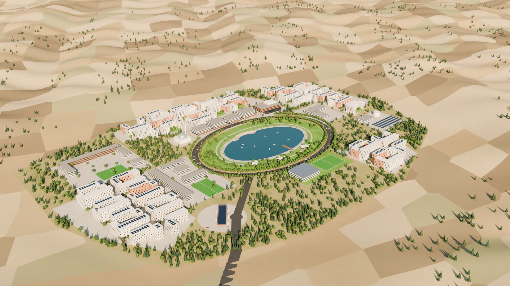
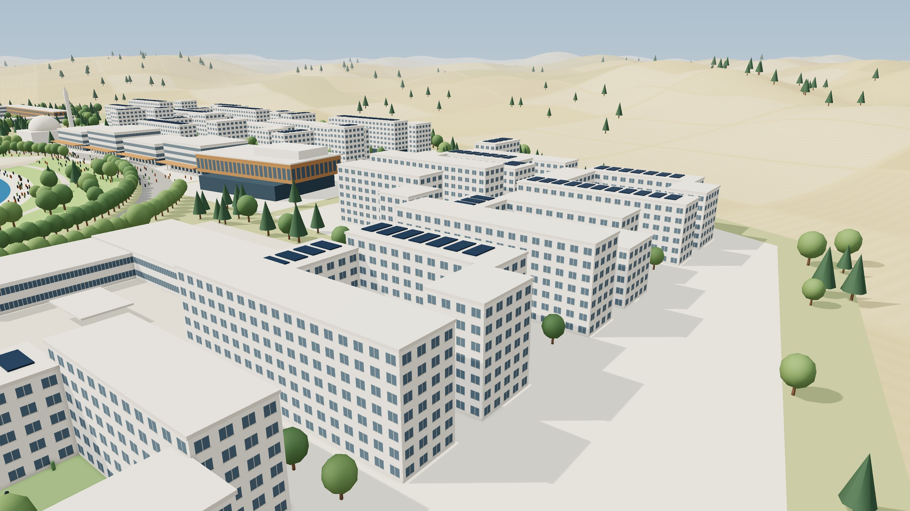
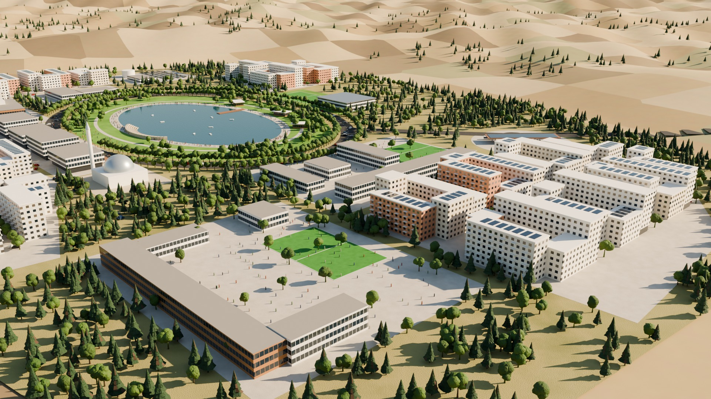
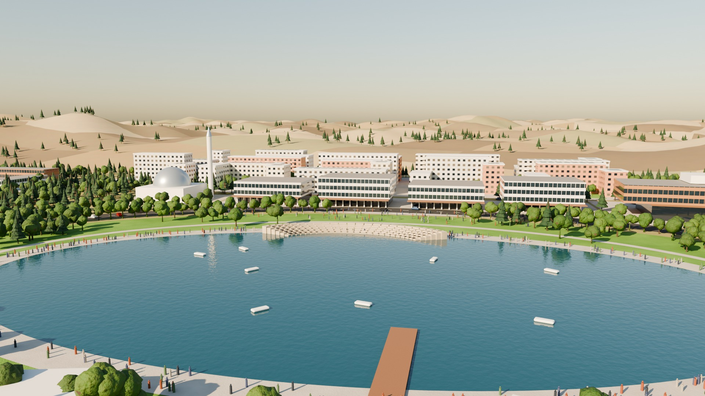
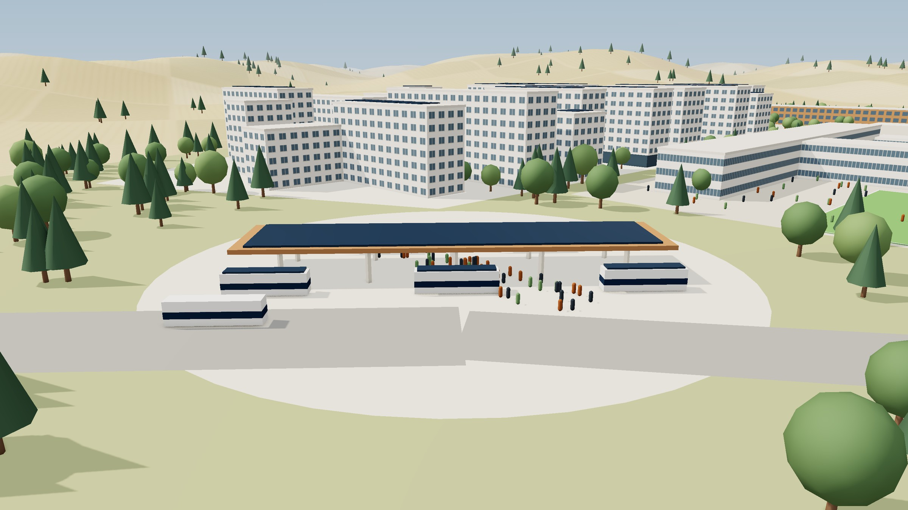

# Kahramankazan Uydukent fizibilitesi

Sarıayak'ta savunma ve havacılık sanayi çalışanları için akıllı bir yaşam alanı

Belen & Partners · Ekim 2026

## 1. Yönetici özeti

**Tek cümlelik mesaj:** Kahramankazan Sarıayak Mahallesi'ndeki 51,1 hektarlık Hazine arazisi, okul kampüsleri, sağlık birimleri, yapay gölü ve sanayi bölgelerine ekspres hattıyla, savunma ve havacılık sanayi çalışanlarının ailece yaşamayı seçeceği yaklaşık 7.500 kişilik akıllı bir yaşam alanına, Kahramankazan Uydukent'e dönüştürülebilir.

Sarıayak Mahallesi'ndeki 511.000 m²'lik Maliye Hazinesi arazisinin, platolara yerleşen dört mahallede **2.500 konut ve yaklaşık 7.500 kişi** için değerlendirilmesi önerilmektedir. Arazinin yaklaşık **%20'si yamaç ve yarıntı olarak korunmaktadır**. Bu oran bölgenin arazi tipine dayalı bir varsayımdır ve parsel topoğrafyasıyla kesinleşecektir. Merkezde **2,5 ha'lık bir yapay göl** ile 3,5 ha'lık göl parkı, iki okul kampüsü, sağlık birimleri ve mahalle merkezi yer almaktadır. Konutlar satılık ve herkese açık olacak; savunma ve havacılık sanayi çalışanlarına öncelik tanınacaktır.

Uydukent, proje ekibinin "Kahramankazan 2030 Savunma Sanayii Ekosistemi" vizyonunun yaşam alanı bileşenidir. Vizyondaki 35,6 milyon m² ve 100.000–200.000 kişilik kapasite ekosistemin bütününe aittir; bu parsele ait değildir.

Toplam yatırım 2026 fiyatlarıyla, KDV ve arazi hariç **yaklaşık 12,5 milyar TL**'dir (aralık 9,9–15,9 milyar TL). Bunun **yaklaşık 3,3 milyar TL'si** altyapı, devlet okulları, sağlık, göl, park, akıllı şehir ve ulaşım gibi kamu ve ortak kullanım kalemleridir. Arazi satın alınmayacağı için arazi bedeli hesaba katılmamıştır.

Uydukent sanayi bölgelerine en yakın nokta değildir. Proje ekibinin bölge görseline göre Uydukent Kınık'a 11 km, HAB ve Kışla bölgesine Kınık üzerinden yaklaşık 19 km (hesap) uzaktadır. Eryaman ve Yenikent, OSM'ye göre sanayi alanına kuş uçuşu 11,7 ve 9,1 km ile daha yakındır. Uydukent'in kazancı koridordadır. İşe gidiş, Ankara'nın sıkışık Batıkent–Susuz–Eryaman koridorundan çıkarak ilçe içindeki Uydukent–Kınık–HAB koridoruna ve mesaiye bağlı **13 elektrikli otobüslük Uydukent Ekspres**'e geçmektedir. Kapıdan kapıya hedef süre 35 dakikanın altıdır.

Kent dışında yaşamın diğer sorunları için çözümlerin ilk konut teslimiyle aynı gün çalışması öngörülmektedir. Eğitimde devlet ve özel okul kampüsleri yer almaktadır; özel okul, anaokulundan liseye iki dilli ve güçlü akademik programlı bir okuldur. Sağlıkta yerleşimde aile sağlığı merkezi, 112 istasyonu ve poliklinik bulunmaktadır; hastane hizmeti yaklaşık 8 km uzaktaki Kahramankazan Devlet Hastanesi'nden alınmaktadır. Sosyal yaşamda göl, park, kültür ve spor tesisleri öngörülmektedir.

Ölçülebilen ulaşım faydası yılda **40–127 milyon TL**'dir ve kamu payını tek başına geri ödememektedir. Asıl gerekçe stratejiktir. 12. Kalkınma Planı savunma sanayii istihdamını **2022'deki 81,1 binden 2028'de 158 bine** çıkarmayı hedeflemektedir ([12. Kalkınma Planı, Tablo 22](https://www.sbb.gov.tr/wp-content/uploads/2023/12/On-Ikinci-Kalkinma-Plani_2024-2028_11122023.pdf)). SSB Stratejik Planı ise yurt dışına ya da başka sektörlere geçen deneyimli personelin kaybını resmi bir tehdit olarak tanımlamaktadır ([SSB 2024–2028 Stratejik Planı](https://www.ssb.gov.tr/storage/img/stratejik-plan-2024-2028.pdf)).

Raporda kullanılan bazı rakamlar ilgili kurumlarla teyit edilecektir. Kararı en çok etkileyebilecek konular, Sarıayak parselinin koordinatı, sınırı ve topoğrafyası ile bölgede görülen teraslı ağaçlandırmanın parselde bulunup bulunmadığı ve hukuki statüsüdür.

### 1.1 Temel göstergeler

| Arazi | Konut | Nüfus | Toplam yatırım | Sanayi bölgelerine süre |
|:---:|:---:|:---:|:---:|:---:|
| **51,1 ha** | **2.500** | **~7.500 kişi** | **~12,5 milyar TL** | **ekspresle <35 dk** |
| Sarıayak, Maliye Hazinesi; ~%20'si korunan yamaç ve yarıntı (varsayım) | önerilen senaryo; aralık 2.000–3.000 konut | hane büyüklüğü 3,0 kişi (varsayım) | 2026 TL, KDV ve arazi hariç; aralık 9,9–15,9 milyar TL | Uydukent–Kınık–HAB/Kışla, ~19 km (hesap); kapıdan kapıya hedef |

### 1.2 Kent dışında yaşamın sorunları ve çözüm paketi

| Sorun | Çözüm | İlk gün | Sonra |
|---|---|---|---|
| Ulaşım: HAB/Kışla Kınık üzerinden ~19 km, raylı bağlantı yok | Uydukent Ekspres (13 elektrikli otobüs, mesaiye bağlı, garantili koltuk); ilçe merkezine (8 km) ring hat; tek ulaşım uygulaması | Ekspres, ring hat, aktarma istasyonu | Öncelikli otobüs koridoru (3–6 yıl); talep yeterse ekosistemin planlanan hafif raylı sistemine bağlantı (6–12 yıl) |
| Eğitim: ailelerin Ankara'daki okullardan vazgeçmekte zorlanması | Devlet okul kampüsü (~32 derslik) ve iki dilli özel kampüs (~25 derslik; anaokulundan liseye, güçlü akademik program); en uzak konut okula ~500 m | Kreş, anaokulu, ilkokul | Özel kampüsün üst kademeleri |
| Sağlık: hastaneye uzaklık, acil erişim | Yerleşimde ASM, 112 istasyonu ve poliklinik; hastane için yaklaşık 8 km uzaktaki Kahramankazan Devlet Hastanesi (2022); tele-sağlık | ASM ve 112 istasyonu | Poliklinik kapsamının genişlemesi |
| Sosyal yaşam: "yatak odası kent" riski | 2,5 ha yapay göl ve 3,5 ha göl parkı; mahalle merkezi, kültür merkezi, cami, spor; yamaç parkurları; topluluk ve aile programları | Mahalle merkezi, pazar, gölün ilk etabı | Kültür merkezi ve spor kompleksi |
| Veri güvenliği: sakinlerin önemli bir kısmının savunma çalışanı olması | Yerli veri altyapısı, asgari veri, KVKK'ya ek güvenlik denetimi | Fiber, akıllı sayaç, operasyon merkezi | Dijital ikiz |

### 1.3 Talep edilen karar

Bu raporla tek bir karar talep edilmektedir: **Sarıayak'taki 511.000 m²'lik Hazine arazisinin savunma sanayi çalışanlarına yönelik bir yaşam alanı olarak değerlendirilmesi.** Konutlar satılık ve herkese açık olacak; savunma ve havacılık sanayi çalışanları öncelikli olacaktır. Uygulama modeli, yani projeyi kimin yapacağı ve satacağı, bu raporun konusu değildir.

Kararın ardından ilk adım, Bölüm 12'deki karar kapılarında sıralanan teyitlerin tamamlanmasıdır:

- Sarıayak parselinin koordinatı, sınırı ve halihazır haritası;
- parselin topoğrafyası ve olası ağaçlandırma alanlarının 6831 sayılı Kanun karşısındaki statüsü;
- jeoteknik etüt ve imar durumu;
- Milli Savunma Bakanlığı ile Sivil Havacılık Genel Müdürlüğü'nün parsel koordinatlarıyla uçuş ekseni ve gürültü görüşü;
- ASKİ, Başkent EDAŞ ve Başkentgaz'ın kapasite görüşleri;
- savunma sanayi çalışanlarına yönelik bir ön talep anketi.

## 2. Projenin tanımı, amacı ve kapsamı

### 2.1 Proje alanı ve yaşam alanı tanımı

Proje alanı, Ankara'nın Kahramankazan ilçesine bağlı Sarıayak Mahallesi'ndedir. Arazi 511.000 m² (51,1 ha) büyüklüğündedir ve Maliye Hazinesi mülkiyetindedir. Proje ekibinin bölge görseline göre Sarıayak, Kahramankazan merkezine yaklaşık 8 km, Kınık'a yaklaşık 11 km uzaklıktadır (Bölüm 7.1). Sarıayak, 2022'de 58 kişinin yaşadığı küçük bir kırsal mahalledir ([Wikipedia: Sarıayak](https://en.wikipedia.org/wiki/Sar%C4%B1ayak,_Kahramankazan); ikincil kaynak). Parselin koordinatı ve sınırı henüz temin edilmemiştir. Bu nedenle mesafeler görseldeki değerler ve bunlardan türetilen hesaplardır. Bölgeleme şeması da haritaya oturtulmamış ölçekli bir diyagramdır.

Kahramankazan Uydukent, savunma ve havacılık sanayinin beyaz yakalı çalışanlarına, özellikle mühendislere yönelik, ancak herkese açık bir yaşam alanıdır. Uydukent kapalı bir site değildir. Konutlar satılık olacak ve herkes satın alabilecektir; savunma ve havacılık sanayi çalışanlarına öncelik tanınacaktır. Dünyadaki örnekler, tek işverene bağlı kapalı yerleşimlerin kriz dönemlerinde kırılgan, açık ve karma yerleşimlerin ise daha dayanıklı olduğunu göstermektedir (Bölüm 4.5).

### 2.2 Kahramankazan 2030 Savunma Sanayii Ekosistemi içindeki yeri

Uydukent tek başına düşünülmüş bir proje değildir. Proje ekibinin "Kahramankazan 2030 Savunma Sanayii Ekosistemi" vizyonu, ilçede birbirine bağlı beş bileşen ile bir sağlık ve yaşam merkezi tanımlamaktadır. Uydukent bu bütünün yaşam alanı bileşenidir. Aşağıdaki bilgiler **proje ekibinin vizyonudur; bileşenlerin statüsü ve rakamların kaynağı teyit edilecektir.**

| No | Bileşen | Bölge | Uydukent ile ilişkisi |
|---|---|---|---|
| 1 | Kahramankazan Kentsel Dönüşüm Bölgesi | Kahramankazan merkezi | Uydukent'e ~8 km; ring hat ile bağlanır; ilçe hizmetleri |
| 2 | HAB TUSAŞ Uzay Gelişim Alanı | Kışla | Uydukent Ekspres'in varış noktası; Kınık üzerinden ~19 km (hesap) |
| 3 | Smart City (Uydukent Projesi) | Sarıayak | Bu rapor |
| 4 | Kınık Özel Endüstri Sanayii Alanı | Kınık | Uydukent'e ~11 km; ekspres hattın ara durağı |
| 5 | Hafif Raylı Ulaşım Sistemi | Kahramankazan'dan Kışla yönüne | Talep yeterse Aşama 2'de bağlantı (Bölüm 9.4) |
| – | Tropic Life and Health Adventure Center | Soğucak | Görselde Uydukent'in komşusu; Kınık'a ~9 km; sağlık ve sosyal yaşam odağı olabilir (teyit edilecek) |

Görseldeki **35,6 milyon m² ve 100.000–200.000 kişi kapasitesi ekosistemin bütününe aittir; 51,1 ha'lık Uydukent'e ait değildir.** Uydukent'in rakamları değişmemektedir: 2.500 konut ve yaklaşık 7.500 kişi. Bu ayrım, ilk brifteki "yaklaşık 100 bin kişi" hedefini de açıklamaktadır; o büyüklük ekosistemin ölçeğidir. Bileşenlerin, özellikle Kınık Özel Endüstri Sanayii Alanı ile hafif raylı sistemin resmi plan durumu bu çalışmada araştırılmamıştır (Ek A).

*Görsel 1. Kahramankazan 2030 Savunma Sanayii Ekosistemi: proje ekibinin vizyon görseli. 35,6 milyon m² ve 100.000–200.000 kişi kapasitesi ekosistemin bütününe aittir; bileşenlerin statüsü ve rakamların kaynağı teyit edilecek.*

### 2.3 Projenin amaçları

Projenin amaçları proje ekibinin ilk brifine dayanmaktadır ve bu raporda dört başlıkta toplanmıştır.

1. **Nitelikli çalışanların çekilmesi ve tutulması.** Savunma ve havacılık sanayinin mühendislerine, aileleriyle birlikte yaşamak isteyecekleri bir yer sunulması amaçlanmaktadır.
2. **Trafiğin başka bir koridora alınması.** Batıkent–Susuz–Eryaman hattındaki sabah ve akşam pikinin azaltılması amaçlanmaktadır. Bunun yolu mesafeyi kısaltmak değildir. Yolculuk kentin sıkışık koridorundan çıkarılarak ilçe içindeki Uydukent–Kınık–HAB koridoruna ve ekspres bir otobüs hattına taşınmaktadır.
3. **Kent dışında yaşamın sorunlarının çözülmesi.** Eğitim, sağlık, sosyal yaşam ve ulaşım sorunlarına ilk günden çalışan çözümler getirilmesi amaçlanmaktadır.
4. **Kahramankazan'ın ve ekosistemin dengeli büyümesi.** 2025'te 63.143 kişilik ilçeye ([ATO, Rakamlarla Ankara 2026](https://www.atonet.org.tr/Uploads/Birimler/Internet/Flash%20Tan%C4%B1t%C4%B1m%20Alan%C4%B1/2026-04-15-RakamlarlaAnkara/2026-04-14-Rakamlarla-Ankara.pdf)), hizmetleri ilçeyle paylaşan ve ilçeye yeni hizmet getiren yaklaşık 7.500 kişilik bir yaşam alanı eklenmesi amaçlanmaktadır.

### 2.4 Kapsam ve kapsam dışı konular

Proje ekibinin 23 Ekim 2026 kararlarıyla alan programı **yalnızca yaşam alanını** kapsamaktadır: konut, okullar, yapay göl ve sosyal tesisler, sağlık birimleri, spor, ibadet, teknik altyapı ve mahalle ticareti. Programda çalışma alanı, ofis ya da teknopark bulunmamaktadır. İş yerleri ekosistemin sanayi bölgeleridir: Kışla'daki HAB TUSAŞ Uzay Gelişim Alanı ve Kınık'ta öngörülen özel endüstri alanı.

Master plan düzeyinde bir alan programı tablosu ve soyut, ölçekli bir bölgeleme şeması hazırlanmıştır (Bölüm 8). Finans tarafında rapor; konut dahil toplam yatırımı, kamu ve ortak kullanım payını ve ölçülebilen kamu faydasını vermektedir (Bölüm 11). Arazi satın alınmayacağı için arazi bedeli hesaplanmamıştır. Konutların fiyatlandırılması, alıcı finansmanı ve uygulama modeli bu raporun kapsamı dışındadır.

51,1 ha'nın kapasitesi yoğunluğa göre yaklaşık 6–19 bin kişidir. Bu çalışmada bu aralığın alt yarısında, 7.500 kişilik bir senaryo önerilmektedir (Bölüm 8).

### 2.5 Yöntem ve dayanaklar

Rapor beş tür kaynağa dayanmaktadır:

- politika belgeleri, saha koşulları, birim maliyetler, fayda parametreleri ve örnekler için hazırlanan on araştırma notu ile önceki çalışma turlarının notları;
- proje ekibinin ekosistem ve mesafe görselleri ile 22 Eylül 2026'da Sarıayak bölgesinde çektiği 4K drone videosu (5 saniyede bir alınan karelerden altısı seçilmiştir);
- koordinatörün alan programı, yatırım ve fayda hesapları;
- resmi standartlar: MPYY Ek-2 ([Resmî Gazete, 17.05.2017](https://www.resmigazete.gov.tr/eskiler/2017/05/20170517-2-1.pdf)), MEB Eğitim Yapıları Asgari Tasarım Standartları Kılavuzu ve 2026 yapı yaklaşık birim maliyetleri ([Hukukihaber, tebliğ metni](https://www.hukukihaber.net/mimarlik-ve-muhendislik-hizmet-bedellerinin-hesabinda-kullanilacak-2026-yili-yapi-yaklasik-birim-maliyetleri-hakkinda-teblig));
- Belen & Partners'ın, başta Kahramankazan'da tasarladığı TAI Ankara Lodgings konut mahallesi olmak üzere, kendi deneyimi (Bölüm 14).

Doğrulanmamış her rakam metinde "teyit edilecek", "varsayım" ya da "hesap" olarak işaretlenmiştir. Notların birbiriyle çeliştiği yerlerde iki değer de verilmiştir. Önceki çalışma turunda arazinin başka bir mahallede bulunduğu varsayılmıştı. Proje ekibi 23 Ekim 2026'da arazinin Sarıayak'ta olduğunu bildirmiştir. Bu nedenle önceki konuma özgü mesafe ve uçuş ekseni hesapları rapordan çıkarılmıştır (Ek B).

Raporun kurgusu çözüm önceliklidir; her sorun çözümüyle birlikte ele alınmaktadır. Ayrıntılı veri sınırları ve açık noktalar Ek A ve Ek B'de, birim maliyetler Ek C'de, kamu faydası parametreleri Ek D'de, saha koşullarının ayrıntısı Ek E'de ve politika belgelerinin madde listesi Ek F'de yer almaktadır.

## 3. Politika uyumu

### 3.1 Politika çerçevesinin genel değerlendirmesi

12. Kalkınma Planı'nda savunma sanayi çalışanlarının barınmasına ya da lojmanına ilişkin açık bir madde bulunmamaktadır. 2026 Cumhurbaşkanlığı Yıllık Programı da böyle bir tedbir içermemektedir; "lojman" kelimesi programda yalnızca turizmle ilgili bir tedbirde geçmektedir. Buna karşın politika belgeleri Uydukent önerisinin dört ayağını ayrı ayrı desteklemektedir:

- nitelikli insan kaynağı ve deneyimli personelin sektörde tutulması;
- sanayi yatırım yerleri ile yaşam alanı arasındaki ilişki;
- akıllı, yeşil ve dirençli yerleşim;
- ulaşım ile yerleşimin birlikte planlanması.

Uyum dolaylıdır, ancak güçlüdür. Bu bölümde ilgili maddeler belge belge özetlenmektedir. Madde metinleri ve sayfa numaraları Ek F'de verilmiştir. Plan metni PDF'den çıkarılırken Türkçe karakterler bozulmuş, alıntılar anlam korunarak düzgün yazıma çevrilmiştir. Rapor kesinleşmeden önce alıntıların resmi PDF ile karşılaştırılması önerilmektedir.

### 3.2 On İkinci Kalkınma Planı (2024–2028)

**Savunma sanayii ve insan kaynağı.** Planın 519. maddesi, savunma ve havacılık sanayiinin rekabetçiliğini küresel ölçekte artırmayı ve sektörde edinilen becerilerin sivil sektöre yayılmasını amaç olarak koymaktadır. Tedbir 520.3, "sektörün artan nitelikli insan kaynağı ihtiyacını karşılamak amacıyla eğitim altyapısı güçlendirilecek" hükmünü içermektedir. Tedbir 520.2 kuantum, yapay zekâ, otonom sistemler ve hipersonik alanlarda Ar-Ge'yi öngörmektedir. Tedbir 520.4 yenilik tabanlı girişimci firmaların artırılmasını ve büyük firmaların yerli tedarik ekosistemini geliştirmesini hedeflemektedir. Madde 46, nitelikli insan kaynağına erişimin güçlendirilmesini ve "beyin göçü gibi sorunlarla mücadele edilmesi"ni öncelikler arasında saymaktadır. Tedbir 698.1 gençlere yönelik yetenek yönetimi uygulamaları geliştirilmesini öngörmektedir ([12. Kalkınma Planı, ASO kopyası](https://www.aso.org.tr/raporlar/122024.pdf); [SBB resmi yayını](https://www.sbb.gov.tr/wp-content/uploads/2023/12/On-Ikinci-Kalkinma-Plani_2024-2028_11122023.pdf)).

Planın Tablo 22'si sektörün sayısal hedeflerini vermektedir:

| Gösterge | 2022 | 2023 | 2028 hedefi |
|---|---:|---:|---:|
| Ciro (milyar $) | 12,2 | 15,0 | 26,0 |
| İhracat (milyar $) | 4,4 | 6,0 | 11,0 |
| İstihdam (bin kişi) | 81,1 | 90,0 | 158,0 |
| Yerlilik oranı (%) | 73,4 | 80,0 | 85,0 |

Tablo planın 110. sayfasındadır. PDF çıkarımında sütun hizası kaymış, satır sırası haberlerle eşleştirilmiştir. İstihdam hedefi, plan dönemi sonunda yaklaşık 77 bin ek nitelikli çalışan anlamına gelmektedir (hesap: 158,0 − 81,1).

**Sanayi yatırım yeri ve yaşam alanı ilişkisi.** En doğrudan dayanak **Madde 430**'dur: "İmalat sanayiine uygun yatırım yerlerinin yaşam alanlarına erişilebilirlik, beşeri ve sosyal imkânlar gözetilerek geliştirilmesi, artırılması ve tahsis süreçlerinin kolaylaştırılması sağlanacaktır." Kışla'daki HAB TUSAŞ Uzay Gelişim Alanı ile proje ekibinin vizyonunda Kınık'ta öngörülen özel endüstri alanı bu maddenin tarif ettiği türden yatırım yerleridir. Uydukent ise bu alanlara aynı ilçede erişilebilen bir yaşam alanı önerisidir.

**Şehirleşme, akıllı şehir ve yaşam kalitesi.** Madde 850, "yaşam kalitesi yüksek, yeşil ve dijital teknolojilere dayalı akıllı, güvenli, sürdürülebilir şehir ve yerleşimler oluşturmak"ı temel amaç saymaktadır. Madde 851.6–851.7, kamusal ve yeşil alanların erişilebilirlik ve kapsayıcılık ilkesiyle oluşturulmasını ve sosyal altyapı alan standartlarının yerel yönetimlerle geliştirilmesini öngörmektedir. Tedbir 853.2 mahalle kültürünü, aidiyeti ve "insan odaklı, akıllı, yeşil, güvenli, iklim dirençli ve kimlikli şehir öğeleri"ni öne çıkarmaktadır. Madde 854 kentsel yaşam kalitesinin ölçülmesini istemektedir. Madde 857, akıllı şehir uygulamalarında yerli ürün kullanımının yaygınlaştırılmasını öngörmektedir.

Planın genel değerlendirme bölümü de aynı yöndedir. Madde 154 kentsel planlama ve hizmet sunumunda dijital teknolojilerin yaygınlaştığını belirtmektedir. Madde 91 otomobil bağımlılığının azaltılmasını, toplu taşıma ve yürümenin teşvikini vurgulamaktadır. Madde 792.1 yeni kent yerleşimlerinde sosyal ve kültürel etkileşime imkân veren altyapı unsurlarını öngörmektedir. Bu madde Uydukent'in sosyal donatı programı için ayrı bir dayanaktır.

**Konut.** Madde 861–862, herkesin "ekonomik olarak karşılanabilir, enerji verimli, dirençli, güvenli ve sağlıklı konutlara erişimi"ni amaçlamaktadır. Tedbir 862.4, konut arz ve talebinin niteliğini "veriye dayalı analizlerle belirlemeye yönelik araştırma ve projeler"in destekleneceğini belirtmektedir. Madde 373 ve 373.1 konut arzını artırıcı uygulamaları öngörmektedir. Planın Tablo 49'u dar ve orta gelirlilere yönelik konut üretimini 2022'de 60.440, 2023'te 125.000 (tahmin) ve 2028 hedefi olarak 500.000 vermektedir. Bu hedef TOKİ ve sosyal konut hedefidir. Uydukent gibi karma bir proje bu hedefin parçası değildir. Bu nedenle konut başlığındaki atıf "arz artırıcı" boyutla sınırlı tutulmaktadır.

**Kentsel ulaşım.** Madde 155 büyükşehirlerde trafik tıkanıklığı, gürültü ve karbon sorunlarını ve sürdürülebilir kentsel ulaşım planlamasını öne çıkarmaktadır. Tedbir 884.2, "mekânsal planlar ile ulaşım planları bütüncül şekilde ele alınacak" hükmünü içermektedir. Tedbir, yeni yerleşim alanlarının yoğunlukları planlanırken raylı sistemlerden yararlanılmasını ve yürüme ile bisiklete uygun karma kullanımı teşvik etmektedir. Madde 885–885.4, bireysel araç yerine toplu taşıma ve mikro mobiliteyi; toplu taşımada önce otobüs ya da metrobüsü, yetersiz kalan koridorlarda ise raylı sistemi öngörmektedir. Aynı madde raylı sistem için eşik vermektedir: tramvayda en az 7.000, hafif raylıda en az 10.000, metroda en az 15.000 yolcu/saat-tek yön. Uydukent Ekspres'in sabah pikinde yaklaşık 875 yolcu taşıması beklenmektedir (Bölüm 11). Bu nedenle 885. madde, otobüsle başlama kararını doğrudan desteklemektedir.

**Bölgesel kalkınma.** Tedbir 890.1 bölge planlarının uygulamaya konulmasını, Tedbir 890.4 gelişmiş bölgelerde yüksek katma değerli ve bilgi yoğun faaliyetleri öngörmektedir. Tedbir 891.1, Ankara–Konya–Mersin hattında savunma sanayii başta olmak üzere sanayinin Mersin Konteyner Limanı ile lojistik bağlantısının güçlendirilmesini hedeflemektedir. Bu tedbir Kahramankazan kümesinin bölgesel önemini göstermektedir.

**Atık, su ve iklim.** Madde 880.5 yağmur suyu hasadı ve gri suyun yeniden kullanımı için mevzuat altyapısını öngörmektedir. Madde 881.1 Ulusal Döngüsel Ekonomi Eylem Planı'nı, Madde 882.1 ise sıfır atık uygulamalarını kapsamaktadır. Uydukent'in yapay gölü ve peyzaj suyu bu maddelerle uyumlu biçimde yağmur suyu ve ileri arıtılmış atıksudan beslenecektir (Bölüm 9.3).

### 3.3 2026 Cumhurbaşkanlığı Yıllık Programı ve Orta Vadeli Program

2026 Yıllık Programı, 30.10.2025 tarihli ve 33062 mükerrer sayılı Resmî Gazete'de 10525 sayılı Kararla yayımlanmıştır ([2026 Yıllık Programı](https://www.sbb.gov.tr/wp-content/uploads/2025/10/2026-Yili-Cumhurbaskanligi-Yillik-Programi.pdf); [SBB duyurusu](https://www.sbb.gov.tr/2026-yili-cumhurbaskanligi-yillik-programi-30-10-2025-tarih-ve-33062-mukerrer-sayili-resmi-gazetede-yayimlanmistir/)). Program 12. Kalkınma Planı'nın beş ekseni altında kurgulanmıştır. Tedbirler üç aylık dönemlerle izlenmektedir.

Programın savunma sanayii hedef tablosu (s.168) şöyledir:

| Gösterge | 2024 | 2025 (gerçekleşme tahmini) | 2026 hedefi |
|---|---:|---:|---:|
| Yerlilik oranı (%) | 81 | 82 | 83 |
| İhracat (milyar $) | 7,2 | 7,3 | 8,0 |
| Ciro (milyar $) | 20,2 | 18,2 | 20,0 |
| İstihdam (bin kişi) | 99,0 | 108,9 | 119,8 |

Satır hizası PDF çıkarımında kaymıştır; değerler sıra ve haberle eşleştirilmiştir. 2026 hedefleri haberlerle de teyit edilmektedir ([Türkgün/AA, 2 Kasım 2025](https://www.turkgun.com/gundem/turk-savunma-sanayiinin-2026-hedefleri/335309); ikincil kaynak). İstihdam serisi, yılda yaklaşık 10–11 bin kişilik net artışa işaret etmektedir (hesap).

Tedbir 520.3'ün alt tedbirleri (s.166–167; sorumlu kuruluş SSB) insan kaynağı için ayrıntılı bir program tanımlamaktadır:

| Alt tedbir | İçerik |
|---|---|
| (1) | Savunma Gelişim dijital eğitim platformunun üye ve içerik sayısının artırılması |
| (2) | Üniversite öğrencilerine yönelik dört yetkinlik programı |
| (3) | Mesleki ve teknik liselerde ELMAS Programı |
| (4) | Sektör çalışanlarına yönelik teknik okullar ve üniversitelerle yüksek lisans programları ve yeni programlar |
| (5) | TEKNOFEST ve benzeri yarışmalara katılım; GHOST ve Yenilikçi Yazılımlar Yarışıyor |
| (8) | Savunma Kariyer Platformu'nun üye sayısının artırılması |
| (10) | "Savunma sanayii ekosistemi için insan kaynağına yönelik ihtiyaç analizleri yapılacaktır" |
| (11) | Gençlere yönelik yönlendirme programları |

Alt tedbir (10), Uydukent için önerilen ön talep anketiyle doğrudan örtüşmektedir.

Konut tarafında program iki tedbir içermektedir. İlk Evim Arsa Projesi kapsamında "235 bin hak sahibine ait arsaların tahsis işlemleri tamamlanarak vatandaşlara sunulacaktır" (sorumlu kuruluşlar ÇŞİDB, Hazine ve Maliye Bakanlığı ve TOKİ). Tedbir 862.1 kapsamında Sosyal Konut Projesi'nde 100 bin konut üretimine başlanacaktır. İlk Evim Arsa tedbiri, Hazine arazisinin konut amacıyla değerlendirilmesinin politika emsalidir.

Akıllı şehir için programda ayrı bir yıllık tedbir bulunmamaktadır. Bunun yerine üç tedbir öne çıkmaktadır. Tedbir 853.2, ÇŞİDB'nin onaylayacağı kentsel tasarım projelerinde "insan odaklı, akıllı, yeşil, güvenli, iklim dirençli ve kimlikli şehir öğeleri"nin yaygınlaştırılmasını öngörmektedir. Tedbir 858.3 üç boyutlu şehir ve bina modellerini kapsamaktadır. Tedbir 885.4 ise "Sürdürülebilir Hareketlilik ve Akıllı Ulaşım Sistemleri Strateji Belgesi ve 2025-2030 Eylem Planı"nın yayımlanmasını öngörmektedir (UAB, ÇŞİDB).

Orta Vadeli Program'ın resmi metni bu çalışmada okunamamıştır. OVP 2026–2028 hakkında yalnızca aracı haberler bulunmuştur. Bu haberlere göre program deprem bölgesi çalışmalarının tamamlanmasını, sosyal konutta afet riskli bölgelere öncelik verilmesini ve kentsel dönüşüme ivme kazandırılmasını öngörmektedir ([Bengütürk/AA](https://www.benguturk.com/ekonomi/deprem-bolgesindeki-calismalar-ovp-doneminde-tamamlanacak-233042h); ikincil kaynak). Savunma ve akıllı şehir ifadeleri teyit edilememiştir. SSB Stratejik Planı, OVP (2024–2026) İstihdam Bölümü 4. Tedbiri'ne atıf yapmaktadır: "Savunma sanayii, yapay zekâ, siber güvenlik, temiz ve sürdürülebilir enerji ile uzay teknolojileri gibi stratejik alanlarda nitelikli iş gücü yetiştirmeye yönelik kamu-üniversite-özel sektör işbirliği programları uygulamaya konulacaktır."

Arama sonuçları, OVP 2027–2029'un Eylül 2026'da yayımlandığını ima etmektedir. Bu bilgi tek bir haberde geçtiği için doğrulanmamış ve rapora alınmamıştır. 2027 Yıllık Programı ile OVP 2027–2029'un sunumdan önce yeniden taranması önerilmektedir.

### 3.4 SSB 2024–2028 Stratejik Planı ve sektör göstergeleri

SSB Stratejik Planı'nın A3 amacı "Kurumsal ve Sektörel Kapasiteyi Geliştirmek"tir ([SSB 2024–2028 Stratejik Planı](https://www.ssb.gov.tr/storage/img/stratejik-plan-2024-2028.pdf)). Bu amacın H3.5 hedefi "Nitelikli insan kaynağının sektöre ilgisi artırılacaktır" biçimindedir (s.15, s.92–93). Hedefin stratejileri şunlardır: Savunma Sanayii Akademisi'nin daha etkin faaliyet göstermesi, gençlere yönelik programların işlevselliği ve "Deneyimli insan kaynağının sektöre kazandırılması için politikalar geliştirilecektir" ilkesi. Planın tespiti de açıktır: "Ekosistem genelinde nitelikli personel ihtiyacının karşılanması ve savunma sanayiine yönelik eğitimlerin artırılması gerekmektedir."

H3.5'in performans göstergeleri (s.92) şunlardır:

- PG3.5.1: istihdam programlarıyla işe yerleştirilen genç sayısı;
- PG3.5.2: staj imkânı sağlanan öğrenci sayısı;
- PG3.5.3: Akademi dersleri alan üniversite öğrencisi sayısı;
- PG3.5.4: Akademi eğitimlerinden yararlanan kişi sayısı;
- PG3.5.5: Vizyoner Genç portalı üye sayısı.

Göstergelerin hedef rakamları PDF'den güvenilir biçimde okunamamıştır; resmi PDF'in 92. sayfasından alınması önerilmektedir.

Planın durum analizi (s.46) bir tehdit ve bir zayıf yön tanımlamaktadır. Tehdit, "yurt dışına veya farklı sektörlere geçiş yapan insan kaynağı sonucunda kazanılmış tecrübenin kaybı"dır. Zayıf yön, "kariyer planlamasına ve yetenek yönetimine dayanan İnsan Kaynakları Politikasının geliştirilememesi"dir. Plan, 12. Kalkınma Planı'nın "sektörün nitelikli insan kaynağının karşılanması" ana hedefine bağlanmaktadır. Uydukent bu tehdide işveren desteğiyle değil, yaşam koşullarıyla verilen bir yanıttır.

Sektörün büyüklüğüne ilişkin ikincil kaynaklar da aynı yönü göstermektedir. SSB Başkanı Görgün 2024 verisi için "2.400 firma ve 100 bine yaklaşan çalışan" ifadesini kullanmış, 2025 için 110 bin hedefi vermiştir ([Bengütürk](https://www.benguturk.com/amp/bilim-teknoloji/savunma-sanayii-baskani-gorgun-savunma-ve-havacilik-ihracatimiz-yuzde-194845h); ikincil kaynak). Görgün'e göre 2025'te 10,054 milyar $ ihracat yapılmış ve 17,9 milyar $ tutarında yeni sözleşme imzalanmıştır ([Ekonomi Gazetesi](https://www.ekonomigazetesi.com/sektor-haberleri/ssb-gorgun-2025te-179-milyar-dolarlik-yeni-sozlesme-imzalandi-71356); ikincil kaynak). 10,05 milyar $'lık ihracat, Yıllık Program'daki 7,3 milyar $ tahminini aşmaktadır. Fark, mal ve hizmet tanımlarındaki farklılıktan kaynaklanabilir.

### 3.5 Ulusal akıllı şehir stratejisi

2020–2023 Ulusal Akıllı Şehirler Stratejisi ve Eylem Planı'nın süresi sona ermiştir ([ÇŞİDB 2020–2023 belgesi](https://webdosya.csb.gov.tr/db/cbs/icerikler/2022_13002-20230531133417.pdf)). Habertürk'ün 19 Eylül 2026 tarihli haberine göre bir Cumhurbaşkanlığı Genelgesi ile "2030 Ulusal Akıllı Şehirler Stratejisi ve Eylem Planı" yürürlüğe girmiştir. Belgenin akillisehirler.csb.gov.tr adresinde yayımlanacağı bildirilmektedir ([Habertürk](https://www.haberturk.com/gundem/ulusal-akilli-sehirler-stratejisi-hakkinda-genelge-resmi-gazete-de-3913529); ikincil kaynak). Stratejinin metnine ulaşılamamıştır. Haber metnine göre öncelikler şunlardır:

- akıllı şehir dönüşümü, veri yönetimi ve yapay zekâ destekli karar alma mekanizmaları;
- akıllı şehir hizmetlerinin entegrasyonu ve dijital kent yönetimi;
- dijital güvenlik;
- yenilikçi, çevre dostu ve kapsayıcı projeler.

Haberde sayılan hedefler kaynakların verimli kullanımı ve mükerrer yatırımın önlenmesi, standartlara dayalı birlikte çalışabilir sistemler, yetkin bir akıllı şehir ekosistemi ve vatandaşa bütünleşik hizmettir. Bir arama özeti nihai planın "4 stratejik amaç, 8 hedef, 32 eylem, 297 uygulama adımı" içerdiğini aktarmaktadır ([Bigpara](https://bigpara.hurriyet.com.tr/haberleri/akilli-sehir); arama özeti). Bu sayılar Habertürk sayfasında bulunmadığı için resmi metinden doğrulanmalıdır. Ulusal ölçekte 2030'a kadar 81 ilde dijital ikiz ve 187 belediyede akıllı şehir birimi hedeflendiği bildirilmektedir ([Yeni Ankara](https://www.yeniankara.com.tr/ankara/akilli-sehir-vizyonu-masada-cografi-bilgi-kurulu-toplantisi-ankarada-yapildi-118738); ikincil kaynak).

Uydukent'in akıllı şehir katmanı bu önceliklere bir uygulama örneği olarak bağlanmaktadır: tek bir yaşam alanı platformunda entegre hizmet, veri yönetimi ve savunma çalışanlarının verisi için ek güvenlik (Bölüm 9.5). Numaralı eylem atfı için resmi metin gerekmektedir. İklim Kanunu (2025) ve Sıfır Atık Yönetmeliği'nin birincil metinleri bu çalışmada taranmamıştır; bu konudaki atıflar Kalkınma Planı'nın 880–882. maddeleriyle sınırlıdır.

### 3.6 Ankara ölçeğindeki planlar

Ankara Bölge Planı 2024–2028 ve Ankara 1/100.000 Çevre Düzeni Planı'nın Kahramankazan'a ilişkin hükümleri bu çalışmada okunamamıştır. Ankara Kalkınma Ajansı'nın "2024–2028 Ankara Bölge Planı Taslağı Mekânsal Gelişim Şeması" adlı bir belgesi bulunmaktadır. Arama özetine göre belgenin hedefi, Ankara ekonomisinin "yenilikçilik ve girişimcilik temelli yüksek teknolojili üretim merkezi" olmasıdır ([Ankara Kalkınma Ajansı](https://ankaraka.org.tr/sites/default/files/2023-02/EK_2_2024-2028_Ankara_B%C3%B6lge_Plan%C4%B1_Tasla%C4%9F%C4%B1_Mekansal_Geli%C5%9Fim_%C5%9Eemas%C4%B1.pdf); arama özeti). Alıntıda Kahramankazan ya da savunma ifadesi geçmemektedir. Nihai Bölge Planı'nın savunma ve havacılık kümesine ilişkin hedefleri okunamamıştır. Üst ölçekli çevre düzeni planının durumu Bölüm 7.3'te, Ankara Sürdürülebilir Ulaşım Ana Planı süreci Bölüm 9.4'te ele alınmaktadır.

### 3.7 Politika uyum matrisi

| Politika belgesi | Madde / hedef | İçerik (özet) | Uydukent'teki karşılığı |
|---|---|---|---|
| 12. Kalkınma Planı | m.520.3, Tablo 22 (istihdam 81,1 bin → 158 bin) | Sektörün nitelikli insan kaynağı ihtiyacı karşılanacak | Nitelikli personelin bölgede yerleşmesi ve kalması; nitelikli devlet ve özel okul kampüsleri |
| 12. Kalkınma Planı | m.46, 698.1 | Nitelikli insan kaynağına erişim; beyin göçüyle mücadele; gençlere yönelik yetenek yönetimi | Deneyimli çalışanı ve ailesini bölgede tutan yaşam koşulları |
| 12. Kalkınma Planı | m.430 | Sanayi yatırım yerleri yaşam alanlarına erişilebilirlik, beşeri ve sosyal imkânlar gözetilerek geliştirilecek | HAB ve Kınık sanayi alanlarına aynı ilçede bağlı yaşam alanı |
| 12. Kalkınma Planı | m.850, 853.2, 857 | Akıllı, yeşil, dirençli, mahalle kültürlü yerleşim; akıllı şehirde yerli ürün | Dört mahalle, göl ve park merkezli kimlik, yerli akıllı şehir altyapısı |
| 12. Kalkınma Planı | m.792.1, 851.6–851.7 | Yeni yerleşimlerde sosyal ve kültürel etkileşim altyapısı; erişilebilir kamusal ve yeşil alan | Göl, park, kültür merkezi ve mahalle merkezi |
| 12. Kalkınma Planı | m.373, 862, 862.4 | Konut arzı artırılacak; talep veriye dayalı analizle belirlenecek | 2.500 konutluk yeni arz; savunma sanayi çalışanlarına ön talep anketi |
| 12. Kalkınma Planı | m.884.2, 885 | Yerleşim ve ulaşım birlikte planlanacak; önce otobüs, eşik aşılınca raylı | Uydukent Ekspres ilk gün; öncelikli koridor sonra; ekosistemin hafif raylı sistemine bağlantı ancak eşik aşılırsa |
| 12. Kalkınma Planı | m.891.1 | Ankara–Konya–Mersin hattında savunma sanayii | Kahramankazan 2030 ekosistemi için yaşam altyapısı |
| 12. Kalkınma Planı | m.880.5, 881–882 | Yağmur suyu hasadı ve gri su için mevzuat; sıfır atık; döngüsel ekonomi | Göl ve peyzaj suyu yağmur suyu ve ileri arıtılmış atıksudan; sıfır atık tasarımı |
| 2026 Yıllık Program | 520.3 alt tedbirleri; istihdam 119,8 bin | İnsan kaynağı programları ve ihtiyaç analizleri | Çalışan yerleşimi için talep ve ihtiyaç analizi |
| 2026 Yıllık Program | İlk Evim Arsa (235 bin hak sahibi); 862.1 (100 bin sosyal konut) | Hazine arazisinin konut amaçlı kullanımı | Hazine arazisinin yaşam alanı olarak değerlendirilmesi için politika emsali |
| 2026 Yıllık Program | 853.2, 858.3, 885.4 | Kentsel tasarımda akıllı ve yeşil öğeler; üç boyutlu şehir modelleri; Akıllı Ulaşım Sistemleri 2025–2030 Eylem Planı | Tek ulaşım uygulaması, akıllı sinyalizasyon, sensörler, BIM tabanlı dijital ikiz |
| SSB Stratejik Planı 2024–2028 | H3.5; s.46 tehdit tespiti | Deneyimli personeli sektöre kazandırma; tecrübe kaybı tehdidi | Çalışanı ailesiyle birlikte bölgede tutan yaşam koşulları |
| 2030 Ulusal Akıllı Şehirler Stratejisi (Eylül 2026 genelgesi) | Veri yönetimi, entegre hizmet, dijital güvenlik | Standartlara dayalı, birlikte çalışabilir sistemler | Yerli veri merkezi, asgari veri, savunma çalışanı verisi için ek güvenlik (numaralı eylem teyit edilecek) |

Matrisin en güçlü satırları 520.3, 430, 850–857, 862 ve 885'tir. Politika uyumunun özeti şudur: plan belgeleri nitelikli insan kaynağı, yaşam alanına erişim, akıllı yerleşim ve toplu taşıma hedeflerini ayrı ayrı koymaktadır. Uydukent bu hedeflerin birleştiği yerde konumlanmaktadır.

## 4. Dünyada ve Türkiye'de benzer uygulamalar

Bu bölüm, işverenlerin, kamu kurumlarının ve planlı kentlerin eğitim, sağlık, sosyal yaşam, topluluk yönetimi, ulaşım ve akıllı şehir alanlarında yaptıklarını özetlemektedir. Her alt bölüm kısa bir giriş, bir örnek tablosu ve sentezden oluşmaktadır. Tablolarda yer, yıl, ölçek, yapılan iş, kaynaklı bir sayı ve Uydukent için çıkan ders verilmektedir. Bölümün tablolarında toplam 40 örnek yer almaktadır.

Örneklerin çoğu Uydukent'ten büyüktür. Bu nedenle aktarılan şey ölçek değil, yöntemdir. Kaynakların bir kısmı ikincil niteliktedir (haber, ansiklopedi, kurum beyanı ya da arama özeti); bu kaynaklar tablolarda ayrıca işaretlenmiştir. Dünya örneklerinin fotoğrafları telif nedeniyle kullanılmamıştır.

Örneklerin ortak bulgusu şudur: başarısız yeni yerleşimlerin neredeyse hepsinde konut ve iş hazır olmuş, ancak okul, mahalle ticareti, buluşma yeri ve araçsız ulaşım geç gelmiştir. Başarılı örneklerde ise okul, göl ve köy merkezi ilk sakinlerle birlikte açılmıştır. Uydukent'in aşamalama mantığı (Bölüm 12) bu bulguya dayanmaktadır.

### 4.1 Eğitim

İşverenlerin eğitimdeki rolü iki biçimde görülmektedir. Birincisi, çalışanın çocuğuna doğrudan hizmet veren işveren okuludur. İkincisi, işverenin kamu sistemine kaynak aktardığı ya da bölgeye açık bir okul kurduğu modeldir. Yeni yerleşimlerde ise okulun zamanlaması ve kapasitesi belirleyici olmaktadır.

| Yer | Yıl | Ölçek | Ne yapıldı | Rakam | Uydukent için ders |
|---|---|---|---|---|---|
| International School of Toulouse (Colomiers, Fransa) | 1999 | 2,5–18 yaş; 30'dan fazla milliyet | Airbus'ın talebiyle, uluslararası hareketli çalışanların çocukları için kuruldu; IB (PYP, Diploma) ve IGCSE programları; Colomiers'deki Victor Hugo devlet lisesinin iki dilli uluslararası bölümleri ve aynı kompleksteki Deutsche Schule Toulouse ile birlikte çalışmaktadır | ~490–500 öğrenci ([Wikipedia: IST](https://en.wikipedia.org/wiki/International_School_of_Toulouse); [Wikipedia: Colomiers](https://en.wikipedia.org/wiki/Colomiers); ikincil kaynak) | Özel okul ile devlet okulu rakip değildir; yan yana kurulan iki kampüs birbirini tamamlar |
| Chadwick International (Songdo, Güney Kore) | 2010 | Pre-K–12; kapasite 2.100 | Konut ve iş alanı dolmadan açıldı; açılış defalarca ertelendi; kademeler yıl yıl eklendi, 11. sınıf 2014'te, ilk mezuniyet 2015–16 | Açılışta ~260–280 öğrenci; 2013–14'te 780; 2021–22'de ~1.300; kurumun sitesine göre bugün ~1.500 ([Chadwick: History](https://www.chadwickinternational.org/about/a-rich-history); [Korea Times 2010](https://www.koreatimes.co.kr/amp/southkorea/20100318/songdo-school-opening-to-be-delayed-again); [Wikipedia](https://en.wikipedia.org/wiki/Chadwick_International); kurum beyanı ve ikincil kaynak) | Kademeli açılış: önce kreş, anaokulu ve ilkokul, sonra üst kademeler |
| Boeing ve Everett okulları (Washington, ABD) | 2012 ve sonrası | Hibe ve laboratuvar ölçeği | Everett Public Schools Foundation'a STEM hibesi; WSU North Puget Sound Everett kampüsüne bağış ve "Boeing Innovation Studio" laboratuvarı; şirketin gerekçesi, 5–10 yılda iş gücünün büyük bölümünün emekli olacak olması | 26.000 USD hibe (2012); kampüse 250.000 USD; K-12 eğitimine 6 milyon USD (tarih belirsiz) ([Everett SD belgesi](https://docushare.everett.k12.wa.us/docushare/dsweb/Get/Document-41892/2012%2011.01%20Boeing%20grant%20for%20STEM.pdf); [WSU 2017](https://corporate.wsu.edu/2017/08/); [KING5](https://king5.com/article/news/education/boeing-invests-6m-in-local-stem-education/281-323230707); ikincil kaynak) | Sanayi, okul işletmeden de laboratuvar, mentorluk ve stajla katkı verebilir |
| Colégios Embraer (São José dos Campos ve Botucatu, Brezilya) | 2002– | Yılda 720 genç | Instituto Embraer'in tam gün lise programı; yemek, ulaşım, malzeme ve üniforma sağlanmaktadır; öğrenciler kamu okullarından ve düşük gelirli ailelerden | Öğrencilerin %80'i tam burslu; Juarez Wanderley okulunda 128 sosyal kontenjan; 5.500'den fazla mezun ([Instituto Embraer](https://embraer.com/instituto-embraer/colegios-embraer/pt/); [Catraca Livre](https://catracalivre.com.br/educacao/colegios-embraer-abrem-vagas-para-estudantes-do-ensino-medio/); kurum beyanı) | Şirketlerin eğitime katkısı bölgeye açık bir kamu yararı olabilir |
| Lake Nona okulları (Orlando, ABD) | 2010'lar | Laureate Park İlkokulu (K-5) ~893, Lake Nona Ortaokulu ~1.474, Lake Nona Lisesi ~3.518 öğrenci | Kurumsal tıp kümesinin çevresinde kamu ilkokulu, ortaokulu ve lise zinciri; Orange County'nin yeni ilkokul planı 830 öğrenci kapasiteli (2015–17) | Eagle Creek İlkokulu 786 kapasiteye karşı kasımda ~1.000 öğrenciyle çalıştı ([GreatSchools](https://www.greatschools.org/florida/orlando/18885-Laureate-Park-El); [GrowthSpotter](https://www.growthspotter.com/?p=8150); arama özeti, rakamlar eski olabilir) | Yeni yerleşimde talep kapasiteyi aşabilir; okul binaları büyümeye açık tasarlanmalıdır |

Örnekler iki dersi öne çıkarmaktadır. Birinci ders zamanlamadır. Sejong'da 2013'te kente taşınan memurların yaklaşık %23'ü (1.400 kişi) günde 5 saate varan gidiş-dönüş yapmaktaydı. Bir kısmı okul endişesiyle ailesini Seul'de bırakmayı planlamaktaydı ([JoongAng Daily](https://www.koreajoongangdaily.com/korea/sejong-move-splits-families-hits-marriage-prospects/10731647); ikincil kaynak). Chadwick'in açılışı ise defalarca ertelenmiştir. Bu nedenle okulun konutla aynı anda ya da ondan önce açılması önerilmektedir. İkinci ders kapasite ve güvendir. Chadwick'in kapasitesi 2.100 iken öğrenci sayısı 2021–22'de yaklaşık 1.300'de kalmıştır. Uluslararası okul tek başına aileleri çekmemektedir; yerel velinin güveni için nitelikli Türkçe eğitim veren bir devlet okulu gerekmektedir. Lake Nona'da ise bir ilkokul kapasitesini aşarak çalışmıştır. Bu iki durum, Uydukent'te devlet ve özel kampüslerin yan yana ve büyümeye açık kurulmasını gerektirmektedir.

İşveren ile okul arasındaki ilişkinin başka biçimleri de vardır. Volkswagen, 70. kuruluş yıldönümü nedeniyle 2009'da Neue Schule Wolfsburg'u kente bağışlamıştır. Okul yaklaşık 352 ortaokul ve 160 ilkokul öğrencisine hizmet veren, yabancı dil ağırlıklı bir kapsamlı okuldur ([Wikipedia: Wolfsburg](https://en.wikipedia.org/wiki/Wolfsburg); arama özeti). Hsinchu Bilim Parkı'ndaki Uluslararası Çift Dilli Okul, park şirketlerinin çalışanlarının çocuklarına açıktır ([Wikipedia: International Bilingual School](https://en.wikipedia.org/wiki/International_Bilingual_School_at_Hsinchu_Science_Park); ikincil kaynak). Sejong'da anaokullarının %96,7'si devlete aittir ve ilkokullar yol geçişini en aza indirecek biçimde konumlanmıştır. Kentte 2017'de çocuk yaya kazası 100.000'de 38'dir; ülke ortalaması 79,7'dir ([Korea Times 2021](https://www.koreatimes.co.kr/southkorea/society/20211104/whats-behind-sejong-citys-high-birthrate); ikincil kaynak). Bu örnekler, Uydukent'te iki dilli özel okul ile devlet okulunun birlikte planlanmasını ve okul yollarının yaya güvenliği önceliğiyle tasarlanmasını desteklemektedir. Türkiye'deki okul–şirket protokolleri Bölüm 4.8'de verilmiştir.

### 4.2 Sağlık

Sağlık örneklerinin dersi, 7.500 kişilik bir yerleşimin kendi hastanesine ihtiyaç duymadığıdır. Ancak birinci basamağın yürüme mesafesinde olması ve hastaneye erişimin kesintisiz olması gerekmektedir. Aşağıdaki üç örnek bu yapının iki ucunu göstermektedir: hizmetin kesildiği bir kent ve kurumsal çıpa olarak önce gelen bir hastane.

| Yer | Yıl | Ölçek | Ne yapıldı | Rakam | Uydukent için ders |
|---|---|---|---|---|---|
| Sejong (Güney Kore) | 2024 | Kentteki tek acil tıp merkezi (Chungnam Ulusal Üniversitesi Sejong Hastanesi) | Uzman kaybı ve tıp fakültesi kontenjan protestosu nedeniyle 1 Eylül 2024'ten itibaren yetişkinlere gece acil hizmeti durduruldu; çocuk acili 7/24 sürdü; acil hastalar Daejeon, Cheongju ve Cheonan'a yönlendirildi | 15 uzmandan 4'ü daha istifa etti; önceki ay da 4 istifa olmuştu ([Kyunghyang](https://www.khan.co.kr/en/article/202409051732257); ikincil kaynak) | Tek hastaneye bağımlılık bir risktir; 112 istasyonu sahada olmalı ve birden fazla hastaneye yönlendirme planlanmalıdır |
| Nemours Çocuk Hastanesi, Lake Nona (Orlando, ABD) | 2012 | 397 milyon USD; açılışta 95, bugün 130 yatak | Hastane kümenin kurumsal çıpası olarak önce geldi; aileler tasarım ve işe alım süreçlerine katıldı; UCF ile PedsAcademy öğretmen programı | Hastaneye bağlı yaklaşık 740 m²'lik (8.000 sq ft) birinci basamak ve uzmanlık merkezi sonradan eklendi; açılış yılı doğrulanamadı ([Wikipedia: Nemours Florida](https://en.wikipedia.org/wiki/Nemours_Children%27s_Hospital,_Florida); [Healthcare Finance News](https://www.healthcarefinancenews.com/news/new-childrens-hospital-central-florida); [Healthcare Facilities Today](https://healthcarefacilitiestoday.com/posts/Nemours-Childrens-Health-Opens-New-Location-in-Lake-Nona--30176); ikincil kaynak) | Küçük mahalle sağlık merkezi ile bölgesel hastane birbirini tamamlar |
| Fujisawa Sustainable Smart Town (Japonya) | 2015 (Panasonic duyurusu) | 19 ha; ~600 hane | Panasonic'in beş temel hizmetinden biri sağlıktır (diğerleri enerji, güvenlik, mobilite ve topluluk); sahada hastane yoktur | Nüfus tahmini 3.000 (plan) ile 2.000'in üzeri (blog) arasında ([Panasonic 2015 duyurusu](https://news.panasonic.com/global/topics/4875); [Panasonic hikâyesi 2022](https://news.panasonic.com/global/stories/2022/98441.html); kurum beyanı) | Sağlık hizmeti sahada birinci basamak ve dijital hizmet ölçeğinde kalabilir; hastane bölgeden alınır |

Üç örnek aynı yapıyı göstermektedir: birinci basamak yerleşimin içinde, hastane bölgede, acil erişim güvencede. Ölçek olarak Uydukent Fujisawa'ya yakındır. Fujisawa 19 ha ve yaklaşık 600 hanedir; Uydukent yaklaşık 2,7 kat büyüktür (hesap). Her iki yerleşimde de sağlık hizmeti sahada birinci basamak ölçeğinde kalmaktadır. Lake Nona'da büyük hastane kurum çıpası olarak önce gelmiş, sakinlere yönelik birinci basamak merkezi sonradan eklenmiştir. Uydukent'te ise ilçe hastanesi zaten faaldir; bu nedenle yerleşimde yalnızca birinci basamak ve acil birimlerinin kurulması önerilmektedir.

Sejong örneği, acil erişimin tek bir kuruma bırakılmaması gerektiğini göstermektedir. Türkiye'de 112 istasyonlarının konumlandırılmasında planlama hedefi kentsel bölgede 10 dakikanın, kırsal bölgede 30 dakikanın altıdır. Denizli'de kent merkezinde çağrıların yaklaşık %95'ine ilk 10 dakikada ulaşılmıştır (Bölüm 9.2). Uydukent'teki 112 istasyonu bu kentsel hedefi güvence altına almaktadır.

### 4.3 Göller, parklar ve sosyal yaşam

Başarılı yapay göllerin neredeyse tamamı çok işlevli tasarlanmıştır. Yağmur suyu ve taşkın dengeleme, su arıtma (sulak alan) ve rekreasyon aynı yapıda bir aradadır. Göl tek başına bir kent kurmamaktadır; çevresindeki programlama (pazar, kafe, yürüyüş, etkinlik) ve yaya erişimi belirleyicidir. Aşağıdaki göllerin çoğu 9–450 ha arasındadır; Uydukent'in gölü 2,5 ha'dır. Bu nedenle Uydukent gölü bir gezi ve tekne gölü değil, çevresinde yürünen, su oyunlarının ve gösterilerin yapıldığı bir mahalle gölüdür.

| Yer | Yıl | Ölçek | Ne yapıldı | Rakam | Uydukent için ders |
|---|---|---|---|---|---|
| Reston, Lake Anne Village Center (Virginia, ABD) | 1963–67 | Köy merkezi tarihi bölgesi 41 acre (17 ha); Reston'un dört yapay gölünün toplamı 125 acre (~50,6 ha), en büyüğü Lake Audubon 43,5 acre | Göl kıyısında market, kafe ve konutla birlikte Reston'un ilk köy merkezi; James Rossant tasarımı; nisan–aralık cumartesi çiftçi pazarı, Cardboard Regatta ve Multicultural Festival | 5 Haziran 2017'de ABD Tarihi Yerler Ulusal Kaydı'na eklendi; göllerin alg izleme ve arıtma harcaması 2020'de ~17.000 USD, 2021 planı ~52.000 USD, 2022 bütçesi 29.471 USD; iskele yenileme ve kanal taraması ~1,1 milyon USD (2020) ([Wikipedia: Lake Anne](https://en.wikipedia.org/wiki/Lake_Anne_Village_Center); [Reston Now 2022](https://www.restonnow.com/2022/12/15/reston-association-explores-creation-of-lakes-focused-equity-group/); [Reston Now 2021](https://www.restonnow.com/2021/04/06/reston-association-to-spend-more-on-lake-management-in-2021/); [Connection 2020](https://m.connectionnewspapers.com/news/2020/mar/17/facelift-lake-anne-dock-reston/); [FFXnow](https://www.ffxnow.com/tag/lake/); ikincil kaynak) | Göl ile mahalle merkezi tek bir yer olarak tasarlanmalıdır; yıllık bakım küçüktür, ancak birkaç yılda bir tarama bütçesi gerekir |
| Columbia gölleri (Maryland, ABD) | 1966–74 | Lake Kittamaqundi 27 acre (~11 ha, 1966); Lake Elkhorn 37 acre (~15 ha, 1974; ortalama derinlik 8 ft); Wilde Lake ~22 acre (~9 ha, 1966/67); ayrıca 41 gölet | Her göl bir köyün çıpası; Kittamaqundi kent merkezinin ortasında; Elkhorn çevresinde 2 millik (3,2 km) halka patika ve 100'ün üzerinde kuş türü | Su bitkileri dört "aqua mower" ile biçilmektedir ve kompostlanmaktadır; kimyasal yerine biçme yöntemi kullanılmaktadır ([Columbia Association](https://columbiaassociation.org/blog/open-space/celebrating-lakes-appreciation-month/); kurum beyanı) | Kimyasalsız, bitki dengeli bakım; gölün çevresinde bir yürüyüş halkası |
| Willen Lake (Milton Keynes, İngiltere) | 1970'ler | İki havzada ~40 ha su yüzeyi | Ouzel Nehri taşkınına karşı yağmur suyu dengeleme gölü olarak yapıldı; sahibi ve işleticisi The Parks Trust | Yılda 1 milyonun üzerinde ziyaretçi bildirilmektedir; resmi sayım yok, kaynaklar 750.000 ile 1.000.000'un üzeri arasında çelişmektedir ([Wikipedia: Willen Lake](https://en.wikipedia.org/wiki/Willen_Lake); [Wikipedia: Balancing lake](https://en.wikipedia.org/wiki/Balancing_lake); [Parks Trust](https://theparkstrust.com/find-a-park/willen-lake); ikincil kaynak ve kurum beyanı) | Göl bir altyapıdır; yağmur suyu sistemiyle birlikte gerekçelendirilir |
| Putrajaya sulak alanı ve gölü (Malezya) | 1997–99 | 24 hücreli ~197–200 ha yapay sulak alan; göl 400 ha (kaynaklarda 400–453 ha) | Yağmur suyu sulak alanda arıtılıp göle verilmektedir; hedef DOE Sınıf IIB (temaslı rekreasyon) su kalitesi; inşaat Mart 1997–Mart 1999 | Arıtma sulak alanı göl alanının yaklaşık yarısı kadar ([UTM kaydı](https://libmast.utm.my/Record/upm.eprints-9414); [FAO AGRIS](https://agris.fao.org/search/ar/records/6474739a79cbb2c2c1b35d90); [GSM bülteni](https://gsm.org.my/wp-content/uploads/2022/08/bgsm2003070.pdf)) | Göl çevresinde bir arıtma bandı ayrılmalıdır |
| Bishan-Ang Mo Kio Park (Singapur) | 2009–12 (açılış 17 Mart 2012) | 2,7 km'lik beton kanal yerine ~3 km doğal akışlı nehir | Kanal toprak biyomühendisliği ve taşkın izleme-uyarı sistemiyle nehre dönüştürüldü; üç yeni oyun alanı ve restoranlar eklendi; sakinler ile park arasındaki bölünme kalktı | Yenileme 76 milyon SGD (1988 parkı 8,5 milyon SGD); yılda 6 milyonun üzerinde ziyaretçi ve 83 milyon SGD sosyoekonomik fayda (kurum beyanı; öncesi-sonrası karşılaştırma yok) ([Wikipedia](https://en.wikipedia.org/wiki/Bishan%E2%80%93Ang_Mo_Kio_Park); [Prize for Cities](https://prizeforcities.org/database/bishan-ang-mo-kio-park); [NParks 2012](https://nparks.gov.sg/news/2012/2/natural-river-through-bishan-park); arama özeti) | Drenaj altyapısı park olarak tasarlanırsa aynı bütçe hem taşkın hem rekreasyon hizmeti verir |
| Oodi Merkez Kütüphanesi (Helsinki, Finlandiya) | 2018 | Kent merkez kütüphanesi | Kitap, atölye, sergi ve buluşma mekânı bir arada | İlk yılında 2.877.560 ziyaret; açılış öncesi tahmin yılda ~2,5 milyon; Helsinki kütüphaneleri 2024'te rekor 9,2 milyon ziyaret (+%13) ([Oodi](https://oodihelsinki.fi/en/central-library-oodis-first-year-has-been-a-success/); [Yle](https://yle.fi/a/74-20138690); kurum beyanı) | Kütüphane ve kültür merkezi, gölün yanında ikinci bir sosyal çıpadır |

Göl örneklerinin dersi tasarımın baştan çok işlevli kurulmasıdır. Canberra'daki Lake Ginninderra 1974'te yapılmış, 105 ha yüzeyli ve ortalama 3,5 m derinlikli bir göldür. Göl, 9.800 ha'lık havzadan gelen besin tuzu, çökelti ve çöpü tutacak biçimde tasarlanmıştır; girişindeki sulak alan bir tampon işlevi görmektedir. Buna rağmen sulak alanlarda alg riski sürmektedir ([ACT City Services](https://www.cityservices.act.gov.au/city-living/recreation/waterways/lakeginninderra); [Canberra Tracks](https://www.canberratracks.act.gov.au/heritage-trails/track-6-belconnen/lake-ginninderra)). Putrajaya'da arıtma sulak alanı göl alanının yaklaşık yarısı kadardır. Uydukent gölünün girişine çökeltim havuzu ve bitkili arıtma bandı konulması bu iki örneğe dayanmaktadır (Bölüm 9.3). Reston ve Columbia'da ise bakım felsefesi kimyasalsızdır. Reston Association, alg çiçeklenmelerini bazı dönemlerde, ölü alg kütlesinin oksijeni düşürmesi riski nedeniyle ilaçlamamayı seçmiştir.

Su öğesi tek başına bir kenti canlandırmamaktadır. Songdo Central Park yaklaşık 41 ha'dır ve iş bölgesi arazisinin yaklaşık %10'unu kaplamaktadır. Parkın 1,8 km'lik deniz suyu kanalı kimyasalsız çift filtreyle arıtılmaktadır ([Korea Times 2009](https://www.koreatimes.co.kr/amp/southkorea/society/20090805/bringing-central-park-to-new-songdo-city); ikincil kaynak). Buna rağmen Songdo'nun doluluk sorunu sürmüştür (Bölüm 4.7). Sejong Lake Park yaklaşık 32 ha su yüzeyiyle ülkenin en büyük yapay göl parkıdır; yıllık ziyaretçi sayısı bulunamamıştır ([Korea Times 2026](https://www.koreatimes.co.kr/lifestyle/travel-food/20261004/sejong-travel-guide-government-city-wins-over-travelers-with-gardens-padak); [KOTRA broşürü](https://www.investkorea.org/upload/kotraexpress/2021/11/images/Experience_Korea.pdf); ikincil kaynak). Karşılaştırma için Suwon Gwanggyo Lake Park'ın yıllık 3 milyon ziyaretçisi bildirilmektedir ([Wikipedia: Gwanggyo Lake Park](https://en.wikipedia.org/wiki/Gwanggyo_Lake_Park)). Aarhus'taki Dokk1 kütüphanesi açılıştan sonraki 7 ayda 1 milyondan fazla ziyaretçiye ulaşmıştır; kafe, kent arşivi, vatandaş hizmetleri ve makerspace içermektedir ([Fortune](https://fortune.com/2016/08/20/dokk1-aarhaus-public-library)). Uydukent'in kültür merkezi bu ölçekte değildir, ancak aynı işlevi görecektir. Uydukent için ölçek değil, göl çevresindeki programlama ve yaya erişimi belirleyicidir.

### 4.4 Topluluk yönetimi ve işletme modelleri

Mahalle gölü olan planlı kentlerin ortak noktası, kamusal alanı tek bir kurumun işletmesidir. Kurumun biçimi değişmektedir: sakinlerin finanse ettiği bir birlik, özel statülü bir yerel yönetim, bir hayır kurumu ya da belediye, şirketler ve üniversitelerin ortak yönetim şirketi.

| Yer | Yıl | Ölçek | Ne yapıldı | Rakam | Uydukent için ders |
|---|---|---|---|---|---|
| Reston Association (Virginia, ABD) | 1964 (Reston'un kuruluşu, 10 Nisan 1964) | Reston 2020 nüfusu 63.226; 7 köy merkezi planlandı, 5'i yapıldı | "Reston Deed" altında parklar, ortak alanlar, göller ve patika ağı yönetilmektedir; her konut standart aidat ödemektedir, bazı hak sahiplerine indirim uygulanmaktadır | Alanın 15,7 mil²'sinin ~0,35 mil²'si su; Reston Town Center ve Herndon metro istasyonları 15 Kasım 2022'de açıldı ([Wikipedia: Reston](https://en.wikipedia.org/wiki/Reston,_Virginia); ikincil kaynak) | Kamusal alanın sürekli bakımı için güvenceli bir gelir ve tek sorumlu kurum |
| Columbia Association (Maryland, ABD) | 1967 (ilk köy) | Columbia nüfusu 2020'de 104.681; 95 millik patika ağı, göller, göletler ve spor tesisleri | Kâr amacı gütmeyen sakin birliği; yıllık aidat, değerleme değerinin %50'si üzerinden 100 USD başına 0,68 USD (üst sınır 0,75) | FY2019'da gelir ~74,4 milyon USD, gider ~70,6 milyon USD; gelirin ~%54'ü aidattan, kalanı üyelik ve program gelirinden; aidat artışına yıllık %3,5 tavan (FY2022) ([CA aidat sayfası](https://columbiaassociation.org/annual-charge/); [CA FY2022 bütçesi](https://columbiaassociation.org/blog/board-of-directors/ca-budget-breakdown-phase-1-fy2022/); [Wikipedia: Columbia](https://en.wikipedia.org/wiki/Columbia,_Maryland); arama özeti) | Aidatın yanında tesis ve program gelirleri; sakin güveni için artış tavanı |
| The Woodlands Township (Teksas, ABD) | 1974 (kent), 1993 (Township) | 113,6 km²; 8 köy; 2020'de 114.436 kişi ve 42.103 hane; 151 kentsel park | Kuruluştan 19 yıl sonra Teksas yasama organı kararıyla 7 üyeli seçimli kurul kuruldu; çöp, park ve itfaiye hizmetleri; Town Center'dan Lake Woodlands'e uzanan su yolu | Tüm sakinler bir parka 10 dakikalık yürüme mesafesinde; ExxonMobil kenardaki 385 acre'lık kampüse 2014–15'te ~10.000 çalışan taşıdı ([Wikipedia: The Woodlands](https://en.wikipedia.org/wiki/The_Woodlands,_Texas); ikincil kaynak) | Yönetim kademeli kurulabilir; büyük işveren kampüsü ile planlı kent yan yana gelişebilir |
| The Parks Trust (Milton Keynes, İngiltere) | Kuruluş yılı kaynaklarda yok | Willen Lake dahil göl ve parklar | Hayır kurumu; göl ve parkları kamu bütçesinden bağımsız işletmektedir | Willen Lake'te yılda 1 milyonun üzerinde ziyaretçi ([Parks Trust](https://theparkstrust.com/find-a-park/willen-lake); kurum beyanı) | Vakıf modeli: bakımın kamu bütçesinden bağımsız sürmesi |
| UDCK Town Management (Kashiwa-no-ha, Japonya) | 18 Ocak 2019 (kuruluş); 30 Ocak 2019 (kentsel yenileme destek kuruluşu olarak tanınma) | Kashiwa-no-ha ~273 ha | Ortaklar: Kashiwa Belediyesi, Ticaret Odası, Tanaka Furusato konseyi, Mitsui Fudosan, raylı sistem şirketi, Tokyo ve Chiba üniversiteleri; beş sakin programı: şehir yapım okulu, üniversite bağlantı programı, Pinokyo projesi, pazar ve kasaba kulübü | Tokyo Üniversitesi tezinde 162 katılımcı anketlendi, 52 kişiyle görüşüldü, 244 anket dağıtıldı (%66 yanıt; sonuçlar okunmadı) ([MLIT UDCK belgesi](https://www.mlit.go.jp/toshi/pdf/UDCK.pdf); [Tokyo Üniversitesi tez deposu](https://repository.dl.itc.u-tokyo.ac.jp/record/3945/files/K-02904_9.pdf)) | Belediye, sanayi firmaları, üniversite ve sakin temsilcilerinin ortak işletmesi |

Göl ve park bakımı için üç model öne çıkmaktadır: kâr amacı gütmeyen sakin birliği (Reston ve Columbia), kamu niteliğinde özel statülü yönetim (The Woodlands Township) ve vakıf ya da belediye modeli (The Parks Trust). Irvine'deki Woodbridge'de iki yapay göl de Woodbridge Village Association tarafından yönetilmektedir ([AskDoss rehberi 2026](https://askdoss.com/woodbridge-irvine-neighborhood-guide-2026/); ikincil kaynak). Ankara'daki Göksu Parkı ise sorumluluğun kurumlar arasında dağıldığı bir modelin riskini göstermektedir (Bölüm 4.8). Columbia'da aidat artışına konan yıllık tavan, sakin güvenini korumaya yönelik bir uygulamadır.

Topluluk yönetimi yalnızca bakım değildir. Milton Keynes'te düşük gelirli sakinlerle yapılan 2025 tarihli bir Open University çalışması, toplu taşıma eksikliğinin, sınırlı hizmetin, mahalle merkezi yokluğunun ve sosyal yalıtılmışlığın ekonomik, sosyal ve psikolojik maliyet yarattığını göstermiştir ([Roelen vd. 2025](https://oro.open.ac.uk/105277)). Kashiwa-no-ha'daki UDCK programları ise sakinlerin kent yapımına katılımını düzenli etkinliklerle kurmaktadır. Uydukent için önerilen yapı Bölüm 9.3'te verilmiştir: göl, park ve ortak tesislerin tek bir yetkili işletmeci tarafından, belediye, sanayi firmaları ve sakin temsilcilerinden oluşan bir kurulun gözetiminde yönetilmesi.

### 4.5 Savunma ve havacılık kümelerinin çevresindeki yaşam alanları

Bu alt bölüm, büyük bir işverenin ya da teknoloji kümesinin çevresinde kurulan yaşam alanlarını ele almaktadır. Örneklerde iki eğilim görülmektedir. Kümeye yakın konut ve sosyal altyapı planlanmaktadır; ancak tek işverene bağımlılık uzun vadeli bir risk oluşturmaktadır. Türkiye'de savunma sanayi çalışanlarına yönelik duyurulmuş bir TOKİ protokolü, kooperatif ya da toplu lojman programı kamuya açık kaynaklarda bulunamamıştır. Bu bir boşluktur. Ancak kaynakla desteklenmediği için Uydukent için "ilk" iddiasında bulunulmamaktadır.

| Yer | Yıl | Ölçek | Ne yapıldı | Rakam | Uydukent için ders |
|---|---|---|---|---|---|
| Lake Nona Medical City (Orlando, ABD) | 2011– (Laureate Park inşaatı) | ~650 akre yaşam bilimleri kümesi; nihai hedef 25.000'in üzerinde sakin ve 11.000 konut | Tavistock kurumları hibe ve bedelsiz arsayla çekti (Nemours, UCF, Sanford Burnham Prebys, UF ve VA hastanesi); Laureate Park mahallesi küme çalışanları için planlandı; konutları dört inşaatçı yaptı | ~12.000 sakin, sahada 5.000 çalışan; tam doluluk ~2031 ([Florida Trend](https://www.floridatrend.com/article/22907/tavistocks-role-in-developing-rural-florida/); [Becker's](https://www.beckershospitalreview.com/capital/hospital-executives-may-want-to-keep-an-eye-on-lake-nona-florida/); ikincil kaynak) | Kurumsal çıpa ile yakın konut birlikte planlanır; tam doluluk uzun sürer |
| KAI Sacheon (Güney Kore) | 2024 (çalışan verisi); 2030 (kent hedefi) | KAI merkezi Sanam-myeon; Mart 2024'te 5.222 çalışan | Samsung Aerospace eski kampüsü için konut, spor sahaları ve donatıları da içeren 20.000'in üzerinde çalışanlık eski bir plan (inşa durumu belirsiz); Sacheon Belediyesi "Havacılık Yakınsama Şehri" planlamaktadır | Belediyenin hedefi 2030'a kadar 257.000 yeni sakin (gelecek planı); 2020'de Songji-ri'de KAI'ye ait olmayan 750 konutluk bir proje ([Wikipedia: KAI](https://en.wikipedia.org/wiki/Korea_Aerospace_Industries); [Studio Axis](https://studioaxis.com/?p=3958); [Asiae 2025](https://view.asiae.co.kr/en/article/2025062508163582833); [Asiae 2020](https://cm.asiae.co.kr/en/article/2020112009304524964); ikincil kaynak) | Havacılık kümesi çevresinde belediye öncülüğünde konut ve eğitim planlanmaktadır; uygulama sonucu henüz yoktur, örnek "benzer yönde plan" olarak okunmalıdır |
| Wolfsburg (Almanya) | 1938 | Nüfus 1973'te 131.971 (zirve), 31 Aralık 2025'te 129.813 | Volkswagen işçileri için planlı kent; Autostadt, phaeno bilim merkezi (250 deney istasyonu), Kunstmuseum ve VfL Wolfsburg ile kültür ve spor; 1988'de üniversite kenti oldu (Ostfalia) | Autostadt yılda ~2 milyon ziyaretçi; kent phaeno ve diğer tesislere 2005'ten bu yana ~100 milyon € harcadı; VW kentte ~50.000 iş sağlamaktadır, günde 78.000'in üzerinde kişi kente çalışmaya gelmektedir ([Wikipedia: Wolfsburg](https://en.wikipedia.org/wiki/Wolfsburg); [Immobilien Zeitung](https://www.iz.de/translatednews/news/wolfsburg-re-engineering-the-autostadt-520899); [Wolfsburg mobilite istasyonları çerçeve planı 2021](https://www.wolfsburg.de/-/media/Wolfsburg/Statistik_Daten_Fakten/Statistik_Daten_und_Fakten/2021_Rahmenkonzept_Mobilitaetsstationen_fuer_Wolfsburg.pdf); ikincil kaynak) | Kurumsal sosyal altyapı topluluk kurar; ancak finansmanı tek işverene bağlıysa kırılgandır |
| Toyota City (Japonya) | 2008–09 krizi | Nüfus ~422.000–423.000; ~70.000 yerel kişi Toyota'da; istihdamın ~%40'ı otomotiv (2015) | Çeşitlenme çabalarına rağmen Toyota ve tedarikçilerine bağımlılık sürdü; 2022 tarihli bir monografi üretim sistemindeki değişimin ve sınıf eşitsizliğinin yerel bağları aşındırdığını yazmaktadır | Krizde iş bulma bürosu günde 1.000 iş arayan karşıladı ([AFP/Peninsula 2015](https://thepeninsulaqatar.com/article/17/05/2015/symbol-of-japan-s-auto-rise-toyota-city); [Maclean's](https://macleans.ca/general/toyota-city-slumps-along-with-its-namesake/); [Toyota City in Transition](https://www.bokus.com/bok/9789811698316/toyota-city-in-transition); ikincil kaynak) | Yerleşim herkese açık ve karma olmalı; sosyal yaşamın finansmanı tek işverene bağlanmamalıdır |
| Tsukuba Bilim Kenti (Japonya) | 1963 (karar); 1966 (arazi alımı); 1969 (inşaat) | Tsukuba Üniversitesi ve 60 ulusal araştırma enstitüsü; ~7.500 yabancı öğrenci ve araştırmacı (2000) | Kent araca göre kuruldu; 1970–80'lerde aileler asfaltsız yollar ve tarlalar karşısında kültür şoku yaşadı; Tsukuba Express ancak 2005'te geldi (Akihabara–Tsukuba ~45 dk); 2006'dan itibaren kent, kentsel yaşam kurmaya yöneldi | Nüfus 78.110 (1970), 127.402 (1980), 168.466 (1990), 241.656 (2020); 1 Ocak 2024 tahmini 256.526 ([Wikipedia: Tsukuba](https://en.wikipedia.org/wiki/Tsukuba,_Ibaraki); ikincil kaynak) | Altyapı, peyzaj, sosyal yaşam ve ulaşım ilk konuttan önce planlanmalıdır |

Örnekler, kümenin yanında yaşam alanı kurmanın yaygın olduğunu göstermektedir. Başarı ise sosyal altyapının zamanlamasına ve tek işverene bağımlılığın sınırlanmasına bağlıdır. Tsukuba'da hekim Oda Susumu 1977'de olağandışı intihar sayılarına dikkat çekmiştir. 1980'lerin ortasına kadar 7.000 araştırmacı arasında en az 8 doğrulanmış intihar bildirilmiş, ilk hipotez zorunlu taşınmanın yarattığı yalnızlık olmuştur ([everyeye.it](https://tech.everyeye.it/notizie/sindrome-tsukuba-misteriose-storia-756986.html); doğrulanması güç ikincil kaynak). Novosibirsk yakınındaki Akademgorodok'ta (1958) 7 yılda 20 enstitü kurulmuş ve bilim insanları edebiyat, sanat ve müzik kulüpleri oluşturmuştur. Kaynaklar 1970–80'lerde yaklaşık 40 kulüpten söz etmekte, ancak kulüplerin 1968'de yetkililerce kapatıldığını da yazmaktadır; tarihler tutarsızdır ([Britannica](https://www.britannica.com/place/Akademgorodok)). Bu iki örnek, topluluk yaşamının hem gerekli hem de kurumsal desteğe bağlı olduğunu göstermektedir.

İşverenin konut taahhüdü de tek başına güvence değildir. Meta'nın Menlo Park'taki yaklaşık 1.730 konutluk Willow Village projesi 2022'de onaylanmış, şirket 1 Mayıs 2026'da projeyi durdurmuştur ([Almanac](https://www.almanacnews.com/menlo-park/2026/05/01/meta-halts-massive-mixed-use-development-in-menlo-park/)). Google'ın San Jose'deki Downtown West projesi 2021'de 4.000 konutla onaylanmış, 2023'te durmuştur ([KQED](https://www.kqed.org/news/12069836/googles-once-grand-vision-for-downtown-west-in-san-jose-still-on-hold-apparently); [9to5Google](https://9to5google.com/2021/05/26/google-gets-approval-on-multi-billion-dollar-downtown-west-campus-in-san-jose/)). Uydukent'in herkese açık, mülkiyetli ve karma bir yerleşim olarak kurgulanması bu derslere dayanmaktadır. Yerleşimin talebi tek bir işverenin kararına bağlı değildir.

### 4.6 Ulaşım: işveren servisleri, ekspres hatlar, BRT, hafif raylı sistem ve toplu taşıma odaklı gelişme

Havacılık ve teknoloji kümelerinin çevresinde iki durum sık görülmektedir. Raylı sistem kümenin kurulmasından yıllar sonra gelmektedir. Bu dönemde yük, işveren servisleri ve ölçülebilir talep yönetimi hedefleriyle taşınmaktadır. Aşağıdaki örnekler bu iki durumu ve aşamalı geçişin maliyetini göstermektedir.

| Yer | Yıl | Ölçek | Ne yapıldı | Rakam | Uydukent için ders |
|---|---|---|---|---|---|
| Toulouse ve Blagnac havalimanı bölgesi (Airbus, Fransa) | COMMUTE projesi; metro açılışı 2028 | ~71.000 iş (Airbus, ATR, Safran ve havalimanı dahil) | İşverenler arası mobilite planı; şirketler arası ortak araç, bisiklet hizmetleri ve şirket mobilite yöneticileri; Airbus fabrikalarından geçen ~27 km, 21 istasyonlu otomatik metro (Toulouse Aerospace Express) | Çalışanların %65'i bireysel araçla, %12'si toplu taşımayla, %12'si ortak araçla gelmektedir; 2.000'in üzerinde Airbus çalışanı ortak araç uygulamasını kullandı; metro 2,7 milyar €, ~200.000 yolcu/gün, açılışı 2025'ten 2028'e kaydı ([UIA COMMUTE](https://portico.urban-initiative.eu/uia/making-transitions-affordable-all/commute); [Avrupa Komisyonu: COMMUTE](https://ec.europa.eu/regional_policy/fr/projects/France/commute-smarter-commuting-reduces-traffic-congestion-around-airport-in-toulouse-france); [Railway Technology](https://www.railway-technology.com/projects/toulouse-aerospace-express-tae/)) | Raylı sistem geç gelir; ilk günden işverene bağlı ekspres servis gerekir |
| Boeing Everett (Washington, ABD) | 2019 | Boeing–Everett çalışanlarından 12.000'i Swift hatları boyunca oturmaktadır (2017) | Swift Green Line BRT; Seaway Transit Center Boeing ana girişinin karşısında; 1991 tarihli Commute Trip Reduction (CTR) yasası 100'den fazla çalışanı olan işyerlerini kapsamaktadır; vanpool | Hat 73 milyon USD, 24 Mart 2019'da açıldı, hafta içi 10 dakikada bir sefer; CTR programları işe gidiş araç-km'sini ortalama %6 azaltmaktadır; Everett'te bir alt bölgede tek kişilik araç payı %78,5 (2014) ([Wikipedia: Swift Green Line](https://en.wikipedia.org/wiki/Swift_Green_Line); [Community Transit](https://www.communitytransit.org/busservice/boeing); [Swift Green Line infografiği](https://t4america.org/wp-content/uploads/2017/04/Swift-Green-Line-Infographic.pdf); [CARB politika notu](https://ww2.arb.ca.gov/sites/default/files/2020-06/Impacts_of_Employer-Based_Trip_Reduction_Programs_and_Vanpools_on_Passenger_Vehicle_Use_and_Greenhouse_Gas_Emissions_Policy_Brief.pdf); [Everett CTR planı](https://everetttransit.org/DocumentCenter/View/2525/Everett---CTR-Four-Year-Plan-Update-2025-29---Final-Approved)) | İşyeri kapısında aktarma noktası ve sık sefer gerekir; gönüllü programların etkisi sınırlıdır |
| Stanford Üniversitesi (Kaliforniya, ABD) | 2000 | Kampüs ölçeği | 2000 tarihli Genel Kullanım İzni'nin (GUP) "net yeni işe gidiş yolculuğu yok" koşulu: sabah ve akşam tepe saat giriş-çıkış sayımları taban değerin altında kalmalı; yılda iki izleme | Tek kişilik araç payı 2003'te %67, 2024'te %38 (SSS sayfasında yıl 2023, tutarsız); sayımların doğruluğu eski bir Palo Alto belediye başkanınca tartışıldı, üniversite iddiayı reddetti ([Stanford GUP](https://transportation.stanford.edu/about-us/stanford-and-general-use-permit); [GUP SSS](https://transportation.stanford.edu/about-us/stanford-and-general-use-permit/frequently-asked-questions-faqs-general-use-permit); [Palo Alto Daily Post](https://padailypost.com/2018/01/26/stanford-traffic-counts-rigged-former-mayor-thinks-so-but-university-denies-it/)) | Ulaşım hedefi izin koşuluna bağlanır ve her yıl ölçülür |
| Genentech (Güney San Francisco, ABD) | 2013 (değerlendirme) | Biyoteknoloji kampüsü; servis ağı bugün Oyster Point'te 200'ün üzerinde şirketle paylaşılmaktadır | gRide programı ve servis ağı; kent, kampüs master planı için en az %30 mod değişimi, 3 yılda bir bağımsız anket ve ceza şartı koydu | Program öncesi tek kişilik araç payı %74; gRide katılımı ilk 8 ayda %25, hedef %30'un üzeri; şirket 100 milyon sürüş mili tasarrufu bildirmektedir (şirket beyanı) ([Genentech SPUR sunumu](https://www.spur.org/sites/default/files/2013-09/DanielMcCoy.pdf); [SF Examiner](https://www.sfexaminer.com/national-news/nathan-byerly-providing-smooth-commute-for-genentech/article_f5e03663-4fb6-53b1-b921-a860ca651d02.html)) | Ortak servis ağı birden çok işverenle maliyet paylaşımı yoluyla kurulabilir; hedef kamu izniyle bağlanabilir |
| Ottawa Transitway (Kanada) | 2010'lar (kapasite sınırı); 2019 (hafif raylı açılışı) | Merkezde en çok ~180 otobüs/saat | Otobüs yolu kapasiteye ulaşınca hafif raylıya dönüştürüldü; yer altı bölüm yapıldı; inşaat sırasında otobüsler karayolu ve cadde şeritlerine alındı; açılıştan sonra hatlar aktarma istasyonlarında birleşecek biçimde ağ yeniden tasarlandı | Yalnızca Confederation Line dönüşümü için 540 milyon dolar (2014 makalesi); "önce BRT daha ucuzdur" varsayımı otobüs işletme ve yenileme maliyetleri nedeniyle sorgulandı ([Wikipedia: Transitway](https://en.wikipedia.org/wiki/Transitway_(Ottawa)); [Planetizen](https://planetizen.com/node/71026); [Smart Cities Dive](https://smartcitiesdive.com/ex/sustainablecitiescollective/we-have-lrt-now-what-ottawa-s-next-transit-challenge/325086); [Talking Transport](https://talkingtransport.com/2019/09/22/what-other-cities-are-doing-ottawa/)) | Koridor baştan raylı sistem standardında ayrılmalıdır |
| Bengaluru Yellow Line (Hindistan) | 11 Ağustos 2025 | 19,15 km; RV Road–Bommasandra (Electronic City dahil) | İşyeri kümesi metro gelmeden yıllarca trafik sorunu yaşadı; hat açılışta 3 trenle 25 dakika aralıkla başladı | Günlük ortalama 60.000–80.000 yolcu (BMRCL ilk tahmini 25.000–30.000); açılış günü ağ rekoru 1.048.031 yolcu ([Deccan Herald](https://www.deccanherald.com/amp/story/india%2Fkarnataka%2Fbengaluru%2Fbengaluru-metro-ridership-crosses-1-million-for-the-first-time-after-yellow-line-opens-3677771); [ETV Bharat](https://www.etvbharat.com/en/!state/bengalurus-yellow-metro-line-offers-seamless-airport-and-it-corridor-connectivity-enn25080403887); ikincil kaynak) | Gecikmiş raylı sistem birikmiş talep yaratır; çözüm geç gelirse maliyeti yüksek olur |

Örnekler iki sonucu birlikte göstermektedir. Birincisi, raylı sistem kümenin kurulmasından yıllar sonra gelmektedir. Toulouse'da hat fabrika kapılarından geçecek olmasına rağmen 3 yıl gecikmiştir. Paris-Saclay'de Hat 18'in ilk bölümünün Aralık 2026'nın ilk haftasında açılması beklenmektedir; kampüsler bu hattan çok önce kurulmuştur ([Sud Radio/AFP](https://www.sudradio.fr/societe/metro-grand-paris-express-la-ligne-18-sur-les-rails-debut-decembre-report-de-six-mois-pour-la-15-sud); ikincil kaynak). Caltrain'de elektrifikasyon sonrası yolcu sayısı FY2025'te 9,1 milyona çıkmıştır (FY2024: 6,2 milyon; %57 artış); ancak hat 2027–2035 arasında yılda ortalama yaklaşık 75 milyon $'lık bir finansman açığıyla karşı karşıyadır ([Mass Transit](https://www.masstransitmag.com/rail/news/55340523/ca-caltrain-ridership-surged-57-in-2025-but-funding-cliff-looms)). Hsinchu Bilim Parkı'nda Zhubei ve Hukou'dan 10 dakikalık yol tepe saatte yaklaşık 60 dakika sürmektedir. TSMC bu nedenle 07:30, 08:30 ve 09:30 başlangıçlı bir esnek mesai planı uygulamaktadır ([Taiwan News](https://www.taiwannews.com.tw/en/news/4794430); ikincil kaynak).

İkincisi, ilk günden çalışan servisler ve ölçülen hedefler etkilidir; plan tek başına yetmemektedir. Sejong, hedefi yolculukların %70'inin toplu taşımayla yapılması olan, toplu taşıma merkezli ilk Kore kenti olarak planlanmıştır. Ancak 2020'de kent içi yolculukların %45,4'ü araçla, %7,3'ü otobüsle yapılmıştır ([SNU Quill](https://snuquill.com/article/170/); ikincil kaynak). Körfez Bölgesi'nde ise 2014'te 35 işletmeci ve sponsorun 765 servis aracı yılda 9,6 milyon biniş sağlamıştır; 2012'de araç sayısı 473'tü ([Bay Area Council](https://www.bayareacouncil.org/news/council-mtc-study-finds-9-6-million-ride-commuter-shuttles/); eski veri). San Francisco'da servis programı kalıcı hale getirilmiş, 17 işletmeci 125 Muni durağını küçük bir ücret karşılığı kullanmaya başlamıştır ([KQED](https://www.kqed.org/news/11328302/s-f-agency-votes-to-make-google-bus-program-permanent); eski veri). Toplu taşıma odaklı gelişmede koridorun ve istasyon alanının baştan ayrılması belirleyicidir. Tsukuba Express (58,3 km, 2005) için 1989 tarihli Konut-Demiryolu Entegrasyonu Yasası ile özel arazi düzenleme alanları belirlenmiş ve demiryolu koridoru bu düzenlemeyle ayrılmıştır ([World Bank](https://documents1.worldbank.org/curated/en/481571569562840686/pdf/Land-Readjustment-in-Japan-Case-Study.pdf)). Hong Kong'da MTR istasyonlarının yaklaşık yarısında üst yapı (13 milyon m² kat alanı) bulunmaktadır ([McKinsey](https://mckinsey.com/capabilities/operations/our-insights/the-rail-plus-property-model)). Kopenhag Ørestad'da yeni kent yaklaşık 30 yılda metro istasyonlarının çevresinde doğrusal biçimde gelişmiştir ([World Transit Research](https://www.worldtransitresearch.info/research/4152)). Uydukent için çıkan ders, Uydukent–Kınık–HAB koridorunun ve ekosistemin hafif raylı sistemine bağlantı güzergâhının plan aşamasında ayrılmasıdır (Bölüm 9.4).

### 4.7 Akıllı şehir ve veri güvenliği

Akıllı şehir örneklerinin ortak dersi, teknolojinin tek başına yaşam alanı kurmadığıdır. Başarılı örnekler bir ulaşım ya da işveren çıpasına ve güçlü bir yönetim yapısına dayanmaktadır. Veri güvenliğine özgü, kaynaklı bir uluslararası örnek bu çalışmada bulunamamıştır. Bu nedenle Uydukent'in veri güvenliği ilkeleri Türkiye'nin politika çerçevesine ve savunma sanayi firmalarının güvenlik gereksinimlerine dayandırılmaktadır (Bölüm 9.5).

| Yer | Yıl | Ölçek | Ne yapıldı | Rakam | Uydukent için ders |
|---|---|---|---|---|---|
| Fujisawa Sustainable Smart Town (Japonya) | 2011 (proje haberi) | 19 ha eski Panasonic fabrika arsası; hedef 1.000 hane ve ~3.000 kişi | Panasonic liderliğinde 9 özel firma; tüm konut ve tesislerde güneş enerjisi ve batarya planı; 8 akıllı hizmet sunacak bir kasaba yönetim şirketi planlandı; bugün 18 üye kuruluş ve belediye konseyde, sakinlerin "Fujisawa SST Committee" adlı özyönetim örgütü var | Proje maliyeti 742 milyon USD (2011 haberi; başka kaynaklarda ~60 milyar yen ya da 770 milyon USD, çelişkili); hedef 1990 kent seviyesine göre %70 daha az karbon; açılışta 100'ün üzerinde hane ([Eco-Business](https://eco-business.com/news/new-smart-town-on-tokyo-outskirts); [Networkworld](https://www.networkworld.com/article/933206/panasonic-opens-smart-town-targeting-zeroemission-houses.html); [Panasonic basın bülteni](https://news.panasonic.com/global/press/en121001-6); arama özeti) | Akıllı hizmetler tek bir yönetim yapısı ve sakin komitesiyle işletilmelidir |
| Songdo Uluslararası İş Bölgesi (Güney Kore) | 2000'ler–2010'lar; tamamlanma 2015'ten 2018'e kaydı | Hedef 300.000 sakin (POSCO E&C'ye göre 256.611; bazı kaynaklarda 500.000 kapasite) | Akıllı şehir olarak planlandı; ofislerin büyük bölümü boş kaldı; yollar 10 şeride varan genişlikte | Nüfus ~100.000–167.000 (2020 Wikipedia 167.346; 2024 bir seminerde ~200.000; kaynaklar çelişkili); sakinler insanlarla çoğunlukla çevrimiçi gruplar aracılığıyla tanıştıklarını anlatmaktadır; Seul'e 60 dakikayı aşan ulaşım kiracıları caydırdı ([Pacific Standard](https://psmag.com/news/finding-community-in-the-worlds-smartest-city/); [JLL](https://research.jllapsites.com/songdo-city-future/); [Wikipedia: Songdo](https://en.wikipedia.org/wiki/Songdo); [CUHK semineri](https://www.grm.cuhk.edu.hk/cab/dept-seminars/2024/Seminar20240520.pdf); [POSCO E&C](https://poscoenc.com:446/en/business_areas/project.aspx?brpt=269); ikincil kaynak) | İşe sabit ve kısa ulaşım, dar ve yaya öncelikli sokaklar ve fiziksel buluşma yerleri gerekir; çevrimiçi kanallar boşluğu doldurmaz |
| Masdar City (Birleşik Arap Emirlikleri) | 2016 (plan); ~2023 (durum) | Orijinal hedef 50.000 sakin; revize hedef 2030'da 40.000 sakin ve 50.000 çalışan | Düşük karbon hedefli planlı kent; iş ve konut dengesi kurulamadı | ~2023'te ~15.000 kişi yaşamaktadır ya da çalışmaktadır, bunların ~5.000'i sakin ([Wikipedia: Masdar City](https://en.wikipedia.org/wiki/Masdar_City); [Eco-Business](https://www.eco-business.com/zh-hans/news/masdar-city--a-glimpse-of-the-future-in-the-desert/); [Arabian Business](https://www.arabianbusiness.com/masdar-city-targets-completion-by-2030-639109.html); ikincil kaynak) | Talep gerçek bir istihdam çıpasına bağlanmalı; etaplar ön talep verisine göre açılmalıdır |
| Hammarby Sjöstad (Stokholm, İsveç) | 1990'lar–2010'lar | ~9.000 daire ve 30.000 kişi hedefi (C40'a göre ~20.000 sakin) | Hammarby Gölü çevresinde sanayi alanının dönüşümü; hafif raylı bağlantı (Tvärbanan); çevresel hedef ve izleme sistemi; hedef, 1990'lar benzeri bölgelerin çevresel yükünün yarısı | 2008 çalışmasına göre bina kaynaklı sera gazı 1990 tabanının %40–46, ulaşım kaynaklı %48 altında; KTH değerlendirmesine göre enerji hedefleri tutmadı, atık hedefi ölçülemedi ([Wikipedia: Hammarby Sjöstad](https://en.wikipedia.org/wiki/Hammarby_Sj%C3%B6stad); [KTH değerlendirmesi](https://kth.se/seed/tidigare-avdelningar/industriell-ekologi/forskning/finalized/hammarby-sjostad-evaluation-of-the-environmental-profile-of-an-new-urban-district-in-stockholm-1.77604); arama özeti) | İzlenemeyen hedef konulmamalıdır; göstergeler sayaçla ölçülmeli ve yayımlanmalıdır |

Ölçek olarak Uydukent'e en yakın örnek Fujisawa'dır; Uydukent yaklaşık 2,7 kat büyüktür (hesap). Kashiwa-no-ha (~273 ha) 2005'te Tsukuba Express istasyonuyla başlamıştır; 2016 tarihli resmi bir yayında yaklaşık 5.000 sakin ve 2023 hedefi olarak 26.000 sakin verilmektedir ([ULI](https://casestudies.uli.org/kashiwa-no-ha-smart-city); [gov-online](https://www.gov-online.go.jp/video/cao/dl/public_html/gov/pdf/hlj/20160901/16-17.pdf); arama özeti). Toyota'nın Woven City'sinde Faz 1 inşaatı 31 Ekim 2024'te tamamlanmıştır; Faz 1 yaklaşık 50.000 m² ve yaklaşık 360 sakin, tüm plan yaklaşık 708.000 m² ve yaklaşık 2.000 sakindir ([Toyota Pressroom](https://pressroom.toyota.com/toyota-woven-city-a-test-course-for-mobility-completes-phase-1-construction-and-prepares-for-launch/)). Woven City açık piyasaya kapalı bir test sahasıdır; ilk sakinleri ağırlıklı olarak Toyota çalışanları ve aileleridir. Bu örnekler, akıllı hizmetlerin tek başına bir yerleşim nedeni olmadığını göstermektedir. Bilgi işçilerinin konut tercihine ilişkin araştırmalar da güvenlik, ulaşım süresi ve altyapı gibi temel ihtiyaçları öne çıkarmaktadır (Bölüm 10.1).

Veri güvenliği açısından Uydukent'in durumu örneklerden farklıdır. Sakinlerin önemli bir kısmı savunma ve havacılık sanayi çalışanı olacaktır. Bu nedenle konum, kamera ve ulaşım verisi karşı istihbarat açısından hassastır. 12. Kalkınma Planı'nın 857. maddesi akıllı şehirde yerli ürün kullanımını, 2030 Ulusal Akıllı Şehirler Stratejisi ise dijital güvenliği öncelik olarak koymaktadır (Bölüm 3.5). Konya Büyükşehir Belediyesi'nin 14 kavşaklık akıllı kavşak projesi (bütçe 494.260 €, hibe sözleşmesi 24 Aralık 2025) hizmete odaklı ve ölçülebilir bir akıllı sistem bileşenine örnektir ([Gazete Vatan](https://www.gazetevatan.com/galeri/konyada-trafigi-bitirecek-mujde-geldi-tam-14-noktada-basliyor-2344298); arama özeti). Uydukent'te verinin yurt içinde, asgari ölçüde ve denetimli tutulması önerilmektedir; ayrıntılar Bölüm 9.5'tedir.

### 4.8 Türkiye örnekleri

Türkiye örnekleri Uydukent için en yakın derslerdir, çünkü iklim, mevzuat ve kurumsal yapı aynıdır. Örnekler üç gruptadır: Ankara ve Eskişehir'deki göl ve parklar, planlı yerleşimler ve işveren konutları, savunma sanayinde okul ve konut uygulamaları.

| Yer | Yıl | Ölçek | Ne yapıldı | Rakam | Uydukent için ders |
|---|---|---|---|---|---|
| Göksu Parkı (Eryaman, Etimesgut, Ankara) | 2003 | Park 50,8 ha; gölet 12,4–14,1 ha (kaynaklar çelişmektedir; parkın ~%24–28'i su) | Eski Susuz Göleti; 1960'larda DSİ taşkın amaçlı bakım, 1990'lardan itibaren düzenleme, 2003 projesi; gezi teknesi, kano, spor sahaları, 3 restoran, sinema; giriş ücretsiz, yüzme ve balık tutma yasak | Temmuz 2021'de suyun rengi bozuldu, ABB "su teknik niteliğini yitirdi" dedi; Ocak 2022'de ~%95 iyileşme iddia edildi; Nisan 2022'de sakinler sorunun sürdüğünü bildirdi; sakinlerin saydığı nedenler: köprü yerine menfezsiz beton geçit, çevre tesislerden atık, istilacı kaplumbağa, 5 yıldır temizlenmeyen sazlık ([Hürriyet 2022](https://www.hurriyet.com.tr/yerel-haberler/ankara/goksuya-acil-mudahale-sart-42050851); [Yeni Ankara](https://www.yeniankara.com.tr/etimesgut/goksu-parki-nerede-neler-var-ankara-etimesgutta-gezilecek-yerler-ve-aktiviteler-125348); [Wikipedia: Göksu Park](https://en.wikipedia.org/wiki/G%C3%B6ksu_Park); ikincil kaynak) | Sirkülasyon, biyolojik arıtma, sediment tutucu ve tek bir yetkili işletici baştan tasarlanmalıdır |
| Sazova Bilim Kültür ve Sanat Parkı (Eskişehir) | 2008 | ~400 dönüm (~40 ha) park; gölet ~2,5 ha (zayıf kaynak) | Eskişehir Büyükşehir Belediyesi kurdu; gölet çevresinde masal şatosu, korsan gemisi, planetaryum (Sabancı Holding sponsorluğu), hayvanat bahçesi (Eti sponsorluğu), minyatür tren | Masal Şatosu'na hafta sonu 5–6 bin, bayramlarda iki katı ziyaretçi (park çalışanı beyanı, tarih belirsiz) ([Wikipedia: Sazova Park](https://en.wikipedia.org/wiki/Sazova_Park); [Milliyet](https://milliyet.com.tr/tatil/galeri/eskisehir-gezilecek-yerler-2021-eskisehir-mutlaka-gezilmesi-gereken-yerlerin-listesi-6210018); [TGRT Haber](https://www.tgrthaber.com/yasam/bayram-tatilinde-bodrumu-cesmeyi-birakip-eskisehire-geldiler-2648131); ikincil kaynak) | Uydukent ölçeğindeki bir gölet de bilim ve çocuk programlarıyla çekim merkezi olabilir |
| Batıkent (Ankara) | 1979 (Kent-Koop); 1983 (ilk iskân) | 1983'ten bu yana 50.000 konut; nüfus ~200.000 (Wikipedia) ile ~300.000 (Türkçe kaynak) arasında çelişkili | Ankara Belediyesi başlattı; merkezi hükümet, belediye ve 13 konut kooperatifinin kurduğu Kent-Koop'tan oluşan üç ortaklı bir model; kooperatifler işyeri ya da sendika bazında örgütlendi | İlk iskân 516 konutla; metro (M1) 29 Aralık 1997'de geldi, yani ilk iskândan yaklaşık 14 yıl sonra (tarihler farklı kaynaklardan; çıkarım) ([Kitapyurdu: Batıkent](https://www.kitapyurdu.com/kitap/batikent-kuram-kurucu-uygulama/714225.html); [Atılım Üniv./WIT Press](https://ada.atilim.edu.tr/entities/publication/e75f4a3a-84e6-411a-b68e-d8901e3ff2ba); [Wikipedia: Batıkent](https://en.wikipedia.org/wiki/Bat%C4%B1kent,_Yenimahalle); [Wikipedia: Ankara Metro](https://en.wikipedia.org/wiki/Ankara_Metro)) | Raylı sistem yerleşimle birlikte gelmeyebilir; ilk günden ekspres otobüs gerekir |
| Erdemir lojmanları (Karadeniz Ereğli) | 1962–65 | Uydu kent olarak planlanan, Türkiye'nin ilk prefabrik konut adaları | Ulusal yarışmayla tasarlanan, ortak alanlı, düşük yoğunluklu kamu işçi konutu | Lojmanlar 2019'dan itibaren fabrika ve kamu kurumlarının özelleştirilmesiyle birlikte satıldı; birim sayısı verilmemiş ([Büyükyıldırım, Bilgi Üniversitesi tezi](https://openaccess.bilgi.edu.tr/items/2ba86991-2420-4866-88e0-6b3bb299207f)) | Mülkiyetli ve herkese açık konut, işverene ait lojmandan daha dayanıklıdır |
| TUSAŞ Şehit Hakan Gülşen MTAL (Kızılcahamam, Ankara) | 2019 (protokol) | LGS ile öğrenci almaktadır; 2021'de pansiyonda 26 ilden öğrenci | MEB Mesleki ve Teknik Eğitim Genel Müdürlüğü ile TUSAŞ arasında Temmuz 2019 protokolü: staj, laboratuvar ve atölye desteği, burs, uygun mezunlara istihdam, sektör bölümlerine yerleşenlere yükseköğrenim bursu | Öğrenciler haftada bir gün şirkette mesleki ders almaktadır; Erasmus ile Avrupa'da 20 günlük kurs ([MEB](https://www.meb.gov.tr/meb-ve-tusas-mill-muharip-ucagi-ile-agir-sinif-taarruz-helikopterini-hayata-gecirecek-teknisyenler-yetistirecek/haber/18952/tr); [Memurlar.net/İHA 2021](https://www.memurlar.net/haber/1006357/gelecegin-ucak-muhendisleri-bu-okuldan-cikiyor.html)) | Şirket ile MEB arasında staj, burs ve atölye protokolleri Türkiye'de uygulanmaktadır |
| TUSAŞ Kahramanmaraş | 2023 sonrası | İlk aşamada 100–250, ileride 500–600 çalışan (kaynaklar çelişmektedir) | SSB Başkanı İsmail Demir'e göre şirketler yatırım yerlerinin hemen yanında çalışan konutu oluşturacak; ilk aşamada Türkoğlu OSB'de 3 yıllığına kiralanan bina, kalıcı tesis havalimanı yolunda planlı | Tesis ve konut için yaklaşık 1 milyar TL bütçe anıldı; konutun inşa edildiğine dair teyit bulunamadı ([Ekonomi Gazetesi](https://www.ekonomigazetesi.com/sektor-haberleri/savunma-sanayi/kahramanmaras-depremin-ardindan-savunma-destegi-ile-hayata-donuyor-14230); [Sanayi Gazetesi](https://sanayigazetesi.com.tr/?p=32905); [Memurlar.net](https://www.memurlar.net/haber/1062776/tusas-kahramanmaras-ta-ucak-parcalari-ureten-fabrika-kuracak.html?amp=1); arama özeti) | Sektörde üretim tesisi ile çalışan konutu birlikte düşünülmektedir |

Ankara'daki ikinci büyük park örneği AKM Millet Bahçesi'dir. Yaklaşık 70 ha'lık park Kasım 2021'de açılmış ve ilk 4 günde 200 bin ziyaretçi almıştır ([memurlar.net](https://www.memurlar.net/haber/998393/akm-millet-bahcesi-4-gunde-200-bin-ziyaretci.html); arama özeti). Bu, Ankara'da ücretsiz ve büyük kentsel parka talebin yüksek olduğunu göstermektedir. Gölbaşı'ndaki Mogan Gölü ise riskin yönünü göstermektedir. 2011 tarihli bir tezde atıksu ve tarımsal akış nedeniyle pH, askıda katı madde, toplam azot ve fosfor sınır değerlerinin aşıldığı saptanmıştır ([Selçuk Üniversitesi](https://acikerisim.selcuk.edu.tr/items/d5c68a04-01d2-4083-a57d-07fde39f5008/full)). Kuru karasal iklimde besin tuzu yükü göl kalitesinin ana riskidir. Göksu örneği ayrıca sorumluluğun kurumlar arasında dağılmasının sorunu uzatabildiğini göstermektedir (çıkarım). Uydukent gölü Göksu'nun yaklaşık beşte biri büyüklüğündedir; bu nedenle suyun yenilenmesi daha da kritiktir.

Savunma sanayinde okul iş birliğinin ikinci örneği ASELSAN MTAL'dir. Okul ilk yıl 119 öğrenci almış; mesleki eğitim şirket tesislerinde verilmiş, bazı dersleri şirket uzmanları vermiştir. Konya'daki ASELSAN MTAL 2021'de 170 öğrenciyle açılmıştır ([Hürriyet](https://www.hurriyet.com.tr/egitim/aselsan-mesleki-ve-teknik-anadolu-lisesi-egitime-basladi-41328328); [Hürriyet](https://www.hurriyet.com.tr/egitim/savunma-sanayisi-alaninda-lise-kuruluyor-41384590)). TÜBİTAK'ın Deneyap Teknoloji Atölyeleri 2022'deki sınav turunda 50 atölyeye 6.803 öğrenci almış; bir yılın başvurusu 182.800'e ulaşmıştır ([TÜBİTAK](https://tubitak.gov.tr/tr/haber/deneyap-turkiye-teknoloji-atolyeleri-icin-42-ilde-sinav-yapildi)). İşveren kentlerinin akıbetine ilişkin bir örnek de Kırıkkale'dir. Kentin nüfusu 1935'te 4.599 iken 2000'de 205.078'e, 2023'te 283.053'e ulaşmıştır; 1980 sonrasında sanayinin ağırlığı azalmış ve hizmetler öne çıkmıştır ([TDV İslam Ansiklopedisi](https://islamansiklopedisi.org.tr/kirikkale); [Kure Ansiklopedi](https://kureansiklopedi.com/tr/detay/kirikkale-2)). Bu örnek, tek işverene bağlı bir kentin ikinci işlevlerle dayanıklılık kazanabildiğini düşündürmektedir (tek kaynaktan çıkarım). Kahramankazan'ın kendisi de bir örnektir: Belen & Partners'ın 2022'de tasarladığı TAI Ankara Lodgings konut mahallesi 400.000 m²'de 1.500 konut ile yürüme mesafesinde okul, sağlık ocağı, kütüphane ve spor tesisleri içermektedir (Bölüm 14).

### 4.9 Uydukent'e aktarılan dersler

Bu alt bölüm, 4.1–4.8'deki örneklerden çıkan dersleri, her dersin dayandığı kanıtı ve raporda uygulandığı yeri özetlemektedir.

| Ders | Dayandığı örnekler | Kanıt niteliğindeki rakam | Uydukent'teki karşılığı | Bölüm |
|---|---|---|---|---|
| Okul, kreş ve sağlık birimi ilk konutla aynı gün açılır | Sejong, Songdo, Chadwick, Tsukuba | Sejong'da memurların ~%23'ü günde 5 saate varan gidiş-dönüş yapmaktaydı (2013) | Aşama 0 paketi | 9.1, 9.2, 12 |
| Devlet okulu ile özel okul yan yana kurulur; uluslararası okul tek başına yetmez | Toulouse, Songdo | Chadwick'te 2.100 kapasiteye karşı ~1.300 öğrenci (2021–22) | İki kampüs | 8.2, 9.1 |
| İşveren okulu yönetmek zorunda değildir; laboratuvar, mentorluk ve protokolle katkı verir | Boeing, Embraer, TUSAŞ Şehit Hakan Gülşen MTAL, ASELSAN MTAL | Boeing K-12'ye 6 milyon USD; Embraer 5.500'den fazla mezun | Gönüllü mentorluk ve Deneyap atölyesi | 9.1 |
| Okul binaları büyümeye açık tasarlanır | Lake Nona | Eagle Creek'te 786 kapasiteye karşı ~1.000 öğrenci | Modüler ek derslik | 9.1 |
| Birinci basamak sahada, hastane bölgede, acil erişim güvencede olur | Sejong, Nemours, Fujisawa | Sejong'da 2024'te gece yetişkin acil hizmeti durdu | ASM, 112 istasyonu ve poliklinik; Kahramankazan Devlet Hastanesi | 9.2 |
| Göl bir altyapıdır: yağmur suyu, arıtma ve rekreasyon birlikte tasarlanır | Willen, Ginninderra, Putrajaya, Bishan | Putrajaya'da ~197–200 ha arıtma sulak alanı | Dengeleme havzası, çökeltim havuzu, arıtma bandı | 9.3 |
| Gölün su kalitesi tasarımla başlar, tek bir işletmeciyle sürer | Göksu, Mogan, Reston, Columbia | Göksu'da Temmuz 2021'de suyun rengi bozuldu | Sirkülasyon, kimyasalsız bakım, tek işletmeci | 9.3 |
| Göl ile mahalle merkezi tek bir yer olarak tasarlanır | Reston Lake Anne, Sazova | Lake Anne 2017'de ulusal tarihi kayda girdi | Gölün kuzey kıyısında mahalle merkezi | 8.3, 9.3 |
| Kamusal alan tek bir kurum tarafından işletilir | Reston Association, Columbia Association, The Woodlands, The Parks Trust, UDCK | Columbia'da gelirin ~%54'ü aidattan (FY2019) | Kurul gözetiminde tek işletmeci | 9.3 |
| Ulaşım ilk günden mesaiye bağlanır; raylı sistem eşik aşılınca gelir | Toulouse, Boeing Everett, Bengaluru, 12. Kalkınma Planı m.885 | Toulouse metrosunun açılışı 2025'ten 2028'e kaydı | Uydukent Ekspres | 9.4 |
| Koridor baştan raylı sistem standardında ayrılır | Ottawa, Tsukuba Express | Ottawa'da dönüşüm için 540 milyon dolar | Koridor rezervi | 9.4 |
| Ulaşım ve sürdürülebilirlik hedefleri ölçülür ve yayımlanır | Stanford, Genentech, Hammarby | Stanford'da tek kişilik araç payı %67'den %38'e indi | Yıllık gösterge raporu | 9.4, 9.5 |
| Yerleşim herkese açık ve karma olur; tek işverene bağlanmaz | Wolfsburg, Toyota City, Erdemir, Silikon Vadisi işveren konut projeleri | Toyota City'de krizde günde 1.000 iş arayan | Herkese açık, mülkiyetli konut | 2.1, 10 |
| Akıllı hizmet temel ihtiyaçlara hizmet eder; fiziksel buluşma yerinin yerini tutmaz | Songdo, Masdar, Fujisawa | Masdar'da 50.000 sakin hedefine karşı ~5.000 sakin | Hizmet odaklı akıllı katman ve mahalle merkezi | 9.5 |

Derslerin ortak noktası sıralamadır. Başarılı örneklerde okul, sağlık birimi, buluşma yeri ve işe ulaşım ilk sakinlerle birlikte hazır olmuştur. Başarısız örneklerde ise konut önce gelmiş, hizmetler yıllar sonra tamamlanmıştır. Uydukent'in Aşama 0 paketi bu nedenle ilk konut teslimiyle aynı gün açılacak hizmetleri tanımlamaktadır (Bölüm 12).

İkinci ortak nokta yönetim ve ölçümdür. Göl, park ve servis gibi ortak hizmetler, tek bir sorumlu kurum ve ölçülen göstergeler olduğunda sürmektedir. Bu nedenle Uydukent'te ortak tesislerin tek bir işletmeciye verilmesi ve ulaşım, su ve göl göstergelerinin her yıl yayımlanması önerilmektedir (Bölüm 9.3–9.5).

## 5. Bölge: Ankara, Kahramankazan ve savunma-havacılık kümesi

### 5.1 Kahramankazan ilçesi: nüfus, yapı ve ekonomik temel

Kahramankazan, 2004'ten beri Ankara Büyükşehir sınırları içinde, 48 mahalleli bir ilçedir. İlçenin adı 25.10.2016'da "Kazan"dan "Kahramankazan"a değişmiştir ([İlçe Tarım Müdürlüğü Brifingi 2017](https://ankara.tarimorman.gov.tr/BelgelerArsiv/Kahramankazan%20Brifing%202017.docx)). İlçe nüfusu son on yılda düzenli olarak artmıştır:

| Yıl | Nüfus | Kaynak |
|---|---:|---|
| 2017 | 51.764 | İlçe Tarım Müdürlüğü Brifingi 2017 |
| 2022 | 59.123 | [Wikipedia: Kahramankazan](https://en.wikipedia.org/wiki/Kahramankazan) (TÜİK ADNKS) |
| 2023 | 60.804 | [ATO, Rakamlarla Ankara 2026](https://www.atonet.org.tr/Uploads/Birimler/Internet/Flash%20Tan%C4%B1t%C4%B1m%20Alan%C4%B1/2026-04-15-RakamlarlaAnkara/2026-04-14-Rakamlarla-Ankara.pdf) |
| 2024 | 62.060 | ATO, Rakamlarla Ankara 2026 |
| 2025 | 63.143 | ATO, Rakamlarla Ankara 2026 |

Yıllık büyüme yaklaşık %1,7–2,1'dir (hesap). 2022'de nüfus yoğunluğu yaklaşık 108 kişi/km²'dir. Kırsal mahallelerin çoğu çok küçüktür: 2022'de Sarıayak 58, Emirgazi 160, Aydın 204 ve Soğucak 277 kişidir ([Wikipedia: Kahramankazan](https://en.wikipedia.org/wiki/Kahramankazan); [Wikipedia: Sarıayak](https://en.wikipedia.org/wiki/Sar%C4%B1ayak,_Kahramankazan); ikincil kaynak). Karşılaştırma için 2025'te Pursaklar 172.810, Sincan 605.366, Etimesgut 632.458 ve Keçiören 931.722 kişidir; Ankara'nın toplam nüfusu 5.910.320'dir (ATO). Uydukent'in yaklaşık 7.500 kişisi, ilçenin 2025 nüfusuna yaklaşık %12'lik bir ekleme anlamına gelmektedir (hesap).

İlçe büyük ölçüde Akıncı Ovası üzerindedir. Kuru tarım ağırlıklıdır ve ortalama rakım yaklaşık 890 m'dir. İlçe merkezi Ankara kent merkezine yaklaşık 45 km uzaklıktadır (Brifing 2017). İlçenin yüzölçümü kaynaklara göre 547 km² (Wikipedia) ile 600 km² (Brifing) arasında değişmektedir. Ekonomik temel çeşitlidir: ilçede bir bira fabrikası, bir çimento fabrikası ve yaklaşık 600 m derinlikte, Ciner grubuna bağlı Kazan Soda Elektrik tarafından işletilen büyük bir trona yatağı bulunmaktadır ([Wikipedia: Kahramankazan](https://en.wikipedia.org/wiki/Kahramankazan)). Saray ve Fatih sanayi bölgeleri çelik yapı, makine ve kimya gibi yan sanayilerle büyümüştür ([Yeni Ankara, Aralık 2025](https://www.yeniankara.com.tr/kahramankazan/kahramankazandan-uzaya-tusasin-stratejik-uretim-ussu-143999)). Türk Uydu Montaj, Entegrasyon ve Test Merkezi (UMET) Kasım 2011'de ilçenin Fethiye Mahallesi'nde açılmıştır ([Wikipedia: Kahramankazan](https://en.wikipedia.org/wiki/Kahramankazan)).

### 5.2 Savunma ve havacılık kümesinin çekirdeği

Kümenin merkezi, proje ekibinin ekosistem görselinde Kışla bölgesinde "HAB TUSAŞ Uzay Gelişim Alanı" olarak gösterilen alandır. Bu alan TUSAŞ'ın Kahramankazan yerleşkesini ve ona bitişik Ankara Uzay ve Havacılık İhtisas Organize Sanayi Bölgesi'ni (HAB OSB) kapsamaktadır. Yerleşkenin toplam alanı yaklaşık 5 milyon m², kapalı alanı 186 bin m² olarak bildirilmektedir ([Yeni Ankara, Aralık 2025](https://www.yeniankara.com.tr/kahramankazan/kahramankazandan-uzaya-tusasin-stratejik-uretim-ussu-143999); ikincil kaynak). Bu bölümde yalnızca kamuya açık ve genel bilgiler kullanılmıştır.

TUSAŞ'ın çalışan sayısı kaynağa ve yıla göre değişmektedir:

| Tarih | Çalışan sayısı | Kaynak ve not |
|---|---|---|
| Yıl belirtilmemiş (eski) | 9.463 | [Capital 500](https://www.capital.com.tr/listeler/capital-500/tusas-turk-havacilik-ve-uzay-sanayi) |
| Ocak 2023 | 13.000 (6.000'i mühendis) | [Defence Turkey](https://defenceturkey.com/news/tusas-savunma-basini-bulusmasindan-notlar-ve-izlenimler); önceki 5 yılda ~8.000 işe alım, 2023 için 3.000 yeni çalışan planı |
| Eylül 2023 | 15.200'ün üzerinde | [Vikipedi: TUSAŞ](https://tr.wikipedia.org/wiki/TUSA%C5%9E); [Yeni Ankara](https://www.yeniankara.com.tr/kahramankazan/kahramankazandan-uzaya-tusasin-stratejik-uretim-ussu-143999) |
| Ocak 2024 | "17 bine yakın" (7.000 mühendis, 6.000 teknisyen) | Genel Müdür açıklaması ([SavunmaSanayiST](https://x.com/SavunmaSanayiST/status/1744634385326829922); [Wikipedia: TAI](https://en.wikipedia.org/wiki/Turkish_Aerospace_Industries)) |
| 2026 | ~16.180 | Kaynak adı verilmeyen aracı site ([Envanter Medya](https://envantermedya.com/tusas-kac-calisani-var/)); doğrulanamadığı için kullanılmadı |

2025–2026 için resmi bir rakam bulunamamıştır. Bu rapor 13–17 bin aralığını kullanmaktadır (teyit edilecek). Tarihi belirsiz bir haberde eski genel müdüre atfen şirkette 10 bin çalışan olduğu ve hedefin 20 bin olduğu aktarılmaktadır ([haber.aero](https://mail.haber.aero/?p=103018); arama özeti). Aynı kaynağa göre 3 yılda 2.500 mühendis alınmıştır ([haber.aero](https://ns2.haber.aero/havacilik/kotil-2028de-10-milyar-dolar-ciro-yapacagiz)). Son 5 yılda altyapıya yaklaşık 150 milyon $ yatırım yapıldığı bildirilmektedir (Defence Turkey).

Büyümenin yönü açıktır. Ocak 2022'de yerleşkede dört yeni tesis açılmıştır ([Savunmasanayist](https://www.savunmasanayist.com/tusasin-kritik-tesislerinin-acilisi-gerceklestirilecek/); ikincil kaynak):

| Tesis | Kapasite |
|---|---|
| Mühendislik merkezi | 65.000 m²; 2.300 kişi |
| Kompozit üretim binası | 150 mühendis ve 850 teknisyen |
| Uzay sistemleri mühendislik merkezi | 718 personel |
| Fabrika seviyesi komponent bakım, onarım ve kontrol merkezi | 510 kişi |

Bu dört tesisin toplam kapasitesi yaklaşık 4.500 kişidir (hesap). Şirketin ciro hedefleri de büyümeyi göstermektedir: 2024'te yaklaşık 3 milyar $, 2025 hedefi 4,3 milyar $, 2028 hedefi 10 milyar $ ve 2034 hedefi 12 milyar $ ([NTV, 24 Mayıs 2025](https://www.ntv.com.tr/ntvpara/tusasin-10-yillik-plani-kaana-uluslararasi-ilgi-artti,UJYlU9jyVEuFERrRi5qFOQ); [CNN Türk](https://www.cnnturk.com/ekonomi/2034e-kadar-uretilecek-kaan-sayisi-aciklandi-hedef-tam-12-milyar-dolar-2289008); ikincil kaynak). Kamuya açık takvime göre HÜRJET'in ilk teslimatı 2027 başında (16 uçak), ANKA-3'ün seri üretimi 2026'da ve KAAN teslimatları 2028 sonunda başlayacaktır. 2034'e kadar yaklaşık 500 KAAN, HÜRJET ve HÜRKUŞ, 350'nin üzerinde helikopter ve yaklaşık 600 İHA üretimi ile 400'ün üzerinde yüksek teknoloji tezgâhı planlanmaktadır (NTV). Bu hedefler 2026 sonrasında iş gücünün belirgin biçimde büyüyeceğini düşündürmektedir; ancak kaynaklı bir çalışan sayısı hedefi bulunamamıştır (çıkarım).

### 5.3 HAB OSB ve küme bileşenleri

HAB OSB, SSB, Ankara Sanayi Odası, SASAD ve Ankara Valiliği ortaklığıyla kurulan 730 ha'lık bir ihtisas bölgesidir. Alanın 400 ha'sı sanayiye, 100 ha'sı Ar-Ge ve teknoloji geliştirme merkezine, 100 ha'sı yeşil alana ayrılmıştır; kalan yaklaşık 130 ha'nın kullanımı haberde açıklanmamıştır. Bölge Ankara–İstanbul otoyolu kenarındadır ve kent merkezine yaklaşık 35 km uzaklıktadır. Hedef yaklaşık 6 milyar dolar yatırım ve 15 bin istihdamdır ([Memurlar.net, 2018](https://www.memurlar.net/haber/729410/uzay-ve-havacilik-icin-6-milyar-lik-yatirim.html?amp=1); ikincil kaynak).

Ocak 2022'de 152 sanayi parselinin 150'si tahsisliydi. O tarihte 16 fabrika açılışa hazırdı, 18 tesis tamamlanmıştı ve 57 tesis inşaat halindeydi. Toplam 300 işletme (150'si sanayi) ve 15 bin istihdam hedeflenmekteydi; altyapının ikinci aşaması %90 düzeyindeydi ([Savunmasanayist](https://www.savunmasanayist.com/tusasin-kritik-tesislerinin-acilisi-gerceklestirilecek/); [CNN Türk](https://www.cnnturk.com/ekonomi/hab-osbde-15-bin-kisiye-istihdam-saglanacak-1696790); ikincil kaynak). Dönemin SSB Başkanı 2021'de nihai istihdamı 15 bin, başka bir açıklamada "20 binin üzerinde" olarak ifade etmiştir ([Takvim, 7 Eylül 2021](https://www.takvim.com.tr/ekonomi/2021/09/07/savunma-sanayii-baskani-ismail-demir-acikladi-15-bin-kisiye-istihdam-saglanacak)). Nisan 2026 tarihli bir emlak haberi HAB'ın "2026 itibarıyla tam kapasiteye ulaştığını" yazmaktadır; ancak haber rakam ya da kaynak vermemektedir ve tanıtım niteliğindedir ([Yeni Ankara, Nisan 2026](https://www.yeniankara.com.tr/kahramankazan/ankaranin-yeni-altin-aksi-belli-oldu-kahramankazanda-gayrimenkul-patlamasi-164626)). Bugünkü fiili istihdam bilinmemektedir.

Bölgedeki firmalara bir örnek, HAB OSB'de bulunan ve büyük savunma şirketlerine alt yüklenici olarak çalıştığını beyan eden Optik Torna'dır ([OSSA profili](https://www.ostimsavunma.org/companies/optik-torna-imalat-san-tic-ltd-sti-2); firma beyanı). Diğer büyük savunma şirketlerinin Kahramankazan'da ya da HAB'da tesisi bulunduğu bu çalışmada kaynakla doğrulanamamıştır; bu nedenle rapora alınmamıştır. Bir arama özetinde HAB için Sincan ve Kahramankazan'da yaklaşık 2,42 milyon m²'lik acele kamulaştırmadan söz edilmektedir ([Diken](https://www.diken.com.tr/?p=1172156); arama özeti, okunmadı). Bu bilgi doğrulanırsa kümenin fiziksel olarak büyümeye devam ettiğini göstermektedir.

TUSAŞ'ın 13–17 bin çalışanı ile HAB OSB'nin planlanan 15 bin kişilik kapasitesi birlikte, Kahramankazan'da 30 binin üzerinde nitelikli istihdam senaryosuna işaret etmektedir (hesap; HAB OSB'nin gerçekleşmesi teyit edilecek).

| Küme bileşeni | Ölçek | Durum | Uydukent'e etkisi |
|---|---|---|---|
| TUSAŞ Kahramankazan yerleşkesi | ~5 milyon m²; 13–17 bin çalışan, ~6–7 bin mühendis | Büyümektedir; 2026 resmi çalışan sayısı teyit edilecek | Hedef kitlenin büyük kısmı; Uydukent Ekspres'in varış noktası (Kışla) |
| HAB OSB | 730 ha; hedef 15 bin istihdam, ~300 işletme | Ocak 2022'de parsellerin büyük kısmı tahsisli; fiili istihdam bilinmemektedir | İkinci hedef kitle; Uydukent Ekspres'in varış noktası (Kışla) |
| Gazi Üniversitesi TUSAŞ Kazan Meslek Yüksekokulu | Kahramankazan, Aydın Mahallesi; Uydukent'e uzaklığı teyit edilecek | OSM kaydı var ([OSM](https://www.openstreetmap.org/way/1084175275)) | Staj, atölye ve sürekli eğitim ortağı |
| Kahramankazan Devlet Hastanesi | ~150 yatak (kaynaklar 150 ile 190 arasında çelişmektedir); 2022'de açıldı | Faal | Yerleşimin hastanesi; Uydukent'e ~8 km (Bölüm 9.2) |
| Kınık Özel Endüstri Sanayii Alanı | Kınık; Uydukent'e 11 km (görsel) | Proje ekibinin 2030 vizyonunda; statüsü teyit edilecek | Uydukent Ekspres'in ara durağı |
| Hafif raylı sistem | Kahramankazan'dan Kışla yönüne (görsel) | Proje ekibinin vizyonu; resmi proje kaydı bu çalışmada bulunamadı | Talep yeterse Aşama 2'de bağlantı |

### 5.4 Ankara'daki savunma sanayi ekosistemi

Ankara'nın toplam savunma sanayi istihdamı için resmi bir rakam bulunamamıştır. Kümelenme verileri kaynağa göre farklıdır. OSTİM Savunma ve Havacılık Kümelenmesi (OSSA) için bir TRT Haber metninde 211 üye ve yaklaşık 7.500 çalışan, OSSA rehberinde 270'in üzerinde üye ve yaklaşık 10.000 çalışan, 2018 bülteninde ise 197 üye ve 7.000'in üzerinde çalışan verilmektedir ([TRT Haber](https://www.trthaber.com/haber/ekonomi/savunmanin-kalbindeki-guc-birligi-buyuyor-403665.html); [OSSA rehberi](https://pakaero.com.pk/wp-content/uploads/2024/05/OSSA-directory.pdf); ikincil kaynak). OSTİM genelinde 6.500'ün üzerinde işletme ve 65.000'in üzerinde çalışan bulunmaktadır; bu rakam sektöre özgü değildir. Tarihsiz bir habere göre SASAD'ın 123 üyesinden 67'si Ankara'dadır.

Ankara'daki diğer büyük savunma yerleşkeleri Kahramankazan dışındadır. ASELSAN'ın Ankara yerleşkeleri Macunköy, Akyurt ve Gölbaşı'ndadır; eski bir sunumda Akyurt için 231.000 m², Gölbaşı için 350.000 m² toplam alan verilmektedir ([ASELSAN MTAL sunumu](https://aselsanmtal.meb.k12.tr/meb_iys_dosyalar/06/25/765999/dosyalar/2020_06/10153116_Sunu1.pdf); arama özeti). Şirketin çalışan yan hakları arasında özel sağlık sigortası, esnek yan hak paketi ve sosyal etkinlikler sayılmaktadır; kreş ya da lojman bilgisi bulunamamıştır ([TechCareer](https://www.techcareer.net/sirketler/aselsan); arama özeti). Gölbaşı'nda 1,5 milyar USD'lik Oğulbey yatırımının temel atma töreni haber verilmiştir (tarih belirsiz) ([SteelRadar](https://www.steelradar.com/aselsan-has-launched-a-15-billion-investment-at-its-ogulbey-facility/); arama özeti). Bu dağılım, savunma sanayi çalışanlarının Ankara'nın farklı ilçelerine yayıldığını ve Kahramankazan kümesinin bunlardan biri olduğunu göstermektedir.

### 5.5 Nitelikli personel kaybı ve bölgedeki konut talebi

Nitelikli personel kaybına ilişkin en güvenli dayanak, SSB Stratejik Planı'ndaki resmi tehdit tespitidir (Bölüm 3.4). Sayısal veriler sınırlı ve eskidir. Bir TBMM araştırma önergesinde ve genel kurul konuşmasında, Ocak 2019'a kadar 100'den fazla mühendisin büyük savunma kuruluşlarından Hollanda merkezli firmalara geçtiği ileri sürülmüştür; bu bir muhalefet iddiasıdır ([TBMM genel kurul konuşması](https://tbmm.gov.tr/milletvekili/UyeGenelKurulKonusmalariDetay?eid=78678); [TBMM önergesi](https://cdn.tbmm.gov.tr/KKBSPublicFile/D27/Y2/T10/WebOnergeMetni/6c326ef1-08a5-4973-a954-daa5b64afe30.pdf); [Diken](https://www.diken.com.tr/?p=633101)). Tarihi belirsiz bir habere göre TUSAŞ'tan yılda 400 kişi ayrılmakta, bunların 200'ü yurt dışına gitmekte, buna karşılık 1.200 mühendis gelmektedir ([haber.aero](https://mail.haber.aero/?p=103018); tek arama özeti, orijinal haber teyit edilmeli). Şirketin yurt dışındaki Türk mühendis adaylarını hedefleyen stajyer programına 72 öğrenci katılmıştır ([Sondakika](https://www.sondakika.com/guncel/haber-tusas-in-stajyer-muhendis-programi-ile-hedef-12413475/); ikincil kaynak).

Bölgedeki konut talebi için kaynaklı bir veri yoktur. Yerel haberler, yaklaşık 17 bin kişilik nitelikli istihdamın bölgede yüksek standartlı konut ihtiyacı doğurduğunu yazmaktadır. Haberlere göre alıcılar güvenlikli site, sağlam zemin, hazır altyapı, rekreasyon, su güvenliği ve raylı sisteme hızlı erişim istemektedir; ancak haberler yöntem belirtmemektedir ([Yeni Ankara, Ağustos 2026](https://www.yeniankara.com.tr/kahramankazan/ankarada-mustakil-yasamin-yeni-rotasi-kahramankazan-incek-ve-cayyoluna-rakip-oldu-178225)). Nisan 2026 tarihli bir haber, İncek, Çayyolu ve Etimesgut'un doygunluğa ulaştığını ve yatırımın kuzeybatıya kaydığını yazmaktadır (rakamsız yorum) ([Yeni Ankara, Nisan 2026](https://www.yeniankara.com.tr/kahramankazan/ankaranin-yeni-altin-aksi-belli-oldu-kahramankazanda-gayrimenkul-patlamasi-164626)). Kahramankazan'a ilişkin bir TBMM soru önergesi ise ilçedeki altyapı, trafik, kirlilik ve sağlık hizmeti sorunlarını gündeme getirmektedir ([TBMM önergesi](https://cdn.tbmm.gov.tr/KKBSPublicFile/D28/Y3/T7/WebOnergeMetni/5c007cf5-0489-4b05-b091-1e0616e907ce.pdf)).

Savunma sanayi çalışanlarının bugün nerede oturduğu da bilinmemektedir. Trafik hedefi proje ekibinin Batıkent–Susuz–Eryaman pik gözlemine dayanmaktadır. Kamuya açık kaynaklarda TUSAŞ, Valilik, Belediye ya da ilgili Bakanlıklar tarafından Kahramankazan'da duyurulmuş bir çalışan konutu programı bulunamamıştır (olumsuz bulgu). Talep ve ikamet verisinin, savunma sanayi çalışanlarına işverenlerle birlikte yapılacak bir ön talep anketiyle toplanması önerilmektedir (Ek A).

### 5.6 Ankara bağlantıları: koridor, raylı sistem ve su durumu

Ankara'dan kümeye giden ana yol Ankara Çevre Yolu–Kahramankazan bölünmüş yoludur. Yol 3x3 şeride çıkarılmıştır; ancak 2026'da hâlâ yol yapım kapamaları yaşanmaktadır ([Türkgün, 11 Nisan 2026](https://www.turkgun.com/gundem/kgm-yol-durumu-bulteni-11-nisan-2026-hangi-yollar-kapali/368923)). Karayolları verisine göre Ankara–Sincan–Yenikent kesimlerinde günde 100 binin üzerinde araç geçmektedir ([Mynet, KGM 2024 verisi](https://finans.mynet.com/haber/detay/ekonomi/bakan-uraloglu-tasit-hareketliligi-verilerini-degerlendirdi/508904/)). Ankara'daki araç sayısı Eylül 2025'te 2 milyon 949 bine ulaşmış, 3 yılda 592 bin artmıştır ([Ensonhaber](https://www.ensonhaber.com/gundem/ankaranin-trafik-cilesi-buyuyor-arac-sayisi-3-milyona-dayandi)). Kentte 2018 sonunda 2,8 kişiye bir araç düşmekteydi ([Habertürk/TÜİK](https://www.haberturk.com/turkiye-de-yaklasik-4-kisiye-bir-arac-dusuyor-2345497-ekonomi)).

Kahramankazan'a raylı sistem ulaşmamaktadır. Başkentray'ın Sincan–Yenikent uzantısı Haziran 2026'da %96,9 tamamlanmıştı; yolcu hizmeti Yenikent-2'de sona ermektedir ve Kazan Soda kolu yalnızca yük hattıdır ([DHA, 23 Temmuz 2026](https://www.dha.com.tr/yerel-haberler/ankara/bakan-uraloglu-sincan-osb-kazan-soda-demiryolu-2914658)). Proje ekibinin 2030 vizyonunda Kahramankazan'dan Kışla yönüne bir hafif raylı sistem yer almaktadır. Bir emlak haberi de bölgede "planlanan raylı sistem bağlantıları"ndan söz etmektedir; ancak resmi bir proje adı ya da takvim bu çalışmada bulunamamıştır ([Yeni Ankara, Nisan 2026](https://www.yeniankara.com.tr/kahramankazan/ankaranin-yeni-altin-aksi-belli-oldu-kahramankazanda-gayrimenkul-patlamasi-164626)). EGO hatları seyrektir; çalışanlar fiilen işveren servisine ve özel araca bağlıdır (çıkarım). Raylı sistem, otobüs ve servis bağlantılarının ayrıntısı Bölüm 9.4'te verilmektedir.

Bölgenin su durumu da kritiktir. Ankara'nın barajlarına 2025'te 182 milyon m³ su girmiştir; uzun dönem ortalaması 350–400 milyon m³'tür. 8 Ocak 2026'da barajların aktif doluluğu %1'e inmiş ve kentin yaklaşık 200 günlük suyu kalmıştır ([BirGün, 10 Ocak 2026](https://www.birgun.net/haber/su-krizi-derinlesiyor-ankara-nin-200-gunluk-suyu-kaldi-683121)). Bu durum, yapay gölün şebeke suyuyla doldurulamayacağı anlamına gelmektedir; önerilen çözüm Bölüm 9.3'tedir.

## 6. Yer seçimi: Sarıayak'ın tercih gerekçeleri

### 6.1 Yer seçiminin ölçütü: yakınlık yerine koridor ve süre

Uydukent Kınık'a 11 km, HAB ve Kışla bölgesine Kınık üzerinden yaklaşık 19 km (hesap) uzaktadır. OSM'ye göre Eryaman (11,7 km) ve Yenikent (~9 km) sanayi alanına daha yakındır. Bu nedenle yer seçiminin gerekçesi "en yakın nokta" olamaz. Gerekçe dört unsurdan oluşmaktadır:

- Uydukent sanayi alanlarıyla aynı ilçededir.
- İşe gidiş, Batıkent–Susuz–Eryaman koridoruna girmeden, ilçe içindeki Uydukent–Kınık–HAB koridorunda mesaiye bağlı bir ekspres hatla yapılmaktadır.
- Yerleşimin askeri yasak bölgenin dışında kalması beklenmektedir (teyit edilecek).
- Uydukent, ekosistemin sanayi bileşenlerine hizmet eden yaşam alanıdır.

Eryaman'dan taşınan bir çalışanın yolu kısalmayabilir. Ancak yolculuk kentin en sıkışık kesiminden çıkmakta ve sabit bir süreye bağlanmaktadır.

### 6.2 Alternatif sahalarla karşılaştırma

Aşağıdaki tablo Uydukent'i üç seçenekle karşılaştırmaktadır: (A) bir şey yapmamak, yani çalışanların Batıkent, Eryaman ve Sincan'da oturmaya devam etmesi; (B) HAB'a bitişik, üsse 5 km'den yakın bir saha; (C) Başkentray'ın yeni ucunda, Sincan Yenikent'te bir saha. Mesafeler Bölüm 7.1'den alınmıştır. Değerlendirmeler bu çalışmanın çıkarımıdır; B ve C sahaları için mülkiyet araştırılmamıştır.

| Ölçüt | (A) Bir şey yapmamak | (B) HAB'a bitişik saha | (C) Yenikent | **Uydukent (Sarıayak)** |
|---|---|---|---|---|
| Arazi ve mülkiyet | Yeni arazi yok | Belirsiz; askeri alan ve OSB ile iç içe | Belirsiz, kentsel parseller | **511 bin m², tek malik Hazine; kamulaştırma gerekmez** |
| Askeri yasak bölge ve mania | Etkilenmez | 2. derece bölge içinde: her yapıya komutanlık izni, yükseklik sınırı | Sınıra yakın olabilir (~9 km) | **HAB'a ~19 km; yasak bölgenin dışında olması beklenir (teyit edilecek)** |
| Üssün ve sanayi alanlarının büyüme alanı | Etkilenmez | Konut, genişleme alanını daraltır | Kısmen | **Korunur; konut stratejik tesisin etrafını sarmaz** |
| Batıkent–Susuz–Eryaman piki | Sürer ve büyür | Azalır | Azalır (Susuz kullanılmaz) | **Azalır; yolculuk ilçe içindeki Uydukent–Kınık–HAB koridoruna geçer** |
| Sanayi bölgesine uzaklık | Sanayi alanına ~12–17 km (Eryaman 11,7; Batıkent 16,9; OSM, kuş uçuşu) | 5 km'den az | ~9 km (OSM) | Kınık 11 km, HAB ~19 km (görsel ve hesap; dezavantaj, ekspres hatla telafi edilir) |
| Raylı erişim | Var (metro, Başkentray) | Yok | Var (Başkentray) | Bugün yok; ekosistemde planlanan hafif raylı sisteme bağlanır (vizyon; teyit edilecek) |
| Mevcut kent hizmetleri | Tam | Yok, sıfırdan | Sincan hizmetleri | **İlçe merkezi 8 km: devlet hastanesi, liseler, belediye** |
| İlçe kalkınması | Etkisi yok | İzole yerleşke riski | Sincan'a eklenir | **Kahramankazan'ı ve 2030 ekosistemini dengeli büyütür** |
| Akıllı şehir için zemin | Yok | Kısıtlı | Kısıtlı | **Boş ve tek malikli arazi: fiber, enerji ve veri altyapısı baştan kurulur** |
| Ekosistemdeki yeri | – | Sanayi alanının parçası | Ekosistemin dışında | **2030 ekosisteminin yaşam alanı bileşeni** |

### 6.3 Sarıayak'ın yedi avantajı

**Hazır kamu arazisi.** 511 bin m²'lik tek malikli Hazine arazisi kamulaştırma gerekmeden değerlendirilebilmektedir. Ulaşım bağlantısı, göl, yeşil kuşak ve altyapı baştan bütüncül olarak planlanabilmektedir.

**Ekosistemin yaşam alanı.** 2030 vizyonunda HAB ve Kışla, Kınık özel endüstri alanı, ilçe merkezindeki kentsel dönüşüm ve hafif raylı sistem birlikte ele alınmaktadır. Uydukent bu bütünün konut, okul ve sosyal yaşam bileşenidir (Bölüm 2.2).

**Stratejik tesisin korunması.** 2565 sayılı Kanun'un uygulama yönetmeliğindeki 2. derece bölge, tesis sınırından 5 km (gerektiğinde 10 km) uzağa kadar uzanmaktadır. ICAO'nun engel sınırlama yüzeyleri ise pist şeridinden yaklaşık 6 km uzağa kadar uzanmaktadır ([Askeri Yasak Bölgeler Yönetmeliği](https://www.lexpera.com.tr/mevzuat/yonetmelikler/askeri-yasak-bolgeler-ve-guvenlik-bolgeleri-yonetmeligi--83-5949); [ICAO MID sunumu](https://www2023.icao.int/MID/Documents/2017/Aerodrome%20Safeguarding%20Workshop/1-2-Overview%20of%20ICAO%20requirements-regulations-PANS%20and%20GM.pdf)). HAB ve Kışla'ya yaklaşık 19 km uzaklık, her iki sınırın da dışında kalmayı olası kılmaktadır. Kesin durum parsel koordinatlarıyla MSB'den teyit edilecektir.

**Trafiğin başka bir koridora alınması.** Ekspres hatla Uydukent'te oturan küme çalışanlarının işe gidişi Batıkent–Susuz–Eryaman kesiminden çıkmaktadır. Sabah pikinde bu, yaklaşık 560 otomobile karşılık gelmektedir (Bölüm 11). Bu etki koridoru tek başına çözmemektedir; ancak model kümenin diğer firmalarına yayıldıkça etki büyüyecektir.

**İlçe merkezine yakınlık.** İlçe merkezine yaklaşık 8 km uzaklıktaki Uydukent, ring hatla devlet hastanesine, liselere ve belediye hizmetlerine bağlanmaktadır. Uydukent ilçeye de okul, göl, park ve kültür tesisi kazandırmaktadır. Mevcut bir ilçe merkezine yaslanmak, Sejong ve Songdo'da görülen "yatak odası kent" riskine karşı bir güvencedir (Bölüm 4).

**Manzaralı platolar ve yeşil kuşak.** Sarıayak bölgesindeki drone görüntüleri platolardan ovaya geniş bir manzara ve yamaçlarda teraslı ağaçlandırma göstermektedir (Bölüm 7.14). Parselde de benzer bir arazi tipi varsa bu iki özellik yaşam alanına kimlik kazandıracaktır (teyit edilecek).

**Yerli akıllı şehir vitrini.** Savunma çalışanlarının verisini yurt içinde ve yüksek güvenlik standardıyla yöneten bir yaşam alanı, 12. Kalkınma Planı'nın yerli ürün vurgusuyla (m.857) uyumlu bir örnek oluşturacaktır.

### 6.4 Olası sorular ve yanıtlar

| Konu | Yanıt |
|---|---|
| Sanayi bölgelerine mesafenin Eryaman'dan uzun olması | HAB ve Kışla'ya Kınık üzerinden ~19 km (hesap); Eryaman ve Yenikent daha yakındır. Amaç, yolculuğu sıkışık kent koridorundan çıkarıp sabit süreye bağlamaktır: mesaiye bağlı Uydukent Ekspres, kapıdan kapıya 35 dakikanın altı hedefiyle çalışır; süre sahada ölçülecektir. |
| Ankara'ya raylı bağlantının bulunmaması | Uydukent'in talebi raylı sistem eşiğinin çok altındadır (~875 pik yolcu; tramvay eşiği 7.000 yolcu/saat). Önce otobüs önerilmektedir; talep yeterse ekosistemin planlanan hafif raylı sistemine bağlantı kurulur. Ankara'da oturmaya devam edenler için Yenikent aktarması öngörülmektedir. |
| Uçuş ekseni ve gürültü | ~19 km uzaklık, yasak bölge ve mania yüzeylerinin dışını olası kılmaktadır. Eksenle ilişki ve gürültü parsel koordinatlarıyla MSB ve SHGM'den teyit edilecektir. |
| Arazinin topoğrafyası | Bölgede platolu ve yarıntılı bir arazi tipi vardır. Plan yapılaşmayı platolarda tutmakta ve arazinin ~%20'sini korumaktadır. Parselin topoğrafyası halihazır harita ve etütle kesinleşecektir. |
| Yamaçlarda olası ağaçlandırma | Parselde ağaçlandırma bulunup bulunmadığı ve 6831 sayılı Kanun karşısındaki statüsü en kritik teyitlerdendir. Statünün platoları da etkilemesi durumunda program yeniden hesaplanır (karar kapısı K1). |
| Kuraklık döneminde yapay göl | Göl şebekeden beslenmez: yağmur suyu ve ileri arıtılmış atıksu kullanılır, şebeke yalnızca acil durumda devreye girer. Göl aynı zamanda yağmur suyu dengeleme havzasıdır. |
| İlk brifteki 100 bin kişilik hedef | Bu büyüklük 2030 ekosistem vizyonuna aittir (100.000–200.000 kişi). 51,1 ha'nın kapasitesi 6–19 bin kişidir; öneri 7.500 kişidir. |
| Talebin varlığı | TUSAŞ'ta 13–17 bin çalışan, HAB OSB'de planlanan 15 bin istihdam bulunmaktadır; 1.750 küme çalışanı bunun küçük bir payıdır. Talep yine de ön anketle ölçülecektir. |
| Hastane kapasitesi | Kahramankazan Devlet Hastanesi ~150 yataklıdır, 2022'de açılmıştır ve ~8 km uzaktadır. Yerleşimde ASM, 112 istasyonu ve poliklinik öngörülmektedir; kapasite Sağlık Bakanlığı ile değerlendirilecektir. |
| Sarıayak'taki mevcut yerleşim | Parselin çevresindeki mevcut yerleşim ve kullanıcılar (teyit edilecek) korunur. Yollar, parkurlar ve donatılar ortak kullanılacak biçimde bağlanır. |

## 7. Saha analizi

Bu bölümde saha koşulları on dört başlıkta ele alınmaktadır. Her başlıkta önce kaynaklı bulgu, ardından bulgunun Uydukent için değerlendirmesi ve son olarak teyit edilecek konular verilmektedir. AFAD, MTA, DSİ, ASKİ, Başkentgaz ve MGM'nin harita ve sorgu portallarına bu çalışmada erişilememiştir. Sarıayak'a özgü sayısal verinin büyük bölümü kamuya açık değildir. Saha koşullarının kaynak düzeyindeki ayrıntısı Ek E'de yer almaktadır. Askeri tesislere ilişkin yalnızca kamuya açık ve genel bilgi kullanılmıştır.

### 7.1 Konum ve uzaklıklar

**Bulgu.** Proje ekibinin bölge görseli, ekosistemin bileşenleri arasındaki mesafeleri vermektedir. Görsel ölçeksiz bir perspektiftir. Mesafelerin yol mesafesi mi kuş uçuşu mu olduğu belirtilmemiştir (teyit edilecek). Değerler parsel için değil, Sarıayak bölgesinin noktası için geçerlidir.

*Görsel 2. Proje ekibinin bölge görseli; ölçeksiz perspektif, mesafeler görseldeki değerlerdir.*

| Bağlantı | Mesafe (km) | Kaynak |
|---|---:|---|
| Sarıayak – Kahramankazan merkezi | 8 | Görsel |
| Sarıayak – Kınık | 11 | Görsel |
| Soğucak – Kınık | 9 | Görsel |
| Kınık – Kışla (HAB) | 8 | Görsel |
| Kahramankazan merkezi – Kışla (HAB) | 16 | Görsel |
| Sarıayak – HAB/Kışla, Kınık üzerinden | ≈19 | Hesap (11 + 8) |
| Sarıayak – HAB/Kışla, Kahramankazan merkezi üzerinden | ≈24 | Hesap (8 + 16) |

Görseldeki 16 km'lik Kahramankazan–Kışla değeri, OSM koordinatlarından hesaplanan 16,9 km'lik Kahramankazan merkezi–sanayi alanı kuş uçuşu mesafesiyle uyumludur. Bu uyum, görseldeki değerlerin doğru büyüklükte olduğunu desteklemektedir. Sanayi alanını merkez alan OSM karşılaştırması aşağıdadır (kuş uçuşu, Haversine; hesap). Nokta, OSM'de TUSAŞ olarak kayıtlı tesis alanının merkezidir ([OSM: TUSAŞ](https://www.openstreetmap.org/way/1184888130)).

| Nokta | Sanayi alanına kuş uçuşu (km, OSM) |
|---|---:|
| Kahramankazan merkezi | 16,9 |
| Saray | 4,5 |
| Susuz | 8,5 |
| Batıkent metro istasyonu | 16,9 |
| Eryaman | 11,7 |
| Yenikent (Başkentray'ın yeni ucu) | 9,1 |

Kaynaklarda HAB ve sanayi bölgesinin Ankara kent merkezine yaklaşık 35 km uzaklıkta olduğu belirtilmektedir ([Memurlar.net, 2018](https://www.memurlar.net/haber/729410/uzay-ve-havacilik-icin-6-milyar-lik-yatirim.html?amp=1)). İlçe merkezi ise Ankara'ya 45 km uzaklıktadır (Brifing 2017). Bir emlak haberi, yol iyileştirmeleri sonrasında Kahramankazan'dan kent merkezine yaklaşık 20 dakikada ulaşıldığını yazmaktadır. Bu iddia doğrulanmamıştır ve 35 km'lik mesafeyle çelişmektedir ([Yeni Ankara, Ağustos 2026](https://www.yeniankara.com.tr/kahramankazan/ankarada-mustakil-yasamin-yeni-rotasi-kahramankazan-incek-ve-cayyoluna-rakip-oldu-178225)).

**Değerlendirme.** Eryaman ve Yenikent sanayi alanına daha yakındır. Ancak Uydukent kent içi koridorlardan ayrıdır ve HAB'a giden yolculuk ilçe içinde kalmaktadır. İlçe merkezi ve Kahramankazan Devlet Hastanesi yaklaşık 8 km uzaktadır; hastaneye özgü mesafe ölçülmemiştir. Kınık üzerinden yaklaşık 19 km'lik güzergâh, ilçe merkezi üzerinden geçen yaklaşık 24 km'lik güzergâha göre daha kısadır. Bu nedenle Uydukent Ekspres'in Kınık üzerinden çalışması önerilmektedir.

**Teyit edilecek.** Parselin koordinatı ve sınırı; görseldeki mesafelerin türü; Uydukent–Kınık–HAB ve Uydukent–ilçe merkezi yol mesafeleri; hastane ve Gazi Üniversitesi TUSAŞ Kazan MYO'ya uzaklık.

### 7.2 Ulaşım erişimi

**Bulgu.** Kahramankazan'a bugün raylı sistem ulaşmamaktadır (Bölüm 5.6). EGO'nun 556-1 hattı 38 km'lik güzergâhı 45 dakikada tamamlamakta ve günde yalnızca birkaç sefer yapmaktadır ([EGO 556-1](https://www.ego.gov.tr/hareketsaatleri?hat_no=556-1)). 502-2 Kahramankazan–Eryaman hattı 2022 duyurusuna göre hafta içi yaklaşık 10 sefer yapmaktadır ([EGO 502-2 duyurusu](https://www.ego.gov.tr/tr/duyuru/7266/5022-kahramankazan-eryaman-1-2-istasyonu-hatti-guzergahi-yeniden-duzenlenmistir)). Ana karayolu bağlantısı Ankara Çevre Yolu–Kahramankazan bölünmüş yoludur. Bir yerel servis firması, HAB bölgesi için üç vardiyalı personel servisi sunduğunu belirtmektedir ([Areltur](https://areltur.com/kahramankazan-saray-personel-servisi-tai-ve-hab-bolgesi-tasimaciligi/); firma beyanı, doğrulanmamış).

**Değerlendirme.** Sefer sayıları vardiya ihtiyacını karşılamaktan uzaktır; çalışanlar fiilen işveren servisine ve özel araca bağlıdır (çıkarım). Önerilen Uydukent Ekspres güzergâhı Uydukent–Kınık–HAB/Kışla eksenidir ve yaklaşık 19 km'dir (hesap). Kapıdan kapıya 35 dakikanın altı bir **hedeftir**; ölçülmüş bir süre değildir. Ring hat Uydukent'i 8 km uzaktaki ilçe merkezine bağlamaktadır. Vizyondaki hafif raylı sistem Kahramankazan'dan Kışla yönüne uzanmaktadır. Uydukent bu hat üzerinde değildir; bağlantı ring hatla ve ileride, talep yeterse, bir uzantıyla kurulabilir (teyit edilecek). Saha içindeki düğüm noktası, şemada güneybatı girişindeki servis ve aktarma istasyonudur (Bölüm 8.3).

**Teyit edilecek.** Güzergâhın yol mesafesi, durak sayısı ve kapıdan kapıya süresi (sahada ölçüm); işverenlerin mesai takvimleri ve mevcut servis düzeni; EGO hatlarının güncel sefer sayıları.

### 7.3 Plan durumu

**Bulgu.** Ankara'nın üst ölçekli planı bugün belirsizdir. 1/100.000 ölçekli Ankara İl Çevre Düzeni Planı 2017'de ABB Meclisi'nde onaylanmış, Ankara 9. İdare Mahkemesi'nin 28.09.2020 tarihli E:2018/551, K:2020/1610 sayılı kararıyla iptal edilmiştir ([ÇŞB plan açıklama raporu, Mayıs 2026](https://webdosya.csb.gov.tr/v2/ankara/2026/05/Plan-A-klama-Raporu-20260506144057.pdf); [bianet: TMMOB davası](https://bianet.org/haber/tmmob-dan-ankara-cevre-duzeni-plani-na-dava-186814)). 2050 hedefli yeni plan 31 Ocak 2026'da Kocatepe Kültür Merkezi'nde tanıtılmış, ancak henüz onaylanmamıştır. Haberde Kahramankazan, nüfus hedefi ya da tarım arazisi hükümleri geçmemektedir ([Karar, 31.01.2026](https://www.karar.com/sehir-haberleri/ankaranin-2050-hedefli-cevre-duzeni-plani-tanitim-toplantisiyla-2025672)).

İlçede güncel plan faaliyeti sürmektedir. ABB Meclisi'nin 12.12.2025 tarihli 1907 sayılı kararı, Saray Mahallesi'nde iki parselde 1/5000 nazım ve 1/1000 uygulama imar planı değişikliğini kapsamaktadır; öneri Kahramankazan Belediyesi'nden gelmiştir. Notlar değişikliğin içeriğini farklı aktarmaktadır: bir notta belediye hizmet alanı, rekreasyon ve park, diğerinde sanayi ve depolama yönünde bir değişiklik olarak geçmektedir ([ABB meclis karar belgesi](https://s.ankara.bel.tr/files/2025/12/22/c181601103661e1ce82fc87fb41a6244.docx)). Merkez mahalleler için yürütülen 1/1000 uygulama imar planı revizyonu, 150 m²'lik asgari parsel şartını düşürmeyi amaçlamaktadır ([Yeni Ankara](https://www.yeniankara.com.tr/kahramankazan/kahramankazanda-yeni-yatirimlar-gundeme-alindi-konut-uretimi-hizlanacak-132316)). Sarıayak'taki parseli kapsayan 1/25.000, 1/5000 ya da 1/1000 ölçekli bir plana ilişkin kamuya açık kayıt bulunamamıştır.

**Değerlendirme.** Üst ölçekli plan boşluğu, parsel ölçeğinde plan yapımını hızlı ama itiraza açık bir süreç haline getirmektedir (yorum). Yeni yerleşimin büyük olasılıkla 1/5000 nazım ve 1/1000 uygulama imar planıyla mümkün olacağı öngörülmektedir. Plan süreci ve itiraz riski bu nedenle ayrı bir risk kalemidir (Bölüm 13). Ekosistem vizyonunun bütünü için de üst ölçekli bir plan kararı gerekecektir.

**Teyit edilecek.** Parselin imar durumu yazısı (ABB, Kahramankazan Belediyesi ve Çevre, Şehircilik ve İklim Değişikliği Bakanlığı); mevcut plan kullanımı; mücavir alan ve belediye sınırı durumu; 2050 Çevre Düzeni Planı'nın hazırlık aşamasındaki paftalarında Sarıayak'ın görünümü.

### 7.4 Arazi niteliği ve tarım arazisi statüsü

**Bulgu.** İlçenin büyük bölümü Akıncı Ovası üzerindedir. İlçe toplam tarım alanı 270.029,5 dekardır. Bunun yalnızca 29.005 dekarı sulanmaktadır (devlet 6.800, halk 22.205 da); 241.024,5 dekar sulanamamaktadır. Yani ilçede kuru tarım ağırlıklıdır. Ova Çayı çevresinde toprak kumlu tın ve hafif, yer yer killi-kumlu ve ağırdır; organik madde fakir, kireç yüksek ve pH 7'nin üzerindedir ([Brifing 2017](https://ankara.tarimorman.gov.tr/BelgelerArsiv/Kahramankazan%20Brifing%202017.docx)). ABB'nin doğal yapı raporundaki 2004 arazi dağılımı tablosu, Kazan için yaklaşık 25.034 ha tarım alanı, 3.541 ha orman ve fundalık, 1.220 ha çayır ve mera ile 17.205 ha tarım dışı alan vermektedir; sütun eşleşmesi tam doğrulanmamıştır ([ABB, Doğal Yapı raporu](https://s.ankara.bel.tr/files/9313/4726/7119/4-dogal-yapi.pdf)).

Kasım 2024'te Cumhurbaşkanı Kararı ile 19 ilde 28 ova Büyük Ova Koruma Alanı ilan edilmiştir. Ankara'dan listede yalnızca Türkhöyük ve Acıkuyu ovaları bulunmaktadır; onaylı planlı alanlar ve tarım dışı kullanım izni verilmiş alanlar kapsam dışıdır ([TRT Haber, 15.11.2024](https://www.trthaber.com/haber/cevre/28-ova-buyuk-ova-koruma-alani-ilan-edildi-888286.html); [Ekonomi Gazetesi](https://www.ekonomigazetesi.com/mevzuat/19-ildeki-28-ova-koruma-alani-olarak-belirlendi-39434)). 4 Nisan 2026'da yürürlüğe giren Tarım Arazilerinin Korunması ve Kullanılması Hakkında Yönetmelik, mutlak, özel ürün, dikili ve sulu tarım arazilerinde genel konut amaçlı dönüşüme izin vermemektedir. Kuru marjinal arazide valilik yolu işlemektedir ([Alomaliye, RG 4.4.2026](https://www.alomaliye.com/2026/04/04/tarim-arazilerinin-korunmasi-ve-kullanilmasi-hakkinda-yonetmelik/)). Hobi bahçesi parselasyonu ve tarım arazisine yapılaşma da bu düzenlemelerle yasaklanmış ve cezaya bağlanmıştır ([Yeni Ankara, Ağustos 2026](https://www.yeniankara.com.tr/kahramankazan/ankarada-mustakil-yasamin-yeni-rotasi-kahramankazan-incek-ve-cayyoluna-rakip-oldu-178225)). Sarıayak bölgesindeki drone görüntülerinde platolar buğday tarlası olarak kullanılmaktadır.

**Değerlendirme.** Parselin tarım nitelikli olması olasıdır. Bu durumda tarım dışı kullanım için 5403 sayılı Kanun'un 13. maddesi kapsamında arazi vasfı değişikliği ve Tarım ve Orman İl Müdürlüğü görüşü gerekebilecektir (yorum). Kuru tarım ve sınırlı sulama, yapay göl için yüzey suyu beslemesinin bulunmadığını da göstermektedir. Bu nedenle arazi sınıfı karar kapısı K1'in bir parçasıdır.

**Teyit edilecek.** Parselin arazi kullanım kabiliyeti sınıfı; mutlak, özel ürün, dikili ya da marjinal arazi statüsü; Büyük Ova Koruma Alanı sınırlarının Resmî Gazete ekindeki koordinatlarla kontrolü.

### 7.5 Deprem tehlikesi

**Bulgu.** AFAD'ın 2018 deprem tehlike haritasından Kahramankazan'a özgü bir değer bu çalışmada alınamamıştır. Akademik bir olasılıksal çalışma (475 yıllık tekrarlanma, 50 yılda %10 aşılma) Ayaş, Çankaya, Etimesgut, Sincan ve Yenimahalle için 0,20–0,25 g; Akyurt, Çubuk, Elmadağ ve "Kazan" için 0,30–0,35 g yer ivmesi bandı vermektedir ([Özmen ve Erkan 2014, Turkish Journal of Earth Sciences](https://journals.tubitak.gov.tr/earth/vol23/iss4/7/); arama özeti). Çalışmadaki "Kazan"ın Kahramankazan olduğu doğrulanmamıştır. 1996 deprem bölgeleri haritasında Ankara 4. derece (0,1–0,2 g) bölgedeydi; bu harita eskidir ([Habertürk](https://www.haberturk.com/ankara-dan-hangi-fay-hatlari-geciyor-2023-ankara-deprem-riski-olan-ilceler-3565313)). Uzmanlara göre Ankara için ana tehlike kent dışındaki faylardır: Kuzey Anadolu Fayı'nın yaklaşık 80–100 km uzaklıktaki Bolu–Gerede kesimi ile Tuzgölü ve Keskin fayları. Ankara içindeki fayların 7'nin üzerinde büyüklükte deprem üretmediği belirtilmektedir. 2019'da Elmadağ, Kahramankazan, Mamak ve Yenimahalle'de 3–3,5 büyüklüğünde depremler olmuştur ([Gazete Vatan](https://www.gazetevatan.com/gundem/ankara-da-deprem-olmazdi-nereden-cikti-bunlar-1272318)). Bir emlak haberi ilçe için AFAD haritasına dayandırılan ZD zemin sınıfından söz etmektedir; bu bilgi doğrulanmamıştır ([Yeni Ankara, Ağustos 2026](https://www.yeniankara.com.tr/kahramankazan/ankarada-mustakil-yasamin-yeni-rotasi-kahramankazan-incek-ve-cayyoluna-rakip-oldu-178225)).

**Değerlendirme.** Akademik çalışma, ilçenin Ankara ortalamasının üzerinde bir tehlikeye sahip olabileceğini düşündürmektedir. Bu nedenle "orta tehlike" gibi bir ifadenin AFAD sorgusundan önce kullanılmaması önerilmektedir. Tasarım değerleri parsel koordinatıyla AFAD Türkiye Deprem Tehlike Haritası'ndan alınmalı ve TBDY 2018'e göre jeoteknik etütle değerlendirilmelidir.

**Teyit edilecek.** AFAD sorgusundan SS, S1 ve PGA değerleri (DD-2, DD-3); zemin sınıfı; MTA diri fay haritasında en yakın fay ve uzaklığı; sıvılaşma potansiyeli ve yeraltı suyu.

### 7.6 İklim

**Bulgu.** Kahramankazan iç Anadolu iklimindedir: yazlar sıcak ve kurak, kışlar soğuktur. Yağış kış ve bahara yoğunlaşmaktadır. Yıllık yağış 350–450 mm, nispi nem yaklaşık %60'tır; yıl içindeki en yüksek ile en düşük sıcaklık farkı 44,1 °C'dir ([Brifing 2017](https://ankara.tarimorman.gov.tr/BelgelerArsiv/Kahramankazan%20Brifing%202017.docx)). MGM'nin Ankara il istatistiklerinde (1927–2025 ölçüm dönemi) ocak ortalaması yaklaşık 0,4 °C, ağustos ortalaması yaklaşık 23,6 °C ve mayıs toplam yağışı yaklaşık 52 mm görünmektedir. İkinci bir MGM tablosu (1991–2020 mevsim normalleri) ocak için 0,9 °C ve mayıs için 51,0 mm vermektedir; iki tablo uyuşmamaktadır ([MGM](https://mgm.gov.tr/veridegerlendirme/il-ve-ilceler-istatistik.aspx/Ankara)). Esenboğa havalimanının rakımı 952 m olarak bildirilmektedir ([meteonews](https://meteonews.ch/en/Course_of_the_Day/G6299725/Ankara_Esenbo%C4%9Fa_International_Airport/d1/tomorrow); ticari kaynak, düşük güven).

**Değerlendirme.** Tasarım için şu sonuçlar çıkmaktadır: güneye yönlenen bloklar, kış rüzgârına karşı bitki perdeleri, yarı kapalı yaya yolları ve kapalı buluşma mekânları. Göl ve park yazın serinletici bir mikroklima yaratacaktır. Buharlaşma kaybı ise göl tasarımının ana girdisidir (Bölüm 9.3). Hakim rüzgâr yönü doğrulanmadığı için rüzgâr koridoru yönü belirtilmemiştir.

**Teyit edilecek.** Esenboğa ya da Kazan istasyonu için MGM resmi normalleri; hakim rüzgâr yönü ve hızı; donlu ve karlı gün sayısı; buharlaşma değerleri.

### 7.7 Topoğrafya ve zemin

**Bulgu.** İlçe brifingindeki "düz ova" tanımı ovanın kendisi için geçerlidir. Sarıayak bölgesinde çekilen drone görüntüleri, ovanın çevresindeki tepelik arazide düz tarla platoları, dik yamaçlar ve derin erozyon yarıntıları göstermektedir (Bölüm 7.14). Parselin bu arazi tipinin neresinde kaldığı bilinmemektedir. İlçe rakımı ortalama 890–892 m'dir, yer yer 1.350 m'ye çıkmaktadır ([Wikipedia: Kahramankazan](https://en.wikipedia.org/wiki/Kahramankazan); [Brifing 2017](https://ankara.tarimorman.gov.tr/BelgelerArsiv/Kahramankazan%20Brifing%202017.docx)). ABB raporuna göre Kazan çevresindeki küçük tepe grubunun en yüksek noktası 1.520 m'lik Dedeçamları Tepesi'dir ([ABB, Doğal Yapı](https://s.ankara.bel.tr/files/9313/4726/7119/4-dogal-yapi.pdf)).

Bölgedeki açık renkli, çıplak ve oyulmuş yamaçlar Neojen yaşlı marn, kil ya da jipsli birimlere benzemektedir. ABB'nin doğal yapı raporu Ankara çevresinde jipsli Neojen birimleri tanımlamaktadır: Kızılırmak Formasyonu (kırmızı çamurtaşı, jips, tüf), Bozkır Formasyonu (jips, çamurtaşı, kumtaşı, tüfit ardalanması) ve Miskincedere Formasyonu (konglomera, çamurtaşı, jips ve marn ardalanması). Ova Çayı çevresinde geniş bir alüvyon alanı ve yüzlerce kum-çakıl ocağı bulunmaktadır. Kazan trona yatağı ise 700 m'den kalın Eosen yaşlı Mülk Formasyonu'ndadır ([JMO](https://www.jmo.org.tr/resimler/ekler/46ba6ad0ece03a1_ek.doc); [MTA Dergisi](https://dergi.mta.gov.tr/files/articles/476/tr/20150622115459_476_22794192.pdf); [DergiPark](https://dergipark.org.tr/tr/pub/sujest/article/248219)). Bu birimlerin Sarıayak parselinde bulunduğu doğrulanmamıştır; yani bu bir hipotezdir. Mevzuatta tek bir "azami yapılaşabilir eğim" hükmü bulunamamıştır ([ÇŞB plan değişikliği açıklaması](https://webdosya.csb.gov.tr/db/mpgm/icerikler/3_plan_deg_aciklama-20230929112233.pdf)).

**Değerlendirme.** Hipotez doğruysa jips çözünmesi ve çökme, sülfatlı zemin, şişen kil ve düşük kesme dayanımı tipik risklerdir (genel mühendislik bilgisi). Göl tabanında da sızdırma ve çökme riski doğmaktadır. Yaygın uygulamaya göre %0–10 eğim yapılaşmaya elverişli, %10–20 eğim ek maliyetle yapılabilir, %20–30 eğim ancak sekili yerleşimle mümkündür; %30'un üzeri yapılaşma dışı sayılmaktadır (kaynaksız uygulama bilgisi). Eğim arttıkça kazı-dolgu, istinat, yol uzunluğu, pompalı kanalizasyon ve drenaj önlemleri artmaktadır. Yarıntıların doldurulması çok pahalıdır. Bu nedenle platoların yerleşime, yamaçların yeşil alana ayrılması önerilmektedir.

**Teyit edilecek.** Parselin sayısal yükseklik modeli, eğim haritası ve halihazır haritası; MTA 1/100.000 ve 1/25.000 paftalarıyla formasyon, çözünme ve şişme potansiyeli; zemin etüdü ve jeoteknik rapor (yerleşim düzeninden önce).

### 7.8 Taşkın, yeraltı suyu ve heyelan

**Bulgu.** Sarıayak'a özgü bir DSİ taşkın kaydı bulunamamıştır. İlçenin tek belirgin akarsuyu Ova Çayı'dır; kum ocakları yatağı çok alçalttığı için çay sulamada kullanılamamaktadır (Brifing 2017). Heyelan envanteri de bulunamamıştır. Ankara'da 1950–1999 arasında 702 afet olayı raporlanmış, bunların 174'ünde 4.960 konut için nakil kararı alınmıştır. Olayların %51'i heyelan, %22'si kaya düşmesi, %18'i su baskını ve %9'u kompleks olaydır. En çok olay Altındağ (%18), Kalecik (%11) ve Mamak'ta (%9) görülmüştür; Kazan öne çıkmamaktadır ([ABB, Doğal Yapı](https://s.ankara.bel.tr/files/9313/4726/7119/4-dogal-yapi.pdf)). Ankara'nın yeraltı suyu potansiyelinin %75'i Ankara ovası, Kazan–Mürted ovası, Polatlı güneyi ve Şereflikoçhisar–Peçenek havzasındadır. Kazan'da çoğunlukla sulama amaçlı çok sayıda kuyu açılmaktadır (2006 DSİ verisi; aynı kaynak).

**Değerlendirme.** Bölgedeki yarıntılar ve vadiler yağmur suyunu toplamaktadır. Bu durum göl için bir fırsat, sediment için ise bir risktir. Yarıntılar aktif yüzey erozyonuna işaret etmektedir; bölgedeki ağaçlandırma muhtemelen bu nedenle yapılmıştır. Yeraltı suyunun yoğun kullanımı, kuyuyla göl beslemesini teorik bir seçenek yapmaktadır; ancak DSİ izni ve kaynak sürdürülebilirliği riski taşıdığı için bu seçenek önerilmemektedir.

**Teyit edilecek.** DSİ taşkın tehlike ve risk haritası; parsele en yakın dere ve kuru dere yatağının mesafesi; yeraltı suyu seviyesi; MTA heyelan duyarlılık verisi ve parselde mühendislik jeolojisi haritalaması.

### 7.9 Ağaçlandırma ve orman statüsü

**Bulgu.** Sarıayak bölgesindeki yamaçlarda eşyükselti teraslarına dikilmiş genç çam sıraları görülmektedir. Kahramankazan için belirli bir ağaçlandırma ya da erozyon kontrol projesi kaydı bulunamamıştır; yalnızca genel mevzuat bulunmuştur ([Ağaçlandırma Yönetmeliği](https://www.lexpera.com.tr/mevzuat/yonetmelikler/agaclandirma-yonetmeligi-3); [Milli Ağaçlandırma ve Erozyon Kontrolü Seferberliği Yönetmeliği](https://www.lexpera.com.tr/mevzuat/yonetmelikler/milli-agaclandirma-ve-erozyon-kontrolu-seferberligi-yonetmeligi-1)). Orman idaresi, 6831 sayılı Kanun çerçevesinde köy tüzel kişiliği adına ağaçlandırma, imar-ihya ya da erozyon kontrolü yapabilmektedir. Eski bir yönetmelik metnine göre ağaçsız orman toprağı niteliğindeki 3 ha ve üzeri sahalarda ağaçlandırma için bedelsiz izin verilebilmektedir ([FAOLEX](https://faolex.fao.org/docs/pdf/tur150431.pdf); arama özeti, güncelliği doğrulanmadı). ABB raporuna göre Kazan Tepeleri eskiden yoğun orman örtüsüne sahipti; bugün yoğun otlatma nedeniyle örtü azalmıştır ve alan resmen koruma altında değildir ([ABB, Doğal Yapı](https://s.ankara.bel.tr/files/9313/4726/7119/4-dogal-yapi.pdf)).

**Değerlendirme.** Seki üzerindeki genç çam sıraları bir ağaçlandırma ya da erozyon kontrol çalışmasına işaret etmektedir. Parselde bu tür bir alan varsa, parsel orman kadastrosu dışında bir Hazine arazisi olsa bile izinli ya da tahsisli bir saha olabilir. Bu durumda yapılaşma engellenebilir ya da alanın orman idaresine iadesi gerekebilir (yorum). Ağaçlandırılmış kısım net yapılaşma alanından çıkarılmalı ve gerekirse yeniden ağaçlandırma bedeli hesaba eklenmelidir. Alan programı yamaçları zaten "korunan yamaç" olarak ayırmaktadır. Konu, yapılaşabilir alanı değiştirebileceği için fizibilitenin en kritik hukuki teyidir.

**Teyit edilecek.** Ankara Orman Bölge Müdürlüğü ve Kahramankazan Orman İşletme Şefliği'ndeki ağaçlandırma ve erozyon kontrol kayıtları; parselin orman kadastrosu, tahsis ve Milli Emlak kayıtları; 6831 sayılı Kanun'un ilgili hükümlerinin parsele uygulanması.

### 7.10 Altyapı

**Bulgu.** Kahramankazan'a özgü ASKİ şebeke kapasitesi, atıksu arıtma tesisi, Başkent EDAŞ trafo merkezi ve Başkentgaz kapsamı bilgisi kamuya açık kaynaklarda bulunamamıştır. Ankara geneline bakıldığında İvedik atıksu arıtma tesisi kapasite sınırındadır; Dünya Bankası ve İller Bankası iş birliğiyle yaklaşık 560.000 m³/gün kapasite artışı planlanmıştır ([Hürriyet Ankara](https://www.hurriyet.com.tr/yerel-haberler/ankara/icme-suyu-projesine-su-indirimi-engeli-42155419); haber özeti). ASKİ, yaklaşık 500 milyon dolarlık üç proje duyurmuştur: Tatlar atıksu arıtma tesisi, Güdül–Beypazarı–Ayaş–Çayırhan içme suyu ve su kaybının azaltılması. Hedefler arasında arıtılmış suyun yeniden kullanımı da vardır ([Habertürk](https://www.haberturk.com/aski-den-500-milyon-dolarlik-yatirim-3906878); [BloombergHT](https://www.bloomberght.com/ankara-da-500-milyon-dolarlik-3-proje-hayata-gecirilecek-3785912)). ASKİ'ye göre kırsalda 567 köyde açık kanal sorunu vardır; 155 köy kapalı sisteme geçirilmiş, 85 köyde çalışma sürmektedir (aynı kaynaklar).

Mevzuat yeniden kullanımı desteklemektedir. Büyükşehir belediyeleri, arıtılan atıksuyun en az %10'unu tarım, rekreasyon ve benzeri yeniden kullanım için değerlendirmekle yükümlüdür; ulusal 2030 hedefi %15'tir ([ASKİ Meclis Kararı](https://aski.gov.tr/Yukle/Dosya/MeclisKarar/962%20-17.07.2026.pdf); [Ensonhaber](https://www.ensonhaber.com/gundem/murat-kurum-aritilmis-atik-sularin-kullanim-alanini-genislettik)). Bölgedeki drone görüntülerinde enerji nakil hattı direkleri ve stabilize yollar görülmektedir. MEB mevzuatı okulların orta ve yüksek gerilim hatlarından en az 100 m uzakta olmasını istemektedir ([Takvim](https://www.takvim.com.tr/egitim/egitim-kurumlarinin-acilmasina-duzenleme-3383459)). Bir emlak haberi, ilçede Kurtboğazı Barajı bulunduğu için "su stresi olmadığını" yazmaktadır; bu iddia doğrulanmamıştır ve 2025–2026 kuraklık verileriyle çelişmektedir ([Yeni Ankara, Ağustos 2026](https://www.yeniankara.com.tr/kahramankazan/ankarada-mustakil-yasamin-yeni-rotasi-kahramankazan-incek-ve-cayyoluna-rakip-oldu-178225)).

**Değerlendirme.** Su, altyapının en kritik girdisidir. Bu nedenle gölün ve peyzajın ileri arıtılmış atıksu ile yağmur suyundan beslenmesi önerilmektedir (Bölüm 9.3). Ekosistemin 100 bin kişilik ölçeğinde günde yaklaşık 20.000–25.000 m³ atıksu oluşacağı tahmin edilmektedir (kaynaksız hesap); bu ölçekte yerleşim içi atıksu arıtması ve arıtılmış suyun göl ve peyzajda kullanılması güçlü bir çözüm hipotezidir. Parselde bir enerji nakil hattı varsa güzergâhı yerleşim düzenini etkileyebilir. Alan programı teknik altyapıya (trafo, su deposu, atık toplama, operasyon merkezi) 0,94 ha ayırmaktadır.

**Teyit edilecek.** Kahramankazan'ın içme suyu kaynağı; ASKİ şebeke kapasitesi ve ilçedeki atıksu arıtma tesisinin adı ve kapasitesi; Başkent EDAŞ ve TEİAŞ'tan hat güzergâhı ve trafo merkezi bilgisi; Başkentgaz kapsamı; katı atık bertaraf düzeni.

### 7.11 Hava kalitesi ve gürültü

**Bulgu.** Kahramankazan'da kamuya duyurulan gürültü olayları ses üstü test uçuşlarıdır. Ankara Valiliği, test uçuşlarında ses hızının aşılabileceği uyarılarını önceden yayımlamaktadır ([NTV](https://www.ntv.com.tr/turkiye/ankara-valiliginden-yuksek-ses-uyarisi,kVqiFTFJA0qf7-bbuCKIjw)). Bir başka haber, birçok ilçede duyulan patlama sesini bir test uçuşundaki ses patlamasına bağlamaktadır ([CNN Türk](https://www.cnnturk.com/son-dakika-ankarada-patlama-sesi)). Gürültü konturu, şikâyet sayısı ve OSB hava kalitesi ölçümü bulunamamıştır.

Çevresel Gürültünün Değerlendirilmesi ve Yönetimi Yönetmeliği'ne (RG 4.6.2010, 27601) göre havaalanından yayılan gürültü Ek-VII Tablo-3'teki sınır değerleri aşamaz ([FAOLEX](https://faolex.fao.org/docs/pdf/tur164383.pdf)). Yönetmelik, yılda 50.000'den fazla iniş-kalkış olan havaalanlarında ölçüm ve izleme sistemi öngörmektedir. Tablo-3'ün sınır değerleri (dBA; gündüz/akşam/gece) şöyledir; PDF'den çıkarılan tablo düzeni bozuk olduğu için sütun eşleştirmesi çıkarımdır:

| Alan türü | Küçük havaalanı (<50.000 hareket/yıl) | Büyük havaalanı (≥50.000 hareket/yıl) |
|---|---|---|
| Gürültüye hassas alanlar (eğitim, kültür, sağlık) | 63 / 58 / 53 | 65 / 60 / 55 |
| Konut yoğun karma alanlar | 65 / 60 / 55 | 68 / 63 / 58 |
| İş yeri yoğun karma alanlar | 67 / 62 / 57 | 72 / 67 / 62 |
| Endüstriyel alanlar | 70 / 65 / 60 | 75 / 70 / 65 |

Yönetmelik sivil havaalanı kriterlerini tanımlamaktadır. Askeri hava meydanlarına aynen uygulanıp uygulanmadığı doğrulanmamıştır; sonraki değişiklikler de kontrol edilmemiştir.

**Değerlendirme.** Uydukent'in uçuş faaliyetlerine yaklaşık 19 km uzaklığı nedeniyle sürekli gürültü etkisi beklenmemektedir; seyrek ve yüksek düzeyli ses olayları ise algı riski oluşturmaktadır (çıkarım). Okul, sağlık ve konut cephelerinde akustik önlemin tasarım aşamasında değerlendirilmesi ve yerleşimde gürültü izleme sensörleri kurulması önerilmektedir (Bölüm 9.5).

**Teyit edilecek.** Gürültü haritası ya da uçuş koridoru bilgisi (gizlilik gereği genel düzeyde, ilgili kurumdan); OSB hava kalitesi için ÇŞİDB İl Müdürlüğü ölçümleri; gürültü yönetmeliğinin güncel metni.

### 7.12 Uçuş ekseni ve askeri kısıtlar

**Bulgu.** Kamuya açık havacılık kaynaklarına göre Mürted havaalanının (ICAO kodu LTAE) pisti 03/21 yönünde ve yaklaşık 3.350 m uzunluğundadır ([SkyVector](https://skyvector.com/airport/LTAE/Ankara-Murted-Airport); [Wikipedia: Mürted](https://en.wikipedia.org/wiki/M%C3%BCrted_Airfield_Command)). Kamuya açık kaynaklara göre meydan 2016'dan bu yana ağırlıklı olarak test uçuşlarında kullanılmaktadır. Askeri Yasak Bölgeler ve Güvenlik Bölgeleri Yönetmeliği'nin genel hükümleri şöyledir ([Lexpera](https://www.lexpera.com.tr/mevzuat/yonetmelikler/askeri-yasak-bolgeler-ve-guvenlik-bolgeleri-yonetmeligi--83-5949); [TKGM yönetmelik metni](https://tkgm.gov.tr/sites/default/files/2020-12/5949_sayili_askeri_yasak_bolgeler_ve_guvenlik_bolgeleri_yonetmeligi.pdf)):

- 1. derece kara askeri yasak bölge, stratejik tesisin dış sınırından en az 100, en fazla 400 m'dir; bölgedeki taşınmazlar kamulaştırılır.
- 2. derece kara yasak bölge, 1. derece sınırından itibaren 5 km, savunma ihtiyacı gerektirirse 10 km'ye kadardır.
- 2. derece bölgede inşaat, kazı ve tadilat için ruhsat veren idarenin yanında yetkili komutanlığın da izni zorunludur.
- Özel güvenlik bölgesi ve askeri güvenlik bölgesi en fazla 400 m'dir.

ICAO'nun varsayılan değerlerine göre iç yatay yüzeyin yarıçapı 4 km'dir ve yaklaşık 45 m yükseklik sınırı getirmektedir. Konik yüzey %5 eğimle iç yatay yüzeyin 100 m üstüne kadar yükselmektedir; bu, pist şeridinden yaklaşık 6 km'lik bir dış sınır anlamına gelmektedir (hesap) ([ICAO MID](https://www2023.icao.int/MID/Documents/2017/Aerodrome%20Safeguarding%20Workshop/1-2-Overview%20of%20ICAO%20requirements-regulations-PANS%20and%20GM.pdf)).

**Değerlendirme.** Uydukent'in Kışla ve HAB bölgesine yaklaşık 19 km (hesap) uzaklığı, 2. derece bölgenin ve ICAO yüzeylerinin dışında kalmasını olası kılmaktadır. Genel planlama uygulamasında jet pistlerinin uzatma eksenlerinde pist ucundan en az 5 km, pist yanlarında en az 1,5–2 km konut yapılmaması bir ön varsayım olarak kullanılmaktadır (kaynaksız uygulama bilgisi). Pistin uzatma ekseniyle ilişki ve gürültü etkisi ise parsel koordinatları olmadan hesaplanamamaktadır. Önceki çalışma turunda başka bir konum için yapılan eksen hesabı Sarıayak için geçerli değildir. Konu bu nedenle gürültü ve algı riski olarak açık tutulmaktadır.

**Teyit edilecek.** Parsel koordinatları gelince yasak bölge, mania ve eksen ilişkisinin MSB ve SHGM'den, gizlilik gereği genel düzeyde görüş alınarak hesaplanması. Gerekirse okul, sağlık ve konut eksenden uzak tarafa yerleştirilecek ve cephelerde akustik önlem değerlendirilecektir.

### 7.13 Mevcut yerleşim ve sosyal donatı

**Bulgu.** Sarıayak, 2022'de 58 kişinin yaşadığı küçük bir kırsal mahalledir ([Wikipedia: Sarıayak](https://en.wikipedia.org/wiki/Sar%C4%B1ayak,_Kahramankazan); ikincil kaynak). Sarıayak bölgesindeki drone görüntülerinde vadide bir köy yerleşimi, platoda dağınık yeni müstakil evler ve seralar görülmektedir. İlçenin hastanesi Kahramankazan Devlet Hastanesi'dir (Bölüm 9.2). Eski bir kaynağa göre ilçede 5 lise, 10 ilköğretim okulu ve 14 diğer okul bulunmakta, ilçede kütüphane bulunmamaktadır ([Vikipedi: Kahramankazan](https://tr.wikipedia.org/wiki/Kahramankazan); eski veri). Kahramankazan Belediyesi ücretsiz bir Dijital Akademi (YKS ve LGS hazırlık) sunmaktadır ([Posta, 27.12.2024](https://www.posta.com.tr/ekonomi/kahramankazana-yeni-mujdeler-2804105)). Belediye başkanına atfen ilçede Gazi, Başkent ve Ankara üniversitelerinin meslek yüksekokulları ya da uygulama birimleri bulunduğu ve belediyenin 150 kişilik bir öğrenci yurdu açtığı aktarılmaktadır ([Türkgün](https://www.turkgun.com/gundem/ilklerin-belediyesi-kahramankazan/224404); doğrulanmadı). Bir emlak haberinde 191 dönümlük Ova Çayı Millet Bahçesi'nden söz edilmektedir ([Yeni Ankara, Ağustos 2026](https://www.yeniankara.com.tr/kahramankazan/ankarada-mustakil-yasamin-yeni-rotasi-kahramankazan-incek-ve-cayyoluna-rakip-oldu-178225)).

**Değerlendirme.** Yeni yaşam alanının mevcut köy yerleşimiyle bağlantılı tasarlanması önerilmektedir. Köyün okulu, camisi ve yolu yeni donatılarla güçlenecektir. Uydukent'in kütüphane ve kültür merkezi ilçenin bu alandaki eksiğini de karşılayacaktır.

**Teyit edilecek.** Sarıayak'taki mevcut yerleşim, güncel nüfus ve arazi kullanıcıları (muhtarlık ve Kahramankazan Belediyesi); ilçedeki okulların güncel sayısı ve kapasitesi (MEB).

### 7.14 Drone saha tespitleri

Proje ekibi 22 Eylül 2026 sabahı Sarıayak bölgesinde 2 dakika 19 saniyelik bir 4K drone videosu çekmiştir. Videodan 5 saniyede bir kare alınmış (28 kare) ve bunlardan altısı seçilmiştir. Parsel sınırı elde olmadığı için görüntülerin 511 bin m²'lik parselin hangi bölümünü gösterdiği bilinmemektedir. Bu nedenle aşağıdaki tespitler Sarıayak bölgesi için yapılmıştır ve parsel için teyit maddeleridir.

*Görsel 3. Sarıayak bölgesinden görünüm: derin bir erozyon yarıntısı, açık renkli çıplak yamaçlar (marn, kil ya da jipsli birim görünümü) ve eşyükselti teraslarına dikilmiş genç çam sıraları.*

*Görsel 4. Sarıayak bölgesinden görünüm: yamaçlarda teraslı ağaçlandırma, bir enerji nakil hattı direği, stabilize yollar ve platoda yeni müstakil evler.*

*Görsel 5. Sarıayak bölgesinden görünüm: vadide köy yerleşimi (cami, kiremit çatılı evler, kavaklar), platoda biçilmiş buğday tarlaları ve yeni villalar; arka planda yarıntılı tepeler.*

*Görsel 6. Sarıayak bölgesinden görünüm: tepe üstündeki geniş ve görece düz tarla platosu; bu arazi tipinde yerleşime en uygun bölüm.*

*Görsel 7. Sarıayak bölgesinden görünüm: platodan Kahramankazan ovasına açılan panoramik manzara, vadiden inen yol ve ağaçlandırılmış tepeler.*

*Görsel 8. Sarıayak bölgesinden görünüm: yamaç ve ova; geniş görüş alanı.*

| No | Sarıayak bölgesinde görülen | Parsel için anlamı ve teyit |
|---|---|---|
| 1 | Topoğrafya düz değil: platolar, dik yamaçlar, derin yarıntılar | Parselin topoğrafyası halihazır harita ve eğim analiziyle belirlenecek; yerleşim düzeni buna göre kurulacak |
| 2 | Yapılaşmaya uygun kısım tepe üstü platolar | Konut adaları platolarda; yamaçlar yeşil kuşak (varsayım) |
| 3 | Yamaçlarda eşyükselti teraslarında genç çam sıraları | Parselde ağaçlandırma olup olmadığı ve 6831 sayılı Kanun karşısındaki statüsü teyit edilecek; plan yamaçları zaten "korunan yamaç" olarak ayırmaktadır |
| 4 | Açık renkli, çıplak, oyulmuş yamaçlar | Olası marn, kil ya da jipsli birim; zemin etüdü ve jeoteknik rapor gerekli; göl tabanında geçirimsizlik |
| 5 | Vadide köy yerleşimi, platoda dağınık yeni evler ve seralar | Parselin çevresindeki mevcut yerleşim teyit edilecek; yeni yaşam alanı onunla bağlantılı tasarlanacak |
| 6 | Enerji nakil hattı direkleri ve stabilize yollar | Parselde hat olup olmadığı Başkent EDAŞ ve TEİAŞ'tan sorulacak; okullar hattan en az 100 m uzakta |
| 7 | Platolardan ovaya geniş manzara | Parselde benzer manzara varsa konut adaları ona yönlendirilecek; yamaçlarda seyir noktaları |
| 8 | Yarıntılar ve vadi yağmur suyunu toplamaktadır | Göl yağmur suyu toplama sistemiyle birlikte tasarlanacak; girişte çökeltim havuzu |

Bölge tespitlerinin alan programına etkisi bir varsayım olarak yansıtılmıştır. 51,1 ha'nın yaklaşık %20'si (10 ha) korunan yamaç ve yarıntı olarak ayrılmıştır. Kesin oran parselin topoğrafik haritası ve eğim analiziyle belirlenecektir. Konut adaları platolara, göl ve park daha alçak ve korunaklı bir bölüme yerleştirilmiştir. Konut yoğunluğu parselin topoğrafyası netleşince yeniden hesaplanacaktır.

### 7.15 Saha analizinin özeti

| Konu | Bulgu | Değerlendirme | Teyit edilecek |
|---|---|---|---|
| Konum | Sarıayak; ilçe merkezine 8 km, Kınık'a 11 km, HAB'a ~19 km (görsel ve hesap) | Kınık üzerinden güzergâh daha kısa | Parsel koordinatı ve sınırı; yol mesafeleri |
| Ulaşım | Raylı yok; EGO seyrek; ekosistemde hafif raylı vizyonu | Uydukent Ekspres ilk günden | Güzergâh ve süre ölçümü; işverenlerle servis takvimi |
| Plan | Üst ölçekli Çevre Düzeni Planı iptal; 2050 planı onaysız; parsel planı bilinmemektedir | 1/5000 ve 1/1000 plan gerekir; itiraz riski | İmar durumu yazısı; Bakanlık ve ABB ile ön görüşme |
| Tarım arazisi | İlçe kuru tarım ağırlıklı; parselin sınıfı bilinmemektedir | Vasıf değişikliği gerekebilir | Arazi sınıfı ve Büyük Ova sınırı |
| Deprem | Akademik çalışmada "Kazan" için 0,30–0,35 g | Ankara ortalamasının üstünde olabilir | AFAD parsel sorgusu; jeoteknik etüt |
| İklim | Yıllık yağış 350–450 mm; soğuk kış, kurak yaz | Güney yönelim, rüzgâr perdesi, buharlaşma | Rüzgâr ve buharlaşma verisi |
| Topoğrafya ve zemin | Bölgede plato, yamaç, yarıntı; olası jipsli ya da marnlı zemin | Yerleşim platolarda; göl tabanında geomembran | Halihazır harita, eğim analizi, zemin etüdü |
| Taşkın ve heyelan | Kayıt yok; yarıntılar yağmur suyunu toplamaktadır | Göl için fırsat, sediment riski | DSİ ve MTA verileri |
| Ağaçlandırma | Bölgede yamaçlarda teraslı genç çam | En kritik hukuki teyit | Orman İşletme Müdürlüğü ve Milli Emlak kayıtları |
| Altyapı | Kapasite bilgisi yok; bölgede enerji hattı var | Su en kritik girdi; yeniden kullanım | ASKİ, Başkent EDAŞ, Başkentgaz, TEİAŞ görüşleri |
| Gürültü | Ses üstü test uçuşu uyarıları; kontur yok | Seyrek olay, algı riski | Gürültü haritası (genel düzeyde) |
| Uçuş ekseni | HAB'a ~19 km; yasak bölge ve mania dışında olması beklenir | Eksen ilişkisi açık | Parsel koordinatıyla MSB ve SHGM görüşü |
| Mevcut yerleşim | Sarıayak 58 kişi (2022); vadide köy yerleşimi | Bağlantılı tasarım | Muhtarlık ve belediye verisi |

## 8. Alan programı ve bölgeleme şeması

### 8.1 Önerilen senaryo: 2.500 konut ve yaklaşık 7.500 kişi

Alan programı koordinatörün hesabıdır ve Mekânsal Planlar Yapım Yönetmeliği Ek-2'nin donatı standartlarına dayanmaktadır. Hesabın varsayımları şunlardır:

- Brüt alan 51,1 ha'dır. Parsel sınırı temin edilmemiştir; şema ölçeklidir, ancak sınır ve yön temsilidir.
- Hane büyüklüğü 3,0 kişi. Konut başına ortalama brüt inşaat alanı 120 m² (ortak alanlar dahil).
- Korunan yamaç ve yarıntılar 10 ha (Sarıayak bölgesindeki drone görüntülerine dayalı varsayım; parselin topoğrafik haritasıyla kesinleşecek).
- Yapay göl su yüzeyi 2,5 ha (proje ekibi: 2–3 ha, arazinin içinde), çevresinde 3,5 ha park.
- Spor kompleksi 1,0 ha; mahalle parkları ve çocuk bahçeleri 2 m²/kişi.
- Donatılar MPYY Ek-2'nin 75.001–150.000 nüfus kademesindeki kişi başı değerlerle hesaplandı (ihtiyatlı seçim): eğitim 6,5; sağlık 1,5; sosyal-kültürel 1,0; ibadet 0,5; teknik altyapı 1,25 m²/kişi. Kademe ilçe projeksiyon nüfusuyla teyit edilmelidir. Kahramankazan 2022'de 59.123 kişiydi; yeni yerleşimle birlikte 0–75.000 kademesinde kalabilir. Bu durumda bazı değerler düşecektir (Bölüm 9.1).
- Mahalle merkezi ve ticaret 1,2 ha; yollar, otopark, servis ve aktarma istasyonu brüt alanın %20'si.
- Öğrenci oranları (1.000 kişi başına; genç aile varsayımı): kreş ve anaokulu 45, ilkokul 60, ortaokul 55, lise 45.

Üç senaryo hesaplanmıştır:

| Gösterge | 2.000 konut | 2.500 konut | 3.000 konut |
|---|---:|---:|---:|
| Nüfus (kişi) | 6.000 | 7.500 | 9.000 |
| Net konut alanı (ha) | 15,0 | 13,1 | 11,2 |
| Konut inşaat alanı (m²) | 240.000 | 300.000 | 360.000 |
| Net konut adasında emsal | 1,60 | 2,29 | 3,21 |
| Net yoğunluk (konut/ha) | 133 | 191 | 268 |
| Brüt yoğunluk (konut/ha) | 39 | 49 | 59 |
| Kişi başı yeşil alan (m²) | 30,3 | 24,7 | 20,9 |

Bu çalışmada 2.500 konutluk senaryo önerilmektedir. Gerekçe dengedir. 2.000 konutta yeşil alan cömerttir; ancak okul, sağlık ve ekspres hat gibi ortak hizmetler daha az kişiye yayılmaktadır. 3.000 konutta net adalarda emsal 3,21'e çıkmaktadır. Bu durumda korunan yamaçlar ve gölle birlikte çok yüksek bloklar gerekmekte, kişi başı yeşil alan da 20,9 m²'ye düşmektedir. 2.500 konutta net adalardaki 2,29 emsal orta yükseklikte bloklarla karşılanabilmektedir: örneğin %30 taban oturumuyla ortalama 7–8 kat (hesap, örnek değer). Gerçek kat yüksekliği zemin, manzara ve plan kararlarıyla belirlenecektir. Brüt yoğunluk 49 konut/ha'dır; bu değer Belen & Partners'ın 2022'de Kahramankazan'da tasarladığı TAI Ankara Lodgings'in yaklaşık 37,5 konut/ha'lık yoğunluğunun biraz üstündedir.

| Kullanım | Alan (ha) | Pay (%) |
|---|---:|---:|
| Korunan yamaç ve yarıntılar (ağaçlandırma, yürüyüş) | 10,00 | 19,6 |
| Yapay göl (su yüzeyi) | 2,50 | 4,9 |
| Göl çevresi park | 3,50 | 6,8 |
| Spor kompleksi | 1,00 | 2,0 |
| Mahalle parkları ve çocuk bahçeleri | 1,50 | 2,9 |
| Eğitim (anaokulu, ilkokul, ortaokul, lise) | 4,88 | 9,5 |
| Sağlık (ASM, 112, poliklinik) | 1,12 | 2,2 |
| Sosyal ve kültürel tesisler | 0,75 | 1,5 |
| İbadet | 0,38 | 0,7 |
| Teknik altyapı (trafo, su deposu, atık, operasyon merkezi) | 0,94 | 1,8 |
| Mahalle merkezi ve ticaret | 1,20 | 2,3 |
| Yollar, otopark, servis ve aktarma istasyonu | 10,22 | 20,0 |
| Konut adaları (net) | 13,12 | 25,7 |
| **Toplam** | **51,10** | **100,0** |

Tabloya göre arazinin yaklaşık dörtte biri konut adası, beşte biri korunan yamaç, beşte biri yol ve ulaşımdır. Kalan üçte biri göl, park, okul, sağlık, spor ve mahalle merkezine ayrılmaktadır. Göl, göl parkı, mahalle parkları, spor ve korunan yamaçlar birlikte 18,5 ha, yani arazinin %36'sıdır (hesap).

### 8.2 Okul kampüsleri: 1.540 öğrenci ve 57 derslik

| Kademe | Öğrenci |
|---|---:|
| Kreş ve anaokulu (3–5) | 338 |
| İlkokul (6–9) | 450 |
| Ortaokul (10–13) | 412 |
| Lise (14–17) | 338 |

Önerilen senaryoda yaklaşık 1.540 öğrenci bulunmaktadır. Derslik başına 30 öğrenci (anaokulunda 20) ile bu sayı yaklaşık 57 dersliğe karşılık gelmektedir. Bu çalışmada iki kampüs önerilmektedir:

- **Devlet okul kampüsü (2,2 ha):** anaokulu, ilkokul ve ortaokul bir arada; yaklaşık 32 derslik.
- **Özel okul kampüsü (2,4 ha):** iki dilli, anaokulundan liseye, güçlü akademik programlı; yaklaşık 25 derslik.
- **Kreş:** konut adalarının zemin katlarında ve mahalle merkezinde.

Devlet lisesi bu kampüslerde yer almamaktadır. MPYY'nin yürüme mesafesi ilkeleri lise için yaklaşık 2.500 m öngörmektedir ([MPYY, Resmî Gazete 14.06.2014](https://www.turmob.org.tr/arsiv/mbs/resmigazete/29030-28987-1.docx)). İlçe merkezindeki liseler yaklaşık 8 km uzakta olduğu için bu mesafe karşılanmamaktadır. Devlet lisesi ihtiyacı bu nedenle okul servisi ve ring hatla ilçe liselerinden karşılanacaktır. MEB yerinde bir devlet lisesi isterse eğitim alanı yeniden hesaplanacaktır (teyit edilecek). Derslik sayısı MEB'in 30 öğrenci planlama esasına, anaokulu sınıfları ise 20–25 kişilik sınıf esasına dayanmaktadır ([MEB Eğitim Yapıları Asgari Tasarım Standartları Kılavuzu](https://canakkale.meb.gov.tr/meb_iys_dosyalar/2023_11/07141045_21_egitim_yapilari_asgari_tasarim_standartlari_kilavuzu_2015.pdf)).

### 8.3 Bölgeleme şeması: dört mahalle ve merkezde göl

Şemanın yerleşim mantığı şöyledir:

- **Konut:** dört mahalle (Kuzey, Batı, Doğu, Güney), platolarda ve manzaraya yönelik.
- **Merkez:** yapay göl ve göl parkı; kuzey kıyısında mahalle merkezi, kültür merkezi ve cami; doğuda ASM ve 112 istasyonu; güneyde spor kompleksi.
- **Okullar:** göl parkının batısında iki kampüs; konutlara yürüme mesafesinde (en uzak konut yaklaşık 500 m).
- **Ulaşım:** güneybatı girişinde Uydukent Ekspres ve Kahramankazan ring hattı için servis ve aktarma istasyonu; göl parkının çevresinde halka yol.
- **Yeşil kuşak:** korunan yamaçlar ve yarıntılar alanın çevresini sarmaktadır; ağaçlandırma korunmakta, yürüyüş parkurları ve seyir noktaları eklenmektedir.

*Görsel 9. Kahramankazan Uydukent bölgeleme şeması (önerilen senaryo: 2.500 konut, yaklaşık 7.500 kişi, 51,1 ha). Şematiktir ve ölçeklidir; parsel sınırı ve yön temsilidir. Kesin sınır ve Sarıayak parselinin topoğrafik haritası gelince yeniden çizilecektir.*

Şemadaki alanlar programla uyumludur: konut 13,9 ha, eğitim 4,6 ha, göl 2,4 ha, park 3,6 ha, mahalle merkezi 1,3 ha, sağlık 1,1 ha, spor 1,1 ha, teknik altyapı 1,0 ha. Küçük farklar çizimin yuvarlamasından kaynaklanmaktadır. Şemanın yönü temsilidir. Parsel koordinatları gelince uçuş ekseni ve gürültüyle ilişki hesaplanacaktır (Bölüm 7.12). Gerekirse yerleşim, okul ve sağlık tesisleri eksenden uzak tarafta kalacak biçimde yeniden düzenlenecektir. Şemadaki ok Kahramankazan merkezi ve sanayi bölgeleri yönünü temsil etmektedir.

Bölgeleme kurgusunun kavramsal görünümleri Görsel 10 ve Görsel 11'de sunulmaktadır. Görseller, şemadaki bölgelerin ölçekli üç boyutlu ifadesidir.

*Görsel 10. Kahramankazan Uydukent kuşbakışı genel görünüm: merkezde yapay göl ve göl parkı, platolarda dört konut mahallesi, batıda okul kampüsleri, çevrede korunan yamaçlar. Temsilî kavram görseli; bölgeleme şemasına dayanır, mimari tasarım niteliği taşımamaktadır.*

*Görsel 11. Avlulu konut adaları: beş ile sekiz kat arası çevre blokları, yeşil avlular, çatılarda güneş panelleri. Temsilî kavram görseli; bölgeleme şemasına dayanır, mimari tasarım niteliği taşımamaktadır.*

### 8.4 Ölçek karşılaştırması

| Karşılaştırma | Alan | Konut ve yoğunluk | Not |
|---|---|---|---|
| Kahramankazan Uydukent (önerilen senaryo) | 51,1 ha | 2.500 konut; brüt 49 konut/ha | Göl 2,5 ha; korunan yamaç 10 ha |
| TAI Ankara Lodgings (Belen & Partners, 2022) | 400.000 m² (40 ha) | 1.500 konut; brüt ~37,5 konut/ha | Kahramankazan'da konut mahallesi (Bölüm 14) |
| Göksu Parkı (Eryaman) | 50,8 ha | – | Uydukent'in tamamı kadar bir alan yalnızca park; gölet 12–14 ha |

## 9. Yaşam alanının bileşenleri

Bu bölüm, kent dışında yaşamın beş sorununa verilen yanıtları aynı yapıda ele almaktadır: hedef, planlama normları, çözümler, akıllı şehir katmanı ve kimin ne zaman yapacağı. Hedefler ve süreler bu çalışmanın önerisidir; dayandıkları veriler önceki bölümlerde ve eklerdedir. "İlk gün", ilk konut teslimiyle aynı gün anlamına gelmektedir (Aşama 0). "3–6 yıl" Aşama 1'i, "6–12 yıl" Aşama 2'yi ifade etmektedir (Bölüm 12).

### 9.1 Eğitim: okul erişimi, planlama normları ve kampüs düzeni

**Hedef.** Her konutun yaklaşık 500 m içinde kreş, anaokulu ve ilkokul, yaklaşık 1.000 m içinde ortaokul bulunması hedeflenmektedir. Bu mesafeler MPYY'nin yürüme mesafesi ilkeleriyle aynıdır (aşağıda). Kreş ve ilk kademelerin ilk konutla aynı gün açık olması gerekmektedir. Sejong'da ailelerin okul endişesiyle eski kentte kalması ve Songdo'da okulun gecikmesi bu hedefin önemini göstermektedir (Bölüm 4.1).

**Planlama normları.** Mekânsal Planlar Yapım Yönetmeliği (MPYY) 14.06.2014 tarih ve 29030 sayılı Resmî Gazete'de yayımlanmıştır. Yönetmeliğin 11. maddesine göre sosyal ve teknik altyapı alanlarında Ek-2 tablosundaki asgari standartlara uyulmaktadır ([MPYY, Resmî Gazete 14.06.2014](https://www.turmob.org.tr/arsiv/mbs/resmigazete/29030-28987-1.docx); [Resmî Gazete](https://resmigazete.gov.tr/eskiler/2014/06/20140614-2.htm)). Ek-2, 17.05.2017 tarihli ve 30069 sayılı Resmî Gazete'deki değişiklikle yeniden düzenlenmiştir ([Resmî Gazete 17.05.2017](https://www.resmigazete.gov.tr/eskiler/2017/05/20170517-2.htm); [Ek-2 PDF](https://www.resmigazete.gov.tr/eskiler/2017/05/20170517-2-1.pdf); [MPGM duyurusu](https://mpgm.csb.gov.tr/mekansal-planlar-yapim-yonetmeligi-degisikligi-yayimlandi-duyuru-257679)). Uydukent hesabında kullanılan 75.001–150.000 nüfus kademesinin eğitim standartları şöyledir:

| Eğitim tesisi | Kişi başı alan (m²) | Asgari birim alan (m²) |
|---|---:|---|
| Anaokulu | 0,50 | 1.500–3.000 |
| İlkokul | 2,00 | 5.000–8.000 |
| Ortaokul | 2,00 | 6.000–10.000 |
| Lise ve diğer eğitim tesisleri (grup için ortak) | 2,00 | Gündüzlü lise 6.000–10.000; yatılı lise 10.000–15.000; endüstri meslek ya da çok programlı lise 10.000–25.000; özel eğitim, rehabilitasyon ve rehberlik merkezi 2.000–4.000; halk eğitim merkezi ve olgunlaşma enstitüsü 3.000–5.000 |
| **Toplam eğitim** | **6,50** | – |

Ek-2'nin açıklamalarına göre standartlar için üst kademe planlardaki ilçe projeksiyon nüfusu esas alınmaktadır. Gündüzlü liselere Anadolu, ticaret, kız meslek ve imam hatip liseleri; yatılı liselere fen, Anadolu öğretmen, sosyal bilimler, otelcilik-turizm, güzel sanatlar ve spor liseleri girmektedir. Kreş ve anaokulu, ilkokul, ortaokul, sağlık, kültür ve sosyal tesis alanları imar planında "ÖZEL" olarak ayrılabilmektedir. Kamu ve özel oranı ilgili yatırımcı kurumun görüşüyle belirlenmekte ve bu alanlar kişi başı standarda dahil edilmektedir. Bu hüküm, Uydukent'teki özel okul kampüsünün eğitim alanı içinde planlanmasına dayanak oluşturmaktadır. Ek-2 değerleri Resmî Gazete'de taranmış görsel olarak yayımlandığı için PDF görsel olarak okunmuştur. 13.03.2022 tarihli değişiklik Ek-2'ye değinmemektedir; 11.05.2023 tarihli değişikliğin içeriğine bakılamamıştır ([Alomaliye, 13.03.2022](https://www.alomaliye.com/2022/03/13/mekansal-planlar-yapim-yonetmeliginde-degisiklik-13-03-2022/); [Alomaliye, 11.05.2023](https://www.alomaliye.com/2023/05/11/mekansal-planlar-yapim-yonetmeliginde-degisiklik-11-05-2023/amp/)).

MPYY'nin 12. maddesi yürüme mesafelerini vermektedir: çocuk bahçesi, oyun alanı, açık semt spor alanı, aile sağlığı merkezi, kreş, anaokulu ve ilkokul için yaklaşık 500 m; ortaokul için yaklaşık 1.000 m; lise için yaklaşık 2.500 m. Brüt yoğunluğu 100 kişi/ha'nın altında olan yerleşimlerde bu mesafeler artırılabilmektedir. Uydukent'in brüt yoğunluğu yaklaşık 147 kişi/ha'dır (hesap: 7.500 / 51,1). Bu nedenle 500 m ve 1.000 m kuralları Uydukent'te doğrudan uygulanmaktadır.

MEB'in Eğitim Yapıları Asgari Tasarım Standartları Kılavuzu'nun yayımlanmış en güncel sürümü 2015 sürümüdür; MEB İEGM sayfasında daha yeni bir sürüm görünmemektedir ([MEB İEGM sayfası](https://iegm.meb.gov.tr/www/egitim-yapilari-asgari-tasarim-standartlari-kilavuzu-2015/icerik/298); [Kılavuz PDF](https://canakkale.meb.gov.tr/meb_iys_dosyalar/2023_11/07141045_21_egitim_yapilari_asgari_tasarim_standartlari_kilavuzu_2015.pdf)). Kılavuz okul türü başına sabit bir parsel tablosu vermemektedir. Bunun yerine şu ilkeleri koymaktadır:

| Konu | Kılavuz hükmü |
|---|---|
| Arazi büyüklüğü | Gelişmiş ülkelerde inşaat taban alanı dahil öğrenci başına 25–30 m²; Türkiye'de yeterli parsel yoksa asgari 15 m²/öğrenci (açık ve kapalı alan) |
| Taban oturma alanı / arsa | İdeal koşulda en fazla %35 (arsanın %65'i yeşil, açık ve oyun alanı); koşula göre %50 bina, %50 yeşil ve diğer alan |
| Derslik kapasitesi | 30 öğrenciye göre planlama |
| Derslikte kişi başı brüt alan | İlkokulda en az 1,60 m²; ortaokul ve lisede en az 1,85 m² |
| Diğer mekânlar | Laboratuvarda 1,85 m²/kişi; çalışma salonunda 1,50 m²/kişi; yemek salonunda 1,30 m²/kişi |
| Anaokulu ve anasınıfı | Derslikler en az 20, en çok 25 kişilik; derslik ve etkinlik odasında kişi başı en az 2,40 m²; bağımsız anaokulunda uyku odasında kişi başı en az 1,50 m² |
| Açık spor | Okul bahçesinde en az 1 basketbol-voleybol sahası; imkân varsa her 300 öğrenci için 2 ek pota |

Lise tip projelerinin 16, 24, 32 ve 40 derslikli olarak hazırlandığı çalışmalarda geçmektedir; okul türü başına derslik tablosu bu çalışmada alınamamıştır. MEB yönetmeliklerinde sınıf mevcudu için kesin bir 30 öğrenci üst sınırı bulunmamaktadır; 30 sayısı nakil ve boş kontenjan kuralından gelmektedir. 2011 tarihli bir MEB yazısında derslik planlaması "azami 30 öğrenci" esasına dayandırılmıştır. Şube açma alt sınırları ilkokulda 10, 5. sınıfta 20 öğrencidir (ya da ortaokul toplamında 40) ([Memurlar.net, 27.10.2019](https://www.memurlar.net/haber/861721/); [Memurlar.net, 2011 MEB yazısı](https://www.memurlar.net/haber/778407/)).

Özel okul kampüsü için MEB Özel Öğretim Kurumları Standartlar Yönergesi geçerlidir (26.03.2025 değişikliği işlenmiş metin) ([MEB ÖÖKGM Yönergesi](https://ookgm.meb.gov.tr/meb_iys_dosyalar/2025_03/27105210_ookstandartlaryonergesi26.03.2025.pdf)). Yönergeye göre ilkokul, ortaokul ve lise dersliği en az 20 m²'dir; teorik derslikte öğrenci başına kullanım alanı en az 1,5 m²'dir (md. 14). Anaokulu dersliği en az 15 m², anaokulu bahçesi öğrenci başına 1,5 m²'dir. İlkokul, ortaokul ve lisede bahçe en az 500 m² ve öğrenci başına 2 m²'dir. Kapalı beden eğitimi salonu en az 80 m²'dir.

Okulların yer seçimi MEB Kurum Açma, Kapatma ve Ad Verme Yönetmeliği'ne (24.06.2017) tabidir. Arsa imara uygun olmalı; bataklık, dere yatağı ya da heyelan alanında bulunmamalıdır. Okul, orta ve yüksek gerilim hatları ile baz istasyonlarından en az 100 m, akaryakıt istasyonundan en az 50 m ve eğlence yerlerinden en az 100 m uzakta olmalıdır. Arsada yol, elektrik, su, kanalizasyon, doğalgaz, telefon ve internet altyapısı bulunmalıdır ([Takvim](https://www.takvim.com.tr/egitim/egitim-kurumlarinin-acilmasina-duzenleme-3383459)).

Okul yapımında hayırsever ve kurum katkısı için de bir çerçeve vardır. MEB'in hayırsever modülünde "okul yaptır" haritası ihtiyaç duyulan illeri ve planlı okulları göstermektedir; bağışçı ilgili yetkiliyle iletişime geçmektedir ([Webtekno, 31.10.2019](https://www.webtekno.com/meb-hayirsever-ihtiyac-haritasi-acildi-h78906.html)). 28.06.2024 tarihli Resmî Gazete değişikliğine göre derslik binası, yurt, spor salonu, kütüphane, laboratuvar ya da atölye yaptıranların adı yalnızca katkı yaptıkları bölüme verilebilmektedir. Kurumun adını MEB, valilik teklifi ve il isim komisyonu kararıyla vermektedir ([Diken](https://www.diken.com.tr/?p=1444121)).

**Öğrenci hesabı ve kontrolü.** Alan programındaki öğrenci sayıları (Bölüm 8.2) 1.000 kişi başına genç aile oranlarıyla hesaplanmıştır: anaokulu 338, ilkokul 450, ortaokul 412 ve lise 338 öğrenci. Bu çalışmada sonuç, notlardaki kohort yöntemiyle karşılaştırılmıştır. Yöntemin demografik girdileri şunlardır: Türkiye'de ortalama hane büyüklüğü 2024'te 3,11, 2025'te 3,08'dir ([Medyascope](https://medyascope.tv/2025/05/14/turkiye-de-aileler-degisiyor-yoksulluk-en-cok-genis-aileleri-etkiliyor/); [CNBC-e](https://www.cnbce.com/haberler/hanehalki-buyuklugu-3-kisiyle-tarihin-en-dusugunde-5-kisiden-biri-yalniz-yasiyor-h12749)). Ankara'da 0–14 yaş payı 2022'de yaklaşık %19,7'dir ([İŞKUR Ankara raporu](https://media.iskur.gov.tr/100319/ankara.pdf)). Türkiye'de bu pay 2007'de %26,4 iken 2024'te %20,9'a inmiştir ([ADNKS 2024 özeti](https://cottgroup.com/file/adrese-dayali-nufus-kayit-sistemi-2024.pdf)). Toplam doğurganlık hızı 2024'te Türkiye'de 1,48, Ankara'da 1,15'tir ([Alomaliye, Doğum İstatistikleri 2024](https://www.alomaliye.com/2025/05/13/dogum-istatistikleri-2024/)). Genç bir mühendis yerleşiminde %20–28'lik bir çocuk payı makul bir aralıktır (varsayım).

| Kademe | Alan programı (not 09) | Kohort yöntemi, %20 çocuk payı | Kohort yöntemi, %24 çocuk payı | Kohort yöntemi, %28 çocuk payı |
|---|---:|---:|---:|---:|
| Kreş (0–2) | – | 300 | 360 | 420 |
| Anaokulu (3–5) | 338 | 300 | 360 | 420 |
| İlkokul (6–9) | 450 | 400 | 480 | 560 |
| Ortaokul (10–13) | 412 | 400 | 480 | 560 |
| Lise (14–17) | 338 | 400 | 480 | 560 |

Kohort yöntemi tek yaş kohortunu 7.500 × çocuk payı / 15 olarak almaktadır; %20'lik payda yılda 100, %24'te 120, %28'de 140 çocuk düşmektedir (hesap). Alan programının değerleri ilk kademelerde düşük ile taban senaryo arasında kalmaktadır. Lise değeri ise daha düşüktür. Notlardaki uyarı da bu yöndedir: gelişen bir yerleşimde göçle gelmeyen ergen sayısı daha düşük olabilir, bu nedenle lise sayısı %70–100 aralığında test edilmelidir. İlk 5–8 yılda talebin küçük yaşlarda yoğunlaşması beklenmektedir. Bu da modüler ve dönüştürülebilir okul binalarını gerektirmektedir.

Alan kontrolü de yapılmıştır. MEB'in 15 m²/öğrenci asgarisi 1.540 öğrenci için yaklaşık 2,3 ha'ya karşılık gelmektedir (hesap). Ek-2'ye göre ayrılan eğitim alanı 4,88 ha'dır, yani MEB asgarisinin yaklaşık 2,1 katıdır. Fazla alan bahçe, spor ve açık okul kullanımına kalmaktadır. Derslik kontrolü şöyledir: anaokulu 338 / 20 ≈ 17, ilkokul 450 / 30 = 15, ortaokul 412 / 30 ≈ 14 ve lise 338 / 30 ≈ 11 derslik; toplam yaklaşık 57 derslik (hesap). Ekosistemin 100 bin kişilik ölçeğinde ise Ek-2 standartları teknik altyapı hariç yaklaşık 195 ha sosyal donatı alanı gerektirmektedir (hesap). Bu ölçek için kampüs tipi okul tasarımı önerilmektedir.

**Ulusal programlar ve Ankara'daki seçenekler.** BİLSEM'lerde 2024–25 için taban puan, tüm sınıf düzeyleri için genel zihinsel yetenekte 130, resimde 80 ve müzikte 70'tir ([MEB duyurusu](https://www.meb.gov.tr/2024-2025-egitim-ogretim-yilinda-bilim-ve-sanat-merkezlerinde-egitim-alacak-ogrencilerin-bireysel-degerlendirme-sonuclari/duyuru/34455)). Ankara, Deneyap Teknoloji Atölyeleri'nin 2019'da başladığı ilk 12 ilden biridir. Program TÜBİTAK, Sanayi ve Teknoloji Bakanlığı, Gençlik ve Spor Bakanlığı ve Türkiye Teknoloji Takımı Vakfı tarafından yürütülmektedir; ücretsizdir ve seçme sınavıyla öğrenci almaktadır. 2019'dan bu yana 16.000 öğrencinin eğitim aldığı ve 2.700 mezun verildiği bildirilmektedir ([TÜBİTAK](https://tubitak.gov.tr/tr/haber/deneyap-turkiye-projesi-hayata-geciyor); [BilimGenç](https://bilimgenc.tubitak.gov.tr/makale/deneyap-teknoloji-atolyeleri-gelecegin-teknoloji-yildizlarini-bekliyor)). 2022 sınav turundaki 50 atölye ve 6.803 öğrenci, atölye başına yaklaşık 136 öğrenci anlamına gelmektedir (hesap). Yerleşimde açılacak bir atölye küçük ve seçici bir program olacaktır; tüm çocukları kapsamayacaktır.

Ankara'daki IB programlı okullar kent merkezindedir: Bilkent Laboratory & International School, TED Ankara Koleji (İncek kampüsü yaklaşık 6.000 öğrenci), Gölbaşı'nda Nesibe Aydın ve Çankaya'da Arı Okulları ([Edarabia IB listesi](https://www.edarabia.com/schools/curr/international-baccalaureate/in/turkey/); [TED Ankara Koleji](https://en.wikipedia.org/wiki/TED_Ankara_College_Foundation_Schools); ikincil kaynak). Bu okulların Kahramankazan'a uzaklığı doğrulanmamıştır; ancak günlük erişimin servis gerektireceği açıktır. Bu durum Uydukent'teki iki dilli özel kampüsün gerekçesini güçlendirmektedir. İlçede 2019'da belediye, İŞKUR, bir savunma şirketi ve Efes MTAL iş birliğiyle "Temel İmalat ve Montaj Elemanı" kursu düzenlenmiştir ([Yeni Şafak](https://www.yenisafak.com/gundem/once-kurs-sonra-istihdam-imkani-3512706)). Bu tür kurslar yetişkin eğitimi için yerel bir emsaldir.

**Çözümler.**

1. **Yan yana iki kampüs.** Göl parkının batısında bir devlet okul kampüsü (2,2 ha; anaokulu, ilkokul ve ortaokul; ~32 derslik) ve bir özel okul kampüsü (2,4 ha; iki dilli, anaokulundan liseye, güçlü akademik programlı; ~25 derslik) önerilmektedir. Toplam ~57 derslik ve 1.540 öğrenci öngörülmektedir (Bölüm 8.2). Devlet okulu nitelikli Türkçe eğitimin, özel kampüs ise iki dilli ve uzun gün seçeneklerinin güvencesidir. Toulouse'da da uluslararası okul ile devlet lisesi yan yana çalışmaktadır.
2. **Okul ile sanayi arasında gönüllü bağ.** Kümedeki mühendislerin gönüllü mentorluğu ve bilim günleri okul etkinliklerini zenginleştirecektir. Boeing'in Everett'teki laboratuvar bağışı ve hibeleri, şirketlerin okul işletmeden katkı verebileceğini göstermektedir. Bu katkı okulların programını belirlemez, yalnızca destekler.
3. **Açık okul.** Kampüslerin spor salonları, kütüphaneleri ve atölyeleri akşamları ve hafta sonları mahalleye açılacaktır. Böylece okul arsası bütün gün kullanılan bir mahalle varlığına dönüşecektir. Ek-2 alanının MEB asgarisini aşan bölümü bu kullanıma olanak vermektedir.
4. **Konutun içinde kreşler.** Kreşler konut adalarının zemin katlarında ve mahalle merkezinde yer alacaktır. Kreşlerin kümedeki işverenler için ortak kreş olarak da çalışması önerilmektedir; yasal çerçeve Bölüm 9.3'te verilmiştir.
5. **Kademeli açılış ve büyüme payı.** İlk yıllarda talep küçük yaşlarda yoğunlaşacaktır. Bu nedenle önce kreş, anaokulu ve ilkokulun açılması, kademelerin yıl yıl eklenmesi önerilmektedir (Chadwick örneği). Lake Nona'da bir ilkokulun kapasitesini aşarak çalışması, kampüslerin büyümeye açık tasarlanmasını gerektirmektedir. Geçici dönemde modüler sınıflar kullanılabilecektir.
6. **Yükseköğretim ve ilçe bağı.** Kahramankazan'daki Gazi Üniversitesi TUSAŞ Kazan Meslek Yüksekokulu ile yetişkinlere yönelik sürekli eğitim programları önerilmektedir (uzaklık teyit edilecek). Yaklaşık 8 km uzaktaki ilçe merkezinin devlet liselerine ring hat ve okul servisi üzerinden bağlantı kurulacaktır.

**Akıllı şehir katmanı.** Okul kampüsünde bir Deneyap atölyesi ve açık makerspace; sanayi mühendislerinin gönüllü mentorluk yaptığı bir platform; okul servislerinin takibi; her derslikte fiber ve uzaktan eğitim altyapısı. Çocuklara ilişkin veriler asgari düzeyde tutulacak ve okul sistemlerinin dışına çıkmayacaktır.

**Kim ve ne zaman.**

| Kurum | Rolü | İlk gün | 3–6 yıl |
|---|---|---|---|
| MEB ve Ankara İl Milli Eğitim Müdürlüğü | Devlet okul kampüsü; derslik ve öğretmen planlaması | Kreş ve anaokulu, ilkokulun ilk sınıfları | Ortaokulun tamamlanması; gerekirse ek derslik |
| Özel okul yatırımcısı | Özel okul kampüsü | Anaokulu ve ilk kademeler | Lise kademesi |
| Savunma ve havacılık sanayi firmaları | Gönüllü mentorluk, bilim etkinlikleri, laboratuvar bağışı | Mentorluk platformu | Okul etkinliklerine süreklilik |
| TÜBİTAK | Deneyap atölyesi | Başvuru | Atölyenin açılması |
| Gazi Üniversitesi | MYO ile sürekli eğitim | Protokol | Ortak programlar |

Yatırım tablosunda devlet okul kampüsü 192–227 milyon TL (baz 198), özel okul kampüsü 150–178 milyon TL (baz 155) olarak yer almaktadır (Bölüm 11).

*Görsel 12. Okul kampüsleri: ön planda özel okul, arka planda devlet okul kampüsü; spor sahaları ve yeşil alanlar konutlara yürüme mesafesindedir. Temsilî kavram görseli; bölgeleme şemasına dayanır, mimari tasarım niteliği taşımamaktadır.*

### 9.2 Sağlık: birinci basamak, hastane erişimi ve acil hizmet

**Hedef.** Birinci basamak sağlık hizmetinin yürüme mesafesinde (aile sağlığı merkezi için yaklaşık 500 m), 112 için kentsel hedef olan 10 dakikanın altında olması ve ilçedeki devlet hastanesine hızlı ve kesintisiz erişim sağlanması hedeflenmektedir.

**Mevcut durum.** Proje ekibinin "şehir hastanesi" olarak andığı yeni hastane, kaynaklara göre Kahramankazan Devlet Hastanesi'dir; ilçede bu adla başka bir hastane kaydı bulunamamıştır. **Kahramankazan Devlet Hastanesi 2022'de açılmıştır ve yaklaşık 150 yataklıdır; kaynaklar 150 ile 190 arasında çelişmektedir.** Sağlık Bakanlığı Sağlık Yatırımları Genel Müdürlüğü, ilçeye tam teşekküllü, 150 yataklı, tek ve çift kişilik odalı yeni bir devlet hastanesi yapıldığını duyurmuştur ([SYGM](https://sygm.saglik.gov.tr/TR-36034/kahramankazana-150-yatakli-devlet-hastanesi.html); [AA, önceki aşama](https://www.aa.com.tr/tr/turkiye/kahramankazan-yeni-hastanesine-kavusacak/1154408)).

Hastanenin tarihçe sayfasına göre hastane 21.02.2022'de hizmete açılmıştır. Yaklaşık 52.626 m²'lik arsada 45 poliklinik, 7 ameliyathane, 10 üniteli diyaliz, 7 yataklı palyatif servis, yoğun bakım (6 + 9 yatak) ve 4 küvözlü yenidoğan yoğun bakım ünitesi bulunmaktadır. 40 yataklı fizik tedavi servisi 23.05.2022'den beri eski Hamdi Eriş ek binasında çalışmaktadır ([Hastane tarihçe sayfası](https://kahramankazandh.saglik.gov.tr/TR-19590/tarihcemiz.html); [TRHastane](https://www.trhastane.com/kahramankazan-devlet-hastanesi-5044.html); [İhale Dünyası](https://www.ihaledunyasi.net/hastaneler/hastanedetay/1420/kahramankazan-devlet-hastanesi)). Adres Atatürk Mah. Osmanlı Cad. No:34 olarak, diğer listelerde Fevzi Çakmak Cad. No:10 olarak geçmektedir. Tarihçe sayfası doğrudan açılamamış, bilgiler arama özetinden alınmış ve 190 yatak ifadesi doğrulanamamıştır. Eski Hamdi Eriş Devlet Hastanesi için üçüncü taraf bir dizin 44 hekim ve 17 branş vermektedir ([Doktorsitesi](https://www.doktorsitesi.com/hastane/kahramankazan-hamdi-eris-devlet-hastanesi); resmi olmayan kaynak). Hastane ilçe merkezindedir; Uydukent'e uzaklığı, görseldeki Sarıayak–Kahramankazan merkezi değeriyle yaklaşık 8 km'dir (hastaneye özgü mesafe ölçülmemiştir).

Ankara'nın üçüncü basamak hastaneleri de seçenekler arasındadır. Keçiören'deki Etlik kampüsü 28.09.2022'de açılmıştır; 8 ayrı hastaneden oluşmakta ve günde yaklaşık 25 bin hastaya hizmet vermektedir ([CNN Türk](https://www.cnnturk.com/turkiye/etlik-sehir-hastanesi-yarin-hizmete-aciliyor-1841686); [Wikipedia: Etlik](https://en.wikipedia.org/wiki/Ankara_Etlik_City_Hospital)). Kahramankazan'dan mesafesi ve süresi doğrulanmamıştır.

**Planlama normları.**

| Norm | Değer | Kaynak |
|---|---|---|
| Sağlık alanı (Ek-2, 75.001–150.000 kademesi) | 1,50 m²/kişi | [Ek-2](https://www.resmigazete.gov.tr/eskiler/2017/05/20170517-2-1.pdf) |
| Aile sağlığı merkezi birim alanı | 750–2.000 m² | Ek-2 |
| Basamak sağlık tesisleri (toplum sağlığı merkezi, 112 istasyonu) | 3.000 m² | Ek-2 |
| Ağız ve diş sağlığı merkezi | Ünite başına 110 m² | Ek-2 |
| Devlet hastanesi, doğum ve çocuk bakımevi, ihtisas ve fizik tedavi hastanesi | Yatak başına 130 m² | Ek-2 |
| Sağlık kampüsü | Yatak başına 220 m² | Ek-2 |
| Aile hekimi başına nüfus | Türkiye ortalaması 3.072 (2022); 3.500 kayıtlı kişinin üstüne ödeme yapılmaz; eğitim aile sağlığı birimlerinde 2.800 | [HSGM](https://hsgm.saglik.gov.tr/media/attachments/2025/04/30/egitim-aile-hekimligi-birimlerine-nufus-aktarimi-1.pdf) |
| Hastane yatağı | 2023'te 100 bin kişiye 312 yatak (~3,12/1.000); 29 büyükşehir ortalaması 318 | [TBMM önergesi](https://cdn.tbmm.gov.tr/KKBSPublicFile/D28/Y4/T7/WebOnergeMetni/48d77b17-d696-4c72-a682-e76cc985769c.pdf); [Cumhuriyet](https://www.cumhuriyet.com.tr/siyaset/sagliktaki-aci-tablo-butceye-yansidi-2261100) |
| 112 ulaşım hedefi | Kentsel bölgede 10 dakikanın, kırsal bölgede 30 dakikanın altı (planlama hedefi) | [Medipol dergisi](https://www.medipol.edu.tr/sites/default/files/document/SD_48_38-39.sayfalar_Fatih_Kirklar.pdf) |
| Yürüme mesafesi | Aile sağlığı merkezi için yaklaşık 500 m | MPYY m.12 |

Ek-2'nin açıklamalarına göre aile sağlığı merkezi birinci basamak sağlık tesisidir. Toplum sağlığı merkezi ile acil sağlık hizmetleri (112) ve istasyonları basamak sağlık tesisleri içinde yer almaktadır. Aile Hekimliği Uygulama Yönetmeliği'nin 20. maddesine göre çalışma bölgeleri nüfus yoğunluğu, idari ve coğrafi şartlar ve sağlık hizmeti alma alışkanlıkları gözetilerek belirlenmektedir; yönetmelik metni 09.04.2026 değişikliğini içermektedir ([Alomaliye, AHUY](https://www.alomaliye.com/wp-content/uploads/2013/01/aile-hekimligi-uygyon-09-04-2026.doc)). Planlı Alanlar İmar Yönetmeliği'nin 13.08.2025 değişikliği gündüz bakımevi ve aile sağlığı merkezi hükümlerini güncellemiştir ([Alomaliye, 13.08.2025](https://www.alomaliye.com/2025/08/13/planli-alanlar-imar-yonetmeliginde-degisiklik-13-08-2025/amp/); [Planlı Alanlar İmar Yönetmeliği, 01.07.2026](https://www.alomaliye.com/wp-content/uploads/2017/07/planli-alanlar-01-07-2026.pdf)). Hastane yatağı için resmi bir planlama normu bulunamamıştır; yalnızca gerçekleşen ulusal oran vardır.

112 hedefinin gerçekleşmesine ilişkin bir örnek Denizli'dir: kent merkezinde çağrıların yaklaşık %95'ine ilk 10 dakikada, kırsalda yaklaşık %96'sına ilk 30 dakikada ulaşılmıştır. Ortalama ulaşma süresi merkezde 5 dakika 20 saniye, kırsalda 14 dakika 8 saniyedir ([Habertürk Denizli](https://www.haberturk.com/denizli-haberleri/115630024-denizlide-gelen-475-bin-cagrida-104-bin-hastaya-ambulans-hizmeti-verildi)). Sağlık Bakanı da kentlerde vakaya ulaşma süresinin 10 dakikanın altına indirildiğini açıklamıştır ([Medikal Akademi](https://www.medikalakademi.com.tr/bakan-fahrettin-koca-kentlerde-vakaya-ulasma-sueremizi-10-dakikanin-altina-indirdik/)). Güncel mevzuat "Ambulanslar ve Acil Sağlık Araçları ile Ambulans Hizmetleri Yönetmeliği"dir (RG 08.01.2025); süre maddesi doğrulanmamıştır ([Alomaliye](https://www.alomaliye.com/2025/01/08/ambulanslar-ve-acil-saglik-araclari-ile-ambulans-hizmetleri-yonetmeligi-2025/amp/)).

**Normların Uydukent'e uygulanması.** Ek-2'ye göre 7.500 kişi için sağlık alanı 11.250 m²'dir; alan programındaki 1,12 ha bu değerdir (hesap). Aile hekimi başına 3.072 kişilik ortalamayla 7.500 kişi yaklaşık 2–3 aile hekimi birimine karşılık gelmektedir (hesap). Bu da tek bir aile sağlığı merkezinin (birim alan 750–2.000 m²) yeterli olduğunu göstermektedir. Türkiye'deki yatak oranıyla (yaklaşık 3,12/1.000) 63 bin kişilik ilçe yaklaşık 197, Uydukent'in 7.500 kişisiyle birlikte yaklaşık 220 yatak eşdeğerine karşılık gelmektedir (hesap). Mevcut hastane ilçenin bugünkü ihtiyacına yakın ölçektedir. Uydukent'in eklediği yük küçüktür (yaklaşık 23 yatak eşdeğeri, hesap); ancak ilçenin büyümesiyle birlikte Sağlık Bakanlığı'nın kapasite planlamasına girdi olarak verilmelidir. Ekosistemin 100 bin kişilik ölçeğinde ise yaklaşık 29–33 aile hekimi, 8–10 aile sağlığı merkezi ve yaklaşık 310 yatak eşdeğeri gerekecektir (hesap).

**Çözümler.**

1. **Yerleşimde sağlık birimleri (1,12 ha; yaklaşık 2.500 m² bina).** Aile sağlığı merkezi, 112 istasyonu ve poliklinik bir arada, göl parkının doğusunda konumlanmaktadır. Poliklinik uzman günleri ile çocuk ve kadın sağlığı gibi sık ihtiyaçlar için kullanılacak, kapsamı nüfus arttıkça genişleyecektir. Eczane mahalle merkezinde yer alacaktır.
2. **Yerleşimin içinde acil erişim.** 112 istasyonunun sahada olması, yerleşimin kentsel 10 dakika hedefini karşılamasını sağlamaktadır. Sejong'da tek acil merkezin 2024'te gece hizmetini durdurması, acil hastaların hangi hastanelere yönlendirileceğinin baştan planlanmasını gerektirmektedir: Kahramankazan Devlet Hastanesi ve Ankara'daki üçüncü basamak hastaneler.
3. **Hastaneye ulaşım.** Kahramankazan ring hattı Uydukent'i yaklaşık 8 km uzaktaki ilçe merkezine ve devlet hastanesine sık seferle bağlayacaktır. Uygulamadaki randevuya bağlı servis, yaşlıları ve çocuklu aileleri kapıdan alacaktır.
4. **Hastane arsası ayrılmaması.** Hastane hizmeti ilçeden alındığı için 51,1 ha'lık arazide hastane arsası ayrılmamıştır. Bu alan göl, okul ve parka kalmıştır.
5. **Psikososyal destek.** Yeni yerleşimlerde yalnızlık riski bilinmektedir (Bölüm 4.5). Okul psikolojik danışmanlarının, ilçedeki toplum ruh sağlığı hizmetleriyle ve yeni gelen ailelere yönelik destek programlarıyla birlikte çalışması önerilmektedir (öneri; kaynaklı değildir).

**Akıllı şehir katmanı.** Tele-sağlık ve uzaktan takip; randevu ile ulaşımın aynı uygulamada birleşmesi; 112 için doğru adresleme ve ambulans yolu bilgisi. Sağlık verisi Sağlık Bakanlığı sistemlerinde kalacak; yaşam alanı platformu sağlık verisi tutmayacaktır.

**Kim ve ne zaman.** Sağlık Bakanlığı ve Ankara İl Sağlık Müdürlüğü ASM, 112 istasyonu, poliklinik ve personelden; Kahramankazan Belediyesi ve ABB ring hattan sorumludur. İlk gün aile sağlığı merkezi ve 112 istasyonu açılacaktır. Poliklinik kapsamı nüfus arttıkça genişleyecektir. Yatırım tablosunda ASM, 112 istasyonu ve poliklinik 53–85 milyon TL (baz 66) olarak yer almaktadır.

### 9.3 Sosyal yaşam, yapay göl ve aile programları

**Hedef.** Yerleşimin bir "yatak odası kent" olmaması hedeflenmektedir: aileler ilk yıldan itibaren buluşacak yer, etkinlik ve doğa bulmalıdır. Göl, şebeke suyuna yük olmadan beslenmeli ve suyu ilk günden temiz kalmalıdır. Çalışan aileler için çocuk bakımı ve eş istihdamı da sosyal yaşamın parçası olarak ele alınmaktadır.

**Sosyal donatı normları.** Ek-2, 75.001–150.000 kademesinde sosyal ve kültürel tesisler için kişi başı 1,00 m² öngörmektedir; bu değer 0–75.000 kademesinde 0,75, 150.001–500.000 kademesinde 1,25 m²'dir. İbadet yeri için kişi başı 0,50 m² öngörülmektedir; küçük ibadet yeri 1.000 m², orta 2.500 m², büyük ibadet yeri ve külliye 10.000 m²'dir. Açık ve yeşil alan standardı ilçe sınırları içindeki planlamada kişi başı 10,00 m²'dir; il bütününde yapılan planlamada hayvanat bahçesi, kent ormanı ve fuar gibi kullanımlar için ayrıca 5,00 m² eklenmektedir ([Ek-2](https://www.resmigazete.gov.tr/eskiler/2017/05/20170517-2-1.pdf)). MPYY'nin 12. maddesine göre küçük cami için yürüme mesafesi 250 m, orta (semt) cami için 400 m, mescit için 150 m'dir. Uydukent'te sosyal ve kültürel tesislere 0,75 ha ve ibadete 0,38 ha ayrılmıştır; kişi başı yeşil alan 24,7 m²'dir (Bölüm 8.1). Yeşil alan, Ek-2'nin 10 m²'lik standardının yaklaşık 2,5 katıdır (hesap).

**Yapay göl.** Gölün arazinin içinde, mahalle merkezinin güneyinde, 2,5 ha su yüzeyiyle (proje ekibinin aralığı 2–3 ha) ve çevresinde 3,5 ha göl parkıyla tasarlanması önerilmektedir. Sarıayak bölgesindeki drone görüntülerinde görülen arazi tipinde göl ve park, platolara göre daha alçak ve korunaklı bir bölüme yerleşmektedir. Yarıntılar ve vadiler yağmur suyunu bu yöne toplamaktadır (parselde teyit edilecek). Gölün doğal bir su kaynağı yoktur; göl tamamen yapay olacaktır.

Su bilançosu kabaca şöyledir (tamamı hesap ve varsayımdır; MGM ve DSİ verisiyle teyit edilecektir):

| Kalem | Değer | Dayanak |
|---|---|---|
| Göl hacmi (ilk dolum) | ~50.000 m³ (aralık 30.000–75.000) | 2,5 ha × ~2 m ortalama derinlik (aralık 2–3 ha × 1,5–2,5 m) |
| İlk dolumun Ankara'nın günlük tüketimine oranı | ~%3,6 | Günlük tüketim ~1,4 milyon m³ ([BirGün](https://www.birgun.net/haber/su-krizi-derinlesiyor-ankara-nin-200-gunluk-suyu-kaldi-683121)) |
| Net buharlaşma kaybı | ~12.500–17.500 m³/yıl | Göl buharlaşması 900–1.100 mm/yıl ve yağış ~390 mm varsayımı (kaynaksız) |
| Arazide toplanabilecek yağmur suyu | ~80.000–120.000 m³/yıl | 51,1 ha × ~0,39 m yağış ≈ 199.000 m³; akış katsayısı 0,4–0,6 |

Bilançodan iki sonuç çıkmaktadır. Birincisi, gölü şebeke suyuyla doldurmak Ankara'nın 2025–2026 kuraklığında hem pratik hem itibar açısından yanlış olacaktır. 2025 son 50 yılın en kurak yılıdır. Baraj girişi 182 milyon m³'e inmiştir (2024: 404; 2023: 661; 2022: 648 milyon m³) ve aşırı buharlaşma kullanılabilir suyu %10 azaltmıştır. 8 Ocak 2026'da kullanılabilir su 13,974 milyon m³'tür ve ölü hacimden çekime başlanmıştır (BirGün). Bazı mahallelerde günde birkaç saatlik kesintiler uygulanmış, kişi başı su 55 L/gün'e kadar düşmüştür ([L'Orient Today](https://today.lorientlejour.com/article/1490988/record-drought-hits-ankara-as-water-shortages-continue.html); [New Arab](https://www.newarab.com/news/turkey-ankara-city-hall-says-water-cuts-due-record-drought?amp=1)). İkincisi, arazinin kendi yağmur suyu ortalama bir yılda buharlaşma kaybını karşılayacak büyüklüktedir. Ancak yıllar arası değişkenlik yüksektir ve yağmur suyu tek başına güvence vermemektedir.

Bu nedenle önerilen su kaynağı üç katmanlıdır:

1. **Yağmur suyu ve yüzey akışı hasadı.** Çatılar, yollar ve yarıntılardan gelen yağmur suyu toplanacaktır. Göl aynı zamanda sitenin yağmur suyu dengeleme havzası olarak çalışacaktır (Willen Lake örneği). Bu, gölün maliyetinin bir kısmını altyapı olarak gerekçelendirmektedir.
2. **İleri arıtılmış atıksu.** Takviye suyu, ASKİ'nin atıksu arıtma tesisinden geri kazanılmış su ya da yerleşimin kendi ileri arıtma ünitesiyle sağlanacaktır; hangisinin seçileceği ASKİ ile birlikte belirlenecektir. Bu tercih mevzuatla uyumludur: büyükşehir belediyeleri arıtılan atıksuyun en az %10'unu yeniden kullanım için değerlendirmekle yükümlüdür ve 12. Kalkınma Planı yağmur suyu hasadı ile gri suyun yeniden kullanımı için mevzuat altyapısını öngörmektedir (m.880.5).
3. **Yalnızca acil durumda şebeke.** Şebeke bağlantısı yalnızca yangın, bakım ya da olağanüstü durumlar için tutulacaktır.

Göksu Parkı bu tasarımın en önemli yerel dersidir (Bölüm 4.8). 12–14 ha'lık gölet 2021–22'de su kalitesini kaybetmiştir; sakinlerin saydığı nedenler tasarım ve işletme kaynaklıdır. Uydukent gölü Göksu'nun yaklaşık beşte biri büyüklüğünde olduğu için suyun yenilenmesi daha da kritiktir. Bu nedenle aşağıdaki önlemlerin ilk günden tasarıma dahil edilmesi önerilmektedir:

| Önlem | Neden | Dayandığı örnek |
|---|---|---|
| Sirkülasyon: pompa, menfez ve havalandırma; ölü köşe bırakmayan göl biçimi | Durgun suda renk bozulması ve oksijen düşüşü | Göksu |
| Biyolojik arıtma: göl girişinde sulak alan ve bitkili arıtma bandı | Besin tuzu ve alg kontrolü | Putrajaya, Mogan |
| Sediment tutucu: yarıntılardan gelen suyun girişinde çökeltim havuzu | Bölgede yarıntılar sediment taşımaktadır (drone) | Lake Ginninderra |
| Geçirimsizlik: geomembran ve zemin etüdü | Olası jipsli ve marnlı zemin; sızdırma ve çökme | Bölüm 7.7 |
| Atıksu ayrımı: kıyıdaki kafe ve tesislerin atıksuyu göle karışmaz | Göksu'da çevre tesis atığı | Göksu |
| Kimyasalsız bakım: su bitkisi biçme, sazlık yönetimi | Oksijen dengesi | Columbia, Reston |
| Kış ve yaz işletmesi: donma, buharlaşma ve seviye takibi | Karasal iklim | Bölüm 7.6 |
| Tek yetkili işletmeci ve yıllık bakım bütçesi; birkaç yılda bir tarama | Sorumluluğun dağılması Göksu'da sorunu uzattı | Reston, Göksu |
| Kıyı güvenliği: sığ ve eğimli kenarlar, çocuk güvenliği | Aileler ve çocuklar için güvenli kullanım | – |

**Gölün çevresi ve diğer sosyal bileşenler.**

1. **Mahalle merkezi (1,2 ha; yaklaşık 12.000 m² ticaret ve hizmet).** Gölün kuzey kıyısında market, kafe, eczane, haftalık pazar ve kışa uygun yarı kapalı bir meydan öngörülmektedir. Lake Anne'de olduğu gibi göl ile merkez tek bir yer olarak tasarlanacaktır.
2. **Kültür merkezi, kütüphane ve atölyeler (yaklaşık 3.000 m²).** Kitap, atölye, sergi, makerspace ve çocuk programları bir arada sunulacaktır. Eski bir kaynakta ilçede kütüphane bulunmadığı not edilmiştir ([Vikipedi](https://tr.wikipedia.org/wiki/Kahramankazan)); bu nedenle tesis ilçeye de hizmet edecektir.
3. **Spor kompleksi (1,0 ha).** Yaklaşık 3.000 m²'lik spor salonu ve açık sahalar öngörülmektedir. Okul spor tesisleri akşamları mahalleye açık olacaktır.
4. **Göl parkı ve mahalle parkları (5 ha).** Göl çevresinde yürüyüş halkası, oyun alanları, amfi ve festival alanı; mahallelerde çocuk bahçeleri yer alacaktır.
5. **Korunan yamaçlar (10 ha).** Parselde ağaçlandırma varsa korunacaktır. Yamaçlara yürüyüş parkurları, seyir noktaları ve ek ağaçlandırma eklenecektir. Bölgede görülen plato manzarası parselde de varsa bu parkurların ana değeri olacaktır.
6. **İbadet (0,38 ha).** Mahalle merkezinin yanında bir cami öngörülmektedir. Cami genelde hayırsever ya da dernek eliyle yapıldığı için yatırım tablosuna alınmamıştır.
7. **Topluluk programları.** Yeni gelen ailelere karşılama; robotik, astronomi, bisiklet ve doğa kulüpleri; bir topluluk koordinatörü öngörülmektedir. Sazova'da olduğu gibi bilim ve çocuk programları küçük bir göleti de çekim merkezine çevirebilmektedir. Ulusal ölçekte 510'un üzerinde gençlik merkezi bulunmaktadır ([DHA](https://www.dha.com.tr/spor/bakan-bak-genclik-merkezlerimizin-sayisi-510larin-uzerinde-2539246)); kültür merkezinin Gençlik ve Spor Bakanlığı programlarına açık olması önerilmektedir.
8. **Mevcut yerleşimle bağ.** Sarıayak'taki mevcut yerleşim ve kullanıcılar (teyit edilecek) ile yollar, yürüyüş parkurları ve donatılar ortak kullanılacak biçimde bağlanacaktır.

**Aile programları ve çocuk bakımı.** Çocuk bakımına ilişkin yürürlükteki metin, 16.08.2013 tarihli ve 28737 sayılı Resmî Gazete'de yayımlanan "Gebe veya Emziren Kadınların Çalıştırılma Şartlarıyla Emzirme Odaları ve Çocuk Bakım Yurtlarına Dair Yönetmelik"tir ([RG kopyası, TES-İş](https://www.tes-is.org.tr/assets/view/userfile/EMZ%C4%B0RME%20ODALARI%20VE%20%C3%87OCUK%20YURTLARI%20HAKKINDA.pdf)). Yönetmeliğin başlıca hükümleri şunlardır:

| Hüküm | İçerik |
|---|---|
| Madde 13(1) | 100–150 kadın çalışanı olan işyerinde, işyerine en çok 250 m uzaklıkta emzirme odası |
| Madde 13(2) | 150'den çok kadın çalışanı olan işyerinde 0–6 yaş için bırakma ve bakım yurdu; yurt 250 m'den uzaksa işveren taşıt sağlar |
| Madde 13(3) | Ortak oda ya da yurt kurulabilir; kamu kurumlarınca yetkilendirilmiş yurtlarla anlaşma yapılabilir |
| Madde 13(4) | Sayım, belediye ve mücavir alan sınırları içindeki tüm işyerlerinin toplamıdır |
| Madde 13(5) | Annesi ölmüş ya da velayeti babada olan erkek çalışanlar sayıya dahildir |
| Madde 14 | Odalara 0–1 yaş, yurtlara 66 aya kadar çocuk; yurtlarda 0–24, 25–48 ve 49–66 aylık çocuklar ayrı bulundurulur |
| Ek-IV | Kadın ve velayet hakkına sahip erkek çalışan sayısının en az %10'u oranında yatak; çocuk odası taban alanı çocuk başına en az 3 m², hacim 8 m³ |
| Madde 17 | Emzirme odalarında her 10 çocuk için, yurtlarda her 20 çocuk için bir bakıcı; yurtta çocuk gelişimi mezunu eleman ve nitelikli yönetici |
| Madde 5(4) | Kendi özel mevzuatına göre kurulmuş oda, yurt ya da kreş varsa yükümlülük yerine getirilmiş sayılır |

Metin gece ve vardiya saatlerini ayrıca düzenlememektedir. Çalışma Bakanlığı'nın 150 ve daha fazla kadın çalışanı olan işyerlerinde kreş ya da gündüz bakımevi hizmeti, 100 ve daha fazla kadın çalışanı olan işyerlerinde emzirme odası öngören bir düzenleme hazırladığı bildirilmektedir. Hazırlığa göre aynı ilçedeki tüm işyerleri sayılacak ve kreş yetkilendirme hükmü 31.12.2027'de yürürlüğe girecektir; düzenleme Resmî Gazete'de yayımlanmamıştır ([Dünya, 18.10.2026](https://dunya.com/gundem/is-yerlerinde-yeni-donem-kres-ve-emzirme-odasi-zorunlulugu-geliyor-haberi-844284)). Kamu kurumlarında kreş açma için asgari çocuk sayısı 50'den 30'a indirilmiştir; doktor, hemşire, polis ve asker gibi vardiyalı personel için bakımevleri 7/24 hizmet verebilmektedir ([İstiklal](https://www.istiklal.com.tr/gundem/kamu-kreslerinde-yeni-duzenleme-30-talepte-acilmasi-zorunlu-olacak-1098992h)).

Sanayi bölgelerinde ortak kreş uygulaması da başlamıştır. Sanayi ve Aile bakanlıkları OSB'lerde kreş için ortak bir çalışma başlatmıştır. Adıyaman OSB kreşi 75 kişiliktir; işletme giderini OSB karşılamaktadır ve doluluk yarı kapasitededir ([Türkiye Gazetesi](https://www.turkiyegazetesi.com.tr/gundem/osblere-kres-seferberligi-838236); [Aile Bakanlığı KSGM](https://aile.gov.tr/ksgm/haberler/annemin-isi-benim-gelecegim-projesi-kapsaminda-sayin-bakanimiz-adiyaman-osb-de-kres-ve-gunduz-bakimevi-acilisini-yapti/)). Bir sivil platforma göre devlet kreşlerinin sayısı 2007'de 492 iken 118'e düşmüştür ([Bianet](https://bianet.org/haber/isyerinde-kres-olsaydi-ali-can-olmeyecekti-155113)). Bir denetimde kreş açması gereken 131 işyerinden 70'inin yükümlülüğe uymadığı saptanmıştır ([Bianet](https://bianet.org/haber/isverenler-cocuk-sevmiyor-62437); tarih belirsiz). Yurt dışında Volkswagen Financial Services'ın Braunschweig'deki şirket kreşi 2008'den beri yaklaşık 180 çocuğa hizmet vermektedir ([VWFS](https://www.vwfs.com/en/media/press-releases/2018/Ten-years-Frech-Daxe-Childrens-house-Ten-years-company-kindergarten-at-Volkswagen-Financial-Services.html)).

Kümedeki büyük işverenler 150 kadın çalışan eşiğini aşmaktadır. Yönetmelik ortak yurt kurulmasına ve yetkili yurtlarla anlaşmaya izin verdiği için Uydukent kreşlerinin işverenler için ortak kreş olarak da çalışması önerilmektedir (öneri; işverenlerle görüşülecek). Talep kaba olarak şöyle hesaplanmıştır: kohort yöntemine göre yerleşimde 0–2 yaşta 300–420 çocuk bulunacaktır; kreş talebi %30–50 alınırsa 90–210 yer gerekmektedir (varsayım ve hesap). Yönetmeliğin standartlarıyla bu talep yaklaşık 5–11 bakıcı ve 270–630 m² salt çocuk odası anlamına gelmektedir (hesap). Vardiyalı çalışan aileler için uzatılmış saatli hizmetin işverenlerle birlikte değerlendirilmesi önerilmektedir.

Eş istihdamı da ailenin taşınma kararında belirleyicidir (Bölüm 4.5). CERN'in eş ve partner programında İsviçre'de oturan çalışanın eşi sözleşme süresi boyunca çalışma izni alabilmekte, tüm açık pozisyonlara başvurabilmekte ve Cenevre Üniversitesi ile ücretsiz iş geçiş atölyelerine, eş iş arama ve entegrasyon forumuna ve bir girişim destek programına katılabilmektedir ([CERN HR](https://hr.web.cern.ch/spousepartner-job-search-and-integration); [CERN Bulletin 2016](https://cds.cern.ch/journal/CERNBulletin/2016/48/Staff%20Association/2235534?ln=en)). Sektör kaynakları, göç öncesi danışmanlık, özgeçmiş ve mülakat koçluğu ile iş arama desteğinin iş teklifinin kabulünü belirleyebildiğini yazmaktadır ([WHR Group](https://www.whrg.com/blog/this-service-can-make-or-break-a-relocation); [Relocate Magazine](https://www.relocatemagazine.com/toolkit-dual-careers-and-spousepartner-support-factsheet); sektör kaynağı). Uydukent'te işverenler, tedarik zinciri ve yerleşimin hizmet işyerleriyle (okul, kreş, sağlık, ticaret) bir "aile kariyer masası" kurulması ve yerel istihdamda yerleşim sakinlerine öncelik verilmesi önerilmektedir.

**Akıllı şehir katmanı.** Topluluk ve etkinlik platformu, tesis rezervasyonu ve kulüp takvimi öngörülmektedir. Gölde çözünmüş oksijen, sıcaklık, bulanıklık ve seviye sensörleri; yağmur suyu ve geri kazanılmış su sayaçları; peyzajda nem sensörlü akıllı sulama kurulacaktır. Hammarby'nin dersi burada da geçerlidir: izlenmeyen hedef tutmamaktadır. Bu nedenle su ve göl göstergeleri her yıl raporlanacaktır. Songdo'nun dersi de geçerlidir: çevrimiçi gruplar fiziksel buluşma yerlerinin yerini tutmamaktadır; platform bu yerleri doldurmak için vardır.

**Kim ve ne zaman.** Göl, park ve ortak tesislerin işletmesinde ilke, tek bir yetkili işletmecinin sorumlu olmasıdır. İşletmecinin belediye, sanayi firmaları ve sakin temsilcilerinden oluşan bir kurulun gözetiminde çalışması önerilmektedir (UDCK, The Parks Trust ve Columbia Association örnekleri). Sorumlu kurumlar şunlardır: Kahramankazan Belediyesi ve ABB (park ve kültür), ASKİ (su temini ve geri kazanılmış su), Gençlik ve Spor Bakanlığı (spor), Aile ve Sosyal Hizmetler Bakanlığı (kreş ve aile programları), savunma ve havacılık sanayi firmaları (programlar, ortak kreş ve sponsorluk). İlk gün mahalle merkezi, pazar alanı, gölün ilk etabı, yürüyüş parkuru, kreş ve geçici kültür birimi açılacaktır. 3–6 yıl içinde kültür merkezi ve spor kompleksi tamamlanacaktır. Yatırım tablosundaki ilgili kalemler şunlardır: yapay göl 55–165 milyon TL (baz 110), göl parkı ve mahalle parkları 124–185 (baz 155), korunan yamaçlar 20–45 (baz 30), kültür merkezi 53–79 (baz 68), spor kompleksi 116–169 (baz 145).

*Görsel 13. Göl kıyısı ve mahalle merkezi: kıyı promenadı, amfi basamaklar, iskele; kıyıda mahalle merkezi, kültür merkezi ve cami. Temsilî kavram görseli; bölgeleme şemasına dayanır, mimari tasarım niteliği taşımamaktadır.*

### 9.4 Ulaşım ve trafik: süre, koridor ve aşamalama

**Hedef.** Uydukent'ten HAB/Kışla ve Kınık sanayi alanlarına kapıdan kapıya 35 dakikanın altında, garantili ve sabit süreli ulaşım hedeflenmektedir. İkinci hedef, Batıkent–Susuz–Eryaman koridorunun sabah ve akşam pikinde ölçülebilir bir azalmadır. Önerilen senaryoda bu azalma her yönde yaklaşık 560 otomobildir (Bölüm 11).

**Ulaşım türleri ve kapasiteleri.** Ulaşım türünün seçimi pik yöndeki talebe bağlıdır. ITDP'ye göre bir koridorun tasarım kapasitesi, en kritik istasyonun ya da kavşağın taşıyabildiği yolcu sayısıyla belirlenmektedir; BRT kapasitesi genellikle istasyonla sınırlıdır ([ITDP BRT Planning Guide](https://brtguide.itdp.org/branch/master/guide/why-brt/performance)). Kaynaklardaki kapasite değerleri şöyledir:

| Ulaşım türü | Kapasite (yolcu/saat/yön) | Kaynak |
|---|---|---|
| Standart otobüs | Pik yönde 2.000'in altında otobüs tercih edilir; 12 m otobüsün pik tasarım yükü ~50 kişi; 4.600–5.000 yolcu/saat için ~92–100 otobüs/saat gerekir | [Malta LRT çalışması 2008](https://www.transport.gov.mt/Malta-LRT-Study-v1-0-October-2008-with-Annexes.pdf-f1689); [Toronto bölgesi çalışması](https://stevemunro.ca/wp-content/uploads/2016/01/r3_section2a.pdf) |
| Geleneksel BRT | ~2.000–6.000 (ayrışma derecesine göre); BRT üst sınırı ile LRT alt sınırı örtüşebilir | [İrlanda NTA BRT raporu](https://www.nationaltransport.ie/wp-content/uploads/2011/12/Bus-Rapid-Transit-Core-Network-Report.pdf) |
| Ayrı yolu olmayan BRT | 5.000–8.000; 120 kişilik araçlarla 12.000'e kadar | [Calgary Transit BRT raporu](https://transit-prd.calgary.ca/content/dam/transit/about-calgary-transit/reports/brt-bus/brt_report.pdf) |
| Arter üzerinde ve özel yolda BRT | ~10.000 ve ~30.000; Bogotá TransMilenio bazı kesimlerde 41.000 | [FTA BRT broşürü](https://www.transit.dot.gov/sites/fta.dot.gov/files/BRTBrochure.pdf) |
| Hafif raylı sistem | ~4.000–5.000 yolcu/saatten itibaren otobüse göre ekonomik ve işletme açısından üstün; ikincil kaynaklarda 12.000–20.000 (çelişkili) | Malta LRT çalışması; [Jakarta Post 2015](https://www.thejakartapost.com/news/2015/11/11/develop-busway-lrt-itdp.html) |
| Metro | 10.000–20.000 | Malta LRT çalışması |
| 12. Kalkınma Planı eşikleri | Tramvay en az 7.000; hafif raylı en az 10.000; metro en az 15.000 | 12. Kalkınma Planı m.885 |
| 5.000 yolcu/saat/yön için araç sayısı | LRT ~10 araç/saat (araç başına 500 kişi); BRT ~34 araç/saat (araç başına 150 kişi), 1,8 dakika aralık | [Kaohsiung karşılaştırması](https://mtbu.kcg.gov.tw/en/LightRailSystem/LRTvsBRT.html) |
| Lastik tekerlekli sanal raylı sistem (ART, Zhuzhou) | 3 vagonlu ~300 yolcu; azami ~70 km/s; ilk hat 6,5 km | [CleanTechnica](https://cleantechnica.com/2017/11/01/chinese-trackless-electric-train/); [Newshub](https://www.newshub.co.nz/home/world/2017/06/china-unveils-driver-less-track-less-trains.html); [Wikipedia: ART](https://en.wikipedia.org/wiki/Autonomous_Rapid_Transit); ikincil basın |

TCRP ve ITDP'nin resmi eşik tabloları bu çalışmada doğrulanamamıştır. Uydukent Ekspres'in sabah pikinde taşıması beklenen yaklaşık 875 yolcu, otobüs için verilen 2.000 yolcu/saat eşiğinin altındadır. Bu nedenle ilk aşamada otobüs yeterlidir. Raylı sistem ancak kümenin bütününden gelen talep birleştiğinde gündeme gelecektir. Önceki çalışma notlarındaki kaba bir hesaba göre yaklaşık 17.000 çalışanın üç vardiyaya dağıldığı ve %50'sinin toplu taşıma ya da servis kullandığı bir senaryoda, kümenin pik talebi pencerenin uzunluğuna bağlı olarak yaklaşık 3.000–8.000 yolcu/saat olabilmektedir (varsayıma dayalı hesap). Bu aralık otobüs ile hafif raylı eşikleri arasındadır; dolayısıyla ekosistem ölçeğinde ayrı yollu BRT ve ileride hafif raylı sistem değerlendirmesi gerekmektedir. 15–30 dakikalık kademeli mesai pik talebi düşürerek raylı eşiğin altında tutabilir; etkinin büyüklüğü için kaynak bulunamamıştır.

BRT ile tramvay arasındaki ara çözümlere örnek, Sophia Antipolis'teki Antibes–Sophia otobüs-tramvay hattıdır: 7,5 km ayrı yol, 2 km öncelikli şerit, 21 körüklü otobüs ve 2 park-et-devam-et alanı. Bölgede toplu taşıma payı %6, yaya payı %22 ve bisiklet payı %1'dir; projenin toplu taşıma payını yaklaşık iki katına çıkarması beklenmektedir ([CASA](https://www.agglo-sophiaantipolis.fr/vivre-et-habiter/se-deplacer/bus-tram/enjeux-du-projet/pdf)). Tek koridorlu çözümlere bir örnek de Hamburg'dur: Airbus Finkenwerder tesisine HADAG feribotunun 62 numaralı hattı ve ayrı bir Airbus iskelesi hizmet vermekte, hat hafta içi yaklaşık 15 dakika aralıkla çalışmaktadır ([hamburg.de](https://www.hamburg.de/verkehr/hadag-linie-62-314160)). Yetersiz talep nedeniyle 66 numaralı hat ise 2026 yaz tarifesinde kaldırılmıştır ([HADAG](https://hadag.de/site/assets/files/3478/20260320_pi_hadag_sommerfahrplan.pdf)).

**Yatırım maliyetleri.** Türkiye'deki raylı sistem yatırımlarının kilometre maliyetleri farklı yıl, kapsam ve para birimiyle verilmektedir; bu nedenle doğrudan karşılaştırılamamaktadır. Aşağıdaki değerler emsal niteliğindedir; birim maliyetler kaynaklardaki tutarlardan bu çalışmada türetilmiştir (hesap).

| Proje | Kapsam | Tutar | Birim maliyet (hesap) | Kaynak |
|---|---|---|---|---|
| Konya tramvayı (Fetih Cd.–Ahmet Özcan–Işıklar) | 19,4 km; 2026 sözleşmesi | Sözleşme 15.973.953.000 TL; yaklaşık maliyet 19.481.436.952 TL | ~823 milyon TL/km | [RayHaber](https://rayhaber.com/2026/10/konyada-194-kilometrelik-tramvay-hatti-icin-1597-milyar-tllik-sozlesme/) |
| Konya'nın 21,2 km'lik diğer tramvay hattı | 2. etap ihalesi 30 Mayıs 2025 | Proje maliyeti ~10,87 milyar TL (etap rakamlarında karışıklık olabilir) | – | [Konya Büyükşehir Belediyesi proje sayfası](https://www.konya.bel.tr/proje/sehir-hastanesi-yeni-sanayi-tramvay-hatti) |
| Trabzon tramvayı 1. etap | 16,5 km, 16 istasyon; 2026 | Yaklaşık maliyet 38,2 milyar TL; en düşük teklif 33.283.061.061 TL | ~2,0 milyar TL/km | [RayHaber](https://rayhaber.com/2026/06/trabzon-tramvay-hatti-1-etap-insaat-isi-ihale-sonucu/); [Haber61](https://www.haber61.net/trabzon/trabzon-tramvay-ihalesinde-teklifler-belli-oldu-baskan-genc-tarih-verdi-h634248.html) |
| Kocaeli Güney hafif raylı sistemi | 21 km; plan rakamı, ihale bedeli değil | ~50 milyar TL | ~2,4 milyar TL/km | [Ekonomim](https://www.ekonomim.com/sehirler/kocaelide-golcuk-izmit-arasi-rayli-sistem-projesi-icin-ihale-sonuclandi-haberi-833827) |
| Gebze–Darıca metrosu | 15,6 km | 121.763.944.000 TL (eski tahminler 2,8 ve 5 milyar TL) | ~7,8 milyar TL/km | [Karar](https://www.karar.com/sehir-haberleri/korfezray-guzergahi-nereden-geciyor-gebze-metro-projesi-ne-zaman-2029851); [Railway Gazette](https://www.railwaygazette.com/projects-and-planning/work-begins-on-gebze-metro/47312.article) |
| Diyarbakır hafif raylı sistemi | 14,1 km; tarih belirsiz, tek haber | 200 milyon € | ~14 milyon €/km | [Rudaw Türkçe](https://rudaw.net/turkish/categories/turkey/1283061) |
| İzmir Çiğli tramvayı | 11 km | 183 milyon € (başka haberde 415 milyon TL ve 2 milyar TL; çelişkili) | ~16,6 milyon €/km | [BirGün](https://www.birgun.net/haber/izmirlilere-yeni-yil-hediyesi-cigli-tramvayi-415699) |
| İzmir Konak tramvayı | 12,8 km; tarihsiz | ~450 milyon TL (~120 milyon USD) | ~35 milyon TL/km | [Wikipedia: T2 Tram İzmir](https://en.wikipedia.org/wiki/T2_(Tram_%C4%B0zmir)) |
| Bursa T2 tramvayı | 9,4 km; kısa tünel dahil; fiyat yılı belirtilmemiş | ~1 milyar TL | ~106 milyon TL/km | [Railway Gazette](https://www.railwaygazette.com/light-rail-and-tram/bursa-opens-t2-tramway/62054.article); [railturkey 2015](https://railturkey.org/2015/06/11/new-tram-line-to-bursa/) |
| Antalya tramvayı | 2016 dönemi; güncel değil | – | 13 milyon TL/km | [Büyük Antalya](https://www.buyukantalya.com/haber/TRAMVAYIN-KILOMETRE-BIRIM-MALIYETI-ACIKLANDI/91607) |
| Akçaray (Kocaeli) | İlk hat 7–7,4 km, 11 istasyon; Kartepe uzatması iki etap | İlk hat 113,99 milyon TL (fiyat yılı yok); Kartepe uzatması toplam 1,54 milyar TL | Hesaplanmadı (etap uzunluğu belirsiz) | [Wikipedia: Akçaray](https://en.wikipedia.org/wiki/Ak%C3%A7aray); [Railway Gazette](https://railwaygazette.com/europe/izmit-tramway-opens/44695.article); [Son Dakika](https://www.sondakika.com/guncel/haber-kocaeli-de-ulasim-cag-atliyor-7793706/) |
| Kayseri tramvay aracı (2014 ihalesi) | 30 yerli tramvay | Yerli araç 1,4 milyon €, yabancı araç 2,3 milyon €; ~127 milyon TL tasarruf iddiası | Yerli araç ~%39 daha ucuz | [Karar](https://www.karar.com/yerli-ve-milli-tramvayla-127-milyon-lira-tasarruf-saglandi-751161); [Memurlar.net](https://www.memurlar.net/haber/727632/yerli-tramvayla-127-milyon-lira-tasarruf-saglandi.html) |
| Samsun tramvay aracı (2015) | 8 araç | 12,3 milyon € (yalnızca araç) | – | [Railway Gazette](https://railwaygazette.com/modes/samsun-receives-durmazlar-trams/43538.article) |
| Swift Green Line BRT (ABD) | Boeing Everett yakını; 2019 | 73 milyon USD | – | [Wikipedia: Swift Green Line](https://en.wikipedia.org/wiki/Swift_Green_Line) |
| Ottawa otobüs yolunun hafif raylıya dönüşümü | Confederation Line | 540 milyon dolar (2014 makalesi) | – | [Planetizen](https://planetizen.com/node/71026) |
| Transit Costs Project (metro ağırlıklı) | 60 ülkede 755 hat | Ağırlıklı ortalama 252,28 milyon USD/km (PPP, 2025 fiyatı); İstanbul M4 81,1, M1B 267,4 milyon USD/km | – | [Transit Costs Project](https://transitcosts.com/); [veri sayfası](https://transitcosts.com/new-data/) |
| Çin ART | Zhuzhou | 150–200 milyon yuan/km (tramvayın yaklaşık beşte biri; metro 400–700 milyon yuan/km) | – | CleanTechnica; Newshub (ikincil basın) |
| 12 m elektrikli otobüs | Birim araç | 10 m e-ATA ~468 bin €/adet (2024, KDV hariç); 12 m için 593.600 € (2022 analist tahmini) | Raporda 480–600 bin €/adet varsayımı | [DonanımHaber](https://www.donanimhaber.com/karsan-dan-romanya-ya-665-milyon-tl-lik-elektrikli-otobus-satisi--182942); [Karsan analist raporu](https://cdn.karsan.com/Delivery/Public/File/info-yatirimkarsan-analist-raporu23-05-2022-_9132193983_czlucahe74.pdf) |

Kaynaklardan şu sonuçlar çıkmaktadır. Tramvay maliyeti TL cinsinden çok hızlı değişmektedir; bütçe için TL nominal rakam yerine avro ya da sabit fiyatlı tahmin kullanılması önerilmektedir. Çiğli (~16,6 milyon €/km) ve Diyarbakır (~14 milyon €/km) değerleri, tramvay için kabaca 14–17 milyon €/km'lik bir aralığa işaret etmektedir (çıkarım; iki kaynak, farklı yıllar). Konya ile Trabzon arasındaki fark tünel, viyadük, araç, depo ve kamulaştırma kapsamından kaynaklanabilir; karşılaştırılabilirlik doğrulanmamıştır. Çin ART rakamları Türkiye koşullarına doğrudan aktarılamaz; Avrupa'da ART sertifikasyonu sınırlıdır.

İşletme maliyeti (TL/araç-km ya da TL/yolcu) hiçbir sistem için kaynaklı olarak bulunamamıştır. Eskişehir'deki Estram'ın gelirlerini maliyete eşit tutacak biçimde başabaş çalıştığı bir yüksek lisans tezinde (2019; Ocak 2016 verisi) belirtilmektedir ([Anadolu Üniversitesi tezi](https://acikerisim.anadolu.edu.tr/bitstreams/c7c14cba-4667-4147-b7ee-8faa2b18ac1c/download)). Estram yaklaşık 55 km'lik ağında 47 araçla 2022'de yaklaşık 40 milyon yolcu taşımıştır; 20 yılda yaklaşık 52 milyon km ve 700 milyon yolcuya ulaşmıştır ([Wikipedia: EsTram](https://en.wikipedia.org/wiki/EsTram); [Ekonomi Gazetesi](https://www.ekonomigazetesi.com/sirket-haberleri/estram-20-yilda-700-milyon-yolcu-tasidi-40179)). Bu, araç-km başına yaklaşık 13,5 yolcu demektir (hesap; birimin araç-km mi tren-km mi olduğu belirsiz). Yeni bir yerleşimde başabaş olmayan, sübvanse edilen bir sistem varsayılmalıdır. Elektrikli otobüsün enerji ve işletme parametreleri Ek C ve Ek D'de verilmektedir.

**İsteğe bağlı ve otonom servisler.** Talebe bağlı mikro transit servislerinin yolcu başı maliyeti genellikle sabit hatlı otobüsten yüksektir. Bir Cornell tezine göre mikro transit tüm pilotlarda ortalama sabit hat otobüs yolculuğundan pahalıdır ve işgücü sözleşme yapısı maliyet etkinliğinin en önemli faktörüdür ([Cornell eCommons](https://ecommons.cornell.edu/entities/publication/f75e99aa-5c49-4ffd-8677-3eab56a76882)). LA Metro bir dönem yolculuk başına 43 USD sübvansiyon bildirmiştir ([UCI ITS](https://its.uci.edu/?p=75061)). Singapur Punggol'da otonom servis Eylül 2025'te denemeye başlamış, 1 Nisan 2026'da halka açık kayıt (1.000'in üzerinde kişi) açılmıştır; filo 10 robotaksi ve 1 robobüsten oluşmakta, 25.000 km otonom test yapılmıştır ([Land Transport Guru](https://landtransportguru.net/autonomous-shuttle-punggol/); [Malay Mail, Temmuz 2026](https://www.malaymail.com/news/singapore/2026/07/30/grab-to-pilot-on-demand-driverless-rides-in-singapores-punggol-town-with-fares-from-late-2026/229509)). Karsan'ın e-ATAK otobüsü Stavanger'de Mayıs 2022'de 4. seviye otonom hizmete başlamıştır; güvenlik görevlisiz işletme hedefi 2026'nın üçüncü çeyreği, tip onayı 2027'nin ilk yarısıdır ve otobüs Mayıs 2026'da hâlâ onay beklemektedir ([Para Dergi](https://www.paradergi.com.tr/dunya/2022/05/20/surucusuz-karsan-e-atak-norvecte-yolcu-tasimaya-basladi); [Ekonomist](https://www.ekonomist.com.tr/otomotiv/karsan-dan-2025-yili-bilanco-degerlendirmesi-var-72513); [Electrive](https://www.electrive.com/es/2026/05/04/un-autobus-autonomo-sin-conductor-de-seguridad-sale-a-la-carretera-en-noruega/)). Bu örnekler, Uydukent'te talebe bağlı servisin yalnızca besleyici rolde, yerleşim içi ve düşük talepli saatlerde kullanılmasını desteklemektedir. Ankara kışı (kar ve buzlanma) otonom sistemler için ek bir risk oluşturmaktadır (çıkarım).

**Ankara bağlantıları.** Uydukent'i Ankara'ya bağlayan mevcut ve planlanan ağın durumu şöyledir:

| Bağlantı | Durum | Kaynak |
|---|---|---|
| Başkentray (Kayaş–Sincan) | 37,5 km, 24 istasyon; pikte 10, gün içinde 15, 21:00–23:00 arasında 30 dakika aralık; yolculuk ~49–53 dk; 2025'te 27,7 milyon yolcu; 12 Nisan 2018'de yeniden açıldı (18 aylık kapanış), 6 yılda 89 milyon yolcu, günde ~60.000 | [Wikipedia: Başkentray](https://en.wikipedia.org/wiki/Ba%C5%9Fkentray); [Hürriyet](https://www.hurriyet.com.tr/haberleri/baskentray-banliyo-hatti) |
| Başkentray Sincan–Yenikent uzantısı | 12 km çift hat, elektrikli ve sinyalli; 3 yeni istasyon (OSB, Yenikent-1, Yenikent-2); 120 km/s tasarım hızı; 5 köprü, 11 kapalı tünel, 14 menfez, 6 alt geçit, 1 üst geçit; Yenikent–Kazan Soda 4.017 m yük iltisakı (yılda 4,4 milyon ton); ilerleme Haziran 2026'da %96,9 (UAB sayfasında %95); ağ ~52 km'ye çıkacak; Yenikent nüfusu 600 binin üzerinde olarak anılmaktadır | [DHA](https://www.dha.com.tr/yerel-haberler/ankara/bakan-uraloglu-sincan-osb-kazan-soda-demiryolu-2914658); [UAB](https://www.uab.gov.tr/haberler/600-bin-ankarali-daha-baskentray-la-bulusacak/); [AA](https://www.aa.com.tr/tr/gundem/baskentray-banliyo-hatti-sincandan-yenikente-kadar-uzanacak/4006843); [Takvim](https://www.takvim.com.tr/guncel/2026/07/23/baskentray-hatti-52-kilometreye-cikiyor); [CNBCE](https://www.cnbce.com/haberler/bakan-uraloglu-acikladi-cift-hatli-demir-yolunun-yuzde-95i-hazir-iste-3-yeni-istasyon-h24138) |
| Esenboğa Havalimanı metrosu | 36 km, 12 istasyon; güzergâh 14 Aralık 2025'te YHT Gar başlangıçlı olarak revize edildi; ihale tarihi 30 Haziran 2026 olarak duyuruldu; yapım süresi 1.800 gün; Gar–havalimanı ~30 dk hedefi; EGO 2017 faaliyet raporunda bitiş hedefi 2022'ydi | [Yeni Ankara, 8 Haziran 2026](https://www.yeniankara.com.tr/ankara/esenboga-havalimani-metro-hatti-ihalesi-ne-zaman-iste-12-istasyonluk-guzergah-171483); [Habertürk](https://www.haberturk.com/esenboga-havalimani-metrosunda-ilk-kazma-2026-da-vuruluyor-3845361-ekonomi) |
| Ankara metrosu | M1 (Kızılay–Batıkent) 29 Aralık 1997; M3 (Batıkent–OSB-Törekent) 12 Şubat 2014; M2 (Kızılay–Koru) 13 Mart 2014; 2025'te günlük ortalama 474.448, yıllık 173,2 milyon yolcu | [Wikipedia: Ankara Metro](https://en.wikipedia.org/wiki/Ankara_Metro) |
| EGO otobüs hatları | 556-1: Sezenler/Keresteciler–Saray (Kazan), 38 km, 45 dk; hafta içi 07:00 ve 07:20, dönüş 18:15; 502-2 Kahramankazan–Eryaman: hafta içi ~10 sefer (2022); eski kaynaklarda 502 Kahramankazan–Sıhhiye ve 563/3–4 hatları | [EGO 556-1](https://www.ego.gov.tr/hareketsaatleri?hat_no=556-1); [EGO 502-2](https://www.ego.gov.tr/tr/duyuru/7266/5022-kahramankazan-eryaman-1-2-istasyonu-hatti-guzergahi-yeniden-duzenlenmistir); [Gazi Üniv. Kazan MYO](https://kazanmyo.gazi.edu.tr/view/page/107507) |
| EGO filosu | 2019–2026 arasında 534 yeni otobüs; son alımlar dizel | [Karar](https://www.karar.com/sehir-haberleri/10-yeni-otobus-ego-filosuna-katildi-2047743); [24saat](https://www.24saatgazetesi.com/ego-filosuna-10-yeni-otobus-dahil-edildi) |
| Karayolu | Çevre Yolu–Keskinler (Kazan çıkışı) ~28,5 km, 3 gidiş-3 geliş, 12 kavşak (2018 verisi); 2026'da yol yapım kapamaları | [Mynet/AA, 2018](https://finans.mynet.com/haber/detay/finans/bakan-arslan-ankara-kahramankazan-bolunmus-yol-insaatini-inceledi/160132/); [Türkgün](https://www.turkgun.com/gundem/kgm-yol-durumu-bulteni-11-nisan-2026-hangi-yollar-kapali/368923) |
| Bisiklet ağı | Ankara Bisiklet Stratejisi ve Master Planı: 53,6 km (EGO) + 210 km = 275 km, 87 güzergâh, 38 istasyon, 2040'a kadar; pilot bölge Batıkent; Kahramankazan planda yer almamaktadır | [Sözcü, 16 Kasım 2021](https://www.sozcu.com.tr/ankara-bisiklet-master-plani-gorucuye-cikiyor-wp6772234); [NTV](https://www.ntv.com.tr/turkiye/ankaraya-56-kilometrelik-bisiklet-yolu-yapilacak,Ym9N15Ry2kCHEc8f_ysOgw) |

Ankara'nın ulaşım planı yenilenme sürecindedir. 2015 Ankara Ulaşım Ana Planı'nın kentsel gelişmeye göre yetersiz kaldığı belirtilmektedir ([Ankara Üniversitesi AVESİS](https://avesis.ankara.edu.tr/yayin/00d0f193-4b46-47a1-98c7-fe293775726d/turkiyede-buyuksehirlerde-kent-ici-ulasim-sorunlari-ve-cozum-onerileri-ankara-ili-ornegi)). ABB'nin Ankara Sürdürülebilir Ulaşım Ana Planı danışmanlık ihalesi 17 Eylül 2026'da yapılacaktı; ön yeterlik sonrası 8 aday davet edilmiştir. Kapsam mevcut sistemi, ulaşım modelini, toplu taşıma acil eylem planını, ulaşım ve trafik iyileştirme planını ve nihai ana planı içermektedir; 15.000 hanede hane halkı anketi ile sürücü, yolcu, yaya ve otopark anketleri yapılacaktır ([Bizim Ankara](https://www.bizimankara.com.tr/abb-ankara-surdurulebilir-ulasim-ana-plani-icin-17-eylulde-ihaleye-cikacak); [Manşet Ankara](https://mansetankara.com/ankara/abbden-ankara-ulasim-ana-plani-ihalesi-270379h)). Güncel resmi bir yolculuk türü dağılımı bulunamamıştır. Ankara Kalkınma Ajansı'nın 2021 tablosuna göre toplu taşıma yolculuklarının %43,99'u EGO otobüsü, %21,34'ü metroyla yapılmaktadır; bu oran tüm yolculukları değil, yalnızca toplu taşımayı kapsamaktadır ([İstatistiklerle Ankara](https://istatistik.ankaraka.org.tr/cizelge/2021/55); arama özeti). Plan 2027'den sonra tamamlanacağı için, Uydukent–Kınık–HAB koridorunun ve ekosistemin hafif raylı sisteminin plan sürecine girdi olarak verilmesi önerilmektedir.

Ankara'da oturmaya devam eden çalışanlar için de süre önemlidir. Etimesgut, Eryaman ve Sincan'dan sanayi alanına yol mesafesi kaba olarak 16–21 km'dir; trafikli saatte servis süresinin 25–40 dakika olduğu tahmin edilmektedir (önceki çalışma notlarındaki hesap ve tahmin; koordinatların bir kısmı doğrulanmadı).

**Vardiya, servis ve talep yönetimi.** Büyük işverenlerde çalışan ulaşımının nasıl çözüldüğüne ilişkin kaynaklı veri sınırlıdır. Toulouse havalimanı bölgesinde çalışanların %65'i bireysel araçla, %12'si toplu taşımayla, %12'si ortak araçla gelmektedir. 2013 hane anketine göre kuzeybatı bölgesinde araç payı %73'tür. Bölgede şirketler arası ortak araç, bisiklet hizmetleri ve şirket mobilite yöneticileriyle 27.000 çalışanlı bir deneme yürütülmüştür ([UIA COMMUTE](https://portico.urban-initiative.eu/uia/making-transitions-affordable-all/commute); [Sopra Steria](https://www.soprasteria.com/industries/transport/commute)). Bölgedeki ortak araç payının %3'ten %10'a çıkarılması hedeflenmiştir (2021); COMMUTE projesinin bütçesi 5.240 bin €'dur ([DREAL Occitanie](https://www.occitanie.developpement-durable.gouv.fr/IMG/pdf/dreal_avancementactions.pdf)). Toulouse toplu taşıma idaresi Tisséo'ya göre 2023'te 64 işyeri (50.146 çalışan) işveren mobilite planı yüklemiştir ([Tisséo rehberi](https://tisseo-collectivites.fr/sites/default/files/media/downloads/tisseo-guide-plan-mobilite-entreprise-01-2021-web.pdf); [Tisséo gözlem raporu 2025](https://www.tisseo-collectivites.fr/sites/default/files/media/downloads/tisseo_observatoire_ecomob_2025_web.pdf)). Bu örnek, işveren servisi olmayan, araç ağırlıklı bir bölgede toplu taşıma payının ancak yaklaşık %12'de kaldığını göstermektedir.

Wolfsburg'da Volkswagen kentte yaklaşık 50.000 iş sağlamaktadır; günde 78.000'in üzerinde kişi kente çalışmaya gelmekte ve kent genelindeki yolculuklarda araç payı yaklaşık %60'tır. Kentin otobüs işletmesi yaklaşık 100 otobüs ve 22 hatla günde yaklaşık 40.000 yolcu taşımakta, hatlar fabrikayı bölgeye bağlamaktadır ([Wolfsburg mobilite istasyonları çerçeve planı 2021](https://www.wolfsburg.de/-/media/Wolfsburg/Statistik_Daten_Fakten/Statistik_Daten_und_Fakten/2021_Rahmenkonzept_Mobilitaetsstationen_fuer_Wolfsburg.pdf); [Wolfsburg.de](https://Wolfsburg.de/en-us/mobilitaetverkehr/busfahren-in-wolfsburg)). Hsinchu'da TSMC'nin 07:30, 08:30 ve 09:30 başlangıçlı esnek mesai planı ve Washington'daki CTR programlarının işe gidiş araç-km'sini ortalama %6 azaltması Bölüm 4.6'da verilmiştir. Türkiye'de fabrika servisleri yaygındır; ancak servis güvenliği ayrı bir konudur. 2 Aralık 2017'de Bursa'da bir fabrika işçi servisi devrilmiş, 4 kişi ölmüş ve 11 kişi yaralanmıştır ([Sondakika](https://www.sondakika.com/guncel/haber-bursa-tofas-ve-oyak-renault-ta-eylem-devam-ediyor-7329015/); arama özeti). Sincan–Temelli yolunda da yağmurlu bir sabah bir işçi servisi devrilmiştir ([Yeni Ankara](https://www.yeniankara.com.tr/sincan/ankarada-kabus-gibi-sabah-isci-servisi-devrildi-sikisanlar-var-126227)). Bu nedenle Uydukent Ekspres'in kamu toplu taşıma standartlarında, tek bir işletmeci tarafından ve düzenli denetimle çalıştırılması önerilmektedir.

**Aşamalama.** Ottawa örneği, otobüs koridoru kapasite sınırına yaklaştığında dönüşümün pahalı ve yıkıcı olduğunu göstermektedir (Bölüm 4.6). Bu nedenle raylı sistem olasılığı bulunan koridorlarda hat ekseninin, istasyon aralıklarının ve yükleme ölçüsünün baştan raylı standartta ayrılması önerilmektedir (çıkarım). Tsukuba Express örneğine en yakın Türkiye aracı, tek malikli kamu arazisinde hat koridorunun baştan ayrılmasıdır; yasal doğrulama yapılmamıştır. Türkiye'deki raylı ağlar da aşamalı büyümüştür: Kayseri ağı 17,5 km'den yaklaşık 35 km'ye genişlemiş ve 68 tramvay takımıyla çalışmaktadır ([railturkey](https://railturkey.org/2018/02/22/urban-transport-by-rail-in-kayseri/)); Akçaray 17,3 km'den 18,7 km'ye (27 duraktan 29 durağa) uzatılmıştır; Kocaeli'de raylı ağın 17,3 km'den 61,2 km'ye çıkması beklenmektedir ([Milliyet](https://www.milliyet.com.tr/ekonomi/bakan-uraloglundan-korfezray-mujdesi-7096122)). Körfezray 28,5 km ve 18 istasyonlu, Gaziray ise yaklaşık 25,5 km'lik ve 5 Kasım 2022'de açılmış bir banliyö hattıdır ([Wikipedia: Gaziray](https://en.wikipedia.org/wiki/Gaziray)). Kayseri ve Konya'nın Ankara'ya benzer karasal iklimde tramvay işletmesi, kar ve soğuğun tramvayı engellemediğine dair dolaylı bir göstergedir ([railturkey 2018](https://railturkey.org/2018/04/13/the-rail-usage-in-turkish-cities-2018/12/); kaynaklı kanıt değil).

**Çözümler.**

1. **Uydukent Ekspres.** İlk günden mesai saatlerine bağlı, garantili koltuklu elektrikli otobüsler önerilmektedir. 2.500 hanede hane başına 1,4 çalışanla 3.500 çalışan sakin bulunacaktır; bunların en az yarısı, yani 1.750 kişi küme çalışanıdır (varsayım; ilk brif). Ekspres payı %50 ile sabah pikinde ~875 yolcu, 12 m otobüs başına ~85 yolcu ve %15 yedekle **13 otobüs** gerekmektedir. Güzergâh Uydukent'teki servis ve aktarma istasyonundan Kınık'a (11 km), oradan HAB ve Kışla bölgesine (8 km) ulaşmaktadır; toplam yaklaşık 19 km'dir (hesap; yol mesafesi ölçülecek). İşletmenin sanayi işverenleriyle servis sözleşmesi modeliyle yürütülmesi önerilmektedir. 12 m elektrikli otobüs ortalama 1,15 kWh/km tüketmektedir; soğukta tüketim %14 artmaktadır ([Sustainable Bus](https://sustainable-bus.com/news/electric-bus-consumption-energy-report-viriciti)). Yerli bir modelin menzili ~500–530 km'dir ([Karsan e-ATA 12](https://www.karsan.com/en/electric-bus/e-ata-12)). Bu nedenle günlük iki pik seferi için depo şarjı yeterlidir.
2. **Kahramankazan ring hattı.** Uydukent'i yaklaşık 8 km uzaktaki ilçe merkezine, devlet hastanesine ve liselere bağlayan sık seferli bir hat önerilmektedir. Hat ekspresle aynı istasyonda buluşacak ve ilçe merkezinde ekosistemin planlanan hafif raylı sistemiyle aktarma noktası olabilecektir.
3. **Yerleşim içinde önce yürüme.** Okullar, ASM ve mahalle merkezi yürüme mesafesindedir. Mahalle sokakları dar ve yaya öncelikli olacak, göl parkının çevresinde bir halka yol bulunacaktır. İleride mahalle içi çağrılı küçük elektrikli servis eklenecektir.
4. **Aşamalı büyüyen koridor ve eşiğe bağlı raylı bağlantı.** 3–6 yıl içinde Uydukent–Kınık–HAB koridorunda otobüse öncelik veren şerit ve kavşaklar önerilmektedir. Koridor baştan raylı sistem standardında ayrılacaktır, çünkü Ottawa örneği sonradan dönüştürmenin pahalı olduğunu göstermektedir ([Planetizen](https://planetizen.com/node/71026)). 6–12 yıl içinde, talep yeterse, ekosistemin Kahramankazan'dan Kışla yönüne planlanan hafif raylı sistemine bağlantı kurulacaktır (proje ekibinin vizyonu; teyit edilecek). Uydukent'in tek başına ürettiği ~875 pik yolcu tramvay eşiğinin çok altındadır. Raylı bağlantının gerekçesi bu nedenle Uydukent değil, ekosistemin bütünüdür.
5. **Ankara tarafı için tamamlayıcı hat.** Ankara'da oturmaya devam eden çalışanlar için Başkentray'ın Yenikent ucundan sanayi alanına (OSM'ye göre kuş uçuşu ~9 km) mesaiye bağlı bir aktarma servisi önerilmektedir. Böylece koridorun pikine iki yönden etki edilecektir: Uydukent'e taşınanlar koridordan çıkacak, Ankara'da kalanlar Susuz koridoruna girmeden trene binecektir.
6. **Talep yönetimi ve ölçüm.** Sanayi işverenleriyle 15–30 dakikalık kademeli mesai başlangıcı ve ekspres kullananlara öncelikli park önerilmektedir. Stanford örneğindeki gibi hedefler ölçülecektir: ekspres payı, koridordan çekilen araç ve yolculuk süresi her yıl sayılacaktır ([Stanford](https://transportation.stanford.edu/about-us/stanford-and-general-use-permit)).

**Ulaşım projeleri.** Önerilen ulaşım işleri aşağıda tek tabloda toplanmıştır. Yatırım tutarları not 10'daki yatırım tablosundan alınmıştır (2026 TL, KDV hariç); not 10'da ayrı bir kalemi bulunmayan işler için tutar hesaplanmamıştır.

| Proje | Kapsam | Yatırım (milyon TL) | Sorumlu kurum | Aşama |
|---|---|---|---|---|
| Uydukent Ekspres (13 elektrikli otobüs ve şarj deposu) | Uydukent–Kınık–HAB/Kışla, ~19 km (hesap); 12 m elektrikli otobüs, %15 yedek; depo şarjı; mesaiye bağlı, garantili koltuk | 385–524 (baz 452) | Sanayi işverenleri (servis sözleşmesi); ABB ve EGO | Aşama 0 (ilk gün) |
| Servis ve aktarma istasyonu | Güneybatı girişinde ekspres, ring hat ve servisler için aktarma; duraklar | 20–45 (baz 30) | Kahramankazan Belediyesi; ABB ve EGO | Aşama 0 |
| Otobüs öncelikli koridor (BRT) | Uydukent–Kınık–HAB koridorunda otobüse öncelikli şerit ve kavşaklar; raylı sistem standardında koridor rezervi | hesaplanmadı | ABB ve EGO; Karayolları ve Ulaştırma ve Altyapı Bakanlığı | Aşama 1 (3–6 yıl) |
| Ekosistemin hafif raylı sistemine bağlantı | Kahramankazan–Kışla yönündeki planlanan hafif raylı sisteme ring hat ya da uzantıyla bağlantı; talep eşiği aşılırsa | hesaplanmadı | ABB; Ulaştırma ve Altyapı Bakanlığı | Aşama 2 (6–12 yıl), eşiğe bağlı |
| Kahramankazan ring hattı (8 km) | Uydukent–ilçe merkezi, devlet hastanesi ve liseler; sık sefer; ekspresle aynı istasyonda aktarma | hesaplanmadı | ABB ve EGO; Kahramankazan Belediyesi | Aşama 0 |
| Yenikent aktarması | Başkentray'ın Yenikent ucundan HAB/Kışla'ya mesaiye bağlı aktarma servisi | hesaplanmadı | TCDD; sanayi işverenleri; EGO | Aşama 0 |
| Mahalle içi çağrılı servis | Küçük elektrikli araçlarla yerleşim içi, talebe bağlı besleyici servis | hesaplanmadı | Kahramankazan Belediyesi | Aşama 1 |
| Bisiklet ve yaya ağı | Dar ve yaya öncelikli sokaklar; göl çevresinde halka yol ve patika; güvenli okul yolları; ilçe merkezine bisiklet bağlantısı | hesaplanmadı | Kahramankazan Belediyesi; ABB | Aşama 0'dan itibaren etaplarla |
| Akıllı durak ve sinyalizasyon | Gerçek zamanlı bilgi veren duraklar; koridorda otobüse öncelik veren akıllı sinyalizasyon | hesaplanmadı | ABB ve EGO | Aşama 0 (duraklar); Aşama 1 (koridor sinyalizasyonu) |
| Ulaşım uygulaması (MaaS) | Ekspres, ring hat, EGO ve Başkentray tek uygulamada; koltuk rezervasyonu, gerçek zamanlı bilgi, anonim yolculuk verisi | hesaplanmadı | Kahramankazan Belediyesi ve ABB; sanayi işverenleri; yerli teknoloji firmaları | Aşama 0 |
| Park yönetimi | İşyerlerinde ekspres ve ortak araç kullananlara öncelikli park; yerleşimde otopark düzeni | hesaplanmadı | Sanayi işverenleri; Kahramankazan Belediyesi | Aşama 0 |
| Kademeli mesai | İşverenlerle 15–30 dakikalık kademeli mesai başlangıcı; ekspres sefer planıyla eşgüdüm | hesaplanmadı | Sanayi işverenleri | Aşama 0 |

Yaya ve bisiklet ağının yapımı kentsel altyapı kalemi içinde, akıllı durak, sinyalizasyon ve ulaşım uygulamasının yerleşim içindeki bölümü ise akıllı şehir sistemleri kalemi içinde düşünülmüştür (Bölüm 11); bu işler için ayrı tutar hesaplanmamıştır. Koridor ve raylı bağlantı yatırımları kamuya önerilen yatırımlardır ve tutarları ilgili kurumların fizibilite çalışmalarıyla belirlenecektir.

**Akıllı şehir katmanı.** İşverenlerin mesai takvimleri, ekspres, ring hat, EGO ve Başkentray tek bir uygulamada birleşecektir: koltuk rezervasyonu, gerçek zamanlı varış bilgisi ve talebe göre sefer. Koridorda otobüse öncelik veren akıllı sinyalizasyon önerilmektedir; referans olarak Konya'nın 14 akıllı kavşak projesinin bütçesi 494.260 €'dur ([Gazete Vatan](https://www.gazetevatan.com/galeri/konyada-trafigi-bitirecek-mujde-geldi-tam-14-noktada-basliyor-2344298)). Sefer planlaması kişisel olmayan, anonimleştirilmiş yolculuk verisiyle yapılacaktır. Sistemin 2026 Yıllık Programı'ndaki Akıllı Ulaşım Sistemleri 2025–2030 Eylem Planı ile uyumlu kurulması önerilmektedir.

**Kim ve ne zaman.**

| Kurum | Rolü | İlk gün | 3–6 yıl | 6–12 yıl |
|---|---|---|---|---|
| Savunma ve havacılık sanayi işverenleri | Mesai verisi, servis sözleşmesi, kademeli mesai | Ekspres hat işletmesi | Ekspresin ekosistemin diğer sanayi alanlarına genişlemesi | – |
| ABB ve EGO | Ring hat, koridor, durak ve sinyalizasyon | Ring hat | Otobüse öncelikli koridor | Hafif raylı sisteme bağlantı, eşik aşılırsa |
| Kahramankazan Belediyesi | Yerleşim içi yollar ve yaya ağı | Servis ve aktarma istasyonu | Mahalle içi çağrılı servis | – |
| Karayolları ve Ulaştırma ve Altyapı Bakanlığı | Uydukent–Kınık–HAB yolu kapasitesi ve güvenliği | Kavşak düzenlemeleri | Koridor iyileştirmesi | – |
| TCDD | Yenikent aktarması | Aktarma servisi için durak | – | – |

Yatırım tablosunda Uydukent Ekspres (13 elektrikli otobüs ve şarj deposu) 385–524 milyon TL (baz 452), servis ve aktarma istasyonu ile duraklar 20–45 milyon TL (baz 30) olarak yer almaktadır.

*Görsel 14. Servis ve aktarma istasyonu: güneş panelli peron örtüsü altında Uydukent Ekspres elektrikli otobüsleri. Temsilî kavram görseli; bölgeleme şemasına dayanır, mimari tasarım niteliği taşımamaktadır.*

### 9.5 Akıllı şehir altyapısı ve veri güvenliği

**Hedef.** Akıllı şehir bileşenlerinin gösteriş için değil, bu raporun çözdüğü sorunlar için kurulması hedeflenmektedir: ulaşım, eğitim, sağlık, sosyal yaşam, enerji ve su. Sakinlerin önemli bir kısmı savunma çalışanı olacağı için konum, kamera ve ulaşım verileri karşı istihbarat açısından hassastır. Bu verilerin yurt içinde, asgari ölçüde ve denetimli tutulması öngörülmektedir. Sistemlerin yerli ürünlerle ve birlikte çalışabilir standartlarla kurulması önerilmektedir (12. Kalkınma Planı m.857; 2030 Ulusal Akıllı Şehirler Stratejisi'nin dijital güvenlik önceliği).

**Çözümler.**

1. **Altyapı.** Her binaya fiber; elektrik, su ve ısı için akıllı sayaç; akıllı aydınlatma; sıfır atık ilkesine göre atık toplama öngörülmektedir (12. Kalkınma Planı m.882.1).
2. **Enerji.** Çatı güneş enerjisi ve depolama, Ankara kışına uygun bina kabuğu, elektrikli araç ve ekspres şarjı önerilmektedir; bölgesel ısıtma ayrıca incelenecektir.
3. **Su.** Yağmur suyu hasadı, geri kazanılmış su ağı (göl ve peyzaj için) ve şebeke kaçaklarının sayaçla izlenmesi öngörülmektedir.
4. **Çevre izleme.** Göl kalitesi, hava kalitesi ve gürültü sensörleri kurulacaktır. Gürültü izleme, uçuş ekseniyle ilişki teyit edilene kadar ayrıca önemlidir; ölçülen veri hem tasarımı hem sakinlerin güvenini destekleyecektir.
5. **Operasyon merkezi ve dijital ikiz.** Teknik altyapı alanında bir operasyon merkezi kurulacak; planlama, inşaat ve işletme tek bir BIM tabanlı modelde yürütülecektir. Bu, 2026 Yıllık Programı'nın üç boyutlu şehir modeli tedbiriyle (858.3) ve 2030'a kadar 81 ilde dijital ikiz hedefiyle uyumludur.
6. **Veri güvenliği kuralları.** Veri yurt içindeki yerli bir veri merkezinde tutulacaktır. Yalnızca hizmet için gereken veri toplanacak; kamera, konum ve ulaşım verisi anonimleştirilecek ve saklama süreleri tanımlanacaktır. Erişimler kayıt altına alınacak, KVKK'ya ek bir güvenlik denetimi uygulanacak ve veri üçüncü taraflara lisanslanmayacaktır. Kuralların savunma ve havacılık sanayi firmalarının güvenlik birimleriyle birlikte yazılması önerilmektedir.
7. **İzleme ve raporlama.** Enerji, su, ekspres payı, yolculuk süresi ve göl kalitesi göstergeleri her yıl yayımlanacaktır. Hammarby'de izlenemeyen hedefler tutmamıştır (Bölüm 4.7).

**Maliyet çerçevesi.** Türkiye'de konut ya da hektar başına akıllı şehir maliyeti için kaynaklı bir veri bulunamamıştır. Bulunan veriler küçük ölçekli ve kısmen tarihsizdir: İBB'nin akıllı şehir altyapı ihalesinin tahmini bedeli 5,5 milyon TL'dir ve yaklaşık 1.500 km hendek ağı, 300 haberleşme tesisi ve 3 yıllık işletmeyi kapsamaktadır (tarih belirsiz) ([Diken](https://www.diken.com.tr/?p=775101)). Konya'nın akıllı kavşak projesi kavşak başına yaklaşık 35.300 €'ya karşılık gelmektedir (hesap). Fujisawa'nın toplam proje maliyeti konut, enerji ve bina içi sistemleri birlikte içerdiği için akıllı sistem maliyeti olarak kullanılmamaktadır. Notlarda akıllı sistemlerin toplam yatırımın %1–3'ü olabileceği kaynaksız bir varsayım olarak geçmektedir. Yatırım tablosu ise konut başına 40–90 bin TL'lik kaynaksız bir varsayımı kullanmaktadır (Bölüm 11). Her iki değer de teklif alınarak kesinleşmelidir.

**Akıllı şehir katmanı.** Ulaşım, eğitim, sağlık, topluluk ve enerji hizmetleri tek bir yaşam alanı platformunda buluşacaktır. Sakin tek bir uygulama kullanacak; veriler ise hizmete göre ayrı ve gerektiği kadar tutulacaktır. Platformun mimarisi birlikte çalışabilir standartlara göre kurulacak ve Ankara Büyükşehir Belediyesi'nin sistemleriyle entegre olabilecektir.

**Kim ve ne zaman.** Altyapı (fiber, sayaç, sensör) yapımla birlikte döşenecektir. Operasyon merkezi ve platform ilk konutla birlikte çalışacak, dijital ikiz işletme döneminde (3–6 yıl) tam kullanıma geçecektir. Sorumlu kurumlar Kahramankazan Belediyesi ve ABB, Başkent EDAŞ, ASKİ, yerli teknoloji firmaları ve sanayi firmalarının güvenlik birimleridir. Yatırım tablosunda akıllı şehir sistemleri 100–225 milyon TL (baz 150) olarak yer almaktadır.

## 10. Savunma sanayi için faydalar: çalışanları çekme ve tutma

### 10.1 İstihdam hedefi ve yaşam altyapısı ihtiyacı

Savunma sanayii, 12. Kalkınma Planı döneminde istihdamını 2022'deki 81,1 binden 2028'de 158 bine, yani yaklaşık 77 bin kişi artırmayı hedeflemektedir (hesap). 2026 Yıllık Programı'nın ara hedefi 119,8 bindir. Aynı dönemde SSB, deneyimli personelin yurt dışına ya da başka sektörlere geçmesini resmi bir tehdit olarak tanımlamaktadır. Sorun yalnızca mühendis yetiştirmek değildir; yetişmiş mühendisin ve ailesinin sektörün bulunduğu yerde tutulması gerekmektedir.

Bilgi işçilerinin nerede oturacağına ilişkin araştırmalar, konut maliyetinin yanında işe gidiş süresini ve çevrenin niteliğini belirleyici saymaktadır. 833 yüksek teknoloji ve finans bilgi işçisiyle yapılan bir çalışmada (2013) en önemli faktörler belediyenin sosyoekonomik düzeyi, konuta erişilebilirlik ve işe gidiş süresi olarak bulunmuştur; kültürel ve eğitsel arazi kullanımı ile yaşam tarzı ikincil faktörlerdir ([Frenkel ve diğerleri](https://independent.academia.edu/AFrenkel)). 2015'te yaklaşık 1.600 teknoloji çalışanıyla yapılan bir ankette, büyük teknoloji kentlerindeki çalışanların %48'i trafiği fazla bulmuştur (diğer kentlerde %32); katılımcıların %59'u okulları iyi ya da mükemmel olarak değerlendirmiştir ([Dice Insights](https://insights.dice.com/2015/11/20/tech-pros-happy-about-their-school-systems/); [IEEE Spectrum](https://spectrum.ieee.org/most-tech-professionals-are-happy-campers-survey-says)). Körfez Bölgesi'nde 2021–22'de yapılan bir ankette yer değiştirmek isteyen teknoloji çalışanlarının %43'ü büyük kente yakın bir banliyöyü tercih etmiştir; bu oran pandemi öncesinde %32'dir ([Findings Press](https://findingspress.org/article/73259-post-pandemic-relocation-preferences-of-remote-tech-workers)).

İşe gidiş süresine biçilen değer de yüksektir. Bir çalışmada üniversite çalışanlarının işe gidiş süresindeki azalmaya biçtiği marjinal değer net saatlik ücretin yaklaşık %75'i olarak bulunmuştur (Transportation 39(6), 2012) ([VU Amsterdam](https://research.vu.nl/en/publications/the-university-workers-willingness-to-pay-for-commuting/)). Almanya'daki bir çalışmaya göre işe gidiş süresinin 45 dakikadan 15 dakikaya inmesine kazancın %13,2'si, uzaktan çalışma olanağına %7,7'si kadar değer biçilmektedir ([Tinbergen Enstitüsü](https://repec.tinbergen.nl/tin/wpaper/10086.rdf); doğrudan doğrulanmadı). Eski ABD çalışmalarında bu değer ücretin yaklaşık %50'si civarındadır ([SWOV](https://swov.nl/en/publicatie/value-computers-travel-time-study-urban-transportations)). Bu sonuçların Türkiye'ye aktarımı doğrulanmamıştır; ancak kamu faydası hesabındaki zaman değeri varsayımının ihtiyatlı olduğunu desteklemektedir (Ek D).

Türkiye'de savunma sanayi çalışanlarının konut tercihini ölçen bir anket ya da akademik çalışma bulunamamıştır. Yerel haberler güvenlikli site, sağlam zemin, hazır altyapı, rekreasyon, su güvenliği ve raylı sisteme hızlı erişim taleplerini öne çıkarmaktadır (Bölüm 5.5). Sejong ve Songdo örnekleri de okulun ve sosyal yaşamın aile kararındaki ağırlığını göstermektedir (Bölüm 4). Akıllı hizmetlerin tek başına bir yerleşim nedeni olduğu kanıtlanmamıştır; temel ihtiyaçlar öndedir (Bölüm 4.7). Uydukent'in faydası işverenin vereceği bir destekten değil, yaşam koşullarının kendisinden gelmektedir.

| Fayda | Sağlanma yolu | Ölçüm yöntemi |
|---|---|---|
| Aileyle taşınma kararını kolaylaştırmak | Okul, kreş, sağlık, göl ve sosyal tesisler ilk konutla aynı gün; yerleşim herkese açık ve karma | Yerleşimde oturan küme çalışanı ve hane sayısı |
| Zamanı geri vermek | Uydukent Ekspres; günde 20–50 dakika kazanç (varsayım, baz 35 dakika) | Ekspres payı, kapıdan kapıya süre |
| Öncelik | Konutlar herkese açık satılık; savunma ve havacılık sanayi çalışanları öncelikli | Öncelik hakkını kullanan çalışan sayısı |
| Deneyimli personeli tutmak | Ailenin, çocukların okulunun ve topluluğun bölgede kök salması | İşveren verisiyle ayrılma oranı (işverenlerle birlikte) |
| Gelecekteki mühendis hattı | Nitelikli okul kampüsleri, Deneyap atölyesi, gönüllü mentorluk | Mezunların sektöre ve meslek programlarına yönelimi |
| Eşlerin işi | Aile kariyer masası; okul, kreş, sağlık ve ticarette yerel istihdam önceliği | Eş istihdamı anketi |

### 10.2 Ölçek ve modelin tekrarlanabilirliği

Önerilen senaryoda yerleşimde yaklaşık 1.750 küme çalışanının yaşaması öngörülmektedir (varsayım). Bu, TUSAŞ'ın bugünkü 13–17 bin çalışanının yaklaşık %10–13'üne ve 2022–2028 arasında hedeflenen yaklaşık 77 bin ek istihdamın yaklaşık %2,3'üne karşılık gelmektedir (hesap). Uydukent tek başına sektörün konut sorununu çözmemektedir. Ancak işe yaradığı gösterilirse aynı model kümenin diğer firmaları ve başka yerleşimler için tekrarlanabilecektir. Bu nedenle ilk etaptan itibaren şu göstergelerin ölçülmesi ve yayımlanması önerilmektedir: taşınan küme çalışanı sayısı, ekspres payı, yolculuk süresi, okulların doluluğu ve çalışan memnuniyeti.

### 10.3 Talep bilgisinin toplanması

Talep tarafı henüz ölçülmemiştir. Savunma sanayi çalışanlarının bugün nerede oturduğu, kaçının ailesiyle taşınmayı düşündüğü ve hangi konut tipini istediği bilinmemektedir. 12. Kalkınma Planı'nın 862.4 tedbiri konut talebinin veriye dayalı analizlerle belirlenmesini, 2026 Yıllık Programı'nın 520.3 tedbirinin (10) numaralı alt tedbiri ise savunma sanayii ekosistemi için insan kaynağı ihtiyaç analizlerini öngörmektedir (Bölüm 3). Bu nedenle savunma sanayi çalışanlarına işverenlerle birlikte bir ön talep anketi ve ön kayıt yapılması, Bölüm 12'deki karar kapılarından biri olarak önerilmektedir. Bir mühendisin ayrılmasının işverene maliyeti (işe alma, yetiştirme, kayıp üretkenlik) için kaynaklı bir veri bulunamamıştır. Bu kalem kamu faydası hesabına katılmamıştır.

## 11. Yatırım tutarı ve kamu faydası

### 11.1 Yatırım tablosu: toplam yatırım ve kamu payı

Yatırım tutarı ve kamu faydası koordinatörün hesabıdır. Birim değerler araştırma notlarından, 2026 yapı yaklaşık birim maliyetleri ise Çevre, Şehircilik ve İklim Değişikliği Bakanlığı tebliğinden alınmıştır. Kaynağı olmayan her değer "varsayım" olarak işaretlenmiştir. Tutarlar 2026 TL'dir; KDV ve arazi bedeli hariçtir. Arazi Hazine'ye aittir ve satın alınmayacaktır. Hesap önerilen senaryo içindir: 2.500 konut, yaklaşık 7.500 kişi.

**Yatırım tablosu (milyon TL)**

| Kalem | Düşük | Baz | Yüksek | Kamu ve ortak kullanım | Dayanak |
|---|---:|---:|---:|:---:|---|
| Konutlar | 6.315 | 7.935 | 10.170 | hayır | 300.000 m² × ÇŞİDB 2026 yaklaşık birim maliyeti (III-B 21.050 / IV-A 26.450 / IV-B 33.900 TL/m²) |
| Kentsel altyapı (yol, su, kanalizasyon, yağmur suyu, elektrik, doğalgaz, fiber) | 1.190 | 1.587 | 1.984 | evet | konut maliyetinin %15–25'i (duyarlılık aralığı; Türkiye'ye özgü TL/ha verisi bulunamadı) |
| Devlet okul kampüsü (yaklaşık 32 derslik) | 192 | 198 | 227 | evet | derslik başına 6,0–7,1 milyon TL (Gemlik 16 derslik 2026, Nazilli anaokulu 2025) |
| Özel okul kampüsü (yaklaşık 25 derslik) | 150 | 155 | 178 | hayır | aynı birim; özel okul yatırımcısı |
| ASM, 112 istasyonu ve poliklinik (yaklaşık 2.500 m²) | 53 | 66 | 85 | evet | 2.500 m² × ÇŞİDB 2026 birim maliyetleri |
| Kültür merkezi, kütüphane ve atölyeler (yaklaşık 3.000 m²) | 53 | 68 | 79 | evet | Bursa Yıldırım 2025 (≈17.800 TL/m²) 2026'ya %27 artışla |
| Spor kompleksi (spor salonu yaklaşık 3.000 m² ve açık sahalar) | 116 | 145 | 169 | evet | Aydın Efeler 2025 ≈30.400, Bursa 2024 ≈34.900 TL/m² (2026'ya taşındı); açık sahalar park birim maliyetiyle |
| Yapay göl (2,5 ha; kazı, geçirimsizlik, kenar, sirkülasyon ve arıtma, yağmur suyu toplama) | 55 | 110 | 165 | evet | metraj tahmini ≈4.400 TL/m² su yüzeyi, ±%50 (Türkiye'de gölet birim fiyatı bulunamadı) |
| Göl parkı ve mahalle parkları (5 ha) | 124 | 155 | 185 | evet | Kelkit Millet Bahçesi Aralık 2024 ≈2.480 TL/m², 2026'ya taşındı |
| Korunan yamaçlar: yürüyüş parkurları, seyir noktaları, ek ağaçlandırma (10 ha) | 20 | 30 | 45 | evet | hafif peyzaj varsayımı (kaynaksız) |
| Mahalle merkezi ve ticaret (yaklaşık 12.000 m²) | 253 | 317 | 407 | hayır | 12.000 m² × ÇŞİDB 2026 birim maliyetleri |
| Akıllı şehir sistemleri (fiber, akıllı sayaç, sensörler, platform, operasyon merkezi) | 100 | 150 | 225 | evet | konut başına 40–90 bin TL varsayımı (kaynaksız) |
| Uydukent Ekspres: 13 elektrikli otobüs (12 m) ve şarj deposu | 385 | 452 | 524 | evet | 12 m e-otobüs 480–600 bin EUR (Karsan 2024 ihalesi, 2022 analist tahmini), depo için +%15–25, kur 53,7 |
| Servis ve aktarma istasyonu, duraklar | 20 | 30 | 45 | evet | varsayım (kaynaksız) |
| Ara toplam | 9.026 | 11.399 | 14.487 | | |
| Proje, etüt, müşavirlik ve beklenmeyen giderler (%10, varsayım) | 903 | 1.140 | 1.449 | | |
| **Toplam yatırım** | **9.929** | **12.539** | **15.936** | | |
| **Kamu ve ortak kullanım payı (%10 dahil)** | **2.540** | **3.291** | **4.106** | | |

Toplam yatırım baz senaryoda yaklaşık **12,54 milyar TL**'dir (aralık 9,93–15,94); bu tutar konut başına yaklaşık 5 milyon TL'ye karşılık gelmektedir. Kamu ve ortak kullanım kalemleri (altyapı, devlet okulları, sağlık, kültür ve spor, göl ve parklar, akıllı şehir, ulaşım) yaklaşık **3,29 milyar TL**'dir (aralık 2,54–4,11); bu, toplamın %26'sıdır. Konut, özel okul ve ticaret yatırımları satış ve işletme gelirleriyle karşılanan kalemlerdir. Kamu ve ortak kullanım kalemlerinin bir kısmı (site içi altyapı, göl ve parklar, akıllı şehir) uygulama modeline göre konut bedeline yüklenebilir; bu rapor uygulama modelini tartışmamaktadır. Cami yatırımı (yaklaşık 1.500 m²) genelde hayırsever ya da dernek eliyle yapıldığı için tabloya alınmamıştır.

### 11.2 Birim maliyetlerin dayanakları

Tablonun dayandığı emsallerin kaynakları şunlardır: 2026 yapı yaklaşık birim maliyetleri ([Hukukihaber](https://www.hukukihaber.net/mimarlik-ve-muhendislik-hizmet-bedellerinin-hesabinda-kullanilacak-2026-yili-yapi-yaklasik-birim-maliyetleri-hakkinda-teblig)); Gemlik'te iki 16 derslikli ilkokul için yaklaşık 96 ve 99 milyon TL (2026) ([Bursa Hakimiyet](https://www.bursahakimiyet.com.tr/bursa/bursa-gemlik-te-195-milyon-tl-lik-iki-yeni-okulun-insaati-basladi-1678922)); Nazilli'de 4 derslikli anaokulu (2025; ilan bedeli kaynaklarda 28,28 ile 28,96 milyon TL arasında farklı) ([ÇŞB Aydın ilanı](https://webdosya.csb.gov.tr/db/aydin/duyurular/-lan-metn--son-20250902092442.pdf)); Bursa Yıldırım'da 8.891 m²'lik pazar, gençlik merkezi ve kütüphane yapısı için yaklaşık 158,4 milyon TL (2025) ([Bursa Hakimiyet](https://www.bursahakimiyet.com.tr/amp/bursa/bursa-yildirim-belediyesi-nden-133-milyon-tl-lik-ihale-iste-kazanan-firma-1457632)); Aydın'da 9.200 m²'lik 3.000 kişilik spor salonu için 280 milyon TL (2025) ([Karar](https://www.karar.com/sehir-haberleri/aydin-buyuksehir-belediyesi-mimar-sinan-kapali-spor-salonu-insaati-1945685)); Bursa'da 18.720 m²'lik spor salonu için yaklaşık 653,4 milyon TL (2024) ([Bursa Hakimiyet](https://www.bursahakimiyet.com.tr/haberleri/maliyet)); Kelkit millet bahçesi için yaklaşık 2.480 TL/m² (Aralık 2024) ([Sözcü](https://www.sozcu.com.tr/42-bin-nufuslu-ahlata-42-milyonluk-millet-bahcesi-wp6632948)); Karsan'ın 38 adet 10 m elektrikli otobüs satışı (17,8 milyon EUR, 2024) ([DonanımHaber](https://www.donanimhaber.com/karsan-dan-romanya-ya-665-milyon-tl-lik-elektrikli-otobus-satisi--182942)). Bu haberlerin çoğunda KDV durumu ve yaklaşık maliyet ile sözleşme bedeli ayrımı belirtilmemiştir. Aşağıdaki tablo, yatırım tablosundaki her kalemin birim dayanağını ve kaynağın niteliğini özetlemektedir. Emsallerin tamamı ve kaynakları Ek C'de verilmiştir.

| Kalem | Kullanılan birim | Emsal ve kaynağın niteliği | Not |
|---|---|---|---|
| Konutlar | III-B 21.050 / IV-A 26.450 / IV-B 33.900 TL/m² | ÇŞİDB 2026 yapı yaklaşık birim maliyetleri (resmi tebliğ; KDV hariç) | Yapı sınıfı kat yüksekliğine bağlıdır |
| Kentsel altyapı | Konut maliyetinin %15–25'i | Türkiye'ye özgü TL/ha verisi bulunamadı; 2023 tarihli bir basın hesabında altyapı ve sosyal donatı birlikte ~5.000 TL/m² | Basın hesabı okulları da içerdiği için çifte sayım riski taşır; bileşen metrajı önerilmektedir |
| Okul kampüsleri | Derslik başına 6,0–7,1 milyon TL | Gemlik 16 derslikli ilkokullar (2026, tek haber); Nazilli 4 derslikli anaokulu (2025) | Ankara'daki 24 ve 32 derslikli ihalelerin bedelleri EKAP'ta |
| ASM, 112 istasyonu ve poliklinik | ÇŞİDB 2026 sınıf maliyetleri × 2.500 m² | Kaynaklı ASM bedeli bulunamadı; emsal ASM'ler 417 m² ve ~1.050 m² | – |
| Kültür merkezi | ≈17.800 TL/m² (2025), 2026'ya %27 artışla | Bursa Yıldırım pazar, gençlik merkezi ve kütüphane yapısı | Karma yapı; ÇŞİDB IV-A/IV-B sınıfı daha güvenli bir yedek yöntemdir |
| Spor kompleksi | ≈30.400–34.900 TL/m² | Aydın Efeler (2025) ve Bursa (2024) spor salonları | ÇŞİDB IV-B (33.900 TL/m²) ile uyumlu |
| Yapay göl | ≈4.400 TL/m² su yüzeyi, ±%50 | Türkiye'de gölet birim fiyatı bulunamadı; metraj tahmini | ABD'deki toprak gölet maliyeti (1–5 USD/m²) yalnızca alt sınırdır |
| Parklar | ≈2.480 TL/m² (Aralık 2024), 2026'ya taşındı | Kelkit Millet Bahçesi (arama özeti) | Gölsüz bir millet bahçesi |
| Akıllı şehir sistemleri | Konut başına 40–90 bin TL | Kaynaksız varsayım | Notlarda alternatif olarak toplam yatırımın %1–3'ü |
| Elektrikli otobüs ve depo | 480–600 bin €/adet; depo için +%15–25; 53,7 TL/€ | Karsan 2024 satışı (10 m) ve 2022 analist tahmini (12 m) | Üreticilerden teklif alınmalıdır |

En büyük belirsizlikler dört tanedir: konutun yapı sınıfı (kat yüksekliğine göre III-B ile IV-B arası), altyapı oranı, zemin koşulları (Sarıayak bölgesindeki drone görüntüleri yarıntılı ve olası jipsli bir zemin göstermektedir; jeoteknik etüt gerekmektedir) ve 2026 sonrası maliyet artışı. TÜİK inşaat maliyet endeksi yıllık %25–30 artmaktadır; artış Ağustos 2026'da %29,59'dur ([Alomaliye](https://www.alomaliye.com/2026/10/09/insaat-maliyetleri-yuzde-29-59-artti/)). Bu nedenle tablonun 2026 fiyatlarıyla okunması ve her etapta güncellenmesi önerilmektedir. Kaynağı bulunmayan kalemler için EKAP'tan TOKİ, İller Bankası ve belediye ihale sonuçlarının taranması ve üreticilerden teklif alınması önerilmektedir (Ek A).

### 11.3 Uydukent Ekspres filosunun boyutlandırılması

- Çalışan sakin: 2.500 hane × 1,4 çalışan = 3.500 kişi (varsayım). En az yarısı savunma ve havacılık kümesinde: **1.750 kişi** (ilk brif).
- Ekspres payı %50 ile sabah pikinde yaklaşık 875 yolcu; 12 m otobüs başına yaklaşık 85 yolcu, %15 yedekle **13 otobüs**.
- Elektrikli otobüs tüketimi 1,15 kWh/km (Hollanda verisi, soğukta +%14); işletme sanayi işverenleriyle servis sözleşmesi modeliyle.

Filo boyutu otobüs başına kabul edilen yolcu sayısına duyarlıdır. Bir Toronto bölgesi çalışmasında 12 m otobüsün pik tasarım yükü yaklaşık 50 kişi olarak verilmektedir (Bölüm 9.4). Bu değerle aynı pik talep için yaklaşık 21 otobüs gerekmektedir (hesap: 875 / 50 × 1,15). Yatırım tablosu not 10'daki 85 yolcu varsayımıyla bırakılmıştır; filo büyüklüğü mesai saatlerinin kademelenmesi ve ön talep verisiyle kesinleşecektir (Ek B).

### 11.4 Ölçülebilen yıllık kamu faydası

Varsayımlar şunlardır: 220 iş günü; Batıkent–Susuz–Eryaman koridorundan gelen çalışanın Uydukent Ekspres ile günde 20–50 dakika (baz 35) kazandığı; zaman değeri 200 TL/saat (yüksek senaryoda mühendis için 350); otomobil payı %40'tan %25'e iner; araç doluluğu 1,25; tek yön 25 km (önceki konum için yapılmış varsayım; Sarıayak için duyarlılık Ek B'de); 7 L/100 km; benzin 80,6 TL/L; 162 g CO2/km; karbon 82,4 EUR/t. Zaman değeri, doluluk ve otomobil payları kaynaksız varsayımlardır. Kaynaklı çıpalar şunlardır: 2024'te saatlik ortalama işgücü maliyeti 248,1 TL ([Habertürk, TÜİK](https://www.haberturk.com/abde-iscilik-maliyetleri-4-1-artti-3873770-ekonomi)), Ulaştırma ve Altyapı Dergisi'ndeki bir çalışmada trafikte bir dakikanın değeri 0,94–12,44 TL ([Takvim](https://www.takvim.com.tr/ekonomi/2026/07/22/trafikte-zaman-kaybi-cuzdanlari-yakiyor)), Ankara'da benzin Ekim 2026'da 84,90 TL/L iken 4,30 TL indirimle yaklaşık 80,60 TL/L ([Dünya](https://www.dunya.com/enerji/akaryakit-fiyatlarinda-son-durum-benzin-motorin-ve-lpgye-zam-indirim-var-mi-19-ekim-2026-haberi-844370)) ve AB emisyon ticaret sisteminde Aralık 2026 vadeli karbon fiyatı 82,40 EUR/t ([S&P Global](https://www.spglobal.com/energy/en/news-research/latest-news/natural-gas/100526-european-carbon-prices-drop-to-7-week-low-as-market-eyes-upcoming-policy-agenda)).

| Fayda | Düşük | Baz | Yüksek |
|---|---:|---:|---:|
| Kazanılan zaman (milyon TL/yıl) | 26 | 45 | 112 |
| Yakıt tasarrufu (milyon TL/yıl) | 13 | 13 | 13 |
| Önlenen CO2 (milyon TL/yıl) | 1,7 | 1,7 | 1,7 |
| **Toplam (milyon TL/yıl)** | **40** | **60** | **127** |
| 30 yıllık bugünkü değer, reel %5 (milyar TL) | 0,62 | 0,92 | 1,95 |

- Batıkent–Susuz–Eryaman koridorundan sabah ve akşam pikinde çekilen otomobil: yaklaşık **560 araç** (her yönde). KGM 2024 verisine göre Ankara–Sincan–Yenikent kesimlerinde günlük 100 binin üzerinde araç bulunmaktadır. Bu azalma koridoru tek başına çözmemektedir; ancak aynı modelin başka savunma firmalarına yayılmasıyla etki büyüyecektir.
- Önlenen otomobil yolculuğu: yılda yaklaşık 2.310 bin araç-km, 374 ton CO2.
- İnşaat döneminde yıllık ortalama yaklaşık **617 kişilik** şantiye istihdamı (TOKİ 2021 oranı: 36,5 milyar TL'de 70 bin kişi ([Para Dergi](https://paradergi.com.tr/is-dunyasi-kulis/2022/02/23/toki-42-bin-yeni-konut-ihale-edecek)), maliyet artışıyla düzeltildi; varsayım). Yan sektörlerle birlikte istihdam daha yüksektir.

İki sayının ayrı okunması gerekmektedir. 560 araç, Uydukent'e taşınan küme çalışanlarının bugün Batıkent–Susuz–Eryaman koridorunu kullanan otomobilleridir; taşınmayla birlikte bu araçların hepsi o koridordan çıkmaktadır. Önlenen 2.310 bin araç-km ise otomobil payının %40'tan %25'e inmesinden, yani yoldan tamamen çekilen yaklaşık 210 otomobilden gelmektedir (hesap). Ekspres otobüslerin elektrik tüketiminden doğan emisyon hesaptan düşülmemiştir; elektrikli otobüsün yolcu başına emisyonu otomobilin yaklaşık onda biridir (hesap; 2022 tüketim noktası emisyon faktörü 0,474 tCO2/MWh ([ETKB](https://enerji.gov.tr//Media/Dizin/EVCED/tr/%C3%87evreVe%C4%B0klim/%C4%B0klimDe%C4%9Fi%C5%9Fikli%C4%9Fi/EmisyonFaktorleri/2022_Uretim_Tuketim_EF.pdf))).

### 11.5 Fayda hesabının yöntemi ve parametreleri

Fayda hesabı, taşınan çalışanların kazandığı zamanı, kaçınılan otomobil yolculuklarının yakıtını ve önlenen CO2'yi parasallaştırmaktadır. Yöntemin adımları şunlardır; tüm parametreler ve kaynakları Ek D'de verilmiştir:

1. Zaman kazancı = günlük süre kazancı (dk) / 60 × iş günü × zaman değeri × taşınan çalışan sayısı.
2. Araç-km = taşınan çalışan sayısı × otomobil payı / doluluk × 2 × tek yön mesafe × iş günü.
3. Yakıt tasarrufu = araç-km × yakıt tüketimi × yakıt fiyatı.
4. Önlenen CO2 = tüketilmeyen yakıt × emisyon faktörü; parasal değer AB emisyon ticaret sistemi fiyatıyla gölge fiyat olarak hesaplanmaktadır.
5. Pik saat araç azalması = taşınan çalışan sayısı × otomobil payı / doluluk × pik payı.
6. İnşaat istihdamı yalnızca doğrudan istihdam olarak raporlanmaktadır.

Parametrelerin seçim gerekçeleri şöyledir:

- **Zaman değeri.** Türkiye için KGM, UAB ya da SBB'nin resmi bir zaman değeri tablosuna ulaşılamamıştır. Ücret temelli yöntemle 2024'teki saatlik işgücü maliyeti (248,1 TL), 2025 kazanç endeksi artışıyla yaklaşık 334 TL/saate, 2026 için %25–30 artışla yaklaşık 420 TL/saate çıkmaktadır (varsayım). İş dışı yolculuk zamanı için uluslararası uygulamada ücretin yaklaşık %50'si alındığından temel değer yaklaşık 200 TL/saattir; %50 kuralı bu çalışmada kaynaklanmamıştır. 200 TL/saat, UAB dergisindeki dakika değeri aralığının (0,94–12,44 TL/dk) orta-alt kısmıyla (3,3 TL/dk) uyumludur. Mühendislerin saat değeri genel ortalamadan yüksek olacağından 200 TL/saat ihtiyatlı bir değerdir; yüksek senaryoda 350 TL/saat kullanılmıştır. Bölüm 10.1'deki ödeme isteği çalışmaları da bu değerin ihtiyatlı olduğunu desteklemektedir.
- **Yakıt.** Yeni otomobil filosunun ortalama tüketimi NEDC'ye göre 2012'de 5,5 L/100 km'dir. Gerçek yol tüketimi için 7,0 L/100 km varsayılmıştır (yaklaşık %25 fazla). Bu değerle yakıt maliyeti yaklaşık 5,7 TL/km'dir. Değişken bakım ve lastik için 1,5–2,5 TL/km'lik ek maliyet kaynaksız bir varsayımdır ve hesaba katılmamıştır.
- **Emisyon.** Benzin için 2,31 kg CO2/L ile 7 L/100 km yaklaşık 162 g/km'ye karşılık gelmektedir. Elektrikli otobüs için 1,15 kWh/km × 0,474 tCO2/MWh ≈ 0,55 kg/km alınmıştır. Yolcu başına ekspres hat emisyonu 11–14 g/yolcu-km, otomobilinki 108–135 g/kişi-km'dir; yani ekspres hat otomobilin yaklaşık onda biri kadar emisyon üretmektedir (hesap).
- **Doluluk ve otomobil payı.** Ankara'ya özgü işe gidiş doluluğu ve servis payı bulunamamıştır. Doluluk 1,2–1,4 aralığında varsayılmış, hesapta 1,25 kullanılmıştır. Ankara'da 2018 sonunda 2,8 kişiye bir araç düşmekteydi.
- **İskonto.** KGM'nin fayda-maliyet analizlerinde %15 iskonto oranı kullanılmıştır (2001 tarihli, eski kaynak). Bu çalışmada reel %5 ve 30 yıl esas alınmıştır; daha yüksek bir iskonto oranı bugünkü değeri düşürecektir.
- **İnşaat istihdamı.** Konut başına ya da milyon TL başına resmi bir istihdam çarpanı bulunamamıştır. TOKİ'nin 2021 oranı (36,5 milyar TL yatırımda yaklaşık 70 bin kişi) maliyet artışıyla düzeltilerek kullanılmıştır. Dolaylı ve uyarılmış istihdam için resmi çarpan bulunmadığından yalnızca doğrudan istihdam raporlanmıştır.

Koridor etkisi de bu çerçevede okunmalıdır. Uydukent'ten çekilen yaklaşık 560 araç, Ankara–Sincan–Yenikent kesimlerindeki günlük 100 binin üzerindeki trafik hacmine göre küçük bir paydır (hesap). Bu nedenle ana fayda sıkışıklığın azalmasından değil, süre, yakıt ve emisyon kazancından ve servis filosunun küçülmesinden gelmektedir. En hassas parametreler zaman değeri ve mesafedir; Sarıayak için mesafe duyarlılığı Ek B'de verilmiştir.

Ekspres hattın işletme maliyetine ilişkin kaba bir karşılaştırma da yapılmıştır. 1,15–1,5 kWh/km tüketim ve kamuya açık şarj tarifeleri üst sınır alınırsa elektrikli otobüsün enerji maliyeti yaklaşık 10–25 TL/km'dir. Dizel otobüste 35–40 L/100 km tüketim ve 97,8 TL/L motorin fiyatıyla bu değer yaklaşık 34–39 TL/km'dir (dizel tüketimi kaynaksız varsayım; hesap). Sürücü, bakım, sigorta ve amortisman ayrı kalemlerdir ve kaynak bulunamamıştır.

### 11.6 Değerlendirme: ölçülen faydanın alt sınır niteliği ve stratejik gerekçe

- Ölçülebilen ulaşım faydaları tek başına kamu ve ortak kullanım payını geri ödememektedir: 30 yıllık bugünkü değer, kamu payının yaklaşık %19–59'u kadardır. Bu bir alt sınırdır. Zaman tasarrufunun koridordaki diğer sürücülere etkisi, kaza ve bakım maliyetleri, sağlık ve eğitime erişim ve belediye gelirleri ölçülmemiştir.
- Asıl gerekçe stratejiktir. 12. Kalkınma Planı savunma sanayii istihdamını 2022'deki 81,1 binden 2028'de 158 bine çıkarmayı hedeflemektedir (Tablo 22). SSB Stratejik Planı 2024–2028 deneyimli personelin yurt dışına ya da başka sektörlere geçmesini resmi bir tehdit olarak tanımlamaktadır. Bu insanlar için eğitim ve sosyal olanakları olan bir yaşam alanı, istihdam hedefinin altyapısıdır. Bir mühendisin ayrılmasının işverene maliyeti (işe alma, yetiştirme, kayıp üretkenlik) hesaba katılmamıştır; kaynaklı veri bulunamamıştır.

Ölçülmeyen faydalar nitel olarak şöyle özetlenmektedir:

| Ölçülmeyen fayda | Neden önemli | Nasıl ölçülebilir |
|---|---|---|
| Deneyimli personelin bölgede kalması | SSB'nin resmi tehdit tespiti; istihdam hedefi | İşveren verisiyle ayrılma oranı karşılaştırması |
| Koridordaki diğer sürücülerin zaman kazancı | 560 araç koridordaki sıkışmayı azaltır | Trafik sayımları ve seyahat süresi ölçümü |
| İlçeye yeni okul, göl, park ve kültür tesisi | Kahramankazan'ın 63 bin sakini de yararlanır | Tesis kullanım sayıları |
| Kaza ve yol bakım maliyetlerinin azalması | Daha az otomobil-km | Kaza istatistikleri |
| Sağlık ve eğitime erişim | Yürüme mesafesinde ASM ve okul | Erişim süresi ve kullanım verisi |
| Su tasarrufu ve yeniden kullanım | Göl ve peyzaj şebekeden beslenmez | Su sayaçları |
| Belediye gelirleri ve yerel istihdam | Yeni hizmet sektörü işleri | Belediye ve SGK verisi |

## 12. Uygulama takvimi, etaplama ve karar kapıları

### 12.1 Göreli takvim

Hedef bir yıl belirlenmediği için takvim göreli olarak yazılmıştır. Karardan sonra bir hazırlık dönemi gelmektedir: teyitler, etütler, plan ve kurum protokolleri. Bu dönemin süresi kurumların yanıt sürelerine bağlıdır. Nazım ve uygulama imar planı ile parselasyon için 12–24 ay kaynaksız bir varsayımdır. Yapım dönemi yatırım hesabında 6 yıla yayılmıştır (varsayım). Hizmetlerin aşamaları ise ilk konut tesliminden sayılmaktadır: Aşama 0 ilk konut teslimiyle aynı gün, Aşama 1 3–6 yıl, Aşama 2 6–12 yıl. Aşama 2'de, talep yeterse, ekosistemin planlanan hafif raylı sistemine bağlantı gündeme gelecektir.

### 12.2 Karar kapıları

| Kapı | Karar | Gerekenler | Sonuç |
|---|---|---|---|
| K0 | Hazine arazisinin savunma sanayi çalışanlarına yönelik bir yaşam alanı olarak değerlendirilmesi | Bu rapor | Teyit ve etüt sürecinin başlaması |
| K1 | Yapılaşabilir alanın belirlenmesi | Sarıayak parselinin koordinatı, sınırı ve sayısal halihazır haritası; topoğrafyası; parselde ağaçlandırma alanı olup olmadığı ve 6831 sayılı Kanun karşısındaki statüsü (Orman İşletme Müdürlüğü ve Milli Emlak kayıtları); arazi sınıfı ve Büyük Ova sınırı; imar durumu ve üst ölçekli plan kararı; MSB ve SHGM'nin parsel koordinatlarıyla yasak bölge, uçuş ekseni ve gürültü görüşü | Yapılaşabilir alan kesinleşir; alan programı ve şema haritaya oturtulur; gerekirse 2.000 konut senaryosuna inilir |
| K2 | Teknik çözümün belirlenmesi | Eğim analizi; zemin etüdü ve jeoteknik rapor; AFAD deprem parametreleri; ASKİ, Başkent EDAŞ, Başkentgaz ve TEİAŞ kapasite ve hat görüşleri; göl su kaynağı kararı (ASKİ ile); ekosistem bileşenlerinin plan ve karar durumu (Kınık Özel Endüstri Sanayii Alanı, hafif raylı sistem) | Master plan, yapı yükseklikleri ve maliyet güncellemesi |
| K3 | Talebin ölçülmesi ve ilk etabın büyüklüğü | Savunma sanayi çalışanlarına işverenlerle birlikte ön talep anketi ve ön kayıt; çalışanların ikamet dağılımı | İlk etap büyüklüğü ve konut karması |
| K4 | Plan ve protokollerin tamamlanması | 1/5000 nazım ve 1/1000 uygulama imar planı; MEB, Sağlık Bakanlığı, ABB ve EGO ile protokoller; sanayi işverenleriyle Uydukent Ekspres servis protokolü | Yapımın başlaması |
| K5 | Sonraki etabın açılma kararı | Etap 1'in doluluğu, ekspres payı, kapıdan kapıya süre, okul doluluğu, göl su kalitesi | Etap 2'nin açılması ya da programın ayarlanması |

### 12.3 Etaplama ve hizmetlerin açılış sırası

| Etap | Konut (öneri) | Konutla birlikte açılanlar |
|---|---|---|
| Etap 1 | Yaklaşık 600–800 konut; servis ve aktarma istasyonuna yakın bir mahalle (şemada Batı mahallesi) | Servis ve aktarma istasyonu; Uydukent Ekspres ve ring hat; altyapı omurgası ve operasyon merkezi; devlet okul kampüsünün kreş, anaokulu ve ilkokul bölümü; ASM ve 112 istasyonu; mahalle merkezinin ilk bölümü ve pazar alanı; gölün ilk etabı ve yürüyüş parkuru; geçici kültür birimi |
| Etap 2 | Kuzey ve Doğu mahalleleri | Gölün ve göl parkının tamamı; mahalle merkezinin tamamı; kültür merkezi; spor kompleksi; özel okul kampüsünün ilk kademeleri; ortaokulun tamamlanması |
| Etap 3 | Güney mahallesi | Özel kampüsün lise kademesi; kalan parklar ve yamaç parkurları; Uydukent–Kınık–HAB koridorunda otobüse öncelikli şerit; talep yeterse hafif raylı bağlantının hazırlığı |

Etap büyüklükleri öneridir ve K3'teki ön talep verisine göre ayarlanacaktır. Etap sırası, ilk sakinlerin ilk günden okula, sağlık birimine, markete ve ekspres hatta yürüyerek ulaşmasını sağlayacak biçimde kurulmuştur. Bu sıra, Sejong ve Songdo'daki "önce konut, sonra hizmet" hatasının tersidir (Bölüm 4).

## 13. Riskler ve azaltma önlemleri

| Risk | Etki | Azaltma önlemi | Ne zaman |
|---|---|---|---|
| Bölgede görülen teraslı ağaçlandırmanın Sarıayak parselinde bulunması ve orman ya da ağaçlandırma statüsü (6831 sayılı Kanun) | Yapılaşabilir alan küçülür; program değişir | Orman İşletme Müdürlüğü ve Milli Emlak kayıtlarının ilk iş olarak alınması; yamaçlar programda zaten yapılaşma dışı; statü platoları da kapsarsa 2.000 konut senaryosu | K1 |
| Zemin: bölgede görülen olası jipsli, marnlı ya da şişen killi birimler | Temel, istinat ve göl maliyeti artar; çökme ve sızdırma | Jeoteknik etüt; sülfata dayanıklı beton; göl tabanında geomembran; yarıntıların doldurulmaması | K2 |
| Parsel topoğrafyasının bölgedekinden farklı çıkması | Korunan yamaç payı (%20 varsayımı) ve konut yoğunluğu değişir | Halihazır harita ve eğim analiziyle programın yeniden hesaplanması | K1–K2 |
| Plan ve imar süreci: üst ölçekli plan boşluğu, itiraz | Gecikme | Bakanlık ve ABB ile erken görüşme; plan gerekçesinde politika uyumu (Bölüm 3) | K1–K4 |
| Tarım arazisi niteliği | Konut dönüşümü kısıtlanabilir | Arazi sınıfının ve Büyük Ova sınırının teyidi; ilgili valilik süreci | K1 |
| Uçuş ekseni ve askeri kısıtlar: parselin eksenle ilişkisi bilinmemektedir | HAB'a ~19 km uzaklık yasak bölge dışını olası kılmaktadır; gürültü ve algı riski açık | Parsel koordinatlarıyla MSB ve SHGM görüşü; gerekirse okul, sağlık ve konutun eksenden uzak yerleşimi; akustik cephe; gürültü izleme ve açık veri | K1 ve işletme |
| Su: kuraklık ve göl beslemesi | Göl dolmaz ya da şebekeye yük olur; itibar riski | Yağmur suyu ve ileri arıtılmış atıksu; şebeke yalnızca acil durumda; gölün etaplı dolumu | K2 |
| Göl su kalitesi (Göksu dersi) | Renk, koku, sağlık riski | Sirkülasyon, biyolojik arıtma, sediment tutucu, tek işletmeci ve bakım bütçesi | Tasarım ve işletme |
| Altyapı kapasitesi ve enerji nakil hattı | Bağlantı maliyeti, yerleşim düzeninin değişmesi | Kurum görüşleri; düzenin hat güzergâhına göre kurulması; okulların hattan en az 100 m uzakta olması | K2 |
| Maliyet artışı (inşaat maliyet endeksi yıllık %25–30) | Bütçe aşımı | Yüksek senaryoyla planlama; her etapta güncelleme; %10 beklenmeyen gider payı | Sürekli |
| Talep belirsizliği | Yavaş doluluk | Ön talep anketi ve ön kayıt; etaplı ilerleme; herkese açık yerleşim | K3 |
| Ekspres filosunun talebe yetmemesi | Pik saatte koltuk yetersizliği; ekspres payının düşmesi | Otobüs başına yolcu varsayımının ön talep verisiyle doğrulanması; kademeli mesai; gerektiğinde ek araç (Bölüm 11.3) | K3 ve Aşama 0 |
| Servis güvenliği | Kaza ve güven kaybı | Kamu toplu taşıma standartları, tek işletmeci ve düzenli denetim (Bölüm 9.4) | Aşama 0 ve işletme |
| Ekspres hattın kurulmaması ya da gecikmesi | Trafik ilçe yollarına ve kavşaklara taşınır; ana vaat boşa düşer | İşverenlerle servis protokolünün yapımdan önce imzalanması; ilk günden işletme; süre ölçümü | K4 ve Aşama 0 |
| Donatıların gecikmesi | Aileler gelmez (Sejong, Songdo) | Aşama 0 paketinin ilk konutla açılması; modüler sınıf ve geçici kültür birimi | Aşama 0 |
| Okul kapasitesinin talebin gerisinde kalması | Sınıf yetersizliği (Lake Nona) | Büyümeye açık kampüs; modüler ek derslik; yıllık öğrenci izleme | Aşama 0–1 |
| Hastane kapasitesi ve acil erişim | Acil hizmet kesintisi (Sejong) | 112 istasyonu sahada; birden fazla hastaneye yönlendirme planı; Sağlık Bakanlığı kapasite planlamasına girdi | K4 |
| Tek işverene bağımlılık | Savunma talebindeki dalgalanma yerel ekonomiyi vurur (Wolfsburg, Toyota City) | Herkese açık ve karma yerleşim; topluluk programlarının bağımsız işletilmesi | Tasarım |
| Veri güvenliği | Güven kaybı; mevzuat riski | Yerli veri merkezi, asgari veri, anonimleştirme, ek güvenlik denetimi | İlk gün |
| Sarıayak'taki mevcut yerleşim ve yerel kabul | İtiraz ve sosyal gerilim | Mevcut yerleşimle bağlantılı tasarım; ortak kullanılan donatılar; katılım toplantıları | K1–K4 |
| Ekosistem bileşenlerinin gecikmesi ya da gerçekleşmemesi (Kınık özel endüstri alanı, hafif raylı sistem) | Ekspres güzergâhı ve raylı bağlantı varsayımı değişir; talep daha yavaş büyür | İlk aşama bugün faal olan HAB ve Kışla alanına göre kurulur; ekosistem bileşenleri teyit edildikçe güzergâh ve etaplar uyarlanır | K2 ve sürekli |

En kritik üç risk şunlardır: yapılaşabilir alanı belirleyen parsel topoğrafyası ve olası ağaçlandırma statüsü, yaşam kalitesini etkileyebilecek uçuş ekseni ilişkisi ve projenin ana vaadini taşıyan ekspres hat. İlk ikisinin K1'de, üçüncüsünün K4'te kapatılması önerilmektedir.

## 14. Referanslarımız

### 14.1 TAI projeleri: Kahramankazan ve Kahramanmaraş

Bu bölüm Belen & Partners'ın kurumsal portföyüne (Ağustos 2025) dayanmaktadır; alanlar, yıllar ve kapsamlar portföyde yazıldığı gibidir. TUSAŞ için iki ayrı şehirde yerleşke ölçeğinde iş yaptık: Kahramankazan'da 1.500 konutluk yeni TUSAŞ konut mahallesini (TAI Ankara Lodgings) ve Kahramanmaraş'ta TUSAŞ lojmanları ile fabrikasını (TAI Kahramanmaraş Lodgings and Factory). Böylece TUSAŞ'ın konut ve üretim ihtiyacını iki şehirde birlikte ele aldık.

| Proje | Yıl, alan | Kapsam | Uydukent'e katkısı |
|---|---|---|---|
| TAI Ankara Lodgings: yeni TUSAŞ konut mahallesi, Kahramankazan | 2022; 400.000 m² | 1.500 konut. Ortada araç, yaya ve bisiklet yolunu birleştiren yeşil bir omurga; çevresinde ticaret, cami, sağlık ocağı, okul, kütüphane ve spor tesisleri; tüm donatılar yürüme mesafesinde; mevcut TUSAŞ konut alanına yaya aksıyla bağlı | Savunma sanayi çalışanlarının konut ihtiyacını ve kullanıcı profilini bilen bir ekip; "okul ve sağlık ocağı yürüme mesafesinde" ilkesinin uygulanmış hâli; brüt ~37,5 konut/ha ile yoğunluk emsali |
| TAI Kahramanmaraş Lodgings and Factory: TUSAŞ lojmanları ve fabrikası, Kahramanmaraş | Alan ve yıl portföyden eklenecek | TUSAŞ için lojman ve fabrika | Üretim tesisi ile çalışan konutunu birlikte ele alma deneyimi |
| Kahramankazan Kentsel Dönüşüm | 2020; 523.000 m² | 322.000 m²'lik alanda 67.000 m² ticaret, 92.000 m² konut ve ticaret, 19.000 m² konut, 82.000 m² park, 22.000 m² spor, 40.000 m² sosyal donatı | Uydukent'in yaslanacağı ilçe merkezinin ticaret ve sosyal kapasitesi; ekosistem vizyonunun 1 numaralı bileşeni Kahramankazan Kentsel Dönüşüm Bölgesi ile aynı adı taşımaktadır (ilişkisi teyit edilecek) |
| Kahramankazan Kent Merkezi | 2020; 412.175 m² | 4.460 m²'lik, dört mevsim kullanılan kent meydanı; 1.340 m² kafeterya | Kışa uygun meydan tasarımı deneyimi |
| Serapınar Termal Yaşam ve Eğlence Merkezi, Kahramankazan | 2025; 3.000.000 m² (tasarım ve yapım) | Termal turizm bölgesi, kongre ve devre mülk otelleri, sağlık kampüsü, yerel pazar, hidroponik seralar | İlçede ikinci bir istihdam ve sosyal yaşam odağı; ring hattın bir durağı olabilir |

Kamuya açık bağlam da aynı yönü göstermektedir: TUSAŞ Kahramanmaraş Türkoğlu'nda bir havacılık yapısalları üretim tesisi açtı ([Bengütürk](https://www.benguturk.com/bilim-teknoloji/tusasin-kahramanmarasta-ucak-parcasi-uretecek-tesisi-acildi-145650h)) ve SSB, şirketlerin yatırım yerlerinin yanında çalışan konutu oluşturacağını açıkladı (Bölüm 4.8).

### 14.2 Ölçek ve tema olarak benzer projeler

| Proje | Yıl, alan | Kapsam ve rolümüz | Uydukent'e katkısı |
|---|---|---|---|
| GIA (Büyük Sanayi Alanı), Niğde | 2024; 29.000.000 m² (tasarım ve yapım) | 400 fabrika, 60.000 doğrudan istihdam hedefi, 50.000 kişilik konut bölgeleri, üniversiteyle entegre eğitim merkezleri, akıllı şehir vizyonu | Sanayi, konut ve akıllı şehri birlikte planlama deneyimi |
| Gölbaşı Teknoloji Geliştirme Merkezi Kampüsü, Ankara | 2022; 4.200.000 m² | Kampüs tasarımı | Teknoloji kampüsü ölçeği |
| MKE Teknopark ve Genel Müdürlük Binası, Ankara | 2020; 45.000 m² | Tasarım | Savunma sanayi kurumuyla çalışma |
| TR Motor ofis ve fabrika binaları, Ankara | 2023; 553.991 m² | Tasarım | Savunma sanayi üretim tesisi |
| TBMM Genel Kurul Salonu yenileme | 2021; 12.500 m² | SSB yetkisinde; biyometrik oylama, yoklama ve toplantı sistemleri için danışmanlık | SSB ile çalışma geçmişi ve akıllı sistem entegrasyonu |
| Kuveyt Uluslararası Havalimanı | 2022; 750.000 m² | Foster + Partners ile parametrik 3B modelleme ve imalat çizimleri | Dijital tasarım ve BIM kapasitesi; dijital ikiz ayağı |

### 14.3 Raporun önerilerine karşılık gelen projeler

| Öneri | İlgili işlerimiz |
|---|---|
| İlk gün hizmetleri için modüler yapılar (Aşama 0) | IVO, Hoop ve Cubby modüler evleri; "Künye" modüler kütüphane; modüler çay evi, fırın ve satış standları |
| Kütüphane ve kültür merkezi (Bölüm 9.3) | İzmir Atatürk İl Halk Kütüphanesi; Kırklareli İl Halk Kütüphanesi; Adıyaman Kültür Merkezi (26.300 m² arsada tiyatro ve konferans salonu, dijital sergi salonu, sanat ve bilim atölyeleri, kitap kafe) |
| Okul ve spor (Bölüm 9.1 ve 9.3) | Burdur Mehmet Akif Ersoy Üniversitesi derslik ve kongre merkezi; Van Burç Anaokulu; Darıca Spor Köyü; Pamukova Kapalı Spor Salonu |
| Sağlık (Bölüm 9.2) | Konya'da 2007 tarihli büyük ölçekli kamu hastanesi projesi; Konya Akademi Hastanesi (2014) |
| Göl ve rekreasyon (Bölüm 9.3) | Waterfalls Valley Urban Design (2 milyon m²); Pamukkale Seyir Tepesi; Tortum Gölü çevresi rekreasyon projeleri |

Roller portföydeki gibi yazılmıştır: TBMM'de danışmanlık, Kuveyt'te Foster + Partners ile dijital üretim, GIA ve Serapınar'da tasarım ve yapım; rolü ayrıca belirtilmeyenler tasarım olarak sunulmuştur. Bölümün özeti şudur: Kahramankazan Uydukent, ilçede yaptığımız TAI Ankara Lodgings konut mahallesi, ilçe merkezi dönüşümü, kent meydanı ve Serapınar zincirinin ve 2030 ekosisteminin yeni halkasıdır.

## 15. Sonuç ve öneriler

### 15.1 Talep edilen karar

Bu raporla Cumhurbaşkanlığı'ndan tek bir karar talep edilmektedir: **Kahramankazan Sarıayak Mahallesi'ndeki 511.000 m²'lik Maliye Hazinesi arazisinin, savunma sanayi çalışanlarına yönelik bir yaşam alanı, Kahramankazan Uydukent olarak değerlendirilmesi.** Konutlar satılık ve herkese açık olacak; savunma ve havacılık sanayi çalışanları öncelikli olacaktır. Arazi satın alınmayacaktır. Uygulama modeli karar sonrasında ayrıca belirlenecektir.

### 15.2 Sonraki adımlar

1. **Arazi teyitleri (K1).** Sarıayak parselinin ada ve parsel numarası, koordinatı, sınırı ve sayısal halihazır haritası; parselin topoğrafyası; parselde ağaçlandırma alanı olup olmadığı ve varsa 6831 sayılı Kanun karşısındaki statüsü; arazi sınıfı; imar durumu ve üst ölçekli plan kararı.
2. **MSB ve SHGM görüşü.** Parsel koordinatlarıyla yasak bölge, mania yüzeyleri, uçuş ekseni ve gürültü için, gizlilik gereği genel düzeyde.
3. **Teknik etütler (K2).** Eğim analizi, zemin etüdü ve jeoteknik rapor, AFAD deprem parametreleri.
4. **Kurum görüşleri.** ASKİ (su, atıksu, geri kazanılmış su ve göl beslemesi), Başkent EDAŞ ve TEİAŞ (kapasite ve hat güzergâhı), Başkentgaz.
5. **Ekosistem teyidi.** 2030 ekosistem vizyonundaki rakamların (35,6 milyon m², 100.000–200.000 kişi) kaynağı ve bileşenlerin, özellikle Kınık Özel Endüstri Sanayii Alanı ile hafif raylı sistemin, plan ve karar durumu.
6. **Ön talep anketi (K3).** Savunma sanayi çalışanlarına, işverenlerle birlikte; çalışanların ikamet dağılımı ve taşınma niyetiyle.
7. **Sağlık ve eğitim kapasitesi.** Kahramankazan Devlet Hastanesi'nin yatak sayısının ve kapasite planının Sağlık Bakanlığı ile, okul planlamasının ve devlet lisesi ihtiyacının MEB ile teyidi.
8. **Ekspres hat protokolü.** Sanayi işverenleriyle servis takvimi ve işletme modeli; Uydukent–Kınık–HAB güzergâhının yol mesafesinin ve kapıdan kapıya süresinin ölçülmesi.
9. **Şemanın haritaya oturtulması.** Parsel sınırı gelince alan programının ve bölgeleme şemasının güncellenmesi.
10. **Ulaşım ana planına girdi.** Uydukent–Kınık–HAB koridorunun ve ekosistemin hafif raylı sisteminin Ankara Sürdürülebilir Ulaşım Ana Planı sürecine eklenmesi.

### 15.3 Genel değerlendirme

Bu çalışma sanayi alanına yakınlık ölçütüyle başlamıştır. Bu ölçüte göre Sarıayak en yakın nokta değildir; Eryaman ve Yenikent daha yakındır. Ancak çalışma, belirleyici ölçütün kilometre olmadığını göstermiştir. Çalışan için önemli olan işe gidişin süresi ve öngörülebilirliği, çocuğunun okulu ve ailesinin yaşam kalitesidir. Uydukent'in değeri, bu üç unsuru aynı ilçede, kentin sıkışık koridorlarının ve askeri kısıtların dışında bir araya getirmesindedir. Projenin başarısı ise bir sıralamaya bağlıdır. Ekspres hat, okul, sağlık birimi ve mahalle merkezi ilk konutla aynı gün açılırsa yerleşim yaşayacaktır. Bu hizmetler geç açılırsa dünyadaki örneklerin hatası tekrarlanacaktır (Bölüm 4.9).

İkinci sonuç ölçekle ilgilidir. 7.500 kişilik bir yaşam alanı, sektörün 77 bin kişilik istihdam artışı hedefinin küçük bir parçasıdır. Ölçülebilen ulaşım faydası da kamu payını tek başına geri ödememektedir. Proje ekibinin 2030 ekosistem vizyonu bu değerlendirmeyi değiştirmektedir: Uydukent tek başına bir konut projesi olarak değil, 100–200 bin kişilik bir savunma sanayii ekosisteminin ilk yaşam alanı olarak okunmalıdır. Göstergeleri baştan ölçülür ve yayımlanırsa Uydukent, ekosistemin sonraki konut ve ulaşım kararları için bir şablon olacaktır. Bu durumda koridordaki etki de, hafif raylı sistem gibi büyük yatırımların gerekçesi de büyüyecektir. Kararı en çok etkileyebilecek belirsizlikler parsele ilişkindir: Sarıayak'taki arazinin sınırı, topoğrafyası ve olası ağaçlandırma alanlarının statüsü. Bu nedenle ilk adım olarak bu konuların teyit edilmesi önerilmektedir.

## 16. Kaynakça

Kaynaklar konu başlıklarına göre sıralanmıştır. Bağlantıların çoğuna Ekim 2026'da erişilmiştir; bir kısmı arama özetleri üzerinden okunduğu için metinde ayrıca işaretlenmiştir.

### Politika belgeleri

- [On İkinci Kalkınma Planı 2024–2028 (SBB)](https://www.sbb.gov.tr/wp-content/uploads/2023/12/On-Ikinci-Kalkinma-Plani_2024-2028_11122023.pdf); [ASO kopyası](https://www.aso.org.tr/raporlar/122024.pdf)
- [2026 Yılı Cumhurbaşkanlığı Yıllık Programı (SBB)](https://www.sbb.gov.tr/wp-content/uploads/2025/10/2026-Yili-Cumhurbaskanligi-Yillik-Programi.pdf)
- [SSB 2024–2028 Stratejik Planı](https://www.ssb.gov.tr/storage/img/stratejik-plan-2024-2028.pdf)
- [Ulusal Akıllı Şehirler Stratejisi genelgesi (Habertürk)](https://www.haberturk.com/gundem/ulusal-akilli-sehirler-stratejisi-hakkinda-genelge-resmi-gazete-de-3913529)
- [Mekânsal Planlar Yapım Yönetmeliği Ek-2 (Resmî Gazete, 17.05.2017)](https://www.resmigazete.gov.tr/eskiler/2017/05/20170517-2-1.pdf); [MPYY (Resmî Gazete, 14.06.2014)](https://www.turmob.org.tr/arsiv/mbs/resmigazete/29030-28987-1.docx)
- [SBB: 2026 Yıllık Programı'nın Resmî Gazete'de yayımlanması](https://www.sbb.gov.tr/2026-yili-cumhurbaskanligi-yillik-programi-30-10-2025-tarih-ve-33062-mukerrer-sayili-resmi-gazetede-yayimlanmistir/)
- [Türkgün/AA: Türk savunma sanayiinin 2026 hedefleri (2 Kasım 2025)](https://www.turkgun.com/gundem/turk-savunma-sanayiinin-2026-hedefleri/335309)
- [Bengütürk/AA: OVP döneminde deprem bölgesi çalışmaları](https://www.benguturk.com/ekonomi/deprem-bolgesindeki-calismalar-ovp-doneminde-tamamlanacak-233042h)
- [Bengütürk: SSB Başkanı Görgün, savunma ve havacılık ihracatı](https://www.benguturk.com/amp/bilim-teknoloji/savunma-sanayii-baskani-gorgun-savunma-ve-havacilik-ihracatimiz-yuzde-194845h)
- [Ekonomi Gazetesi: SSB, 2025'te 17,9 milyar dolarlık yeni sözleşme](https://www.ekonomigazetesi.com/sektor-haberleri/ssb-gorgun-2025te-179-milyar-dolarlik-yeni-sozlesme-imzalandi-71356)
- [ÇŞİDB: 2020–2023 Ulusal Akıllı Şehirler Stratejisi ve Eylem Planı](https://webdosya.csb.gov.tr/db/cbs/icerikler/2022_13002-20230531133417.pdf)
- [Bigpara: akıllı şehir haberleri](https://bigpara.hurriyet.com.tr/haberleri/akilli-sehir)
- [Yeni Ankara: akıllı şehir vizyonu ve Coğrafi Bilgi Kurulu toplantısı](https://www.yeniankara.com.tr/ankara/akilli-sehir-vizyonu-masada-cografi-bilgi-kurulu-toplantisi-ankarada-yapildi-118738)
- [Ankara Kalkınma Ajansı: 2024–2028 Ankara Bölge Planı Taslağı Mekânsal Gelişim Şeması](https://ankaraka.org.tr/sites/default/files/2023-02/EK_2_2024-2028_Ankara_B%C3%B6lge_Plan%C4%B1_Tasla%C4%9F%C4%B1_Mekansal_Geli%C5%9Fim_%C5%9Eemas%C4%B1.pdf)
- [Resmî Gazete: Mekânsal Planlar Yapım Yönetmeliği (14.06.2014)](https://resmigazete.gov.tr/eskiler/2014/06/20140614-2.htm)
- [Resmî Gazete: MPYY değişikliği (17.05.2017)](https://www.resmigazete.gov.tr/eskiler/2017/05/20170517-2.htm)
- [MPGM: MPYY değişikliği duyurusu](https://mpgm.csb.gov.tr/mekansal-planlar-yapim-yonetmeligi-degisikligi-yayimlandi-duyuru-257679)
- [Alomaliye: MPYY değişikliği (13.03.2022)](https://www.alomaliye.com/2022/03/13/mekansal-planlar-yapim-yonetmeliginde-degisiklik-13-03-2022/)
- [Alomaliye: MPYY değişikliği (11.05.2023)](https://www.alomaliye.com/2023/05/11/mekansal-planlar-yapim-yonetmeliginde-degisiklik-11-05-2023/amp/)
- [Yeni Asır: yeni sosyal konut hamlesi (8 Eylül 2026)](https://www.yeniasir.com.tr/ekonomi/2026/09/08/yeni-sosyal-konut-hamlesi-basliyor-istanbuldan-baslayip-81-ile-yayilacak)
- [Yeni Ankara: Ankara'da toplu taşıma rehberi 2026](https://www.yeniankara.com.tr/ankara/ankarada-toplu-tasima-kullanma-rehberi-2026-161698)

### Bölge, savunma-havacılık kümesi ve çalışan tercihleri

- [ATO, Rakamlarla Ankara 2026](https://www.atonet.org.tr/Uploads/Birimler/Internet/Flash%20Tan%C4%B1t%C4%B1m%20Alan%C4%B1/2026-04-15-RakamlarlaAnkara/2026-04-14-Rakamlarla-Ankara.pdf)
- [Kahramankazan İlçe Tarım Müdürlüğü Brifingi 2017](https://ankara.tarimorman.gov.tr/BelgelerArsiv/Kahramankazan%20Brifing%202017.docx)
- [Wikipedia: Kahramankazan](https://en.wikipedia.org/wiki/Kahramankazan); [Vikipedi: Kahramankazan](https://tr.wikipedia.org/wiki/Kahramankazan)
- [Yeni Ankara: TUSAŞ'ın stratejik üretim üssü (Aralık 2025)](https://www.yeniankara.com.tr/kahramankazan/kahramankazandan-uzaya-tusasin-stratejik-uretim-ussu-143999)
- [Defence Turkey: TUSAŞ basın buluşması (Şubat 2023)](https://defenceturkey.com/news/tusas-savunma-basini-bulusmasindan-notlar-ve-izlenimler)
- [SavunmaSanayiST: TUSAŞ çalışan sayısı (Ocak 2024)](https://x.com/SavunmaSanayiST/status/1744634385326829922)
- [Savunmasanayist: TUSAŞ tesislerinin açılışı (Ocak 2022)](https://www.savunmasanayist.com/tusasin-kritik-tesislerinin-acilisi-gerceklestirilecek/)
- [NTV: TUSAŞ'ın 10 yıllık planı](https://www.ntv.com.tr/ntvpara/tusasin-10-yillik-plani-kaana-uluslararasi-ilgi-artti,UJYlU9jyVEuFERrRi5qFOQ)
- [Memurlar.net: HAB OSB (2018)](https://www.memurlar.net/haber/729410/uzay-ve-havacilik-icin-6-milyar-lik-yatirim.html?amp=1); [CNN Türk: HAB OSB istihdamı](https://www.cnnturk.com/ekonomi/hab-osbde-15-bin-kisiye-istihdam-saglanacak-1696790)
- [Yeni Ankara: Kahramankazan'da konut talebi (Ağustos 2026)](https://www.yeniankara.com.tr/kahramankazan/ankarada-mustakil-yasamin-yeni-rotasi-kahramankazan-incek-ve-cayyoluna-rakip-oldu-178225)
- [Yeni Ankara: Kahramankazan'da gayrimenkul ve planlanan raylı sistem bağlantıları (Nisan 2026)](https://www.yeniankara.com.tr/kahramankazan/ankaranin-yeni-altin-aksi-belli-oldu-kahramankazanda-gayrimenkul-patlamasi-164626)
- [Frenkel ve diğerleri: bilgi işçilerinin konut yeri tercihi](https://independent.academia.edu/AFrenkel)
- [Wikipedia: Sarıayak, Kahramankazan](https://en.wikipedia.org/wiki/Sar%C4%B1ayak,_Kahramankazan)
- [Capital 500: TUSAŞ](https://www.capital.com.tr/listeler/capital-500/tusas-turk-havacilik-ve-uzay-sanayi)
- [Vikipedi: TUSAŞ](https://tr.wikipedia.org/wiki/TUSA%C5%9E)
- [Wikipedia: Turkish Aerospace Industries](https://en.wikipedia.org/wiki/Turkish_Aerospace_Industries)
- [Envanter Medya: TUSAŞ çalışan sayısı (kullanılmadı)](https://envantermedya.com/tusas-kac-calisani-var/)
- [haber.aero: çalışan ve mühendis hareketleri (tarihsiz)](https://mail.haber.aero/?p=103018)
- [haber.aero: 2028 ciro hedefi](https://ns2.haber.aero/havacilik/kotil-2028de-10-milyar-dolar-ciro-yapacagiz)
- [CNN Türk: 2034'e kadar üretim ve 12 milyar dolar hedefi](https://www.cnnturk.com/ekonomi/2034e-kadar-uretilecek-kaan-sayisi-aciklandi-hedef-tam-12-milyar-dolar-2289008)
- [Takvim: HAB OSB'de 15 bin kişiye istihdam (7 Eylül 2021)](https://www.takvim.com.tr/ekonomi/2021/09/07/savunma-sanayii-baskani-ismail-demir-acikladi-15-bin-kisiye-istihdam-saglanacak)
- [OSSA: Optik Torna firma profili](https://www.ostimsavunma.org/companies/optik-torna-imalat-san-tic-ltd-sti-2)
- [Diken: HAB için acele kamulaştırma (arama özeti)](https://www.diken.com.tr/?p=1172156)
- [TRT Haber: OSSA kümelenmesi](https://www.trthaber.com/haber/ekonomi/savunmanin-kalbindeki-guc-birligi-buyuyor-403665.html)
- [OSSA rehberi](https://pakaero.com.pk/wp-content/uploads/2024/05/OSSA-directory.pdf)
- [ASELSAN MTAL sunumu (2020)](https://aselsanmtal.meb.k12.tr/meb_iys_dosyalar/06/25/765999/dosyalar/2020_06/10153116_Sunu1.pdf)
- [TechCareer: ASELSAN](https://www.techcareer.net/sirketler/aselsan)
- [SteelRadar: ASELSAN Oğulbey yatırımı](https://www.steelradar.com/aselsan-has-launched-a-15-billion-investment-at-its-ogulbey-facility/)
- [TBMM: genel kurul konuşması (mühendis geçişleri)](https://tbmm.gov.tr/milletvekili/UyeGenelKurulKonusmalariDetay?eid=78678)
- [TBMM: araştırma önergesi (mühendis geçişleri)](https://cdn.tbmm.gov.tr/KKBSPublicFile/D27/Y2/T10/WebOnergeMetni/6c326ef1-08a5-4973-a954-daa5b64afe30.pdf)
- [Diken: mühendis geçişleri](https://www.diken.com.tr/?p=633101)
- [Sondakika: stajyer mühendis programı](https://www.sondakika.com/guncel/haber-tusas-in-stajyer-muhendis-programi-ile-hedef-12413475/)
- [TBMM: Kahramankazan soru önergesi](https://cdn.tbmm.gov.tr/KKBSPublicFile/D28/Y3/T7/WebOnergeMetni/5c007cf5-0489-4b05-b091-1e0616e907ce.pdf)
- [Dice Insights: teknoloji çalışanları ve okullar (2015)](https://insights.dice.com/2015/11/20/tech-pros-happy-about-their-school-systems/)
- [IEEE Spectrum: teknoloji çalışanları anketi](https://spectrum.ieee.org/most-tech-professionals-are-happy-campers-survey-says)
- [Findings Press: uzaktan çalışan teknoloji çalışanlarının yer tercihleri](https://findingspress.org/article/73259-post-pandemic-relocation-preferences-of-remote-tech-workers)

### Saha, plan ve askeri kısıtlar

- [OSM: TUSAŞ](https://www.openstreetmap.org/way/1184888130); [OSM: Gazi Üniversitesi TUSAŞ Kazan MYO](https://www.openstreetmap.org/way/1084175275)
- [ÇŞB Ankara plan açıklama raporu (Mayıs 2026)](https://webdosya.csb.gov.tr/v2/ankara/2026/05/Plan-A-klama-Raporu-20260506144057.pdf); [Karar: 2050 hedefli çevre düzeni planı](https://www.karar.com/sehir-haberleri/ankaranin-2050-hedefli-cevre-duzeni-plani-tanitim-toplantisiyla-2025672)
- [TRT Haber: Büyük Ova Koruma Alanları (Kasım 2024)](https://www.trthaber.com/haber/cevre/28-ova-buyuk-ova-koruma-alani-ilan-edildi-888286.html); [Tarım Arazilerinin Korunması ve Kullanılması Hakkında Yönetmelik (Alomaliye, 4.4.2026)](https://www.alomaliye.com/2026/04/04/tarim-arazilerinin-korunmasi-ve-kullanilmasi-hakkinda-yonetmelik/)
- [Özmen ve Erkan 2014, Turkish Journal of Earth Sciences](https://journals.tubitak.gov.tr/earth/vol23/iss4/7/); [Gazete Vatan: Ankara'da deprem riski](https://www.gazetevatan.com/gundem/ankara-da-deprem-olmazdi-nereden-cikti-bunlar-1272318)
- [MGM: Ankara il istatistikleri](https://mgm.gov.tr/veridegerlendirme/il-ve-ilceler-istatistik.aspx/Ankara)
- [ABB: Doğal Yapı raporu](https://s.ankara.bel.tr/files/9313/4726/7119/4-dogal-yapi.pdf)
- [SkyVector: LTAE](https://skyvector.com/airport/LTAE/Ankara-Murted-Airport); [Askeri Yasak Bölgeler ve Güvenlik Bölgeleri Yönetmeliği (Lexpera)](https://www.lexpera.com.tr/mevzuat/yonetmelikler/askeri-yasak-bolgeler-ve-guvenlik-bolgeleri-yonetmeligi--83-5949); [ICAO MID: havaalanı engel sınırlama gereklilikleri](https://www2023.icao.int/MID/Documents/2017/Aerodrome%20Safeguarding%20Workshop/1-2-Overview%20of%20ICAO%20requirements-regulations-PANS%20and%20GM.pdf)
- [Çevresel gürültü mevzuatı (FAOLEX)](https://faolex.fao.org/docs/pdf/tur164383.pdf); [NTV: Ankara Valiliği yüksek ses uyarısı](https://www.ntv.com.tr/turkiye/ankara-valiliginden-yuksek-ses-uyarisi,kVqiFTFJA0qf7-bbuCKIjw)
- [Takvim: eğitim kurumlarının açılmasına düzenleme](https://www.takvim.com.tr/egitim/egitim-kurumlarinin-acilmasina-duzenleme-3383459)
- [bianet: TMMOB'un Ankara Çevre Düzeni Planı davası](https://bianet.org/haber/tmmob-dan-ankara-cevre-duzeni-plani-na-dava-186814)
- [ABB Meclisi karar belgesi (12.12.2025)](https://s.ankara.bel.tr/files/2025/12/22/c181601103661e1ce82fc87fb41a6244.docx)
- [Yeni Ankara: Kahramankazan'da imar planı revizyonu](https://www.yeniankara.com.tr/kahramankazan/kahramankazanda-yeni-yatirimlar-gundeme-alindi-konut-uretimi-hizlanacak-132316)
- [Ekonomi Gazetesi: 19 ilde 28 ova koruma alanı](https://www.ekonomigazetesi.com/mevzuat/19-ildeki-28-ova-koruma-alani-olarak-belirlendi-39434)
- [Habertürk: Ankara'dan geçen fay hatları ve deprem riski](https://www.haberturk.com/ankara-dan-hangi-fay-hatlari-geciyor-2023-ankara-deprem-riski-olan-ilceler-3565313)
- [meteonews: Esenboğa](https://meteonews.ch/en/Course_of_the_Day/G6299725/Ankara_Esenbo%C4%9Fa_International_Airport/d1/tomorrow)
- [JMO: Kazan trona yatağı](https://www.jmo.org.tr/resimler/ekler/46ba6ad0ece03a1_ek.doc)
- [MTA Dergisi: Kazan çevresinin stratigrafisi](https://dergi.mta.gov.tr/files/articles/476/tr/20150622115459_476_22794192.pdf)
- [DergiPark: Orhaniye Formasyonu](https://dergipark.org.tr/tr/pub/sujest/article/248219)
- [ÇŞB: plan değişikliği açıklama raporu (2023)](https://webdosya.csb.gov.tr/db/mpgm/icerikler/3_plan_deg_aciklama-20230929112233.pdf)
- [Ağaçlandırma Yönetmeliği (Lexpera)](https://www.lexpera.com.tr/mevzuat/yonetmelikler/agaclandirma-yonetmeligi-3)
- [Milli Ağaçlandırma ve Erozyon Kontrolü Seferberliği Yönetmeliği (Lexpera)](https://www.lexpera.com.tr/mevzuat/yonetmelikler/milli-agaclandirma-ve-erozyon-kontrolu-seferberligi-yonetmeligi-1)
- [FAOLEX: ağaçlandırma mevzuatı](https://faolex.fao.org/docs/pdf/tur150431.pdf)
- [CNN Türk: Ankara'da duyulan patlama sesi](https://www.cnnturk.com/son-dakika-ankarada-patlama-sesi)
- [Wikipedia: Mürted Airfield Command](https://en.wikipedia.org/wiki/M%C3%BCrted_Airfield_Command)
- [TKGM: Askeri Yasak Bölgeler ve Güvenlik Bölgeleri Yönetmeliği](https://tkgm.gov.tr/sites/default/files/2020-12/5949_sayili_askeri_yasak_bolgeler_ve_guvenlik_bolgeleri_yonetmeligi.pdf)
- [Alomaliye: 6292 sayılı Kanun metni (2/B tanımı)](https://www.alomaliye.com/2012/04/26/6292-sayili-orman-koylulerinin-desteklenmesi-ve-hazine-tasinmazlarinin-degerlendirilmesi-kanunu/)
- [TKGM: 2565 sayılı Askeri Yasak Bölgeler ve Güvenlik Bölgeleri Kanunu](https://www.tkgm.gov.tr/sites/default/files/2020-10/8_askeri_yasak_bolgeler_ve_guvenlik_bolgeleri_kanunu.pdf)
- [Salihli Belediyesi: imar plan notları](https://www.salihli.bel.tr/YuklenenDosyalar/ImarRapor/08012026_090420_%C4%B0MAR%20PLAN%20NOTLARI.pdf)

### Su ve altyapı

- [BirGün: Ankara'nın 200 günlük suyu kaldı (Ocak 2026)](https://www.birgun.net/haber/su-krizi-derinlesiyor-ankara-nin-200-gunluk-suyu-kaldi-683121); [L'Orient Today: Ankara kuraklığı](https://today.lorientlejour.com/article/1490988/record-drought-hits-ankara-as-water-shortages-continue.html)
- [ASKİ Meclis Kararı 962 (Temmuz 2026)](https://aski.gov.tr/Yukle/Dosya/MeclisKarar/962%20-17.07.2026.pdf); [Ensonhaber: arıtılmış atıksuyun kullanım alanı](https://www.ensonhaber.com/gundem/murat-kurum-aritilmis-atik-sularin-kullanim-alanini-genislettik)
- [Habertürk: ASKİ'nin 500 milyon dolarlık yatırımı](https://www.haberturk.com/aski-den-500-milyon-dolarlik-yatirim-3906878)
- [Hürriyet Ankara: İvedik arıtma tesisi ve içme suyu projesi](https://www.hurriyet.com.tr/yerel-haberler/ankara/icme-suyu-projesine-su-indirimi-engeli-42155419)
- [BloombergHT: Ankara'da 500 milyon dolarlık 3 proje](https://www.bloomberght.com/ankara-da-500-milyon-dolarlik-3-proje-hayata-gecirilecek-3785912)
- [New Arab: Ankara'da kuraklık ve su kesintileri](https://www.newarab.com/news/turkey-ankara-city-hall-says-water-cuts-due-record-drought?amp=1)
- [TBMM: ASKİ tarifesi belgesi](https://cdn.tbmm.gov.tr/KKBSPublicFile/D27/Y3/T10/WebOnergeMetni/e1e83d1b-d6eb-407f-8888-2b44f582aae6.pdf)
- [Aydınlık: mahkemenin su zammını iptali](https://www.aydinlik.com.tr/haber/mahkeme-su-zammini-iptal-etti-askiden-kullanicilara-ozur-mesaji-geldi-573470)

### Ulaşım

- [Türkgün: KGM yol durumu (Nisan 2026)](https://www.turkgun.com/gundem/kgm-yol-durumu-bulteni-11-nisan-2026-hangi-yollar-kapali/368923); [Mynet: KGM 2024 trafik verileri](https://finans.mynet.com/haber/detay/ekonomi/bakan-uraloglu-tasit-hareketliligi-verilerini-degerlendirdi/508904/)
- [DHA: Sincan OSB–Kazan Soda demiryolu (Temmuz 2026)](https://www.dha.com.tr/yerel-haberler/ankara/bakan-uraloglu-sincan-osb-kazan-soda-demiryolu-2914658)
- [EGO 556-1 hareket saatleri](https://www.ego.gov.tr/hareketsaatleri?hat_no=556-1); [EGO 502-2 duyurusu](https://www.ego.gov.tr/tr/duyuru/7266/5022-kahramankazan-eryaman-1-2-istasyonu-hatti-guzergahi-yeniden-duzenlenmistir)
- [Bizim Ankara: Sürdürülebilir Ulaşım Ana Planı ihalesi](https://www.bizimankara.com.tr/abb-ankara-surdurulebilir-ulasim-ana-plani-icin-17-eylulde-ihaleye-cikacak)
- [Sustainable Bus: elektrikli otobüs tüketimi](https://sustainable-bus.com/news/electric-bus-consumption-energy-report-viriciti); [Karsan e-ATA 12](https://www.karsan.com/en/electric-bus/e-ata-12)
- [Planetizen: Ottawa Transitway dönüşümü](https://planetizen.com/node/71026); [Gazete Vatan: Konya akıllı kavşaklar](https://www.gazetevatan.com/galeri/konyada-trafigi-bitirecek-mujde-geldi-tam-14-noktada-basliyor-2344298)
- [Stanford: General Use Permit](https://transportation.stanford.edu/about-us/stanford-and-general-use-permit)
- [UIA: Toulouse COMMUTE](https://portico.urban-initiative.eu/uia/making-transitions-affordable-all/commute); [Railway Technology: Toulouse Aerospace Express](https://www.railway-technology.com/projects/toulouse-aerospace-express-tae/)
- [Wikipedia: Swift Green Line](https://en.wikipedia.org/wiki/Swift_Green_Line); [Community Transit: Boeing](https://www.communitytransit.org/busservice/boeing); [Swift Green Line infografiği (2017)](https://t4america.org/wp-content/uploads/2017/04/Swift-Green-Line-Infographic.pdf)
- [Wolfsburg: mobilite istasyonları çerçeve planı (2021)](https://www.wolfsburg.de/-/media/Wolfsburg/Statistik_Daten_Fakten/Statistik_Daten_und_Fakten/2021_Rahmenkonzept_Mobilitaetsstationen_fuer_Wolfsburg.pdf)
- [Ensonhaber: Ankara'da araç sayısı (2025)](https://www.ensonhaber.com/gundem/ankaranin-trafik-cilesi-buyuyor-arac-sayisi-3-milyona-dayandi)
- [Habertürk/TÜİK: kişi başına araç (2018)](https://www.haberturk.com/turkiye-de-yaklasik-4-kisiye-bir-arac-dusuyor-2345497-ekonomi)
- [Areltur: Kahramankazan personel servisi (firma beyanı)](https://areltur.com/kahramankazan-saray-personel-servisi-tai-ve-hab-bolgesi-tasimaciligi/)
- [ITDP: BRT Planning Guide, Performance](https://brtguide.itdp.org/branch/master/guide/why-brt/performance)
- [Malta Hafif Raylı Sistem Çalışması (2008)](https://www.transport.gov.mt/Malta-LRT-Study-v1-0-October-2008-with-Annexes.pdf-f1689)
- [Toronto bölgesi ulaşım çalışması (Steve Munro arşivi)](https://stevemunro.ca/wp-content/uploads/2016/01/r3_section2a.pdf)
- [İrlanda NTA: Bus Rapid Transit Core Network Report](https://www.nationaltransport.ie/wp-content/uploads/2011/12/Bus-Rapid-Transit-Core-Network-Report.pdf)
- [Calgary Transit: BRT raporu](https://transit-prd.calgary.ca/content/dam/transit/about-calgary-transit/reports/brt-bus/brt_report.pdf)
- [FTA: BRT broşürü](https://www.transit.dot.gov/sites/fta.dot.gov/files/BRTBrochure.pdf)
- [Jakarta Post: busway ve LRT (2015)](https://www.thejakartapost.com/news/2015/11/11/develop-busway-lrt-itdp.html)
- [Kaohsiung: LRT ve BRT karşılaştırması](https://mtbu.kcg.gov.tw/en/LightRailSystem/LRTvsBRT.html)
- [CleanTechnica: Çin'in raysız elektrikli treni (2017)](https://cleantechnica.com/2017/11/01/chinese-trackless-electric-train/)
- [Newshub: Çin'in sürücüsüz raysız treni (2017)](https://www.newshub.co.nz/home/world/2017/06/china-unveils-driver-less-track-less-trains.html)
- [Wikipedia: Autonomous Rapid Transit](https://en.wikipedia.org/wiki/Autonomous_Rapid_Transit)
- [CASA: Antibes–Sophia otobüs-tramvay projesi](https://www.agglo-sophiaantipolis.fr/vivre-et-habiter/se-deplacer/bus-tram/enjeux-du-projet/pdf)
- [hamburg.de: HADAG 62 numaralı hat](https://www.hamburg.de/verkehr/hadag-linie-62-314160)
- [HADAG: 2026 yaz tarifesi](https://hadag.de/site/assets/files/3478/20260320_pi_hadag_sommerfahrplan.pdf)
- [RayHaber: Konya 19,4 km tramvay sözleşmesi (Ekim 2026)](https://rayhaber.com/2026/10/konyada-194-kilometrelik-tramvay-hatti-icin-1597-milyar-tllik-sozlesme/)
- [Konya Büyükşehir Belediyesi: 21,2 km'lik tramvay hattı proje sayfası](https://www.konya.bel.tr/proje/sehir-hastanesi-yeni-sanayi-tramvay-hatti)
- [RayHaber: Trabzon tramvay 1. etap ihale sonucu (Haziran 2026)](https://rayhaber.com/2026/06/trabzon-tramvay-hatti-1-etap-insaat-isi-ihale-sonucu/)
- [Haber61: Trabzon tramvay teklifleri](https://www.haber61.net/trabzon/trabzon-tramvay-ihalesinde-teklifler-belli-oldu-baskan-genc-tarih-verdi-h634248.html)
- [Ekonomim: Gölcük–İzmit raylı sistem ihalesi](https://www.ekonomim.com/sehirler/kocaelide-golcuk-izmit-arasi-rayli-sistem-projesi-icin-ihale-sonuclandi-haberi-833827)
- [Karar: Körfezray ve Gebze metrosu](https://www.karar.com/sehir-haberleri/korfezray-guzergahi-nereden-geciyor-gebze-metro-projesi-ne-zaman-2029851)
- [Railway Gazette: Gebze metrosu](https://www.railwaygazette.com/projects-and-planning/work-begins-on-gebze-metro/47312.article)
- [Rudaw Türkçe: Diyarbakır hafif raylı sistemi](https://rudaw.net/turkish/categories/turkey/1283061)
- [BirGün: İzmir Çiğli tramvayı](https://www.birgun.net/haber/izmirlilere-yeni-yil-hediyesi-cigli-tramvayi-415699)
- [Wikipedia: T2 (Tram İzmir)](https://en.wikipedia.org/wiki/T2_(Tram_%C4%B0zmir))
- [Railway Gazette: Bursa T2 tramvayı](https://www.railwaygazette.com/light-rail-and-tram/bursa-opens-t2-tramway/62054.article)
- [railturkey: Bursa'ya yeni tramvay hattı (2015)](https://railturkey.org/2015/06/11/new-tram-line-to-bursa/)
- [Büyük Antalya: tramvayın kilometre birim maliyeti](https://www.buyukantalya.com/haber/TRAMVAYIN-KILOMETRE-BIRIM-MALIYETI-ACIKLANDI/91607)
- [Wikipedia: Akçaray](https://en.wikipedia.org/wiki/Ak%C3%A7aray)
- [Railway Gazette: İzmit tramvayı](https://railwaygazette.com/europe/izmit-tramway-opens/44695.article)
- [Son Dakika: Kocaeli'de ulaşım](https://www.sondakika.com/guncel/haber-kocaeli-de-ulasim-cag-atliyor-7793706/)
- [Karar: yerli tramvayla 127 milyon lira tasarruf](https://www.karar.com/yerli-ve-milli-tramvayla-127-milyon-lira-tasarruf-saglandi-751161)
- [Memurlar.net: yerli tramvayla tasarruf](https://www.memurlar.net/haber/727632/yerli-tramvayla-127-milyon-lira-tasarruf-saglandi.html)
- [Railway Gazette: Samsun'a Durmazlar tramvayları](https://railwaygazette.com/modes/samsun-receives-durmazlar-trams/43538.article)
- [Transit Costs Project](https://transitcosts.com/)
- [Transit Costs Project: veri sayfası](https://transitcosts.com/new-data/)
- [Karsan analist raporu (23.05.2022)](https://cdn.karsan.com/Delivery/Public/File/info-yatirimkarsan-analist-raporu23-05-2022-_9132193983_czlucahe74.pdf)
- [Anadolu Üniversitesi: Estram yüksek lisans tezi (2019)](https://acikerisim.anadolu.edu.tr/bitstreams/c7c14cba-4667-4147-b7ee-8faa2b18ac1c/download)
- [Wikipedia: EsTram](https://en.wikipedia.org/wiki/EsTram)
- [Ekonomi Gazetesi: Estram 20 yılda 700 milyon yolcu](https://www.ekonomigazetesi.com/sirket-haberleri/estram-20-yilda-700-milyon-yolcu-tasidi-40179)
- [Cornell eCommons: mikro transit maliyetleri tezi](https://ecommons.cornell.edu/entities/publication/f75e99aa-5c49-4ffd-8677-3eab56a76882)
- [UCI ITS: mikro transit politika notu](https://its.uci.edu/?p=75061)
- [Land Transport Guru: Punggol otonom servisi](https://landtransportguru.net/autonomous-shuttle-punggol/)
- [Malay Mail: Punggol'da sürücüsüz talebe bağlı yolculuk (Temmuz 2026)](https://www.malaymail.com/news/singapore/2026/07/30/grab-to-pilot-on-demand-driverless-rides-in-singapores-punggol-town-with-fares-from-late-2026/229509)
- [Para Dergi: Karsan e-ATAK Norveç'te (2022)](https://www.paradergi.com.tr/dunya/2022/05/20/surucusuz-karsan-e-atak-norvecte-yolcu-tasimaya-basladi)
- [Ekonomist: Karsan 2025 bilanço değerlendirmesi](https://www.ekonomist.com.tr/otomotiv/karsan-dan-2025-yili-bilanco-degerlendirmesi-var-72513)
- [Electrive: Norveç'te güvenlik görevlisiz otonom otobüs (Mayıs 2026)](https://www.electrive.com/es/2026/05/04/un-autobus-autonomo-sin-conductor-de-seguridad-sale-a-la-carretera-en-noruega/)
- [Wikipedia: Başkentray](https://en.wikipedia.org/wiki/Ba%C5%9Fkentray)
- [Hürriyet: Başkentray haberleri](https://www.hurriyet.com.tr/haberleri/baskentray-banliyo-hatti)
- [UAB: Başkentray'ın Yenikent uzantısı](https://www.uab.gov.tr/haberler/600-bin-ankarali-daha-baskentray-la-bulusacak/)
- [AA: Başkentray'ın Sincan'dan Yenikent'e uzanması](https://www.aa.com.tr/tr/gundem/baskentray-banliyo-hatti-sincandan-yenikente-kadar-uzanacak/4006843)
- [Takvim: Başkentray 52 kilometreye çıkıyor (23.07.2026)](https://www.takvim.com.tr/guncel/2026/07/23/baskentray-hatti-52-kilometreye-cikiyor)
- [CNBC-e: çift hatlı demiryolunun %95'i hazır](https://www.cnbce.com/haberler/bakan-uraloglu-acikladi-cift-hatli-demir-yolunun-yuzde-95i-hazir-iste-3-yeni-istasyon-h24138)
- [Yeni Ankara: Esenboğa metrosu ihalesi (8 Haziran 2026)](https://www.yeniankara.com.tr/ankara/esenboga-havalimani-metro-hatti-ihalesi-ne-zaman-iste-12-istasyonluk-guzergah-171483)
- [Habertürk: Esenboğa metrosu (Aralık 2025)](https://www.haberturk.com/esenboga-havalimani-metrosunda-ilk-kazma-2026-da-vuruluyor-3845361-ekonomi)
- [Gazi Üniversitesi Kazan MYO: ulaşım bilgisi](https://kazanmyo.gazi.edu.tr/view/page/107507)
- [Karar: EGO filosuna 10 yeni otobüs](https://www.karar.com/sehir-haberleri/10-yeni-otobus-ego-filosuna-katildi-2047743)
- [24saat: EGO filosuna yeni otobüsler](https://www.24saatgazetesi.com/ego-filosuna-10-yeni-otobus-dahil-edildi)
- [Mynet/AA: Ankara–Kahramankazan bölünmüş yolu (2018)](https://finans.mynet.com/haber/detay/finans/bakan-arslan-ankara-kahramankazan-bolunmus-yol-insaatini-inceledi/160132/)
- [Sözcü: Ankara Bisiklet Master Planı (16 Kasım 2021)](https://www.sozcu.com.tr/ankara-bisiklet-master-plani-gorucuye-cikiyor-wp6772234)
- [NTV: Ankara'ya 56 km bisiklet yolu](https://www.ntv.com.tr/turkiye/ankaraya-56-kilometrelik-bisiklet-yolu-yapilacak,Ym9N15Ry2kCHEc8f_ysOgw)
- [Ankara Üniversitesi AVESİS: büyükşehirlerde kent içi ulaşım sorunları](https://avesis.ankara.edu.tr/yayin/00d0f193-4b46-47a1-98c7-fe293775726d/turkiyede-buyuksehirlerde-kent-ici-ulasim-sorunlari-ve-cozum-onerileri-ankara-ili-ornegi)
- [Manşet Ankara: ABB ulaşım ana planı ihalesi](https://mansetankara.com/ankara/abbden-ankara-ulasim-ana-plani-ihalesi-270379h)
- [İstatistiklerle Ankara: toplu taşıma dağılımı (2021)](https://istatistik.ankaraka.org.tr/cizelge/2021/55)
- [Sopra Steria: COMMUTE](https://www.soprasteria.com/industries/transport/commute)
- [DREAL Occitanie: eylemlerin ilerlemesi](https://www.occitanie.developpement-durable.gouv.fr/IMG/pdf/dreal_avancementactions.pdf)
- [Tisséo: işveren mobilite planı rehberi](https://tisseo-collectivites.fr/sites/default/files/media/downloads/tisseo-guide-plan-mobilite-entreprise-01-2021-web.pdf)
- [Tisséo: ekomobilite gözlem raporu 2025](https://www.tisseo-collectivites.fr/sites/default/files/media/downloads/tisseo_observatoire_ecomob_2025_web.pdf)
- [Wolfsburg: kentte otobüs ulaşımı](https://Wolfsburg.de/en-us/mobilitaetverkehr/busfahren-in-wolfsburg)
- [Sondakika: Bursa'da fabrika servisi kazası](https://www.sondakika.com/guncel/haber-bursa-tofas-ve-oyak-renault-ta-eylem-devam-ediyor-7329015/)
- [Yeni Ankara: Sincan'da işçi servisi kazası](https://www.yeniankara.com.tr/sincan/ankarada-kabus-gibi-sabah-isci-servisi-devrildi-sikisanlar-var-126227)
- [railturkey: Kayseri'de raylı ulaşım (2018)](https://railturkey.org/2018/02/22/urban-transport-by-rail-in-kayseri/)
- [Milliyet: Körfezray](https://www.milliyet.com.tr/ekonomi/bakan-uraloglundan-korfezray-mujdesi-7096122)
- [Wikipedia: Gaziray](https://en.wikipedia.org/wiki/Gaziray)
- [railturkey: Türk kentlerinde raylı sistem kullanımı (2018)](https://railturkey.org/2018/04/13/the-rail-usage-in-turkish-cities-2018/12/)

### Sağlık, eğitim ve aile programları

- [SYGM: Kahramankazan'a 150 yataklı devlet hastanesi](https://sygm.saglik.gov.tr/TR-36034/kahramankazana-150-yatakli-devlet-hastanesi.html); [Kahramankazan Devlet Hastanesi tarihçe sayfası](https://kahramankazandh.saglik.gov.tr/TR-19590/tarihcemiz.html)
- [TBMM önergesi: yatak oranı](https://cdn.tbmm.gov.tr/KKBSPublicFile/D28/Y4/T7/WebOnergeMetni/48d77b17-d696-4c72-a682-e76cc985769c.pdf); [HSGM: aile hekimliği nüfus aktarımı](https://hsgm.saglik.gov.tr/media/attachments/2025/04/30/egitim-aile-hekimligi-birimlerine-nufus-aktarimi-1.pdf); [Medipol dergisi: 112 yanıt süresi](https://www.medipol.edu.tr/sites/default/files/document/SD_48_38-39.sayfalar_Fatih_Kirklar.pdf); [CNN Türk: Etlik kampüsü açılışı](https://www.cnnturk.com/turkiye/etlik-sehir-hastanesi-yarin-hizmete-aciliyor-1841686)
- [MEB Eğitim Yapıları Asgari Tasarım Standartları Kılavuzu 2015](https://canakkale.meb.gov.tr/meb_iys_dosyalar/2023_11/07141045_21_egitim_yapilari_asgari_tasarim_standartlari_kilavuzu_2015.pdf)
- [Emzirme odaları ve çocuk bakım yurtları yönetmeliği (RG 16.08.2013; TES-İş kopyası)](https://www.tes-is.org.tr/assets/view/userfile/EMZ%C4%B0RME%20ODALARI%20VE%20%C3%87OCUK%20YURTLARI%20HAKKINDA.pdf)
- [MEB: TUSAŞ MTAL protokolü](https://www.meb.gov.tr/meb-ve-tusas-mill-muharip-ucagi-ile-agir-sinif-taarruz-helikopterini-hayata-gecirecek-teknisyenler-yetistirecek/haber/18952/tr); [Hürriyet: ASELSAN MTAL](https://www.hurriyet.com.tr/egitim/aselsan-mesleki-ve-teknik-anadolu-lisesi-egitime-basladi-41328328); [TÜBİTAK: Deneyap](https://tubitak.gov.tr/tr/haber/deneyap-turkiye-teknoloji-atolyeleri-icin-42-ilde-sinav-yapildi)
- [CERN HR: eş ve partner programı](https://hr.web.cern.ch/spousepartner-job-search-and-integration)
- [Posta: Kahramankazan Dijital Akademi (27.12.2024)](https://www.posta.com.tr/ekonomi/kahramankazana-yeni-mujdeler-2804105)
- [Türkgün: İlklerin belediyesi Kahramankazan](https://www.turkgun.com/gundem/ilklerin-belediyesi-kahramankazan/224404)
- [MEB İEGM: Eğitim Yapıları Asgari Tasarım Standartları Kılavuzu 2015 sayfası](https://iegm.meb.gov.tr/www/egitim-yapilari-asgari-tasarim-standartlari-kilavuzu-2015/icerik/298)
- [Memurlar.net: sınıf mevcudu kuralları (27.10.2019)](https://www.memurlar.net/haber/861721/)
- [Memurlar.net: 2011 tarihli MEB derslik planlaması yazısı](https://www.memurlar.net/haber/778407/)
- [MEB ÖÖKGM: Özel Öğretim Kurumları Standartlar Yönergesi (26.03.2025)](https://ookgm.meb.gov.tr/meb_iys_dosyalar/2025_03/27105210_ookstandartlaryonergesi26.03.2025.pdf)
- [Webtekno: MEB hayırsever ihtiyaç haritası (31.10.2019)](https://www.webtekno.com/meb-hayirsever-ihtiyac-haritasi-acildi-h78906.html)
- [Diken: okul adlandırma düzenlemesi (28.06.2024)](https://www.diken.com.tr/?p=1444121)
- [Medyascope: hane halkı büyüklüğü (2025)](https://medyascope.tv/2025/05/14/turkiye-de-aileler-degisiyor-yoksulluk-en-cok-genis-aileleri-etkiliyor/)
- [CNBC-e: hane halkı büyüklüğü](https://www.cnbce.com/haberler/hanehalki-buyuklugu-3-kisiyle-tarihin-en-dusugunde-5-kisiden-biri-yalniz-yasiyor-h12749)
- [İŞKUR: Ankara işgücü piyasası raporu](https://media.iskur.gov.tr/100319/ankara.pdf)
- [ADNKS 2024 özeti (Cottgroup)](https://cottgroup.com/file/adrese-dayali-nufus-kayit-sistemi-2024.pdf)
- [Alomaliye: Doğum İstatistikleri 2024](https://www.alomaliye.com/2025/05/13/dogum-istatistikleri-2024/)
- [MEB: 2024–2025 BİLSEM bireysel değerlendirme sonuçları](https://www.meb.gov.tr/2024-2025-egitim-ogretim-yilinda-bilim-ve-sanat-merkezlerinde-egitim-alacak-ogrencilerin-bireysel-degerlendirme-sonuclari/duyuru/34455)
- [TÜBİTAK: Deneyap Türkiye projesi](https://tubitak.gov.tr/tr/haber/deneyap-turkiye-projesi-hayata-geciyor)
- [BilimGenç: Deneyap Teknoloji Atölyeleri](https://bilimgenc.tubitak.gov.tr/makale/deneyap-teknoloji-atolyeleri-gelecegin-teknoloji-yildizlarini-bekliyor)
- [Edarabia: Türkiye'deki IB okulları](https://www.edarabia.com/schools/curr/international-baccalaureate/in/turkey/)
- [Wikipedia: TED Ankara College Foundation Schools](https://en.wikipedia.org/wiki/TED_Ankara_College_Foundation_Schools)
- [Yeni Şafak: önce kurs sonra istihdam (2019)](https://www.yenisafak.com/gundem/once-kurs-sonra-istihdam-imkani-3512706)
- [AA: Kahramankazan yeni hastanesine kavuşacak](https://www.aa.com.tr/tr/turkiye/kahramankazan-yeni-hastanesine-kavusacak/1154408)
- [TRHastane: Kahramankazan Devlet Hastanesi](https://www.trhastane.com/kahramankazan-devlet-hastanesi-5044.html)
- [İhale Dünyası: Kahramankazan Devlet Hastanesi](https://www.ihaledunyasi.net/hastaneler/hastanedetay/1420/kahramankazan-devlet-hastanesi)
- [Doktorsitesi: Kahramankazan Hamdi Eriş Devlet Hastanesi](https://www.doktorsitesi.com/hastane/kahramankazan-hamdi-eris-devlet-hastanesi)
- [Wikipedia: Etlik hastane kampüsü](https://en.wikipedia.org/wiki/Ankara_Etlik_City_Hospital)
- [Cumhuriyet: sağlık bütçesi ve yatak oranları](https://www.cumhuriyet.com.tr/siyaset/sagliktaki-aci-tablo-butceye-yansidi-2261100)
- [Alomaliye: Aile Hekimliği Uygulama Yönetmeliği (09.04.2026)](https://www.alomaliye.com/wp-content/uploads/2013/01/aile-hekimligi-uygyon-09-04-2026.doc)
- [Alomaliye: Planlı Alanlar İmar Yönetmeliği değişikliği (13.08.2025)](https://www.alomaliye.com/2025/08/13/planli-alanlar-imar-yonetmeliginde-degisiklik-13-08-2025/amp/)
- [Alomaliye: Planlı Alanlar İmar Yönetmeliği (01.07.2026)](https://www.alomaliye.com/wp-content/uploads/2017/07/planli-alanlar-01-07-2026.pdf)
- [Habertürk: Denizli'de 112 çağrıları](https://www.haberturk.com/denizli-haberleri/115630024-denizlide-gelen-475-bin-cagrida-104-bin-hastaya-ambulans-hizmeti-verildi)
- [Medikal Akademi: kentlerde vakaya ulaşma süresi](https://www.medikalakademi.com.tr/bakan-fahrettin-koca-kentlerde-vakaya-ulasma-sueremizi-10-dakikanin-altina-indirdik/)
- [Alomaliye: Ambulanslar ve Acil Sağlık Araçları ile Ambulans Hizmetleri Yönetmeliği (2025)](https://www.alomaliye.com/2025/01/08/ambulanslar-ve-acil-saglik-araclari-ile-ambulans-hizmetleri-yonetmeligi-2025/amp/)
- [DHA: gençlik merkezlerinin sayısı](https://www.dha.com.tr/spor/bakan-bak-genclik-merkezlerimizin-sayisi-510larin-uzerinde-2539246)
- [Dünya: işyerlerinde kreş ve emzirme odası düzenlemesi (18.10.2026)](https://dunya.com/gundem/is-yerlerinde-yeni-donem-kres-ve-emzirme-odasi-zorunlulugu-geliyor-haberi-844284)
- [İstiklal: kamu kreşlerinde yeni düzenleme](https://www.istiklal.com.tr/gundem/kamu-kreslerinde-yeni-duzenleme-30-talepte-acilmasi-zorunlu-olacak-1098992h)
- [Türkiye Gazetesi: OSB'lerde kreş seferberliği](https://www.turkiyegazetesi.com.tr/gundem/osblere-kres-seferberligi-838236)
- [Aile ve Sosyal Hizmetler Bakanlığı KSGM: Adıyaman OSB kreşi](https://aile.gov.tr/ksgm/haberler/annemin-isi-benim-gelecegim-projesi-kapsaminda-sayin-bakanimiz-adiyaman-osb-de-kres-ve-gunduz-bakimevi-acilisini-yapti/)
- [Bianet: işyerinde kreş talebi](https://bianet.org/haber/isyerinde-kres-olsaydi-ali-can-olmeyecekti-155113)
- [Bianet: işverenlerin kreş yükümlülüğüne uyumu](https://bianet.org/haber/isverenler-cocuk-sevmiyor-62437)
- [VWFS: şirket kreşinin onuncu yılı (2018)](https://www.vwfs.com/en/media/press-releases/2018/Ten-years-Frech-Daxe-Childrens-house-Ten-years-company-kindergarten-at-Volkswagen-Financial-Services.html)
- [CERN Bulletin (2016): eş ve partner desteği](https://cds.cern.ch/journal/CERNBulletin/2016/48/Staff%20Association/2235534?ln=en)
- [WHR Group: eş kariyer desteği](https://www.whrg.com/blog/this-service-can-make-or-break-a-relocation)
- [Relocate Magazine: çift kariyer desteği bilgi notu](https://www.relocatemagazine.com/toolkit-dual-careers-and-spousepartner-support-factsheet)

### Maliyet ve fayda parametreleri

- [2026 yapı yaklaşık birim maliyetleri tebliği (Hukukihaber)](https://www.hukukihaber.net/mimarlik-ve-muhendislik-hizmet-bedellerinin-hesabinda-kullanilacak-2026-yili-yapi-yaklasik-birim-maliyetleri-hakkinda-teblig)
- [Bursa Hakimiyet: Gemlik okulları (2026)](https://www.bursahakimiyet.com.tr/bursa/bursa-gemlik-te-195-milyon-tl-lik-iki-yeni-okulun-insaati-basladi-1678922); [Bursa Hakimiyet: Yıldırım pazar ve kütüphane (2025)](https://www.bursahakimiyet.com.tr/amp/bursa/bursa-yildirim-belediyesi-nden-133-milyon-tl-lik-ihale-iste-kazanan-firma-1457632); [Bursa Hakimiyet: Atatürk Spor Salonu (2024)](https://www.bursahakimiyet.com.tr/haberleri/maliyet)
- [ÇŞB Aydın: Nazilli anaokulu ilanı (2025)](https://webdosya.csb.gov.tr/db/aydin/duyurular/-lan-metn--son-20250902092442.pdf); [Karar: Aydın kapalı spor salonu (2025)](https://www.karar.com/sehir-haberleri/aydin-buyuksehir-belediyesi-mimar-sinan-kapali-spor-salonu-insaati-1945685); [Sözcü: Kelkit millet bahçesi](https://www.sozcu.com.tr/42-bin-nufuslu-ahlata-42-milyonluk-millet-bahcesi-wp6632948)
- [DonanımHaber: Karsan elektrikli otobüs satışı (2024)](https://www.donanimhaber.com/karsan-dan-romanya-ya-665-milyon-tl-lik-elektrikli-otobus-satisi--182942)
- [Alomaliye: inşaat maliyet endeksi (Ekim 2026)](https://www.alomaliye.com/2026/10/09/insaat-maliyetleri-yuzde-29-59-artti/)
- [Habertürk: TÜİK işgücü maliyeti](https://www.haberturk.com/abde-iscilik-maliyetleri-4-1-artti-3873770-ekonomi); [Takvim: trafikte zaman kaybı (Temmuz 2026)](https://www.takvim.com.tr/ekonomi/2026/07/22/trafikte-zaman-kaybi-cuzdanlari-yakiyor)
- [Dünya: akaryakıt fiyatları (19 Ekim 2026)](https://www.dunya.com/enerji/akaryakit-fiyatlarinda-son-durum-benzin-motorin-ve-lpgye-zam-indirim-var-mi-19-ekim-2026-haberi-844370); [S&P Global: AB karbon fiyatları (Ekim 2026)](https://www.spglobal.com/energy/en/news-research/latest-news/natural-gas/100526-european-carbon-prices-drop-to-7-week-low-as-market-eyes-upcoming-policy-agenda)
- [ETKB: 2022 elektrik emisyon faktörleri](https://enerji.gov.tr//Media/Dizin/EVCED/tr/%C3%87evreVe%C4%B0klim/%C4%B0klimDe%C4%9Fi%C5%9Fikli%C4%9Fi/EmisyonFaktorleri/2022_Uretim_Tuketim_EF.pdf); [Para Dergi: TOKİ istihdamı (2022)](https://paradergi.com.tr/is-dunyasi-kulis/2022/02/23/toki-42-bin-yeni-konut-ihale-edecek)
- [Diken: İBB akıllı şehir altyapı ihalesi](https://www.diken.com.tr/?p=775101)
- [VU Amsterdam: üniversite çalışanlarının işe gidiş süresine biçtiği değer](https://research.vu.nl/en/publications/the-university-workers-willingness-to-pay-for-commuting/)
- [Tinbergen Enstitüsü: işe gidiş süresinin değeri çalışması](https://repec.tinbergen.nl/tin/wpaper/10086.rdf)
- [SWOV: kentsel ulaşımda yolculuk süresinin değeri](https://swov.nl/en/publicatie/value-computers-travel-time-study-urban-transportations)
- [hakedis.org: 2025 yapı yaklaşık birim maliyetleri](https://www.hakedis.org/2025-yili-yapi-yaklasik-birim-maliyetleri-yayinlandi/)
- [Capital: 2025 emlak vergisi maliyet bedelleri](https://www.capital.com.tr/haberler/tum-haberler/emlak-vergisinde-2025-icin-esas-alinacak-maliyet-bedelleri-belirlendi)
- [24saat: Ankara İl MEM ihale ilanı (Sincan, 32 derslik)](https://www.24saatgazetesi.com/ankara-il-milli-egitim-mudurlugunden-ihale-ilani-13)
- [Bengütürk: Ankara İl MEM ihale ilanı (Pursaklar, 24 derslik)](https://www.benguturk.com/resmi-ilanlar/ankara-il-milli-egitim-mud-insaat-ve-emlak-sube-mud-7-279282h)
- [Hürriyet: 12 milyonluk lise (2014)](https://www.hurriyet.com.tr/egitim/12-milyonluk-lise-acildi-27485371)
- [Timetürk: hayırsever ailenin 24 derslikli lisesi (2011)](https://www.timeturk.com/tr/2011/01/07/hayirsever-aile-24-derslikli-anadolu-lisesi-ve-2-yurt-yaptiracak.html)
- [Ekonomi Gazetesi: Komyapı–TOKİ konut projesi](https://www.ekonomigazetesi.com/sirket-haberleri/komyapi-toki-ile-25-milyar-liralik-yeni-konut-projesi-53060)
- [Yeni Birlik: Aydın spor kompleksi](https://www.gazetebirlik.com/spor/aydinda-dev-yatirimda-sona-gelindi-270-milyonluk-spor-kompleksi-kapilarini-acmaya-hazirlaniyor/1002660)
- [Sakarya BB: 700 milyonluk spor yatırımı (2025)](https://www.sakarya.bel.tr/tr/Haber/baskan-yusuf-alemdar-700-milyonluk-spor-yatirimini-sehre-kazandiriyoruz/24227)
- [Bursa Hakimiyet: Osmangazi ASM ihalesinin iptali](https://www.bursahakimiyet.com.tr/bursa/bursa-nin-o-mahallesine-kotu-haber-ihale-iptal-edildi-1198762)
- [Posta: Yunusemre ASM ve 112 istasyonu ihalesi](https://www.posta.com.tr/yerel-haberler/manisa/yunusemrede-aile-sagligi-merkezi-ve-112-istasy-3017675)
- [Fanatik: havuz yatırımları](https://www.fanatik.com.tr/diger-sporlar/ozel-sporcularin-havuz-sikintisi-2094643)
- [Gazete Vatan: Alanya altyapı yatırımları (23.03.2026)](https://www.gazetevatan.com/gundem/alanyada-dev-yatirimlar-3-5-milyar-tllik-altyapi-hamlesi-2358250)
- [birimfiyat.com: PE100 boru birim fiyatı](https://www.birimfiyat.com/pdf/29595)
- [birimfiyat.com: KGM asfalt birim fiyatları](https://www.birimfiyat.com/pdf/49425)
- [birimfiyat.com: KGM asfalt birim fiyatları (arama özeti)](https://www.birimfiyat.com/pdf/49232)
- [Ekonomi Gazetesi: konut ve altyapının yeniden yapım maliyeti (2023)](https://www.ekonomigazetesi.com/gundem/konut-ve-altyapinin-yeniden-yapim-maliyeti-45-milyar-dolari-bulacak-7548)
- [Property Council Australia: Perth altyapı maliyetleri](https://www.propertycouncil.com.au/news/infill-could-save-perth-billions)
- [Building.co.uk: altyapı maliyet analizi](https://building.co.uk/cost-analysis-why-maths-is-good-for-you/3081981.article)
- [Sözcü: Afyonkarahisar millet bahçesi](https://www.sozcu.com.tr/millet-bahcesine-110-milyon-lira-harcanacak-wp7519542)
- [Sözcü: Salda millet bahçesi ihalesi](https://www.sozcu.com.tr/salda-ihalesine-ne-oldu-wp5447263)
- [Haberler.com: Çankırı gölet ihalesi](https://www.haberler.com/golet-projesinin-ihalesi-tamam-sira-yapiminda-9703085-haberi/)
- [LawnStarter: gölet yapım maliyeti](https://www.lawnstarter.com/blog/cost/pond-building-price/)
- [Angi: gölet maliyeti](https://match.angi.com/cost/landscape/install-a-pond)
- [Yapay göl maliyeti derlemesi (2026)](https://new.risingsunartscentre.org/news/man-made-lake-cost-budgeting-a-residential-water-feature-2026.html)
- [Queensland DSDIP: göl bakım dosyası](https://edqdad.dsdip.qld.gov.au/developmentAssessments/attachments/view/11058/)
- [Ashford Cabinet (2017): göl bakım bütçesi](https://ashford.moderngov.co.uk/Data/Cabinet/201702091900/Agenda/Cabinet%2009.02.17%20-%20Item%2010.pdf)
- [Green Building Advisor: Japonya'da akıllı kasabalar](https://www.greenbuildingadvisor.com/article/japans-emerging-smart-town-boom)
- [Ticari Gazete: Mersin elektrikli otobüsleri](https://www.ticarigazetesi.com/9105.html)
- [SeeNews: Sofya elektrikli otobüs ihalesi](https://seenews.com/news/sofia-relaunches-141-mln-euro-tender-for-52-new-electric-buses-691226)
- [Paratic: Karsan Bükreş ihalesi](https://paratic.com/karsan-romanyada-elektrikli-otobus-ihalesi-kazandi/)
- [Trolleymotion: elektrikli otobüs enerji tüketimi çalışması (2026)](https://trolleymotion.eu/wp-content/uploads/2026/07/Empirical-Energy-Consumption-Estimation-and-Battery.pdf)
- [Hesapkurdu: elektrikli araç şarj maliyeti](https://www.hesapkurdu.com/tasit-kredisi/rehber/elektrikli-arac-sarj-maliyeti-hesaplama-ve-fiyatlari)
- [Araclo: elektrikli araç pazarı 2026](https://www.araclo.com/blog/elektrikli-arac-pazari-2026-ilk-yari-pay-artti-ama-satis-neden-dustu)
- [Uzmanpara: Nisan 2026 elektrik zammı](https://uzmanpara.milliyet.com.tr/uzmanpara/elektrik-zammi-2026-nisanda-ne-kadar-oldu-elektrige-ne-kadar-zam-geldi-iste-yeni-tarife-7565631)
- [Alomaliye: Kazanç Yapısı İstatistikleri 2022](https://www.alomaliye.com/2023/12/25/kazanc-yapisi-istatistikleri-2022/)
- [Karar: TÜİK işgücü girdi endeksleri 2025](https://www.karar.com/guncel-haberler/tuik-son-verileri-acikladi-isgucu-girdi-endeksleri-2025-yilinin-2030758)
- [İYTE: İzmir metrosu hedonik çalışması](https://openaccess.iyte.edu.tr:443/bitstream/11147/2193/1/2193.pdf)
- [Motor1: akaryakıt fiyatları (2 Ekim 2026)](https://tr.motor1.com/news/810575/akaryakit-fiyatlari-2-ekim-2026/)
- [GFEI: Türkiye yakıt ekonomisi](https://www.globalfueleconomy.org/media/461048/me-and-wa_turkey.pdf)
- [ICCT: Türkiye'de araç tescil vergisi (2019)](https://theicct.org/wp-content/uploads/2021/06/Registration_Tax_-in_-Turkey_-TK_2019_05_17.pdf)
- [Tamindir: otomobil kullanma maliyeti](https://www.tamindir.com/blog/bir-otomobilin-aylik-maliyeti_111301/)
- [CNN Türk: 2025'te otomobil kullanma maliyeti](https://cnnturk.com/ekonomi/galeri/mtv-kasko-sigorta-yakit-bakim-iste-2025te-kontagi-cevirmenin-maliyeti-2219508)
- [CNN Türk: araç bakım maliyeti (2024)](https://cnnturk.com/otomobil/galeri/astari-yuzunden-pahali-arac-almak-bir-dert-bakimi-ayri-bir-dert-2135595)
- [ABD EPA: emisyon faktörleri (2022)](https://www.epa.gov/system/files/documents/2022-04/ghg_emission_factors_hub.pdf)
- [CNBC-e: ETS yönetmeliği](https://www.cnbce.com/haberler/ets-yonetmeligi-yayimlandi-iste-karbon-piyasasinin-yeni-kurallari-h35893)
- [Para Dergi: emisyon ticaret sistemi (Ocak 2026)](https://www.paradergi.com.tr/sektorler/2026/01/26/emisyon-ticaret-sistemi-icin-geri-sayim-basladi)
- [Hürriyet: trafikte günlük kayıp iddiası (kullanılmadı)](https://www.hurriyet.com.tr/yerel-haberler/ankara/trafikte-gunluk-kaybimiz-2-5-saat-43034574)
- [Capital: inşaat sektörü istihdamı](https://www.capital.com.tr/haberler/tum-haberler/insaat-sektoru-istihdami-rekor-serisini-sürdürüyor)
- [Sanayi Gazetesi: inşaat istihdamı (İNDER, KONUTDER)](https://sanayigazetesi.com.tr/?p=223623)
- [Çelikradar: inşaatın etkilediği 250 sektörün istihdamı](https://www.steelradar.com/insaatin-etkiledigi-250-sektorun-istihdami-6-milyonu-geciyor/)
- [TBMM tutanağı: TOKİ istihdamı](https://tbmm.gov.tr/Tutanaklar/TutanakGoster/3005)

### Dünya ve Türkiye örnekleri

- Yeni kentler: [JoongAng Daily: Sejong](https://www.koreajoongangdaily.com/korea/sejong-move-splits-families-hits-marriage-prospects/10731647); [SNU Quill: Sejong](https://snuquill.com/article/170/); [Kyunghyang: Sejong acil servisi](https://www.khan.co.kr/en/article/202409051732257); [Pacific Standard: Songdo](https://psmag.com/news/finding-community-in-the-worlds-smartest-city/); [JLL: Songdo](https://research.jllapsites.com/songdo-city-future/); [Wikipedia: Masdar City](https://en.wikipedia.org/wiki/Masdar_City); [Wikipedia: Tsukuba](https://en.wikipedia.org/wiki/Tsukuba,_Ibaraki); [Wikipedia: Wolfsburg](https://en.wikipedia.org/wiki/Wolfsburg); [Maclean's: Toyota City](https://macleans.ca/general/toyota-city-slumps-along-with-its-namesake/)
- Eğitim: [Wikipedia: International School of Toulouse](https://en.wikipedia.org/wiki/International_School_of_Toulouse); [Chadwick International: History](https://www.chadwickinternational.org/about/a-rich-history); [Wikipedia: Chadwick International](https://en.wikipedia.org/wiki/Chadwick_International); [Everett SD: Boeing STEM hibesi](https://docushare.everett.k12.wa.us/docushare/dsweb/Get/Document-41892/2012%2011.01%20Boeing%20grant%20for%20STEM.pdf); [KING5: Boeing STEM yatırımı](https://king5.com/article/news/education/boeing-invests-6m-in-local-stem-education/281-323230707); [Instituto Embraer: Colégios](https://embraer.com/instituto-embraer/colegios-embraer/pt/); [GreatSchools: Laureate Park](https://www.greatschools.org/florida/orlando/18885-Laureate-Park-El); [GrowthSpotter: Lake Nona okulları](https://www.growthspotter.com/?p=8150)
- Sağlık ve akıllı kasabalar: [Wikipedia: Nemours Children's Hospital, Florida](https://en.wikipedia.org/wiki/Nemours_Children%27s_Hospital,_Florida); [Florida Trend: Lake Nona](https://www.floridatrend.com/article/22907/tavistocks-role-in-developing-rural-florida/)
- Göller ve parklar: [Wikipedia: Lake Anne Village Center](https://en.wikipedia.org/wiki/Lake_Anne_Village_Center); [Wikipedia: Reston](https://en.wikipedia.org/wiki/Reston,_Virginia); [Reston Now 2021](https://www.restonnow.com/2021/04/06/reston-association-to-spend-more-on-lake-management-in-2021/); [Reston Now 2022](https://www.restonnow.com/2022/12/15/reston-association-explores-creation-of-lakes-focused-equity-group/); [Connection Newspapers 2020](https://m.connectionnewspapers.com/news/2020/mar/17/facelift-lake-anne-dock-reston/); [Columbia Association: göller](https://columbiaassociation.org/blog/open-space/celebrating-lakes-appreciation-month/); [Columbia Association: yıllık aidat](https://columbiaassociation.org/annual-charge/); [Wikipedia: The Woodlands](https://en.wikipedia.org/wiki/The_Woodlands,_Texas); [Wikipedia: Willen Lake](https://en.wikipedia.org/wiki/Willen_Lake); [The Parks Trust](https://theparkstrust.com/find-a-park/willen-lake); [ACT City Services: Lake Ginninderra](https://www.cityservices.act.gov.au/city-living/recreation/waterways/lakeginninderra); [UTM: Putrajaya sulak alanı](https://libmast.utm.my/Record/upm.eprints-9414); [Wikipedia: Hammarby Sjöstad](https://en.wikipedia.org/wiki/Hammarby_Sj%C3%B6stad)
- Türkiye: [Wikipedia: Ankara Metro](https://en.wikipedia.org/wiki/Ankara_Metro); [Batıkent: Kuram, Kurucu, Uygulama](https://www.kitapyurdu.com/kitap/batikent-kuram-kurucu-uygulama/714225.html); [Büyükyıldırım, Erdemir lojmanları tezi](https://openaccess.bilgi.edu.tr/items/2ba86991-2420-4866-88e0-6b3bb299207f); [Hürriyet: Göksu'ya acil müdahale (2022)](https://www.hurriyet.com.tr/yerel-haberler/ankara/goksuya-acil-mudahale-sart-42050851); [Yeni Ankara: Göksu Parkı](https://www.yeniankara.com.tr/etimesgut/goksu-parki-nerede-neler-var-ankara-etimesgutta-gezilecek-yerler-ve-aktiviteler-125348); [Wikipedia: Sazova Park](https://en.wikipedia.org/wiki/Sazova_Park); [Milliyet: Eskişehir gezi rehberi](https://milliyet.com.tr/tatil/galeri/eskisehir-gezilecek-yerler-2021-eskisehir-mutlaka-gezilmesi-gereken-yerlerin-listesi-6210018); [Selçuk Üniversitesi: Mogan Gölü tezi](https://acikerisim.selcuk.edu.tr/items/d5c68a04-01d2-4083-a57d-07fde39f5008/full)
- Kültür ve topluluk: [Oodi: ilk yıl](https://oodihelsinki.fi/en/central-library-oodis-first-year-has-been-a-success/); [Fortune: Dokk1](https://fortune.com/2016/08/20/dokk1-aarhaus-public-library); [MLIT: UDCK Town Management](https://www.mlit.go.jp/toshi/pdf/UDCK.pdf)
- Savunma ve havacılık: [Ekonomi Gazetesi: TUSAŞ Kahramanmaraş](https://www.ekonomigazetesi.com/sektor-haberleri/savunma-sanayi/kahramanmaras-depremin-ardindan-savunma-destegi-ile-hayata-donuyor-14230); [Bengütürk: TUSAŞ Kahramanmaraş tesisi](https://www.benguturk.com/bilim-teknoloji/tusasin-kahramanmarasta-ucak-parcasi-uretecek-tesisi-acildi-145650h)
- Eğitim (ek kaynaklar): [Wikipedia: Colomiers](https://en.wikipedia.org/wiki/Colomiers); [Korea Times: Songdo okulunun açılışının yeniden ertelenmesi (2010)](https://www.koreatimes.co.kr/amp/southkorea/20100318/songdo-school-opening-to-be-delayed-again); [WSU: kurumsal haberler (Ağustos 2017)](https://corporate.wsu.edu/2017/08/); [Catraca Livre: Colégios Embraer kontenjanları](https://catracalivre.com.br/educacao/colegios-embraer-abrem-vagas-para-estudantes-do-ensino-medio/); [Wikipedia: International Bilingual School at Hsinchu Science Park](https://en.wikipedia.org/wiki/International_Bilingual_School_at_Hsinchu_Science_Park); [Korea Times: Sejong'daki yüksek doğurganlığın nedenleri (2021)](https://www.koreatimes.co.kr/southkorea/society/20211104/whats-behind-sejong-citys-high-birthrate)
- Sağlık (ek kaynaklar): [Healthcare Finance News: Orta Florida'da yeni çocuk hastanesi](https://www.healthcarefinancenews.com/news/new-childrens-hospital-central-florida); [Healthcare Facilities Today: Nemours'un Lake Nona'daki yeni merkezi](https://healthcarefacilitiestoday.com/posts/Nemours-Childrens-Health-Opens-New-Location-in-Lake-Nona--30176); [Panasonic: Fujisawa SST duyurusu (2015)](https://news.panasonic.com/global/topics/4875); [Panasonic: Fujisawa SST hikâyesi (2022)](https://news.panasonic.com/global/stories/2022/98441.html)
- Göller, parklar ve sosyal yaşam (ek kaynaklar): [FFXnow: Reston gölleri haberleri](https://www.ffxnow.com/tag/lake/); [Wikipedia: Balancing lake](https://en.wikipedia.org/wiki/Balancing_lake); [FAO AGRIS: Putrajaya Wetlands](https://agris.fao.org/search/ar/records/6474739a79cbb2c2c1b35d90); [GSM bülteni: Putrajaya (2003)](https://gsm.org.my/wp-content/uploads/2022/08/bgsm2003070.pdf); [Wikipedia: Bishan–Ang Mo Kio Park](https://en.wikipedia.org/wiki/Bishan%E2%80%93Ang_Mo_Kio_Park); [Prize for Cities: Bishan-Ang Mo Kio Park](https://prizeforcities.org/database/bishan-ang-mo-kio-park); [NParks: Bishan Park'tan geçen doğal nehir (2012)](https://nparks.gov.sg/news/2012/2/natural-river-through-bishan-park); [Yle: Helsinki kütüphanelerinin 2024 ziyaret rekoru](https://yle.fi/a/74-20138690); [Canberra Tracks: Lake Ginninderra](https://www.canberratracks.act.gov.au/heritage-trails/track-6-belconnen/lake-ginninderra); [Korea Times: Songdo Central Park (2009)](https://www.koreatimes.co.kr/amp/southkorea/society/20090805/bringing-central-park-to-new-songdo-city); [Korea Times: Sejong gezi rehberi (2026)](https://www.koreatimes.co.kr/lifestyle/travel-food/20261004/sejong-travel-guide-government-city-wins-over-travelers-with-gardens-padak); [KOTRA: Experience Korea broşürü](https://www.investkorea.org/upload/kotraexpress/2021/11/images/Experience_Korea.pdf); [Wikipedia: Gwanggyo Lake Park](https://en.wikipedia.org/wiki/Gwanggyo_Lake_Park)
- Topluluk yönetimi: [Columbia Association: FY2022 bütçe dökümü](https://columbiaassociation.org/blog/board-of-directors/ca-budget-breakdown-phase-1-fy2022/); [Wikipedia: Columbia, Maryland](https://en.wikipedia.org/wiki/Columbia,_Maryland); [Tokyo Üniversitesi tez deposu: Kashiwa-no-ha topluluk çalışması](https://repository.dl.itc.u-tokyo.ac.jp/record/3945/files/K-02904_9.pdf); [AskDoss: Woodbridge, Irvine mahalle rehberi (2026)](https://askdoss.com/woodbridge-irvine-neighborhood-guide-2026/); [Roelen vd. (2025): Hidden Toil Behind Shiny Fronts, Open University](https://oro.open.ac.uk/105277)
- Savunma, havacılık ve teknoloji kümeleri: [Becker's Hospital Review: Lake Nona](https://www.beckershospitalreview.com/capital/hospital-executives-may-want-to-keep-an-eye-on-lake-nona-florida/); [Wikipedia: Korea Aerospace Industries](https://en.wikipedia.org/wiki/Korea_Aerospace_Industries); [Studio Axis: Sacheon kampüs planı](https://studioaxis.com/?p=3958); [Asiae: Sacheon havacılık kenti planı (2025)](https://view.asiae.co.kr/en/article/2025062508163582833); [Asiae: Songji-ri konut projesi (2020)](https://cm.asiae.co.kr/en/article/2020112009304524964); [Immobilien Zeitung: Wolfsburg, Re-engineering the Autostadt](https://www.iz.de/translatednews/news/wolfsburg-re-engineering-the-autostadt-520899); [AFP/The Peninsula: Toyota City (2015)](https://thepeninsulaqatar.com/article/17/05/2015/symbol-of-japan-s-auto-rise-toyota-city); [Toyota City in Transition (2022)](https://www.bokus.com/bok/9789811698316/toyota-city-in-transition); [everyeye.it: Tsukuba sendromu](https://tech.everyeye.it/notizie/sindrome-tsukuba-misteriose-storia-756986.html); [Britannica: Akademgorodok](https://www.britannica.com/place/Akademgorodok); [Almanac: Meta'nın Menlo Park projesini durdurması (Mayıs 2026)](https://www.almanacnews.com/menlo-park/2026/05/01/meta-halts-massive-mixed-use-development-in-menlo-park/); [KQED: Google Downtown West projesinin durumu](https://www.kqed.org/news/12069836/googles-once-grand-vision-for-downtown-west-in-san-jose-still-on-hold-apparently); [9to5Google: Downtown West onayı (2021)](https://9to5google.com/2021/05/26/google-gets-approval-on-multi-billion-dollar-downtown-west-campus-in-san-jose/)
- Ulaşım örnekleri: [Avrupa Komisyonu: COMMUTE projesi](https://ec.europa.eu/regional_policy/fr/projects/France/commute-smarter-commuting-reduces-traffic-congestion-around-airport-in-toulouse-france); [CARB: işveren temelli yolculuk azaltma programları politika notu](https://ww2.arb.ca.gov/sites/default/files/2020-06/Impacts_of_Employer-Based_Trip_Reduction_Programs_and_Vanpools_on_Passenger_Vehicle_Use_and_Greenhouse_Gas_Emissions_Policy_Brief.pdf); [Everett Transit: CTR dört yıllık planı 2025–29](https://everetttransit.org/DocumentCenter/View/2525/Everett---CTR-Four-Year-Plan-Update-2025-29---Final-Approved); [Stanford: General Use Permit sıkça sorulan sorular](https://transportation.stanford.edu/about-us/stanford-and-general-use-permit/frequently-asked-questions-faqs-general-use-permit); [Palo Alto Daily Post: Stanford trafik sayımları tartışması (2018)](https://padailypost.com/2018/01/26/stanford-traffic-counts-rigged-former-mayor-thinks-so-but-university-denies-it/); [SPUR: Genentech sunumu (2013)](https://www.spur.org/sites/default/files/2013-09/DanielMcCoy.pdf); [SF Examiner: Genentech ulaşım programı](https://www.sfexaminer.com/national-news/nathan-byerly-providing-smooth-commute-for-genentech/article_f5e03663-4fb6-53b1-b921-a860ca651d02.html); [Wikipedia: Transitway (Ottawa)](https://en.wikipedia.org/wiki/Transitway_(Ottawa)); [Smart Cities Dive: Ottawa'nın hafif raylı sonrası ulaşım sorunları](https://smartcitiesdive.com/ex/sustainablecitiescollective/we-have-lrt-now-what-ottawa-s-next-transit-challenge/325086); [Talking Transport: Ottawa (2019)](https://talkingtransport.com/2019/09/22/what-other-cities-are-doing-ottawa/); [Deccan Herald: Bengaluru metro yolcu rekoru](https://www.deccanherald.com/amp/story/india%2Fkarnataka%2Fbengaluru%2Fbengaluru-metro-ridership-crosses-1-million-for-the-first-time-after-yellow-line-opens-3677771); [ETV Bharat: Bengaluru Yellow Line](https://www.etvbharat.com/en/!state/bengalurus-yellow-metro-line-offers-seamless-airport-and-it-corridor-connectivity-enn25080403887); [Sud Radio/AFP: Grand Paris Express Hat 18](https://www.sudradio.fr/societe/metro-grand-paris-express-la-ligne-18-sur-les-rails-debut-decembre-report-de-six-mois-pour-la-15-sud); [Mass Transit: Caltrain yolcu artışı ve finansman açığı](https://www.masstransitmag.com/rail/news/55340523/ca-caltrain-ridership-surged-57-in-2025-but-funding-cliff-looms); [Taiwan News: Hsinchu Bilim Parkı trafiği](https://www.taiwannews.com.tw/en/news/4794430); [Bay Area Council: MTC servis sayımı](https://www.bayareacouncil.org/news/council-mtc-study-finds-9-6-million-ride-commuter-shuttles/); [KQED: San Francisco servis programının kalıcı hale gelmesi](https://www.kqed.org/news/11328302/s-f-agency-votes-to-make-google-bus-program-permanent); [World Bank: Land Readjustment in Japan](https://documents1.worldbank.org/curated/en/481571569562840686/pdf/Land-Readjustment-in-Japan-Case-Study.pdf); [McKinsey: The "Rail plus Property" model](https://mckinsey.com/capabilities/operations/our-insights/the-rail-plus-property-model); [World Transit Research: Kopenhag'da toplu taşıma odaklı gelişme](https://www.worldtransitresearch.info/research/4152)
- Akıllı şehir: [Eco-Business: Tokyo yakınında yeni akıllı kasaba](https://eco-business.com/news/new-smart-town-on-tokyo-outskirts); [Network World: Panasonic'in akıllı kasabası](https://www.networkworld.com/article/933206/panasonic-opens-smart-town-targeting-zeroemission-houses.html); [Panasonic basın bülteni: Fujisawa SST](https://news.panasonic.com/global/press/en121001-6); [Wikipedia: Songdo](https://en.wikipedia.org/wiki/Songdo); [CUHK semineri (2024): Songdo](https://www.grm.cuhk.edu.hk/cab/dept-seminars/2024/Seminar20240520.pdf); [POSCO E&C: Songdo projesi](https://poscoenc.com:446/en/business_areas/project.aspx?brpt=269); [Eco-Business: Masdar City](https://www.eco-business.com/zh-hans/news/masdar-city--a-glimpse-of-the-future-in-the-desert/); [Arabian Business: Masdar City 2030 hedefi](https://www.arabianbusiness.com/masdar-city-targets-completion-by-2030-639109.html); [KTH: Hammarby Sjöstad çevresel profil değerlendirmesi](https://kth.se/seed/tidigare-avdelningar/industriell-ekologi/forskning/finalized/hammarby-sjostad-evaluation-of-the-environmental-profile-of-an-new-urban-district-in-stockholm-1.77604); [ULI: Kashiwa-no-ha Smart City](https://casestudies.uli.org/kashiwa-no-ha-smart-city); [Japonya Hükümeti yayını (2016): Kashiwa-no-ha](https://www.gov-online.go.jp/video/cao/dl/public_html/gov/pdf/hlj/20160901/16-17.pdf); [Toyota Pressroom: Woven City Faz 1](https://pressroom.toyota.com/toyota-woven-city-a-test-course-for-mobility-completes-phase-1-construction-and-prepares-for-launch/)
- Türkiye (ek kaynaklar): [Wikipedia: Göksu Park](https://en.wikipedia.org/wiki/G%C3%B6ksu_Park); [TGRT Haber: bayramda Eskişehir ziyaretçileri](https://www.tgrthaber.com/yasam/bayram-tatilinde-bodrumu-cesmeyi-birakip-eskisehire-geldiler-2648131); [Atılım Üniversitesi/WIT Press: Batıkent](https://ada.atilim.edu.tr/entities/publication/e75f4a3a-84e6-411a-b68e-d8901e3ff2ba); [Wikipedia: Batıkent, Yenimahalle](https://en.wikipedia.org/wiki/Bat%C4%B1kent,_Yenimahalle); [Memurlar.net/İHA: geleceğin uçak mühendisleri bu okuldan çıkıyor (2021)](https://www.memurlar.net/haber/1006357/gelecegin-ucak-muhendisleri-bu-okuldan-cikiyor.html); [Sanayi Gazetesi: savunma sanayiinin Kahramanmaraş yatırımı](https://sanayigazetesi.com.tr/?p=32905); [Memurlar.net: Kahramanmaraş'ta uçak parçası fabrikası](https://www.memurlar.net/haber/1062776/tusas-kahramanmaras-ta-ucak-parcalari-ureten-fabrika-kuracak.html?amp=1); [Memurlar.net: AKM Millet Bahçesi'ne 4 günde 200 bin ziyaretçi](https://www.memurlar.net/haber/998393/akm-millet-bahcesi-4-gunde-200-bin-ziyaretci.html); [Hürriyet: savunma sanayisi alanında lise kuruluyor (Konya)](https://www.hurriyet.com.tr/egitim/savunma-sanayisi-alaninda-lise-kuruluyor-41384590); [TDV İslam Ansiklopedisi: Kırıkkale](https://islamansiklopedisi.org.tr/kirikkale); [Kure Ansiklopedi: Kırıkkale](https://kureansiklopedi.com/tr/detay/kirikkale-2)

### İç kaynaklar

- Belen & Partners araştırma notları: "Örencik yaşam alanı fizibilitesi" 01–10 (Ekim 2026), "Kahramankazan TUSAŞ çalışan yerleşimi" 01–11 ve "Örencik fizibilite pazar ve maliyet verileri" 01–04.
- Koordinatör hesapları: alan programı ve bölgeleme şeması (not 09), yatırım ve fayda hesabı (not 10).
- Proje ekibinin görselleri: "Kahramankazan 2030 Savunma Sanayii Ekosistemi" (`gorseller/ekosistem_2030.jpg`) ve bölge mesafeleri (`gorseller/ekosistem_mesafeler.jpg`), Ekim 2026.
- Proje ekibinin drone çekimi, Sarıayak bölgesi, 22 Eylül 2026 (seçilmiş kareler: `gorseller/drone_01…06`).
- Önceki rapor: "Örencik yaşam alanı fizibilitesi" (Belen & Partners, Ekim 2026; arazinin Örencik'te olduğu varsayımıyla hazırlanmıştı).
- Belen & Partners kurumsal portföyü (Ağustos 2025).

## Ek A: Açık noktalar ve teyit edilecek veriler (iç kullanım)

Bu ek sunuma girmemektedir. Aşağıdaki maddeler raporun sayısal sonuçlarını doğrudan değiştirebilir; ilk altısının önce kapatılması önerilmektedir.

| No | Teyit edilecek | Neden kritik | Kimden |
|---|---|---|---|
| 1 | Sarıayak parselinin ada ve parsel numarası, koordinatı, sınırı ve sayısal halihazır haritası | Şemanın haritaya oturtulması; mesafeler; askeri kısıtlar ve uçuş ekseniyle ilişki | Milli Emlak, Tapu ve Kadastro |
| 2 | Parselin topoğrafyası; parselde ağaçlandırma alanı olup olmadığı ve varsa hukuki statüsü (6831 sayılı Kanun; orman kadastrosu, ağaçlandırma tahsisi) | Yapılaşabilir alanı ve korunan yamaç payını (%20 varsayımı) değiştirir; en kritik teyitlerden | Orman İşletme Müdürlüğü, Ankara Orman Bölge Müdürlüğü, Milli Emlak |
| 3 | İmar durumu, üst ölçekli plan kararı, arazi sınıfı, Büyük Ova sınırı | Plan süreci ve konut dönüşümünün mümkünlüğü | ABB, Kahramankazan Belediyesi, ÇŞİDB, Tarım ve Orman İl Müdürlüğü |
| 4 | Parsel koordinatlarıyla yasak bölge, mania yüzeyleri, uçuş usulü ve gürültü | Yerleşim düzeni ve algı | MSB, SHGM (genel düzeyde) |
| 5 | 2030 ekosistem vizyonundaki rakamların kaynağı (35,6 milyon m², 100.000–200.000 kişi) ve bileşenlerin plan ve karar durumu (Kınık Özel Endüstri Sanayii Alanı, hafif raylı sistem, Soğucak'taki merkez) | Ekosistem çerçevesi ve ekspres hat ile raylı bağlantı varsayımları | Proje ekibi, ilgili kurumlar |
| 6 | Görseldeki mesafelerin (8, 11, 9, 8, 16 km) yol mesafesi mi kuş uçuşu mu olduğu; Uydukent–Kınık–HAB yol mesafesi | Ekspres süresi, filo boyutu, fayda hesabı | Proje ekibi, harita ölçümü |
| 7 | Zemin etüdü ve jeoteknik rapor; AFAD deprem parametreleri | Temel, göl tabanı, maliyet | Etüt firması, AFAD |
| 8 | ASKİ, Başkent EDAŞ, Başkentgaz ve TEİAŞ kapasite ve hat görüşleri | Altyapı maliyeti ve düzen | İlgili kurumlar |
| 9 | Göl su kaynağı (AAT çıkışı mı, yerleşim içi ileri arıtma mı), geri kazanılmış su kalitesi, buharlaşma | Göl su bilançosu | ASKİ, MGM, DSİ |
| 10 | Hastanenin yatak sayısı (150 mi, 190 mı), acil servis kapasitesi; ASM ve 112 planı | Sağlık planı | Ankara İl Sağlık Müdürlüğü |
| 11 | Planlanan özel okulların sayısı ve kademeleri; ilçe liselerinin kapasitesi; yerinde devlet lisesi ihtiyacı | Okul planı ve eğitim alanı | Proje ekibi, MEB |
| 12 | TUSAŞ ve HAB OSB'nin 2026 çalışan sayıları, çalışanların ikamet dağılımı, mesai saatleri, mevcut servis düzeni | Ekspres boyutu, fayda hesabı | İşverenler |
| 13 | Savunma sanayi çalışanlarına ön talep anketi ve ön kayıt | Etap büyüklüğü ve konut karması | İşverenlerle birlikte |
| 14 | Ekspres güzergâhı ve kapıdan kapıya süre | 35 dakika hedefinin doğrulanması | Saha ölçümü, EGO |
| 15 | HAB OSB'nin fiili istihdamı ve firma listesi | Kümenin büyüklüğü | HAB OSB |
| 16 | 2030 Ulusal Akıllı Şehirler Stratejisi'nin resmi metni ve eylem numaraları; 2027 Yıllık Programı ve OVP 2027–2029 | Politika matrisi | ÇŞİDB, SBB |
| 17 | Elektrikli otobüs, şarj deposu ve akıllı şehir sistemleri için teklifler; altyapı ve göl için birim fiyatlar (EKAP) | Yatırım tablosundaki kaynaksız kalemler | Üreticiler, EKAP |
| 18 | TAI Kahramanmaraş Lodgings and Factory için alan, yıl, konut sayısı ve kapsam; portföydeki Kahramankazan Kentsel Dönüşüm projesinin ekosistemin 1 numaralı bileşeniyle ilişkisi | Referans tablosu | Portföy, proje ekibi |
| 19 | Sarıayak'taki mevcut yerleşim, nüfus ve kullanıcılar | Yerel kabul ve bağlantılar | Muhtarlık, Kahramankazan Belediyesi |
| 20 | Gazi Üniversitesi TUSAŞ Kazan MYO'nun Uydukent'e uzaklığı | Eğitim bağlantıları | Harita ölçümü |
| 21 | 12 m otobüs başına pik yolcu kapasitesi (not 10'da ~85, emsal çalışmada ~50 tasarım yükü) | Ekspres filosunun büyüklüğü ve yatırım tutarı | İşletmeci, EGO, üretici |
| 22 | Kümedeki işverenlerin kadın çalışan sayısı ve kreş yükümlülüğünü yerine getirme biçimi; ortak kreşe katılım | Kreş kapasitesi ve işletme modeli | İşverenler, Aile ve Sosyal Hizmetler Bakanlığı |
| 23 | Ankara Sürdürülebilir Ulaşım Ana Planı ihalesinin sonucu ve takvimi | Koridor ve raylı bağlantı önerilerinin plana girmesi | ABB |
| 24 | Okul binalarının yapımında hayırsever ya da kurum katkısının biçimi ve adlandırma kuralları | Okul yapım takvimi | MEB, Ankara İl Milli Eğitim Müdürlüğü |
| 25 | ASKİ'nin güncel su ve atıksu tarifesi ile geri kazanılmış su kalite sınıfları | Göl işletme maliyeti | ASKİ |

## Ek B: Veri sınırları ve varsayımlar

Rapor açık kaynak taramasına, proje ekibinin drone görüntülerine ve koordinatör hesaplarına dayanmaktadır. AFAD, MTA, DSİ, ASKİ, Başkentgaz ve MGM'nin harita ve sorgu portallarına erişilememiştir; Sarıayak'a özgü sayısal verinin büyük bölümü kamuya açık değildir. Birçok rakam haber sayfalarından ya da arama özetlerinden alınmış ve metinde işaretlenmiştir. Parsel koordinatı ve sınırı olmadığı için mesafeler proje ekibinin görselindeki değerler ve bunlardan türetilen hesaplardır; bölgeleme şeması temsili yönlü bir diyagramdır. Drone görüntüleri Sarıayak bölgesinde çekilmiştir; parsel sınırı bilinmediği için tespitler parsel için teyit maddeleridir. Proje ekibinin 2030 ekosistem rakamları (35,6 milyon m², 100.000–200.000 kişi) ekosistemin bütününe aittir ve kaynağı teyit edilecektir. Tutarlar 2026 TL'dir; KDV ve arazi bedeli hariçtir. Savunma tesislerine ilişkin yalnızca kamuya açık ve genel bilgi kullanılmıştır.

### Temel varsayımlar

| Varsayım | Değer | Durum |
|---|---|---|
| Alan programı varsayımları (hane 3,0 kişi; konut başına 120 m²; korunan yamaç 10 ha; göl 2,5 ha ve park 3,5 ha; MPYY Ek-2 75.001–150.000 kademesi; öğrenci oranları 45/60/55/45) | Bölüm 8 | Varsayım; yamaç payı Sarıayak parselinin topoğrafik haritasıyla, kademe ilçe projeksiyonuyla teyit edilecek |
| Hane başına çalışan; küme payı | 1,4; en az %50 | Varsayım; ilk brif |
| Ekspres payı; otobüs kapasitesi; yedek | %50; ~85 yolcu; %15 | Varsayım |
| Günlük zaman kazancı | 20–50 dakika (baz 35) | Varsayım |
| Zaman değeri | 200 TL/saat (yüksek senaryoda 350) | Kaynaksız; TÜİK ve UAB verisiyle uyumlu |
| Otomobil payı; doluluk; tek yön mesafe | %40'tan %25'e; 1,25; 25 km | Kaynaksız varsayım; 25 km önceki konum için yapılmıştı. Sarıayak–Kınık–HAB ~19 km (hesap) alınırsa mesafeyle orantılı yakıt ve CO2 kalemleri ~%24 azalır (13 → ~10; 1,7 → ~1,3 milyon TL/yıl; hesap), zaman kazancı değişmez; not 10 tablosu güncellenmedi |
| Yakıt; emisyon; karbon fiyatı | 7 L/100 km, 80,6 TL/L; 162 g/km; 82,4 EUR/t | Fiyat ve karbon kaynaklı; tüketim varsayım |
| İş günü; iskonto | 220 gün; reel %5, 30 yıl | Varsayım |
| Kur | 53,7 TL/EUR | Örtük kur; güncel kurla değiştirilecek |
| Altyapı oranı | Konut maliyetinin %15–25'i | Kaynaksız duyarlılık aralığı |
| Akıllı şehir sistemleri | Konut başına 40–90 bin TL | Kaynaksız |
| Yapay göl birim maliyeti | ~4.400 TL/m² su yüzeyi, ±%50 | Metraj tahmini |
| Proje, etüt ve beklenmeyen giderler | %10 | Varsayım |
| Yapım süresi | 6 yıl | Hesap betiğinin varsayımı |
| Göl buharlaşması | 900–1.100 mm/yıl | Kaynaksız; MGM ve DSİ verisiyle teyit edilecek |

### Notlar arasındaki çelişkiler ve raporda nasıl ele alındıkları

| Konu | Çelişki | Raporda |
|---|---|---|
| Hastane | Proje ekibinin ifadesi ile kaynaklar farklı; kaynaklara göre ilçedeki yeni hastane Kahramankazan Devlet Hastanesi | Devlet hastanesi olarak yazıldı; ekibin ifadesi bir kez açıklandı |
| Hastane yatak sayısı | 150 (SYGM) ile 190 (tarihçe sayfası, arama özeti) | "Yaklaşık 150 yatak; kaynaklar 150 ile 190 arasında çelişmektedir" |
| Topoğrafya | İlçe brifingi "düz ova"; Sarıayak bölgesindeki drone görüntüleri yarıntılı ve platolu arazi | Drone gözlemi bölgenin arazi tipi olarak alındı; parselde teyit edilecek |
| TUSAŞ çalışan sayısı | 13.000 (Ocak 2023), 15.200 (Eylül 2023), ~17.000 (Ocak 2024); kaynağı belirsiz bir 2026 rakamı | 13–17 bin aralığı; 2026 rakamı kullanılmadı |
| İlçe nüfusu | 59.123 (2022) ve 63.143 (2025) | Farklı yıllar; MPYY kademesi için 2022, güncel durum için 2025 kullanıldı |
| Göksu göleti | 12,4 ha (Hürriyet 2022) ile 14,1 ha (Yeni Ankara) | 12–14 ha aralığı |
| MGM ocak ortalaması | 0,4 °C ile 0,9 °C (iki tablo) | İkisi de yazıldı; MGM'den teyit edilecek |
| Nazilli anaokulu ilan bedeli | 28,28 ile 28,96 milyon TL | Fark not edildi; yatırım tablosu not 10'daki birimle aynı bırakıldı |
| Deprem | Akademik çalışmadaki "Kazan"ın Kahramankazan olduğu doğrulanmadı | "Olabilir" diye yazıldı; AFAD sorgusu şart |
| Not 10 biçimi | CO2 satırında ondalık nokta (1.7) | Türkçe biçimle 1,7 yazıldı; değer aynı |
| Arazinin konumu | Önceki rapor ve notlar arazinin Örencik Mahallesi'nde olduğunu varsaydı; proje ekibi 23 Ekim 2026'da arazinin Sarıayak'ta olduğunu ve drone görüntülerinin Sarıayak bölgesini gösterdiğini bildirdi | Örencik'e özgü OSM mesafeleri ve pist ekseni hesabı çıkarıldı; mesafeler proje ekibinin görselinden alındı; ilçe merkezi ve devlet hastanesi artık ~8 km; drone görüntüleri Sarıayak bölgesinin görünümü olarak kullanıldı; not klasörlerinin adları tarihsel olarak korundu |
| Mesafeler | Görselde Kahramankazan–Kışla 16 km; OSM'ye göre Kahramankazan merkezi–sanayi alanı kuş uçuşu 16,9 km | Uyumlu; görseldeki değerler kullanıldı, ölçüm türü (yol ya da kuş uçuşu) teyit edilecek |
| 100 bin kişi | İlk brif yaklaşık 100 bin kişi; 51,1 ha'nın kapasitesi 6–19 bin kişi | 2030 ekosistem vizyonuyla açıklandı: 100.000–200.000 kişi ekosistemin bütününe ait |
| Özel okul programı | Not 09 özel kampüsün lise kademesi için özel bir alan ağırlığı önermekteydi | Proje ekibinin kararıyla çıkarıldı; özel kampüs iki dilli ve güçlü akademik programlı bir okul |
| Otobüs kapasitesi | Not 10'da 12 m otobüs başına ~85 yolcu; bir Toronto bölgesi çalışmasında pik tasarım yükü ~50 kişi | Not 10'daki değer ve yatırım tablosu korundu; 50 kişilik yükle ~21 otobüs gerektiği duyarlılık olarak yazıldı (Bölüm 11.3) |
| TUSAŞ yerleşkesi sosyal tesisleri | Önceki bir notta ~650 bin m²'lik lojman, kreş ve okul alanı aktarılmış; sonraki kontrolde kaynak sayfada bu bilgi bulunamamış | Doğrulanmamış sayıldı ve rapora alınmadı |
| HAB OSB alan dağılımı | Toplam 730 ha; kullanımları sayılan alanların toplamı 600 ha | Kalan ~130 ha'nın açıklanmadığı yazıldı |
| TUSAŞ Kahramanmaraş çalışan sayısı | İlk aşamada 100–250, ileride 500–600; başka kaynakta 500'e kadar | Aralık olarak yazıldı, teyit beklemektedir |
| Başkentray Yenikent uzantısının ilerlemesi | %96,9 (Haziran 2026) ile %95 (UAB sayfası); eski bir haberde farklı hat kapsamı | Güncel değer (%96,9) kullanıldı, diğeri not edildi |
| İlçe yüzölçümü | 547 km² (Wikipedia) ile 600 km² (Brifing) | İkisi de yazıldı |
| ABB Meclisi'nin 1907 sayılı kararı | Notlarda değişiklik bir yerde belediye hizmet alanı, rekreasyon ve park, diğerinde sanayi ve depolama olarak geçmektedir | İki aktarım birlikte yazıldı |
| Putrajaya göl alanı | 400, 453 ya da ~700 ha | 400 ha (kaynaklarda 400–453 ha) yazıldı |
| Batıkent nüfusu | ~200.000 (Wikipedia) ile ~300.000 (Türkçe kaynak) | Aralık olarak yazıldı |
| Fujisawa proje maliyeti | 742 milyon USD, ~60 milyar yen ya da 770 milyon USD | Çelişki not edildi; akıllı sistem maliyeti olarak kullanılmadı |
| Songdo nüfusu | ~70.000 ile ~200.000 arasında farklı tarihli değerler | ~100.000–167.000 aralığı yazıldı |
| Aydın spor salonu bedeli | 280 milyon TL ile 270 milyon TL | Not 10'daki birim (≈30.400 TL/m²) korundu |
| Wolfsburg okul ve Akademgorodok kulüpleri | Kaynaklarda tarih ve sayı tutarsızlıkları | Tutarsızlık metinde belirtildi |

## Ek C: Birim maliyetler ve kaynakları

Bu ek, yatırım tablosunun (Bölüm 11) dayandığı birim maliyet verilerini kaynaklarıyla birlikte toplamaktadır. Araştırma sırasında EKAP ihale sonuçlarına erişilememiştir; verilerin çoğu haber ve belediye sayfalarından alınmıştır. KDV durumu çoğu kaynakta belirtilmemiştir; "belirtilmemiş" yazılan tutarlarda KDV'nin dahil olup olmadığı bilinmemektedir. Tutar ÷ inşaat alanı biçimindeki TL/m² türetmeleri bu çalışmanın hesabıdır. "Türetme" başlığı altındaki satırlar kaynaklı değildir; hesap ya da varsayımdır.

### C.1 Yapı yaklaşık birim maliyetleri

| Kalem | Değer | Kaynak ve not |
|---|---|---|
| 2026 yapı yaklaşık birim maliyetleri | III-B 21.050; IV-A 26.450; IV-B 33.900 TL/m² (KDV hariç) | [Hukukihaber, tebliğ metni](https://www.hukukihaber.net/mimarlik-ve-muhendislik-hizmet-bedellerinin-hesabinda-kullanilacak-2026-yili-yapi-yaklasik-birim-maliyetleri-hakkinda-teblig) |
| 2025 yapı yaklaşık birim maliyetleri tebliği | RG 31.01.2025, sayı 32799; KDV hariç; %15 genel gider ve %10 yüklenici kârı dahil; tabloda olmayan yapılar için metraj × birim fiyat yöntemi | [hakedis.org](https://www.hakedis.org/2025-yili-yapi-yaklasik-birim-maliyetleri-yayinlandi/) |
| 2025 emlak vergisi tebliği | Okul, havuz gibi binaların m² normal inşaat maliyetleri yeniden düzenlenmiştir; rakam bulunamadı | [Capital](https://www.capital.com.tr/haberler/tum-haberler/emlak-vergisinde-2025-icin-esas-alinacak-maliyet-bedelleri-belirlendi) |
| İnşaat maliyet endeksi | Yıllık %25–30 artış; Ağustos 2026'da %29,59 | [Alomaliye](https://www.alomaliye.com/2026/10/09/insaat-maliyetleri-yuzde-29-59-artti/) |

### C.2 Okullar

| Emsal | Kapsam | Tutar | Yıl ve not | Kaynak |
|---|---|---|---|---|
| Gemlik Atatürk İlkokulu (Bursa) | 16 derslik, ~350–400 öğrenci; Bursa İl MEM ihalesi | ~96,079 milyon TL | İnşaat 17 Temmuz 2026'da başladı, bitiş hedefi Haziran 2027; KDV belirtilmemiş | [Bursa Hakimiyet](https://www.bursahakimiyet.com.tr/bursa/bursa-gemlik-te-195-milyon-tl-lik-iki-yeni-okulun-insaati-basladi-1678922) |
| Gemlik Şehit Cemal İlkokulu (Bursa) | 16 derslik | ~99,109 milyon TL | 2026; iki okul toplam ~195 milyon TL; tek haber kaynağı, resmi ihale belgesi görülmedi | Aynı kaynak |
| Nazilli anaokulu (Aydın) | 4 derslik; arsa karşılığı okul yapımı protokolü | Bina tahmini bedeli 28.275.000 TL (arama özetinde KDV dahil); aynı ilanda 28.962.409,68 TL de geçmektedir | İlan 2025; teklif tarihi 15.10.2025; iki rakam arasında fark var; ilan PDF'i doğrudan açılamadı | [ÇŞB Aydın ilanı](https://webdosya.csb.gov.tr/db/aydin/duyurular/-lan-metn--son-20250902092442.pdf) |
| Sincan Saraycık Mahallesi İlkokulu (Ankara) | 32 derslik; İKN 2026/1894462 | Yaklaşık maliyet ilanda yok (EKAP şartnamesinde) | İlan 05.10.2026; ihale 26.10.2026 | [24saat ilanı](https://www.24saatgazetesi.com/ankara-il-milli-egitim-mudurlugunden-ihale-ilani-13) |
| Pursaklar Azmi Ertuğrul İlkokulu (Ankara) | 24 derslik | Bedel yok | İhale 22.09.2026; arama özeti | [Bengütürk resmi ilanlar](https://www.benguturk.com/resmi-ilanlar/ankara-il-milli-egitim-mud-insaat-ve-emlak-sube-mud-7-279282h) |
| Buca meslek lisesi (hayırsever) | 24 derslik | 12 milyon TL | 2014; enflasyon düzeltilmemiş, bugün kullanılamaz | [Hürriyet](https://www.hurriyet.com.tr/egitim/12-milyonluk-lise-acildi-27485371) |
| Bursa Anadolu öğretmen lisesi ve 2 yurt (hayırsever) | 24 derslik | ~8 milyon TL | 2011; bugün kullanılamaz | [Timetürk](https://www.timeturk.com/tr/2011/01/07/hayirsever-aile-24-derslikli-anadolu-lisesi-ve-2-yurt-yaptiracak.html) |
| Komyapı Eskişehir TOKİ projesi | 32 derslik ilkokul ve 32 derslik lise | Bedel yok | Yıl belirsiz | [Ekonomi Gazetesi](https://www.ekonomigazetesi.com/sirket-haberleri/komyapi-toki-ile-25-milyar-liralik-yeni-konut-projesi-53060) |

Türetme (hesap ve varsayım):

- 16 derslikli ilkokul ≈ 96–99 milyon TL (2026); derslik başına ~6,0–6,2 milyon TL; öğrenci başına ~250–280 bin TL (22–25 öğrenci/derslik).
- Doğrusal ölçekle 24 derslik ~145–150 milyon TL, 32 derslik ~190–200 milyon TL (±%25; spor salonu ve yemekhane kapsamı belirsiz).
- Nazilli anaokulunda derslik başı ~7,1 milyon TL'dir; küçük ölçek ve ortak alan payı nedeniyle daha yüksektir. 8–10 derslikli bir anaokulu için 55–70 milyon TL makul bir ilk varsayımdır.
- Kreş için ayrı kaynak bulunamamıştır; anaokulu birim maliyeti yedek olarak alınmalıdır.
- Özel okul için yedek yöntem ÇŞİDB IV-A/IV-B sınıf maliyeti × brüt m²'dir; MEB devlet okulu için öğrenci başına ~7–8 m² brüt alan varsayımı kaynaksızdır.
- Yatırım tablosu derslik başına 6,0–7,1 milyon TL kullanmaktadır (Bölüm 11).

### C.3 Spor, kültür ve sağlık binaları

| Emsal | Kapsam | Tutar | Türetilen birim (hesap) | Yıl ve not | Kaynak |
|---|---|---|---|---|---|
| Aydın Büyükşehir Mimar Sinan kapalı spor salonu (Efeler) | 3.000 kişi; 9.200 m² | 280 milyon TL (başka haberde 270 milyon TL) | ~30.400 TL/m² | Haber 27.03.2025; yaklaşık mı sözleşme mi belirsiz; KDV belirtilmemiş | [Karar](https://www.karar.com/sehir-haberleri/aydin-buyuksehir-belediyesi-mimar-sinan-kapali-spor-salonu-insaati-1945685); [Yeni Birlik](https://www.gazetebirlik.com/spor/aydinda-dev-yatirimda-sona-gelindi-270-milyonluk-spor-kompleksi-kapilarini-acmaya-hazirlaniyor/1002660) |
| Bursa Atatürk Spor Salonu | 18.720 m²; 3.100 koltuk; kapalı otopark, fitness ve branş salonları dahil | Yaklaşık maliyet 653.419.172,06 TL | ~34.900 TL/m² | Sözleşme 21.02.2024; Süper Toto desteği; KDV belirtilmemiş | [Bursa Hakimiyet](https://www.bursahakimiyet.com.tr/haberleri/maliyet) |
| Bursa Yıldırım Yavuzselim kapalı pazar ve gençlik merkezi | İki katlı, 8.891 m²; 234 tezgâhlı pazar ve 160 kişilik kütüphane | Yaklaşık maliyet 158.359.054,48 TL; en düşük teklif 133 milyon TL, en yüksek 164 milyon TL | ~15.000–18.000 TL/m² | Sözleşme 30.06.2025, 500 gün; KDV belirtilmemiş | [Bursa Hakimiyet, 03.07.2025](https://www.bursahakimiyet.com.tr/amp/bursa/bursa-yildirim-belediyesi-nden-133-milyon-tl-lik-ihale-iste-kazanan-firma-1457632) |
| Sakarya Büyükşehir 2025 spor programı | Kapalı spor salonları, gençlik merkezi, yüzme havuzu, stat | Toplam ~700 milyon TL; Kazımpaşa stadı 22 milyon TL | Kalem bazında bedel yok | 07.04.2025 | [Sakarya BB](https://www.sakarya.bel.tr/tr/Haber/baskan-yusuf-alemdar-700-milyonluk-spor-yatirimini-sehre-kazandiriyoruz/24227) |
| Osmangazi Panayır ASM (Bursa) | 3 katlı betonarme; taban 129 m², toplam 417 m² | Bedel yok | – | İhale Ocak 2024'te geçerli teklif çıkmadığı için iptal edildi | [Bursa Hakimiyet](https://www.bursahakimiyet.com.tr/bursa/bursa-nin-o-mahallesine-kotu-haber-ihale-iptal-edildi-1198762) |
| Manisa Yunusemre Akgedik ASM ve 112 istasyonu | 10 hekimli ASM ve 112 istasyonu; ~1.050 m² | Bedel yok | – | İhale 12.08.2026 | [Posta](https://www.posta.com.tr/yerel-haberler/manisa/yunusemrede-aile-sagligi-merkezi-ve-112-istasy-3017675) |
| Konya olimpik havuz | Olimpik havuz | En düşük teklif 31,2 milyon TL | – | 2021; eski, güvenilirlik düşük | [Fanatik](https://www.fanatik.com.tr/diger-sporlar/ozel-sporcularin-havuz-sikintisi-2094643) |
| İzmir Halkapınar olimpik kapalı havuz | Olimpik kapalı havuz | 255 milyon TL | – | Tarih belirsiz; güvenilirlik düşük | Aynı kaynak |

Türetme (hesap ve varsayım):

- Kapalı spor salonu: 30–35 bin TL/m² (2025 yaklaşık); 3.000–5.000 m²'lik bir salon için ~100–175 milyon TL; 500–1.000 seyircilik tipik bir salon için ~100–150 milyon TL (kaynaksız ekstrapolasyon). ÇŞİDB 2026 IV-B (33.900 TL/m²) bu aralıkla uyumludur.
- Kültür merkezi ve kütüphane: Yıldırım emsalinden ~15.000–18.000 TL/m² çıkmaktadır; ancak bu yapı karışık bir pazar yapısıdır. Donanımlı bir kültür merkezi için ÇŞİDB IV-A/IV-B (26.450–33.900 TL/m², 2026) daha güvenlidir.
- ASM: ~400–1.050 m² (iki emsal) × ÇŞİDB III-B/IV-A ≈ 10–28 milyon TL (türetme; kaynaklı bedel yok).
- Yarı olimpik kapalı havuz: ÇŞİDB sınıf maliyeti × ~3.500–5.000 m² brüt alan ve teknik donanım için ek pay.

### C.4 Kentsel altyapı

| Emsal | Kapsam | Tutar | Türetilen birim (hesap) | Kaynak ve not |
|---|---|---|---|---|
| Alanya ASAT 2019–2026 yatırımları (içme suyu) | 377.237 m | 1.468.425.449 TL | ~3.900 TL/m | [Gazete Vatan, 23.03.2026](https://www.gazetevatan.com/gundem/alanyada-dev-yatirimlar-3-5-milyar-tllik-altyapi-hamlesi-2358250); farklı yıllar ve kapsamlar karışık |
| Alanya ASAT (kanalizasyon) | 84.112 m | 384.087.324 TL | ~4.570 TL/m | Aynı kaynak |
| Alanya ASAT (yağmur suyu) | 1.921 m | 21.484.762 TL | ~11.180 TL/m | Aynı kaynak |
| Alanya ASAT (asfalt ve yol kaplama) | Uzunluk yok | 450.598.747 TL; tüm yatırımlar 3.524.272.140 TL | – | Aynı kaynak |
| PE100 SDR17 PN10 110 mm boru, temin ve döşeme | ÇŞİDB müşterek tesisat birim fiyatı | 287,03 TL/m (montaj 47,14 TL/m) | – | Aralık 2025; [birimfiyat.com](https://www.birimfiyat.com/pdf/29595); üçüncü taraf derleme, KDV hariç varsayıldı |
| İller Bankası PE100 180 mm boru döşeme (boru hariç) | Birim fiyat | 149,63 TL/m | – | Aynı kaynak |
| KGM asfalt betonu binder (KGM/6320) | Malzeme temini | 1.157,84 TL/ton (Ocak 2025: 938,83) | – | Aralık 2025; [birimfiyat.com](https://www.birimfiyat.com/pdf/49425); [arama özeti](https://www.birimfiyat.com/pdf/49232); nakliye ve serme hariç |
| KGM aşınma Tip-1 (KGM/6410) | Malzeme temini | 1.193,39 TL/ton | – | Aynı kaynak |
| KGM bitümlü sıcak temel Tip-A (KGM/6220-A) | Malzeme temini | 1.120,00 TL/ton | – | Aynı kaynak |
| KGM bakım için binder karışımı (KGM/6330) | Malzeme temini | 889,73 TL/ton | – | Aynı kaynak |
| Deprem konutu hesabı (Ekonomi Gazetesi'nin kendi hesabı) | Altyapı ve sosyal donatı dahil ~15.000 TL/m²; konut ~10.000 TL/m² | 105 m² konut için 1,05 milyon TL (altyapısız) ve 1,575 milyon TL (altyapılı) | Fark ~5.000 TL/m² (konut maliyetinin ~%50'si) | Şubat 2023; arsa ve kamulaştırma hariç ([Ekonomi Gazetesi](https://www.ekonomigazetesi.com/gundem/konut-ve-altyapinin-yeniden-yapim-maliyeti-45-milyar-dolari-bulacak-7548)) |
| TOKİ Malatya projesi | 997 konut, 29 dükkânlık çarşı, altyapı ve çevre düzenlemesi | Sözleşme 2,488 milyar TL | ~2,5 milyon TL/konut | Yıl belirsiz ([Ekonomi Gazetesi](https://www.ekonomigazetesi.com/sirket-haberleri/komyapi-toki-ile-25-milyar-liralik-yeni-konut-projesi-53060)) |
| Perth (Avustralya) yeni yerleşim altyapısı | Yol, su, iletişim, enerji, sağlık, eğitim | ~1.390 AUD/parsel | – | Kavram farklı, düşük güvenilirlik ([Property Council Australia](https://www.propertycouncil.com.au/news/infill-could-save-perth-billions)) |
| İngiltere stratejik altyapı | Üst sınır | 2 milyon £/ha | – | 2006 ([Building.co.uk](https://building.co.uk/cost-analysis-why-maths-is-good-for-you/3081981.article)) |

Türetme (hesap ve varsayım):

- 2023 tarihli ~5.000 TL/m²'lik altyapı ve donatı payı kabaca konut maliyetinin %50'si olarak okunabilir; ancak bu pay okul ve sosyal tesisleri de içermektedir, çifte sayım riski vardır.
- Bu çalışmada okullar ayrı kalem olduğundan saf altyapı için konut maliyetinin %15–25'i kullanılmıştır (kaynaksız mühendislik varsayımı; duyarlılık aralığı). Not 03'te aynı kalem için %10–15 önerilmiştir; yatırım tablosu not 05 ve not 10'daki %15–25 aralığını kullanmaktadır.
- Bileşen yöntemi için 51,1 ha'da yol ağının arazinin ~%20–25'ini (~10–13 ha) kaplayacağı, her şebeke için ~150–250 m/ha boru metrajı gerektiği varsayılabilir. Birim fiyatlar Alanya türetmelerinden (3.900–11.000 TL/m) ve ÇŞİDB/KGM listelerinden 2026'ya taşınmalıdır.

### C.5 Yapay göl, gölet ve göl suyu

| Emsal | Kapsam | Tutar | Türetilen birim | Kaynak ve not |
|---|---|---|---|---|
| Kelkit (Gümüşhane) Çayı Kenarı Millet Bahçesi | ~15.030 m²; göl yok | Yaklaşık maliyet 37.324.876 TL | ~2.480 TL/m² | İhale 17.12.2024; arama özeti ([Sözcü](https://www.sozcu.com.tr/42-bin-nufuslu-ahlata-42-milyonluk-millet-bahcesi-wp6632948)) |
| Afyonkarahisar Merkez Millet Bahçesi | – | Yaklaşık maliyet 144,58 milyon TL; sözleşme 110,44 milyon TL | – | 2022–23, eski ([Sözcü](https://www.sozcu.com.tr/millet-bahcesine-110-milyon-lira-harcanacak-wp7519542)) |
| Salda (Burdur) Millet Bahçesi | – | Yaklaşık maliyet 24,2 milyon TL; en düşük teklif 14,7 milyon TL | – | Yıl belirsiz ([Sözcü](https://www.sozcu.com.tr/salda-ihalesine-ne-oldu-wp5447263)) |
| Çankırı Recep Tayyip Erdoğan Parkı alt kısmı | 24.455 m² proje; 11.000 m² göl yüzeyi | Bedel açıklanmamış | – | İhale tamamlanmış; yıl yok ([Haberler.com](https://www.haberler.com/golet-projesinin-ihalesi-tamam-sira-yapiminda-9703085-haberi/)) |
| ABD büyük yapay göl (müteahhit tahmini) | Kazı ve astar | 3.500–17.735 USD/acre | ~0,9–4,4 USD/m² | Güvenilirlik düşük ([LawnStarter](https://www.lawnstarter.com/blog/cost/pond-building-price/); [Angi](https://match.angi.com/cost/landscape/install-a-pond)) |
| ABD küçük göl ve gölet | – | 2,5–7,15 USD/ft²; 10 acre'ın üzerinde 1.400–4.800 USD/acre | ~27–77 USD/m² | Aynı kaynaklar; dönüşümler arama aracının hesabı |
| Crystal Lagoons | Pazarlama fiyatı | 600 bin USD/acre ve üzeri | ~1,5 milyon USD/ha | Düşük güvenilirlik, ikincil kaynak ([derleme](https://new.risingsunartscentre.org/news/man-made-lake-cost-budgeting-a-residential-water-feature-2026.html)) |
| Queensland (Avustralya) göl bakımı | Göl boyutu belirtilmemiş | Yılda ~391.000–522.000 AUD | – | [Qld DSDIP](https://edqdad.dsdip.qld.gov.au/developmentAssessments/attachments/view/11058/) |
| Kent (İngiltere) küçük göl bakım bütçesi | Alan yok | Yılda 15.000 £ | – | 2017 ([Ashford Cabinet](https://ashford.moderngov.co.uk/Data/Cabinet/201702091900/Agenda/Cabinet%2009.02.17%20-%20Item%2010.pdf)) |

Göl suyuna ilişkin veriler şunlardır:

| Kalem | Değer | Kaynak |
|---|---|---|
| Ankara barajları, 8 Ocak 2026 | Aktif doluluk %1 (bir önceki yıl aynı tarihte %19,75); kullanılabilir su 13,974 milyon m³; günlük tüketim 1,4 milyon m³; ~200 günlük su; ölü hacimden çekim başladı | [BirGün, 10.01.2026](https://www.birgun.net/haber/su-krizi-derinlesiyor-ankara-nin-200-gunluk-suyu-kaldi-683121) |
| Baraj girişi | 2025: 182; 2024: 404; 2023: 661; 2022: 648 milyon m³; uzun dönem 350–400 milyon m³; aşırı buharlaşma kullanılabilir suyu %10 azalttı | Aynı kaynak |
| Kesintiler | Kontrollü su verme, bazı mahallelerde günde birkaç saat kesinti; kişi başı su 55 L/gün'e kadar düştü | [L'Orient Today](https://today.lorientlejour.com/article/1490988/record-drought-hits-ankara-as-water-shortages-continue.html); [New Arab](https://www.newarab.com/news/turkey-ankara-city-hall-says-water-cuts-due-record-drought?amp=1) |
| Yeniden kullanım yükümlülüğü | Büyükşehir belediyeleri arıtılan atıksuyun en az %10'unu yeniden kullanım için değerlendirmekle yükümlü; ulusal 2030 hedefi %15; çerçeve Su Kirliliği Kontrolü Yönetmeliği md. 28 ve Atıksu Arıtma Tesisleri Teknik Usuller Tebliği | [ASKİ Meclis Kararı 962](https://aski.gov.tr/Yukle/Dosya/MeclisKarar/962%20-17.07.2026.pdf) (arama özeti); [Ensonhaber](https://www.ensonhaber.com/gundem/murat-kurum-aritilmis-atik-sularin-kullanim-alanini-genislettik) |
| ASKİ tarifesi (Ocak 2020, eski) | Su 3,33; atıksu 1,67; ÇTV 0,40 TL/m³; 2026 tarifesi bulunamadı; Haziran 2026'da mahkeme bir ASKİ su zammını iptal etti | [TBMM belgesi](https://cdn.tbmm.gov.tr/KKBSPublicFile/D27/Y3/T10/WebOnergeMetni/e1e83d1b-d6eb-407f-8888-2b44f582aae6.pdf); [Aydınlık](https://www.aydinlik.com.tr/haber/mahkeme-su-zammini-iptal-etti-askiden-kullanicilara-ozur-mesaji-geldi-573470) |

Türetme (hesap ve varsayım):

- Göl hacmi: 2–3 ha × 1,5–2,5 m ≈ 30.000–75.000 m³; orta durum 2,5 ha × 2 m = 50.000 m³. İlk dolum Ankara'nın günlük tüketiminin ~%3,6'sıdır.
- Buharlaşma (kaynaksız ilk varsayım): göl buharlaşması ~900–1.100 mm/yıl, yağış ~390 mm; net kayıp ~500–700 mm/yıl; 2,5 ha için ~12.500–17.500 m³/yıl.
- Yağmur hasadı: 51,1 ha × 0,39 m ≈ 199.000 m³/yıl yağış; akış katsayısı 0,4–0,6 ile ~80–120 bin m³/yıl. Yıllar arası değişkenlik yüksektir.
- Maliyet: Türkiye için ihale bedeli bulunmadığından göl maliyeti hacim × kazı, geomembran m² × fiyat ve teknik donanım olarak hesaplanmalıdır. ABD'deki 1–5 USD/m²'lik değer yalnızca toprak gölet için alt sınırdır; kenar düzenlemesi, sirkülasyon ve aydınlatma içeren bir rekreasyon gölü bunun 10–50 katı olabilir (kaynaksız tahmin; ±%50). Yatırım tablosu metraj tahminine dayanan ≈4.400 TL/m² su yüzeyini kullanmaktadır (Bölüm 11).
- Göl kenarı peyzajı: Kelkit'in ~2.500 TL/m²'lik değeriyle (2024 sonu) 3–5 ha'lık göl çevresi peyzajı ~75–125 milyon TL'dir (varsayım).
- İşletme: yıllık bakım yatırımın %2–5'i kadar varsayılabilir (kaynaksız); buharlaşma telafisi için su temini maliyeti ayrıca eklenmelidir.

### C.6 Akıllı şehir sistemleri

| Emsal | Kapsam | Tutar | Türetilen birim | Kaynak ve not |
|---|---|---|---|---|
| Konya Büyükşehir akıllı kavşaklar | Ek 14 kavşak; AB hibe projesi | 494.260 € | ~35.300 €/kavşak | Hibe sözleşmesi 24.12.2025; arama özeti ([Gazete Vatan](https://www.gazetevatan.com/galeri/konyada-trafigi-bitirecek-mujde-geldi-tam-14-noktada-basliyor-2344298)) |
| İBB akıllı şehir altyapı ihalesi | ~1.500 km hendek ağı, 300 haberleşme tesisi, 3 yıl işletme | Muhammen 5,5 milyon TL | – | Tarih ve kapsam belirsiz ([Diken](https://www.diken.com.tr/?p=775101)) |
| Fujisawa SST | ~1.000 konut, ~3.000 kişi | ~60 milyar yen (~510 milyon USD, 2015 haberi); başka kaynakta 770 milyon USD | Konut başı resmi rakam yok | Toplam; konut, enerji ve bina içi sistemleri birlikte içerir, akıllı sistem maliyeti olarak kullanılmamalıdır ([Network World](https://www.networkworld.com/article/933206/panasonic-opens-smart-town-targeting-zeroemission-houses.html); [Green Building Advisor](https://www.greenbuildingadvisor.com/article/japans-emerging-smart-town-boom)) |
| Ulusal strateji hedefleri | 2030'a kadar 81 ilde dijital ikiz, 187 belediyede akıllı şehir birimi | – | – | [Yeni Ankara](https://www.yeniankara.com.tr/ankara/akilli-sehir-vizyonu-masada-cografi-bilgi-kurulu-toplantisi-ankarada-yapildi-118738) |

Türetme: notlarda akıllı sistemlerin toplam yatırımın %1–3'ü olabileceği kaynaksız bir varsayım olarak geçmektedir; yatırım tablosu konut başına 40–90 bin TL'lik kaynaksız varsayımı kullanmaktadır. Akıllı aydınlatma (TL/direk), platform ve fiber (TL/m hendek) birim fiyatları bulunamamıştır.

### C.7 Elektrikli otobüs ve şarj

| Emsal | Kapsam | Tutar | Türetilen birim | Kaynak ve not |
|---|---|---|---|---|
| Karsan–Botoşani (Romanya) | 38 adet e-ATA 10 (10 m) | 17,8 milyon € (665,7 milyon TL), KDV hariç | ~468 bin €/adet | 2024; teslimat 2025; şarjın dahil olup olmadığı belirtilmemiş ([DonanımHaber](https://www.donanimhaber.com/karsan-dan-romanya-ya-665-milyon-tl-lik-elektrikli-otobus-satisi--182942)) |
| 2022 analist raporu | 12 m elektrikli belediye otobüsü (batarya dahil) | 593.600 €; dizel eşdeğeri 212.800 € | – | KDV belirsiz; arama özeti ([Karsan analist raporu](https://cdn.karsan.com/Delivery/Public/File/info-yatirimkarsan-analist-raporu23-05-2022-_9132193983_czlucahe74.pdf)) |
| Karsan e-ATA 12 teknik verisi | 528 kWh'e kadar LFP batarya; ~500–530 km menzil; 150 kW'a kadar kablolu şarj | Fiyat "talep üzerine" | – | [Karsan](https://www.karsan.com/en/electric-bus/e-ata-12) |
| Mersin | 17 adet 12 m e-ATA (AB IPA II fonlu) | Bedel yok | – | [Ticari Gazete](https://www.ticarigazetesi.com/9105.html) |
| Karsan 2025 sonuçları | 330 milyon € ciro, bunun 220 milyon €'su elektrikli; Bari'ye 42 adet 18 m e-ATA (2026 teslim) | – | – | [Ekonomist](https://www.ekonomist.com.tr/otomotiv/karsan-dan-2025-yili-bilanco-degerlendirmesi-var-72513) |
| Sofya | 52 elektrikli otobüs ihalesi | 141 milyon € | Kapsam belirsiz, birim fiyat olarak kullanılmadı | [SeeNews](https://seenews.com/news/sofia-relaunches-141-mln-euro-tender-for-52-new-electric-buses-691226) |
| Bükreş 2022 Karsan ihalesi | 100 adet 12 m, şarj ve garaj işletimi | Haberde 1,17 milyar TL (para birimi belirsiz) | Birim fiyat olarak kullanılmadı | [Paratic](https://paratic.com/karsan-romanyada-elektrikli-otobus-ihalesi-kazandi/) |
| EGO filosu | 2019–2026 arasında 534 yeni otobüs; son alımlar dizel | – | – | [Karar](https://www.karar.com/sehir-haberleri/10-yeni-otobus-ego-filosuna-katildi-2047743) |
| Enerji tüketimi | 12 m: 1,15 kWh/km; 18 m: 1,63 kWh/km (79 araç, Hollanda, 2020); soğukta +%14, sıcakta +%9 | – | – | [Sustainable Bus](https://sustainable-bus.com/news/electric-bus-consumption-energy-report-viriciti); Fraunhofer'in 2026 ön baskısı sabit 1,5 kWh/km planlama değerini eleştirmektedir ([Trolleymotion](https://trolleymotion.eu/wp-content/uploads/2026/07/Empirical-Energy-Consumption-Estimation-and-Battery.pdf)) |
| Şarj tarifeleri | DC halka açık 12,99–16,50; AC halka açık 8,50–9,99; ev 2,60–3,90 TL/kWh | – | – | 2026; arama özeti ([Hesapkurdu](https://www.hesapkurdu.com/tasit-kredisi/rehber/elektrikli-arac-sarj-maliyeti-hesaplama-ve-fiyatlari); [Araclo](https://www.araclo.com/blog/elektrikli-arac-pazari-2026-ilk-yari-pay-artti-ama-satis-neden-dustu)) |
| Elektrik zammı (4 Nisan 2026) | Sanayi (OG) %5,8; AG ticarethane ve kamu %17,5; mesken %25 | Mutlak TL/kWh bulunamadı | – | [Uzmanpara](https://uzmanpara.milliyet.com.tr/uzmanpara/elektrik-zammi-2026-nisanda-ne-kadar-oldu-elektrige-ne-kadar-zam-geldi-iste-yeni-tarife-7565631) |
| Eski ve uygulanamaz emsaller | İzmir 20 e-otobüs ve şarj 8,8 milyon TL (yıl belirsiz); İETT 60 minibüs 378 milyon TL (2017) | – | Kullanılmadı | Notlardaki not |

Türetme (hesap ve varsayım):

- 12 m elektrikli otobüs için ön birim fiyat 480–600 bin €/adet'tir (KDV hariç; 2024'teki 10 m değerinin %10–25 üzeri ve 2022 tahmini). 53,7 TL/€ ile bu ~26–32 milyon TL/adet, %20 KDV ile 31–39 milyon TL/adet'tir. 18 m otobüs için ~1,4–1,6 kat alınabilir (kaynaksız oran).
- Yedek oranı %10–15 (kaynaksız); depo şarj yatırımı için notlarda filo bedelinin %10–15'i önerilmiş, yatırım tablosunda ise +%15–25 kullanılmıştır. Değer teklifle değiştirilmelidir.
- Enerji maliyeti: 1,15–1,5 kWh/km × şarj tarifesi ≈ 10–25 TL/km. Dizel otobüs için 35–40 L/100 km × 97,8 TL/L ≈ 34–39 TL/km (dizel tüketimi kaynaksız).
- Sürücü, bakım, sigorta ve amortisman maliyetleri için kaynak bulunamamıştır; Türkiye'deki 12 ve 18 m e-otobüs ihale birim fiyatları ve depo yatırımı EKAP, KAP ve belediye meclis kararlarından taranmalıdır.

### C.8 Bulunamayan birim maliyetler

Aşağıdaki kalemler için kaynaklı ve güncel bir değer bulunamamıştır. Bu kalemlerin teyidi Ek A'daki 17. maddeye dahildir:

- 24 ve 32 derslikli okulların sonuçlanmış ihale bedelleri, hayırsever okul protokol bedelleri ve kreş maliyeti;
- TL/ha, TL/konut, TL/m yol ve TL/m boru olarak altyapı bedeli; doğalgaz, elektrik dağıtım ve fiber bağlantı bedelleri; 2026 ÇŞİDB, KGM ve DSİ birim fiyat listeleri;
- Türkiye'de park göleti için TL/m² ya da TL/m³ bedeli, geomembran ve kil geçirimsizlik birim fiyatları ve göl işletme maliyeti;
- yarı olimpik kapalı havuz, ASM tip proje maliyeti, küçük spor salonu ve kültür merkezi ihale bedelleri;
- akıllı sayaç, aydınlatma, sensör, operasyon merkezi ve platform birim maliyetleri;
- okul ve sosyal donatı dahil toplam proje maliyeti emsalleri ile Ankara'daki TOKİ ihale bedelleri.

## Ek D: Kamu faydası parametreleri ve yöntem

Bu ek, Bölüm 11'deki ölçülebilir kamu faydası hesabının parametrelerini, kaynaklarını ve yöntemini vermektedir. Türkiye'ye özgü resmi zaman değeri (KGM, UAB ya da SBB kılavuzu), KGM araç işletme gideri, Ankara araç doluluğu, Kahramankazan yolunun yıllık ortalama günlük trafiği ve 2025–2026 elektrikli otobüs ihale birim fiyatı bulunamamıştır. Bu değerler için varsayım kullanılmış ve varsayımlar işaretlenmiştir. Haber ya da arama özeti gibi dolaylı kaynaklar ayrıca belirtilmiştir.

### D.1 Parametre tablosu

| Parametre | Değer | Birim | Yıl | Kaynak durumu | Kullanım |
|---|---|---|---|---|---|
| Benzin, Ankara | 84,90 (19 Ekim); 4,30 TL indirimle ~80,60 (20 Ekim) | TL/L | Ekim 2026 | [Dünya](https://www.dunya.com/enerji/akaryakit-fiyatlarinda-son-durum-benzin-motorin-ve-lpgye-zam-indirim-var-mi-19-ekim-2026-haberi-844370); indirim için arama özeti | Yakıt tasarrufunun parasal değeri |
| Motorin, Ankara | 97,80 | TL/L | Ekim 2026 | Dünya | Dizel servis ve otobüs yakıtı |
| LPG, Ankara | 41,29 | TL/L | Ekim 2026 | Dünya | – |
| Elektrik üretim emisyon faktörü | 0,438 tCO2/MWh (0,442 CO2e) | t/MWh | 2022 (yayın 06.12.2024) | ETKB EVÇED (birincil) | Elektrikli otobüs emisyonu |
| Tüketim noktası emisyon faktörü (iletim / dağıtım) | 0,442 / 0,474 tCO2/MWh (CO2e 0,445 / 0,478) | t/MWh | 2022 | [ETKB EVÇED](https://enerji.gov.tr//Media/Dizin/EVCED/tr/%C3%87evreVe%C4%B0klim/%C4%B0klimDe%C4%9Fi%C5%9Fikli%C4%9Fi/EmisyonFaktorleri/2022_Uretim_Tuketim_EF.pdf) | Şarj deposu enerjisi için tercih edilen değer |
| Saatlik işgücü maliyeti | 248,1 (aylık 45.777) | TL/saat | 2024 | TÜİK, [Habertürk](https://www.haberturk.com/abde-iscilik-maliyetleri-4-1-artti-3873770-ekonomi) aktarımı | Zaman değeri çıpası |
| Saatlik brüt ücret ortalaması | 55,4 (yıllık 144.390; yükseköğretimli erkek 207.112, kadın 171.568) | TL/saat | 2022 | TÜİK Kazanç Yapısı 2022 ([Alomaliye](https://www.alomaliye.com/2023/12/25/kazanc-yapisi-istatistikleri-2022/)) | Eski çıpa |
| Saatlik kazanç endeksi artışı | +%35,0 (2025 IV. çeyrek / 2024 IV. çeyrek); işgücü maliyeti endeksi %34,2 | % | 2025 | TÜİK ([Karar](https://www.karar.com/guncel-haberler/tuik-son-verileri-acikladi-isgucu-girdi-endeksleri-2025-yilinin-2030758); arama özeti) | 2024'ten 2025'e güncelleme |
| Trafikte zaman kaybının değeri | 0,94–12,44 | TL/dakika (56–746 TL/saat, hesap) | 2025 verisi, makale Temmuz 2026 | UAB dergisi çalışması ([Takvim](https://www.takvim.com.tr/ekonomi/2026/07/22/trafikte-zaman-kaybi-cuzdanlari-yakiyor) aktarımı; TomTom tabanlı) | Alt ve üst sınır |
| AB emisyon ticaret sistemi | 82,40 | €/tCO2 | 5 Ekim 2026 | [S&P Global](https://www.spglobal.com/energy/en/news-research/latest-news/natural-gas/100526-european-carbon-prices-drop-to-7-week-low-as-market-eyes-upcoming-policy-agenda) | CO2'nin parasallaştırılması |
| Avro kuru (örtük) | ~53,7 | TL/€ | 2026 | Takvim haberindeki 143,5 milyon € = 7,7 milyar TL (hesap) | Kur varsayımı; güncel kurla değiştirilmeli |
| Elektrikli otobüs tüketimi | 12 m: 1,15; 18 m: 1,63 | kWh/km | 2020, Hollanda | ViriCiti, [Sustainable Bus](https://sustainable-bus.com/news/electric-bus-consumption-energy-report-viriciti) | Enerji hesabı; soğukta +%14 |
| e-ATA 10 m birim fiyatı | ~468 bin (17,8 milyon € / 38 adet, KDV hariç) | €/adet | Ekim 2024 | Karsan KAP, [DonanımHaber](https://www.donanimhaber.com/karsan-dan-romanya-ya-665-milyon-tl-lik-elektrikli-otobus-satisi--182942) | Fiyat çıpası (10 m) |
| 12 m e-otobüs (analist tahmini) | 593.600 (dizel eşdeğeri 212.800) | € | 2022 | Analist raporu (arama özeti) | Eski üst çıpa |
| DC halka açık şarj | 12,99–16,50 | TL/kWh | Mart 2026 | Hesapkurdu, Araclo | Enerji maliyeti üst sınırı |
| AC halka açık / ev şarjı | 8,50–9,99 / 2,60–3,90 | TL/kWh | 2026 | Araclo (arama özeti) | Alt sınır |
| Brüt asgari ücret | 26.005,50 | TL/ay | 2025 | ÇSGB bülteni (arama özeti) | İnşaat işçiliği karşılaştırması |
| İnşaat sektörü istihdamı | 1.903.511 (Haziran, yıllık +%8,2); doğrudan ~1,8 milyon; yan sektörlerle 6 milyonun üzerinde | kişi | 2025 | TÜİK; İNDER; Çelikradar | İstihdam bağlamı |
| TOKİ şantiye istihdamı | ~70 bin kişi doğrudan (36,5 milyar TL yatırım) | kişi | 2021 | [Para Dergi, 23.02.2022](https://paradergi.com.tr/is-dunyasi-kulis/2022/02/23/toki-42-bin-yeni-konut-ihale-edecek) | Yatırım başına istihdam yedeği |

### D.2 Zaman değeri

Türkiye için resmi bir KGM, UAB ya da SBB zaman değeri tablosuna ulaşılamamıştır. Dünya Bankası, EBRD, JICA ya da EIB'nin Türkiye değerlendirmelerindeki zaman değerleri de bulunamamıştır. Kaynaklı en yakın veriler şunlardır:

- UAB'nin Ulaştırma ve Altyapı Dergisi'nde yayımlanan, TomTom Trafik Endeksi tabanlı bir çalışmaya göre trafikte 1 dakikalık zaman kaybının parasal değeri 0,94–12,44 TL'dir. Çalışmaya göre trafiğin yıllık ek maliyeti 245,6 milyar TL'dir (otomobil 163,6, ticari araç 82 milyar TL); 803 milyon L yakıt israf edilmekte ve yaklaşık 1,89 milyon ton ek CO2 (143,5 milyon €) salınmaktadır. İstanbul, Ankara ve İzmir'de zirve saatte yaklaşık 10 km'lik gidiş-dönüş için yılda 112 saat kayıp hesaplanmıştır ([Takvim](https://www.takvim.com.tr/ekonomi/2026/07/22/trafikte-zaman-kaybi-cuzdanlari-yakiyor); ikincil aktarım, birincil makale görülmedi).
- TÜİK'e göre 2024'te saatlik ortalama işgücü maliyeti 248,1 TL'dir (aylık 45.777 TL). 2025'in son çeyreğinde saatlik işgücü maliyeti endeksi yıllık %34,2, saatlik kazanç endeksi %35,0 artmıştır.
- TÜİK Kazanç Yapısı 2022'ye göre saatlik ortalama brüt ücret 55,4 TL'dir; mühendise özgü bir rakam yoktur.
- İzmir metrosu üzerine bir hedonik çalışmada zamanın değeri saatte yaklaşık 1,47–1,83 USD bulunmuştur; çalışma emlakçı anketine dayanmaktadır ve zayıftır ([İYTE](https://openaccess.iyte.edu.tr:443/bitstream/11147/2193/1/2193.pdf); arama özeti).

Ücret temelli yöntemle hesap şöyledir: 248,1 TL/saat (2024) × ~1,345 (2025 kazanç endeksi artışı) ≈ 334 TL/saat (2025); 2026 için %25–30 artışla ≈ 420 TL/saat (varsayım). Bu değer işveren primlerini içeren işgücü maliyetidir. İş dışı yolculuk zamanı için yaygın uluslararası uygulamada ücret oranının yaklaşık %50'si alındığından temel değer yaklaşık 200 TL/saattir. Mühendis ve uzman için 300–400 TL/saat üst senaryo olarak önerilmektedir. %50 kuralı bu çalışmada kaynaklanmamıştır (hesap varsayımı). 200 TL/saat, UAB dergisindeki aralığın orta-alt kısmıyla (3,3 TL/dk) uyumludur. Bölüm 10.1'deki ödeme isteği çalışmaları (net saatlik ücretin ~%75'i; eski ABD çalışmalarında ~%50'si) de bu değerin ihtiyatlı olduğunu desteklemektedir.

### D.3 Araç işletme maliyeti ve yakıt

Pompa fiyatları nettir: Ekim 2026'da Ankara'da benzin ~80,6–84,9 TL/L, motorin 97,8 TL/L'dir. 2 Ekim'de Ankara'da benzin 85,60, motorin 98,30 TL/L'dir; kaynaklar arasında fark vardır (9 Ekim Dünya haberinde motorin 91,30 TL/L) ([Motor1](https://tr.motor1.com/news/810575/akaryakit-fiyatlari-2-ekim-2026/); arama özeti). KGM'nin resmi araç işletme gideri tablosu bulunamamıştır. Yeni otomobil filosunun ortalama tüketimi NEDC'ye göre 2012'de 5,5, 2013'te 5,3 L/100 km'dir ([GFEI Türkiye](https://www.globalfueleconomy.org/media/461048/me-and-wa_turkey.pdf)). Türkiye'de yeni araçların CO2 düzeyi 2013'ten sonra AB ortalamasına yaklaşmıştır; zorunlu bir CO2 standardı yoktur ([ICCT](https://theicct.org/wp-content/uploads/2021/06/Registration_Tax_-in_-Turkey_-TK_2019_05_17.pdf)).

Yıllık otomobil sahip olma maliyetine ilişkin haberler (15 bin km/yıl için 2026'da Clio 88.907 TL, Corolla Hybrid 112.340 TL, Togg T10X 95.721 TL; 2025'te yıllık ~70 bin TL) kaynak içinde ay ve yıl karışıklığı içerdiği için km başı maliyet hesabında kullanılmamıştır ([Tamindir](https://www.tamindir.com/blog/bir-otomobilin-aylik-maliyeti_111301/); [CNN Türk](https://cnnturk.com/ekonomi/galeri/mtv-kasko-sigorta-yakit-bakim-iste-2025te-kontagi-cevirmenin-maliyeti-2219508)). Bakım örneği olarak orta segment bir aracın 20.000 km'deki ilk bakımı Temmuz 2024'te 5 bin TL'nin üzerindedir ([CNN Türk](https://cnnturk.com/otomobil/galeri/astari-yuzunden-pahali-arac-almak-bir-dert-bakimi-ayri-bir-dert-2135595)).

Hesap için gerçek yol tüketimi 7,0 L/100 km varsayılmıştır (NEDC 5,5'in yaklaşık %25 üzeri; kaynaksız). Yakıt maliyeti ≈ 0,07 × 81 ≈ 5,7 TL/km'dir. Değişken bakım ve lastik için 1,5–2,5 TL/km ek maliyet kaynaksız bir varsayımdır; toplam ~7–8 TL/km olabilir. Bölüm 11'deki hesap yalnızca yakıtı kullanmaktadır.

### D.4 Emisyon faktörleri

| Kalem | Değer | Kaynak |
|---|---|---|
| Türkiye elektrik üretim faktörü | 0,438 tCO2/MWh (2022); 2020'de 0,417 | ETKB EVÇED (IEA yöntemi, TEİAŞ ve ulusal envanter verisi) |
| Tüketim noktası faktörü | İletimden bağlı 0,442; dağıtımdan bağlı 0,474 tCO2/MWh (2022) | ETKB EVÇED |
| Yakıta göre üretim faktörü | Linyit 1,177; taş kömürü 1,007 tCO2/MWh (2022) | ETKB EVÇED |
| 2021 şebeke marjı (CDM Tool 07) | İşletme marjı 0,7279; yapı marjı 0,3541 tCO2/MWh | Arama özeti; proje bazlı azaltım içindir, ortalama değildir |
| Benzin ve dizel | 8,78 ve 10,21 kg CO2/galon (≈2,32 ve 2,70 kg/L); IPCC 2006 varsayılanı benzin 69,3, dizel 74,1 kg/GJ | [ABD EPA](https://www.epa.gov/system/files/documents/2022-04/ghg_emission_factors_hub.pdf); IPCC değeri arama özeti |
| UAB dergisi çalışmasından türetme | 803 milyon L yakıt = 1,89 milyon t CO2 → ~2,35 kg/L | Hesap |
| Türkiye emisyon ticaret sistemi | Pilot dönem 2026–2027, 50.000 tCO2e'nin üzerindeki tesisler (çelik, alüminyum, çimento, gübre, elektrik); tam piyasa 2028; yürürlük tarihi kaynaklar arasında çelişkili | [CNBC-e](https://www.cnbce.com/haberler/ets-yonetmeligi-yayimlandi-iste-karbon-piyasasinin-yeni-kurallari-h35893); [Para Dergi](https://www.paradergi.com.tr/sektorler/2026/01/26/emisyon-ticaret-sistemi-icin-geri-sayim-basladi) |

Türetmeler (hesap): otomobil için 7 L/100 km × 2,31 kg/L ≈ 162 g/km; dizelde 2,68 kg/L ve 6 L/100 km ≈ 161 g/km. Elektrikli otobüs için 1,15 kWh/km × 0,474 t/MWh ≈ 0,55 kg/km (iletim hattı bağlantısında 0,51 kg/km). 2026 şebekesi 2022'den daha az karbonlu olabileceğinden bu değer ihtiyatlıdır. Dizel otobüs için kaynak bulunamamıştır (kaba: 35–40 L/100 km × 2,68 ≈ 0,9–1,1 kg/km; kaynaksız). Ekspres hatta yolcu başına emisyon 0,55 kg/km ÷ 40–50 yolcu ≈ 11–14 g/yolcu-km'dir; otomobilde 162 g/km ÷ 1,2–1,5 kişi = 108–135 g/kişi-km'dir. Türkiye ETS yolcu taşımacılığını kapsamadığı için karbon bedeli AB fiyatıyla gölge fiyat olarak kullanılmıştır.

### D.5 Araç doluluğu, servis payı ve koridor trafiği

Ankara'ya özgü işe gidiş otomobil doluluğu ve servis payı için kaynak bulunamamıştır. Ankara'da 2018 sonunda 2,8 kişiye bir araç düşmektedir (İstanbul'da 3,6) ([Habertürk/TÜİK](https://www.haberturk.com/turkiye-de-yaklasik-4-kisiye-bir-arac-dusuyor-2345497-ekonomi)). 2015 Ankara Ulaşım Ana Planı'nın metni ve yolculuk türü tablosuna erişilememiştir; yeni plan için 15.000 hanelik anket yapılacaktır (Bölüm 9.4). Doluluk 1,2–1,4 kişi/araç aralığında varsayılmıştır (kaynaksız). Faydanın iki koldan hesaplanması önerilmektedir: servis kullanan çalışan için otobüs-km azalması ve süre, özel araç kullanan çalışan için araç-km, yakıt ve pik saatteki araç azalması. Servis payı bilinmediğinden %40 ve %60 gibi senaryolar çalıştırılmalı ve işverenlerle anket yapılmalıdır.

Koridorun kesim bazlı günlük trafiği ve pik sıkışıklık verisi bulunamamıştır. KGM'nin 2024 trafik hacmi verilerine göre Esenboğa yolunun bazı kesimlerinde ~70 bin, Ankara–Gölbaşı'nda ~80 bin, Ankara–Sincan–Yenikent'in bazı kesimlerinde 100 binin üzerinde ve Ankara çevre yolunun bazı kesimlerinde ~110 bin araç geçmektedir; zaman bazı belirtilmemiştir, muhtemelen günlüktür ([Mynet](https://finans.mynet.com/haber/detay/ekonomi/bakan-uraloglu-tasit-hareketliligi-verilerini-degerlendirdi/508904/)). Ankara'da günlük ~2,5 saat zaman kaybı iddiası yöntemsiz olduğu için kullanılmamıştır ([Hürriyet](https://www.hurriyet.com.tr/yerel-haberler/ankara/trafikte-gunluk-kaybimiz-2-5-saat-43034574)). Pik saatteki araç azalması için kullanılacak formül şudur: taşınan çalışan × aynı vardiya payı × özel araç payı / doluluk × pik payı. Notlardaki örnekte 3.000 çalışan, %60 otomobil payı, 1,3 doluluk ve %60 tek vardiya pikiyle ~830 araç/pik saat/yön bulunmaktadır; bu, 100 binlik günlük trafiğe göre ~%1'lik bir etkidir (hesap). Bu nedenle ana fayda sıkışıklık olarak değil; süre, yakıt, CO2 ve servis filosunun azalması olarak yazılmalıdır.

### D.6 İnşaat dönemi istihdamı

Konut başına ya da milyon TL başına resmi bir istihdam çarpanı bulunamamıştır. Kaynaklı bağlam şöyledir:

- TÜİK'e göre inşaatta çalışan sayısı Haziran 2025'te yıllık %8,2 artışla 1.903.511'e ulaşmıştır ([Capital](https://www.capital.com.tr/haberler/tum-haberler/insaat-sektoru-istihdami-rekor-serisini-sürdürüyor); arama özeti).
- İNDER'e göre doğrudan istihdam 1,8 milyon, sektörün GSYH payı %4,7'dir; KONUTDER'e göre bir projede eskiden 5 kişi çalışırken şimdi 7–8 kişi çalışmakta ve ruhsatlı daire başına ücretli çalışan sayısı 2010–2024 arasında %60 artmıştır ([Sanayi Gazetesi](https://sanayigazetesi.com.tr/?p=223623); arama özeti).
- 250 yan sektörle birlikte istihdam 6 milyonun üzerindedir ([Çelikradar](https://www.steelradar.com/insaatin-etkiledigi-250-sektorun-istihdami-6-milyonu-geciyor/)).
- TOKİ 2021'de yaklaşık 36,5 milyar TL yatırımla yaklaşık 70 bin kişiye doğrudan istihdam sağlamıştır; bir TOKİ yetkilisi doğrudan ve dolaylı 900 bin kişiden söz etmiştir (dönem belirsiz) ([Para Dergi](https://paradergi.com.tr/is-dunyasi-kulis/2022/02/23/toki-42-bin-yeni-konut-ihale-edecek); [TBMM tutanağı](https://tbmm.gov.tr/Tutanaklar/TutanakGoster/3005)).

Notlarda önerilen alternatif yöntem şudur: toplam inşaat maliyeti × işçilik payı (%25–35, kaynaksız varsayım) / yıllık işçi maliyeti (brüt asgari ücret × 12 × işveren primi ~1,2 ve ek giderlerle ~375 bin TL; 2026 asgari ücretiyle güncellenmeli). TOKİ 2021 oranı (2021 fiyatlarıyla ~1,9 kişi/milyon TL), 2026 TL'sinde ~0,6 kişi/milyon TL'ye karşılık gelmektedir; bu da enflasyonla uyumlu görünmektedir (hesap). Bölüm 11'deki yıllık ~617 kişilik şantiye istihdamı TOKİ 2021 oranının maliyet artışıyla düzeltilmesiyle hesaplanmıştır. Yöntemler arasındaki fark nedeniyle sonuç bir alt sınır olarak okunmalıdır. Dolaylı ve uyarılmış istihdam için resmi çarpan bulunmadığından yalnızca doğrudan istihdam raporlanmıştır.

### D.7 Mühendis devir ve ikame maliyeti

Savunma sanayinde bir mühendisin ayrılmasının ve yerine yenisinin alınmasının maliyeti için kaynak bulunamamıştır. Bu kalem fayda hesabının dışında bırakılmıştır. Duyarlılık analizinde kullanılacaksa "ikame maliyeti = yıllık ücretin %X'i" biçiminde ve açıkça varsayım olarak işaretlenmesi önerilmektedir.

### D.8 Hesap yöntemi ve sayısal örnek

Girdiler şunlardır: N = taşınan çalışan sayısı; p = otomobil payı; ρ = doluluk (1,2–1,4); d = tek yön mesafe kısalması; Δt = günlük süre kazancı (dk); D = 220 iş günü (varsayım); c = 7 L/100 km; f = yakıt fiyatı; e = 2,31 kg/L; VOT = 200 TL/saat.

1. Kişi başı süre kazancı = Δt / 60 × D × VOT. Örneğin Δt = 40 dakika için yılda 147 saat ve yaklaşık 29.300 TL/kişi (2026 TL). Toplam = N × bu değer.
2. Araç-km = N × p / ρ × 2d × D. Örneğin d = 30 km için araç başına yılda 13.200 km.
3. Yakıt = araç-km × c; araç başına yılda 924 L × 80,6 TL/L ≈ 74.500 TL (yalnızca benzin).
4. CO2 = 924 L × 2,31 kg = araç başına yılda 2,13 t; parasal değeri 82,4 € × 53,7 TL/€ ile ≈ 9.400 TL/araç-yıl (gölge fiyat).
5. Elektrikli ekspres hattın ek emisyonu = otobüs-km × 0,55 kg; net CO2 = (2) × 0,162 kg/km − otobüs-km × 0,55 kg/km.
6. Pik saat araç azalması = N × p / ρ × pik vardiya payı.
7. İnşaat istihdamı: D.6'daki yöntem; yalnızca doğrudan istihdam.
8. Fayda akımı 15–20 yıl için, KGM'nin eski %15'lik iskonto oranıyla ve %8–10 duyarlılıkla hesaplanabilir; zaman değeri ±%50, doluluk 1,2–1,4 ve mesafe aralığıyla duyarlılık yapılmalıdır.

Notlardaki örnekte, bu varsayımlarla 1.000 otomobil kullanıcısı için yıllık fayda 29,3 milyon TL zaman, 74,5 milyon TL yakıt ve 9,4 milyon TL CO2 olmak üzere yaklaşık 113 milyon TL'dir (2026 TL, kaba). Bu örnek yöntemi göstermek içindir; Uydukent'in sonuçları Bölüm 11.4'tedir. En hassas parametreler zaman değeri ve mesafedir.

### D.9 Notta önerilen değerler ile raporda kullanılan değerler

| Parametre | Notta önerilen | Bölüm 11'de kullanılan | Açıklama |
|---|---|---|---|
| Zaman değeri | ~200 TL/saat; mühendis için 300–400 TL/saat | 200 TL/saat; yüksek senaryoda 350 TL/saat | Uyumlu |
| Günlük süre kazancı | Örnekte 40 dakika | 20–50 dakika (baz 35) | Varsayım |
| Doluluk | 1,2–1,4 | 1,25 | Aralık içinde |
| Otomobil payı | %40/%60 senaryoları | %40'tan %25'e iniş | Varsayım |
| Mesafe | Örnekte 30 km | 25 km (önceki konum için); Sarıayak için ~19 km duyarlılığı Ek B'de | Mesafeyle orantılı kalemler duyarlı |
| Yakıt tüketimi ve fiyatı | 7 L/100 km; 80,6 TL/L | Aynı | – |
| Emisyon ve karbon fiyatı | 162 g/km; 82,4 €/t; 53,7 TL/€ | Aynı | – |
| İskonto ve süre | %15 (KGM, eski); duyarlılık %8–10; 15–20 yıl | Reel %5; 30 yıl | Yüksek iskonto oranı bugünkü değeri düşürür |
| İnşaat istihdamı | İşçilik payı yöntemi | TOKİ 2021 oranı, maliyet artışıyla düzeltilmiş | D.6 |

## Ek E: Saha koşulları ayrıntısı

Bu ek, Bölüm 7'deki saha analizinin kaynak düzeyindeki ayrıntısını vermektedir. Araştırma sırasında AFAD, MTA, DSİ, ASKİ, Başkentgaz ve MGM'nin harita ve sorgu portallarına erişilememiştir. Sarıayak'a özgü sayısal verinin büyük bölümü kamuya açık değildir; bulunamayan veriler her başlığın sonunda ayrıca belirtilmiştir. Önceki çalışma turunda başka bir mahalleye özgü olarak toplanan veriler (mahalle tarım kayıtları ve konum karşılaştırması) Sarıayak için geçerli olmadığından bu eke alınmamıştır. Askeri tesis ayrıntısı derlenmemiştir; yalnızca kamuya açık mevzuat ve genel bilgi kullanılmıştır.

### E.1 İmar ve planlama durumu

**Özet.** Ankara'nın üst ölçekli planı belirsizdir. 2038 hedefli 1/100.000 Çevre Düzeni Planı 2020'de mahkemece iptal edilmiş, yerine 2050 hedefli yeni plan Ocak 2026'da tanıtılmış, ancak onaylanmamıştır. Sarıayak'ı kapsayan 1/25.000, 1/5000 ya da 1/1000 ölçekli bir plana dair kamuya açık kayıt bulunamamıştır.

| Bulgu | Kaynak |
|---|---|
| 1/100.000 Ankara İli Çevre Düzeni Planı 2017'de ABB Meclisi'nde onaylandı; Ankara 9. İdare Mahkemesi'nin 28.09.2020 tarihli E:2018/551, K:2020/1610 sayılı kararıyla iptal edildi; 2026 tarihli bir plan açıklama raporu bu planın yürürlükte olmadığını belirtmektedir | [ÇŞB Ankara plan açıklama raporu, 2026-05](https://webdosya.csb.gov.tr/v2/ankara/2026/05/Plan-A-klama-Raporu-20260506144057.pdf); [bianet: TMMOB davası](https://bianet.org/haber/tmmob-dan-ankara-cevre-duzeni-plani-na-dava-186814) |
| ABB, 2050 hedefli yeni 1/100.000 Çevre Düzeni Planı'nı 31 Ocak 2026'da Kocatepe Kültür Merkezi'nde tanıttı; plan henüz onaylanmadı, meclis oy birliğiyle kesinleşirse bağlayıcı olacak; haberde Kahramankazan, nüfus hedefi ya da tarım arazisi hükmü yok | [Karar, 31.01.2026](https://www.karar.com/sehir-haberleri/ankaranin-2050-hedefli-cevre-duzeni-plani-tanitim-toplantisiyla-2025672) |
| ABB Meclisi'nin 12.12.2025 tarihli 1907 sayılı kararı: Saray Mahallesi'nde 221375 ve 221376 numaralı parsellerde 1/5000 nazım ve 1/1000 uygulama imar planı değişikliği; öneri Kahramankazan Belediyesi'nden (Belediye Meclisi'nin 24.10.2025 tarihli 169 sayılı kararı); belgede Sarıayak geçmemektedir | [ABB meclis karar belgesi](https://s.ankara.bel.tr/files/2025/12/22/c181601103661e1ce82fc87fb41a6244.docx) |
| Merkez mahalleler için 1/1000 uygulama imar planı revizyonu, 150 m²'lik asgari parsel şartını düşürmeyi amaçlamaktadır | [Yeni Ankara](https://www.yeniankara.com.tr/kahramankazan/kahramankazanda-yeni-yatirimlar-gundeme-alindi-konut-uretimi-hizlanacak-132316) |
| Kahramankazan 2004'ten beri Ankara Büyükşehir sınırları içinde (ilçe ve köyleri); 48 mahalle; "Kazan" adı 25.10.2016'da "Kahramankazan" oldu | [Brifing 2017](https://ankara.tarimorman.gov.tr/BelgelerArsiv/Kahramankazan%20Brifing%202017.docx) |

**Çıkarım.** Üst ölçekli plan boşluğu, parsel ölçeğinde plan yapımını hızlı ama itiraza açık bir süreç haline getirmektedir. Fizibilitede plan değişikliği riski ve süresi ayrı bir risk kalemi olmalıdır (yorum). Nüfus yoğunluğu yüksek yeni bir yerleşim, onaylı üst plan olmadığı için ancak 1/5000 nazım plan değişikliğiyle mümkün görünmektedir.

**Eksik veri.** Parselin mevcut plan kullanımı (tarım, sanayi, konut, ağaçlandırma), mücavir alan ve belediye sınırı durumu; Çevre Düzeni Planı paftaları ve e-Plan sorgusu; 2050 planının hazırlık aşamasındaki paftasında bölgenin görünümü; parselin ada, parsel ve imar durumu belgesi.

### E.2 Arazi yapısı, tarım arazisi sınıfı ve Büyük Ova Koruma Alanı

**Özet.** Kahramankazan'ın büyük bölümü düz bir ovadır (Akıncı Ovası) ve ağırlıklı olarak buğday ve arpa tarımı yapılmaktadır. Parselin arazi kullanım kabiliyeti sınıfı ve mutlak ya da marjinal statüsü bulunamamıştır.

| Bulgu | Kaynak |
|---|---|
| İlçe "genellikle düz arazi"; Ankara'nın en büyük ovalarından Akıncı Ovası ilçe sınırlarında; tek akarsu Ova Çayı bu ovadan geçmektedir, ancak kum ocakları yatağı çok alçalttığı için sulamada kullanılamamaktadır | [Brifing 2017](https://ankara.tarimorman.gov.tr/BelgelerArsiv/Kahramankazan%20Brifing%202017.docx) |
| İlçe toplam tarım alanı 270.029,5 da; sulanan 29.005 da (devlet 6.800, halk 22.205); sulanamayan 241.024,5 da | Aynı kaynak |
| Toprak: Ova Çayı çevresi kumlu tın ve hafif; yer yer killi-kumlu ve ağır; organik madde fakir, kireç yüksek, pH ≥ 7 (alkali); rakım 890 m, bazı yerlerde 1.350 m | Aynı kaynak |
| Kasım 2024'te Cumhurbaşkanı Kararı ile 19 ilde 28 ova Büyük Ova Koruma Alanı ilan edildi; Ankara'dan Türkhöyük ve Acıkuyu; onaylı planlı alanlar ve tarım dışı kullanım izni verilmiş alanlar kapsam dışı | [TRT Haber, 15.11.2024](https://www.trthaber.com/haber/cevre/28-ova-buyuk-ova-koruma-alani-ilan-edildi-888286.html); [Ekonomi Gazetesi](https://www.ekonomigazetesi.com/mevzuat/19-ildeki-28-ova-koruma-alani-olarak-belirlendi-39434) |
| 4 Nisan 2026'da yürürlüğe giren Tarım Arazilerinin Korunması ve Kullanılması Hakkında Yönetmelik mutlak, özel ürün, dikili ve sulu tarım arazilerinde genel konut amaçlı dönüşüme izin vermemektedir; kuru marjinal arazide valilik yolu işlemektedir | [Alomaliye, RG 4.4.2026](https://www.alomaliye.com/2026/04/04/tarim-arazilerinin-korunmasi-ve-kullanilmasi-hakkinda-yonetmelik/) |
| 2004 arazi dağılımı (Kazan): tarım ~25.034 ha, orman ve fundalık ~3.541 ha, çayır ve mera ~1.220 ha, tarım dışı ~17.205 ha (sütun eşleşmesi tam doğrulanmadı) | [ABB, Doğal Yapı raporu, Tablo 4.9/4.10](https://s.ankara.bel.tr/files/9313/4726/7119/4-dogal-yapi.pdf) |

**Çıkarım.** Kuru tarım ovası olması, parselin muhtemelen tarım nitelikli olduğu anlamına gelmektedir. Hazine arazisinin tarım dışı kullanımı için 5403 sayılı Kanun'un 13. maddesi kapsamında arazi vasfı değişikliği ve Tarım ve Orman İl Müdürlüğü görüşü gerekebilecektir (yorum). Kuru tarım ve sınırlı sulama, yapay göl için yüzey suyu beslemesinin bulunmadığını göstermektedir; göl beslemesi arıtılmış atıksu ve yağmur suyu hasadıyla sağlanmalıdır.

**Eksik veri.** Parsel için arazi kullanım kabiliyeti sınıfı ve mutlak, özel ürün, dikili ya da marjinal statü (Tarım ve Orman Bakanlığı arazi sınıflama haritası); Türkhöyük ve Acıkuyu ovalarının konumu; Resmî Gazete ekindeki sınır koordinatları; 2017 sonrası mahalle düzeyinde tarım verisi.

### E.3 Deprem

**Özet.** AFAD 2018 haritasından Kahramankazan'a özgü yer ivmesi alınamamıştır. Akademik bir olasılıksal çalışma, ilçenin Ankara ortalamasının üzerinde bir tehlikeye sahip olabileceğini düşündürmektedir.

| Bulgu | Kaynak |
|---|---|
| Özmen ve Erkan (2014), 50 yılda %10 aşılma: Ayaş, Çankaya, Etimesgut, Sincan, Yenimahalle 0,20–0,25 g; Akyurt, Çubuk, Elmadağ ve "Kazan" 0,30–0,35 g; çalışmadaki "Kazan"ın Kahramankazan olduğu doğrulanmadı | [Turkish Journal of Earth Sciences 23(4)](https://journals.tubitak.gov.tr/earth/vol23/iss4/7/); arama özeti |
| 1996 deprem bölgeleri haritasında Ankara 4. derece (0,1–0,2 g); eski ve güncel değil | [Habertürk](https://www.haberturk.com/ankara-dan-hangi-fay-hatlari-geciyor-2023-ankara-deprem-riski-olan-ilceler-3565313) |
| Prof. Süleyman Pampal: Ankara için ana tehlike kent dışındaki faylar (Bolu–Gerede KAF ~80–100 km, Tuzgölü, Keskin); Ankara içi faylar 7'nin üzerinde yıkıcı deprem üretmez; 2019'da Elmadağ, Kahramankazan, Mamak ve Yenimahalle'de 3–3,5 büyüklüğünde depremler | [Gazete Vatan](https://www.gazetevatan.com/gundem/ankara-da-deprem-olmazdi-nereden-cikti-bunlar-1272318) |
| Bir haber listesi Kazan'ı riskli ilçeler arasında saymaktadır (bilimsel değil, düşük ağırlık) | Habertürk |

**Çıkarım.** Tasarım için 2018 AFAD haritası (TBDY-2018) parsel koordinatı sorgusundan SS, S1, PGA ve zemin sınıfı alınmalı, jeoteknik etüt yapılmalıdır. "Orta tehlike" ifadesi ancak AFAD sorgusundan sonra kullanılmalıdır.

**Eksik veri.** AFAD sorgusu (PGA DD-2 ve DD-3, SS ve S1); MTA diri fay haritasında en yakın fay ve uzaklığı; sıvılaşma, zemin sınıfı ve yeraltı suyu için jeoteknik veri.

### E.4 Taşkın ve yeraltı suyu

**Özet.** Ova Çayı ilçenin tek belirgin akarsuyudur ve kum ocakları nedeniyle yatağı derinleşmiştir. DSİ taşkın risk haritası ve bölgeye özel taşkın alanı kaydı bulunamamıştır.

| Bulgu | Kaynak |
|---|---|
| Ova Çayı Akıncı Ovası'ndan geçmektedir; kum ocakları yatağı çok alçaltmış | [Brifing 2017](https://ankara.tarimorman.gov.tr/BelgelerArsiv/Kahramankazan%20Brifing%202017.docx) |
| Bölgeye özgü taşkın ya da heyelan aramasında kaynak çıkmadı | Arama sonucu |
| Ankara yeraltı suyu potansiyelinin %75'i Ankara ovası, Kazan–Mürted ovası, Polatlı güneyi ve Şereflikoçhisar–Peçenek havzasında; Kazan'da çok sayıda, çoğunlukla sulama amaçlı kuyu açılmaktadır (2006 DSİ verisi) | [ABB, Doğal Yapı](https://s.ankara.bel.tr/files/9313/4726/7119/4-dogal-yapi.pdf) |

**Çıkarım.** Ova ve mevsimsel dereler yerel sel ve yüzey suyu birikmesi olasılığı yaratmaktadır. Yapay göl ve yağmur suyu yönetimi tasarımı için parseldeki dere ve kuru dere kenarı mesafesi hakkında DSİ görüşü alınmalıdır (yorum). Yeraltı suyunun yoğun kullanımı, kuyuyla göl beslemesini teorik bir seçenek yapmaktadır; ancak DSİ kuyu izni ve kaynak sürdürülebilirliği riski nedeniyle bu seçenek raporda önerilmemiştir.

**Eksik veri.** DSİ taşkın tehlike ve risk haritası; parsele en yakın dere ve mesafesi; yeraltı suyu seviyesi (DSİ ve ASKİ kuyu verisi); MTA heyelan duyarlılığı.

### E.5 İklim

**Özet.** Yağış kış ve bahar ağırlıklıdır; yıllık yağış 350–450 mm'dir. İstasyon normali, rüzgâr gülü, don günü ve kar günü bu çalışmada alınamamıştır.

| Bulgu | Kaynak |
|---|---|
| İç Anadolu iklimi; yaz sıcak ve kurak, kış soğuk; yağış genelde kış ve bahar; nispi nem ~%60; yıl içi en yüksek–en düşük sıcaklık farkı 44,1 °C; yıllık yağış 350–450 mm | [Brifing 2017](https://ankara.tarimorman.gov.tr/BelgelerArsiv/Kahramankazan%20Brifing%202017.docx) |
| MGM Ankara il istatistiği (1927–2025): ocak ~0,4 °C, ağustos ~23,6 °C, mayıs toplam yağışı ~52 mm; ikinci bir MGM tablosu (1991–2020 mevsim normalleri) ocak 0,9 °C ve mayıs 51,0 mm; iki tablo uyuşmamaktadır | [MGM Ankara istatistik](https://mgm.gov.tr/veridegerlendirme/il-ve-ilceler-istatistik.aspx/Ankara) |
| Esenboğa havalimanı rakımı 952 m (ticari kaynak, düşük güven) | [meteonews](https://meteonews.ch/en/Course_of_the_Day/G6299725/Ankara_Esenbo%C4%9Fa_International_Airport/d1/tomorrow) |

**Çıkarım.** Kurak ve soğuk kışlı iklimde güney yönelimli bloklar, kış rüzgârına karşı kuzey ve kuzeydoğu perdeleri ve yazın serinletme için göl çevresinde mikroklima değerlendirmesi uygundur. Hakim rüzgâr yönü doğrulanmadığı için rüzgâr koridoru yönü şimdilik belirtilememektedir.

**Eksik veri.** Esenboğa ya da Kazan istasyonu için MGM resmi normalleri; hakim rüzgâr yönü ve hızı; donlu ve karlı gün sayısı; göl su bilançosu için kritik olan buharlaşma değerleri.

### E.6 Topoğrafya ve heyelan

**Özet.** İlçe ortalaması 890–892 m olan düz bir ovadır; ancak Sarıayak bölgesindeki drone görüntüleri tepelik bir arazi göstermektedir (E.11). Parselin yüksekliği ve eğimi doğrulanamamıştır.

| Bulgu | Kaynak |
|---|---|
| İlçe rakımı ~892 m (Wikipedia), 890 m (Tarım Müdürlüğü), bazı yerlerde 1.350 m | [Wikipedia: Kahramankazan](https://en.wikipedia.org/wiki/Kahramankazan); Brifing 2017 |
| İlçe merkezi koordinatı 40°12′23″K 32°40′54″D; yüzölçümü 547 km² (Wikipedia) ile 600 km² (Brifing) arasında çelişkili | Aynı kaynaklar |

**Eksik veri.** Parsel için sayısal yükseklik modeli (SRTM ya da HGK), eğim sınıfları ve MTA heyelan envanteri.

### E.7 Altyapı: su, kanalizasyon, elektrik, doğalgaz ve atık

**Özet.** Kahramankazan'a özgü ASKİ, atıksu arıtma, Başkent EDAŞ ve Başkentgaz verisi bulunamamıştır.

| Bulgu | Kaynak |
|---|---|
| ASKİ'nin ~500 milyon dolarlık 3 projesi: Tatlar atıksu arıtma tesisi, Güdül–Beypazarı–Ayaş–Çayırhan içme suyu, su kaybının azaltılması; hedefler arasında arıtılmış suyun yeniden kullanımı | [Habertürk](https://www.haberturk.com/aski-den-500-milyon-dolarlik-yatirim-3906878); [BloombergHT](https://www.bloomberght.com/ankara-da-500-milyon-dolarlik-3-proje-hayata-gecirilecek-3785912) |
| İvedik arıtma tesisi kapasite sınırında; Dünya Bankası ve İller Bankası iş birliğiyle ~560.000 m³/gün kapasite artışı planlanmış (haber özeti) | [Hürriyet Ankara](https://www.hurriyet.com.tr/yerel-haberler/ankara/icme-suyu-projesine-su-indirimi-engeli-42155419) |
| Kırsalda 567 köyde açık kanal sorunu; 155 köy kapalı sisteme geçirildi, 85 köyde çalışma sürmektedir (ASKİ açıklaması) | ASKİ arama sonucu |

**Çıkarım.** Ekosistemin 100 bin kişilik ölçeğinde günde yaklaşık 20.000–25.000 m³ atıksu oluşacağı varsayılmaktadır (kaynaksız hesap). Bu ölçekte kendi atıksu arıtmasının kurulması ve arıtılmış suyun göl ve peyzaj sulamasında kullanılması güçlü bir çözüm hipotezidir; ASKİ bağlantı kapasitesi teyit edilmelidir.

**Eksik veri.** Kahramankazan'ın içme suyu kaynağı; ASKİ şebeke kapasitesi; Kahramankazan atıksu arıtma tesisinin adı ve kapasitesi; Başkent EDAŞ trafo merkezi ve 154/34,5 kV trafo merkezi bilgisi; Başkentgaz kapsamı; ilçeye özgü katı atık bertaraf düzeni.

### E.8 Hava kalitesi ve gürültü

**Özet.** Kahramankazan'da kamuya duyurulan gürültü olayları ses üstü test uçuşlarıdır. Gürültü konturu ya da OSB kirlilik verisi bulunamamıştır.

| Bulgu | Kaynak |
|---|---|
| Ankara Valiliği, test uçuşlarında ses hızının aşılacağı uyarısını önceden yayımlamaktadır | [NTV](https://www.ntv.com.tr/turkiye/ankara-valiliginden-yuksek-ses-uyarisi,kVqiFTFJA0qf7-bbuCKIjw) |
| Bir haber, birçok ilçede duyulan patlama sesini bir test uçuşundaki ses patlamasına bağlamaktadır | [CNN Türk](https://www.cnnturk.com/son-dakika-ankarada-patlama-sesi) |
| Çevresel Gürültünün Değerlendirilmesi ve Yönetimi Yönetmeliği (RG 4.6.2010, 27601), Md. 20 ve Ek-VII Tablo-3: havaalanı gürültü sınır değerleri (Bölüm 7.11'deki tablo); yılda 50.000'den fazla hareketi olan havaalanlarında ölçüm ve izleme sistemi | [FAOLEX](https://faolex.fao.org/docs/pdf/tur164383.pdf) |

**Çıkarım.** Yerleşim kararı için gürültü haritası ya da uçuş koridoru bilgisinin resmi kurumdan, gizlilik gereği genel düzeyde istenmesi önerilmektedir. Konut tasarımında akustik cephe önlemi varsayılmalıdır (yorum). Gürültü yönetmeliği sivil havaalanı kriterlerini tanımlamaktadır; askeri meydanlara aynen uygulanıp uygulanmadığı doğrulanmamıştır.

**Eksik veri.** Gürültü konturu, şikâyet sayısı, OSB hava kalitesi ölçümleri (ÇŞİDB İl Müdürlüğü); haberlerin kesin tarihleri.

### E.9 Mesafe ve seyahat süreleri

**Özet.** Bu çalışmada yeni rota verisi üretilmemiştir; Uydukent için kullanılan mesafeler proje ekibinin görselinden alınmıştır (Bölüm 7.1). İlçe merkezi Ankara'ya 45 km uzaklıktadır (Brifing 2017).

Önceki çalışma notlarında, sanayi alanının kapı koordinatı bulunamadığı için havaalanı referans noktası esas alınarak Ankara'daki noktalara kaba mesafeler hesaplanmıştır. Yol mesafesi düz hat × 1,3 olarak alınmıştır (kaba katsayı, ölçülmedi). Koordinatların bir kısmı doğrulanmamıştır; hata ±3–5 km'dir.

| Nokta | Düz hat (km) | Tahmini yol (km) | Not |
|---|---:|---:|---|
| Saray | ~6,2 | ~8 | Koordinat Wikipedia'dan |
| Kahramankazan merkezi | ~17,3 | ~22,5 | Koordinat Wikipedia'dan; OSM tabanlı hesapta 16,9 km |
| Sincan merkezi | ~12,6 | ~16 | Koordinat doğrulanmadı |
| Yenikent | ~12 | ~16 | Düşük güven |
| Eryaman | ~12,4 | ~16 | Düşük güven; OSM tabanlı hesapta 11,7 km |
| Etimesgut | ~16 | ~21 | Düşük güven |
| Keçiören | ~27 | ~35 | Düşük güven |
| Kızılay | ~30 | ~39 | Koordinat doğrulanmadı; 2018 haberindeki ~35 km ile uyumlu |
| Esenboğa | ~37 | ~48 | Koordinat doğrulanmadı |

Etimesgut, Eryaman ve Sincan'dan 16–21 km'lik yol için trafikli saatte günlük servis süresinin yaklaşık 25–40 dakika olduğu tahmin edilmektedir. Bu değerler OSM tabanlı tablodan (Bölüm 7.1) daha kabadır ve yalnızca büyüklük göstergesi olarak verilmiştir.

**Eksik veri.** Sanayi alanı kapı koordinatı; Sarıayak'tan HAB/Kışla, Kızılay, Esenboğa, Sincan ve Batıkent'e tepe saat süreleri (saha ölçümü gerekli).

### E.10 Sosyal donatı ve hastane

**Özet.** İlçedeki hastane, Sağlık Bakanlığı'nın yaptığı ve 21.02.2022'de hizmete açılan Kahramankazan Devlet Hastanesi'dir. Yatak sayısı kaynaklarda 150 (SYGM) ile 190 (tarihçe sayfası, arama özeti) arasında çelişmektedir. Ayrıntılar Bölüm 9.2'dedir.

| Bulgu | Kaynak |
|---|---|
| Tam teşekküllü, 150 yataklı, tek ve çift kişilik odalı yeni devlet hastanesi | [SYGM](https://sygm.saglik.gov.tr/TR-36034/kahramankazana-150-yatakli-devlet-hastanesi.html); [AA, önceki aşama](https://www.aa.com.tr/tr/turkiye/kahramankazan-yeni-hastanesine-kavusacak/1154408) |
| 21.02.2022'de açıldı; 40 yataklı fizik tedavi servisi 23.05.2022'den beri Hamdi Eriş ek binasında; ~52.626 m² arsa; 45 poliklinik, 7 ameliyathane, 10 üniteli diyaliz, 7 yataklı palyatif, yoğun bakım (6 + 9 yatak), 4 küvözlü yenidoğan yoğun bakım; adres Atatürk Mah. Osmanlı Cad. No:34 (diğer listelerde Fevzi Çakmak Cad. No:10) | [Hastane tarihçe sayfası](https://kahramankazandh.saglik.gov.tr/TR-19590/tarihcemiz.html); [TRHastane](https://www.trhastane.com/kahramankazan-devlet-hastanesi-5044.html); [İhale Dünyası](https://www.ihaledunyasi.net/hastaneler/hastanedetay/1420/kahramankazan-devlet-hastanesi); tarihçe sayfası doğrudan açılamadı |
| İlçe nüfusu 51.764 (2017) ve 59.123 (2022); 48 mahalle | Brifing 2017; Wikipedia |

**Çıkarım.** 150–190 yatak ilçe nüfusuna yetse de, ekosistemin 100 bin kişilik ek nüfusu için (~310 yatak eşdeğeri) yetersiz kalacaktır. Bu ölçekte yerleşimlerin içinde ASM ve ek sağlık donatısı gerekmektedir (hesap; Bölüm 9.2). Uydukent'in 7.500 kişisi için ek yük yaklaşık 23 yatak eşdeğeridir.

**Eksik veri.** İlçedeki okul sayısı ve kapasitesi (MEB Kahramankazan), park ve spor tesisi sayıları; Ankara'daki üçüncü basamak hastanelere ulaşım süresi.

### E.11 Drone gözlemine dayalı ek inceleme

Sarıayak bölgesindeki drone gözlemine göre arazi düz değildir. Görüntülerde derin erozyon yarıkları ve beyazımsı, çıplak yamaçlar; üstte düz, buğday anızlı platolar; vadide bir köy yerleşimi; dağınık yeni müstakil evler, seralar, toprak yollar ve enerji direkleri; yamaçlarda sıralı sekiler üzerinde genç çam ağaçlandırması görülmektedir. Bu gözlem, E.2 ve E.6'daki ilçe geneline ait "düz ova" çıkarımını Sarıayak bölgesi için geçersiz kılmaktadır. Parsel topoğrafyası "tepelik ve yarıntılı arazi ile üst plato" olarak ele alınmalıdır. Gözlem kaynaklı bir belge değil, saha bilgisidir ve doğrulama beklemektedir.

#### (a) Ağaçlandırma, erozyon kontrolü ve hukuki statü

**Özet.** Kahramankazan için belirli bir ağaçlandırma ya da erozyon kontrol projesi kaydı bulunamamıştır. Genel mevzuat çerçevesi bulunmuştur. Hazine arazisinde ağaçlandırılmış bir sahanın orman sayılıp sayılmadığı, parsel bazında Orman İşletme Müdürlüğü ve Milli Emlak kayıtlarıyla belirlenmektedir ve fizibilitenin en kritik hukuki doğrulama kalemidir.

| Bulgu | Kaynak |
|---|---|
| Aramada yerel proje çıkmadı; yalnızca Ağaçlandırma Yönetmeliği ve Milli Ağaçlandırma ve Erozyon Kontrolü Seferberliği Yönetmeliği metinleri bulundu | [Ağaçlandırma Yönetmeliği](https://www.lexpera.com.tr/mevzuat/yonetmelikler/agaclandirma-yonetmeligi-3); [Seferberlik Yönetmeliği](https://www.lexpera.com.tr/mevzuat/yonetmelikler/milli-agaclandirma-ve-erozyon-kontrolu-seferberligi-yonetmeligi-1) |
| Orman idaresi 6831 sayılı Kanun çerçevesinde köy tüzel kişiliği adına ağaçlandırma, imar-ihya ya da erozyon kontrolü yapabilir; seferberlik yönetmeliğinde ağaçsız orman toprağı niteliğindeki 3 ha ve üzeri sahalarda bedelsiz izin verilebildiği belirtilmektedir (eski metin, güncelliği doğrulanmadı; arama özeti) | [FAOLEX](https://faolex.fao.org/docs/pdf/tur150431.pdf) |
| 2/B arazileri, 6831 sayılı Kanun'un 2/B maddesi uyarınca orman sınırları dışına çıkarılan Hazine arazileridir | [Alomaliye, 6292 sayılı Kanun](https://www.alomaliye.com/2012/04/26/6292-sayili-orman-koylulerinin-desteklenmesi-ve-hazine-tasinmazlarinin-degerlendirilmesi-kanunu/) |
| Kazan Tepeleri (Dedeçamları Tepesi 1.520 m) Kazan çevresindeki küçük tepe grubudur; eskiden orman örtüsü yoğundu, bugün yoğun otlatma nedeniyle azalmıştır; resmen koruma altında değildir; çevrede Orhaniye, Güvenç ve İmrendi yerleşimleri vardır | [ABB, Doğal Yapı](https://s.ankara.bel.tr/files/9313/4726/7119/4-dogal-yapi.pdf) |
| 2004 arazi dağılımında Kazan için ~3.541 ha orman ve fundalık | Aynı kaynak (Tablo 4.9/4.10) |

**Çıkarım.** Seki üzerindeki genç çam sıraları bir ağaçlandırma ya da erozyon kontrol çalışmasına işaret etmektedir. Sahada bir orman idaresi ağaçlandırma kaydı varsa, parsel orman kadastrosu dışında bir Hazine arazisi olsa bile izinli ya da tahsisli bir saha olabilir. Bu durumda yapılaşma 6831 sayılı Kanun ve ilgili yönetmelik uyarınca engellenebilir ya da alanın orman idaresine iadesi gerekebilir (yorum; hüküm metinleri okunmadı). 511.000 m² içinde ağaçlandırılmış bir kısım varsa bu kısım net yapılaşma alanından çıkarılmalı ve gerekirse yeniden ağaçlandırma bedeli fizibiliteye eklenmelidir.

**Eksik veri.** Ankara Orman Bölge Müdürlüğü ve Kahramankazan Orman İşletme Şefliği'ndeki ağaçlandırma ve erozyon kontrol proje kaydı; parselin 2/A, 2/B, tahsis ve orman kadastro durumu; 6831 sayılı Kanun'un 2, 16, 17 ve 18. maddeleri ile Hazine ağaçlandırma tahsisine ilişkin hüküm metinleri.

#### (b) Jeoloji

**Özet.** ABB raporu Ankara çevresi için jipsli Neojen birimleri tanımlamaktadır. Bunların Sarıayak'ta bulunduğu doğrulanmamıştır. Drone görüntülerindeki çıplak ve oyulmuş yamaç görünümü jipsli, marnlı ve çamurtaşlı Neojen birimlerle uyumludur (hipotez).

| Formasyon ya da birim | Tanım | Kaynak |
|---|---|---|
| Kızılırmak Formasyonu | Kırmızı çamurtaşı, jips, tüf, az konglomera ve kumtaşı; çamurtaşları gevşek; jipsler beyaz, ince tabakalı, küçük kristalli | [ABB, Doğal Yapı](https://s.ankara.bel.tr/files/9313/4726/7119/4-dogal-yapi.pdf) |
| Bozkır Formasyonu | Jips, çamurtaşı, kumtaşı ve tüfit ardalanması; jipsler beyaz-sarımsı, yer yer iri kristalli | Aynı kaynak |
| Miskincedere Formasyonu | Konglomera, çamurtaşı, jips ve marn ardalanması; havza ortasında kalın jips | Aynı kaynak |
| Kazan trona yatağı | Eosen yaşlı Mülk Formasyonu (700 m'den kalın; üstte marnlı, ortada dolomitik, altta bitümlü şeyl) | [JMO](https://www.jmo.org.tr/resimler/ekler/46ba6ad0ece03a1_ek.doc) |
| Orhaniye çevresi | Lütesiyen–Bartoniyen sığ deniz Orhaniye Formasyonu; Maastrihtiyen Dikmendede Formasyonu kumtaşları; Bağlum–Kazan'da Geç Kretase–Pliyosen stratigrafisi | [MTA Dergisi](https://dergi.mta.gov.tr/files/articles/476/tr/20150622115459_476_22794192.pdf); [DergiPark](https://dergipark.org.tr/tr/pub/sujest/article/248219) |
| Ova Çayı çevresi | Geniş alüvyon alanı; yüzlerce kum-çakıl ocağı | ABB, Doğal Yapı |

**Çıkarım.** Jips içeren birimlerde çözünme ve çökme, sülfatlı zemin (sülfata dayanıklı çimento gereği), şişen kil ve düşük kesme dayanımı tipik risklerdir (genel mühendislik bilgisi; bu çalışmada kaynaklanmadı). Yapay göl tabanı çözünür ya da geçirimli birimlerde sızdırma ve çökme riski taşımaktadır; geomembran ve jeoteknik etüt gerekmektedir.

**Eksik veri.** MTA 1/100.000 ve 1/25.000 paftalarıyla parseldeki formasyon, karst ve çözünme ile şişme potansiyeli (MTA yer bilimleri portalına erişilemedi).

#### (c) Heyelan ve erozyon duyarlılığı

**Özet.** Kahramankazan için heyelan envanteri ya da erozyon risk haritası bulunamamıştır. Ankara'nın genel afet kaydında heyelan öne çıkmaktadır; ancak olaylar Altındağ, Kalecik ve Mamak'ta yoğunlaşmaktadır.

| Bulgu | Kaynak |
|---|---|
| 1950–1999 arasında Ankara'da 702 afet olayı; 174'ünde 4.960 konut için nakil kararı; heyelan %51, kaya düşmesi %22, su baskını %18, kompleks %9; en çok olay Altındağ (%18), Kalecik (%11), Mamak (%9); tetikleyiciler jeoloji, zemin su içeriği artışı, morfoloji ve yanlış arazi kullanımı | [ABB, Doğal Yapı](https://s.ankara.bel.tr/files/9313/4726/7119/4-dogal-yapi.pdf) |
| Ankara yeraltı suyu potansiyelinin %75'i Ankara ovası, Kazan–Mürted ovası, Polatlı güneyi ve Şereflikoçhisar–Peçenek havzasında; Kazan'da çok sayıda sulama kuyusu (2006 DSİ verisi) | Aynı kaynak |

**Çıkarım.** Çıplak yamaçlar ve derin yarıklar aktif yüzey erozyonuna ve yarılmaya işaret etmektedir; ağaçlandırma muhtemelen bu nedenle yapılmıştır. Parselde heyelan ve yarılma sınırlarını gösteren bir mühendislik jeolojisi haritalaması gerekmektedir. Yeraltı suyunun yoğun kullanımı kuyuyla göl beslemesi için bir fırsat olarak görülebilir; ancak DSİ kuyu izni ve kaynak sürdürülebilirliği riski taşımaktadır.

**Eksik veri.** AFAD ve MTA heyelan envanteri, erozyon (toprak kaybı) risk haritası ve DSİ taban suyu verisi.

#### (d) Eğim eşikleri ve maliyet etkisi

**Özet.** Mevzuatta tek bir "yapılaşabilir azami eğim" hükmü bulunamamıştır. Aşağıdaki eşikler genel uygulama bilgisidir ve doğrulanmamıştır; Çevre Düzeni Planı ve plan notlarından teyit edilmelidir.

| Bulgu | Kaynak |
|---|---|
| Mekânsal planlarda eğim sınıflarına ilişkin arama, doğrudan eğim eşiği veren bir kaynak döndürmedi | [ÇŞB plan değişikliği açıklaması](https://webdosya.csb.gov.tr/db/mpgm/icerikler/3_plan_deg_aciklama-20230929112233.pdf) |
| Tarım arazisi sınıf ölçütleri: I. sınıfta eğim düşük ve erozyon yok; II. sınıfta %6–12 eğim ve şiddetli erozyon | [ABB, Doğal Yapı](https://s.ankara.bel.tr/files/9313/4726/7119/4-dogal-yapi.pdf) |

Kaynaksız uygulama bilgisi (teyit gerekir):

| Eğim | Yapılaşma uygunluğu |
|---|---|
| %0–10 | Yapılaşmaya elverişli |
| %10–20 | Ek maliyetle yapılabilir |
| %20–30 | Ancak sekili ya da ayrık yerleşim ve yüksek zemin düzenlemesiyle |
| %30'un üzeri | Genelde yapılaşma dışı |

**Çıkarım.** Eğim arttıkça kazı-dolgu, istinat, yol uzunluğu ve eğimi, pompalı kanalizasyon ve drenaj ile erozyon önlemleri artmaktadır. Yarıkların doldurulması çok pahalıdır. Net yapılaşabilir alan 511.000 m²'nin önemli bir bölümünün altında kalabilir. Düz platoların yerleşime; yamaçların yeşil alana, ağaçlandırmaya ve göl çevresi rekreasyonuna ayrılması önerilmektedir. Nicel maliyet için topoğrafik harita ve jeoteknik etüt gerekmektedir.

**Eksik veri.** Güncel Çevre Düzeni Planı ve MPYY eğim kısıtı hükmü; Kahramankazan imar yönetmeliği; birim istinat ve kazı maliyetleri.

### E.12 Askeri kısıtlar ve uçuş ekseni: genel çerçeve

**Özet.** Bu başlık yalnızca kamuya açık mevzuat ve uluslararası varsayılan değerleri özetlemektedir. Sanayi alanının yanındaki meydan için ilan edilmiş yasak bölge ya da güvenlik bölgesi sınır haritası bulunamamıştır; hangi derecenin uygulandığı MSB'den teyit edilmelidir.

Askeri Yasak Bölgeler ve Güvenlik Bölgeleri Yönetmeliği'nin (konsolide metin; son değişiklik 06.09.2022) genel hükümleri şöyledir ([Lexpera](https://www.lexpera.com.tr/mevzuat/yonetmelikler/askeri-yasak-bolgeler-ve-guvenlik-bolgeleri-yonetmeligi--83-5949); [TKGM yönetmelik metni](https://tkgm.gov.tr/sites/default/files/2020-12/5949_sayili_askeri_yasak_bolgeler_ve_guvenlik_bolgeleri_yonetmeligi.pdf); [2565 sayılı Kanun, TKGM](https://www.tkgm.gov.tr/sites/default/files/2020-10/8_askeri_yasak_bolgeler_ve_guvenlik_bolgeleri_kanunu.pdf)):

| Hüküm | İçerik |
|---|---|
| Md. 3(1)(A), 4(1), 5(1) | 1. derece kara askeri yasak bölge stratejik tesisin dış sınırından en az 100, en fazla 400 m; bölgedeki taşınmazlar kamulaştırılır |
| Md. 3(2), 8(3) | 2. derece kara yasak bölge 1. derece sınırından itibaren 5 km, savunma ihtiyacı gerektirirse 10 km'ye kadar |
| Md. 3(5)–(6), 15–17 | Hava yasak bölgeleri (1. ve 2. derece) yatayda en az 25 km, dikeyde sınırsızdır; bu hükümler uçuş iznine ilişkindir |
| Md. 3(7), 20–21, 22(3) | Özel güvenlik bölgesi en fazla 400 m (nükleer tesislerde 1 km); askeri güvenlik bölgesi en fazla 400 m; güvenlik bölgesi sınırından 200 m'ye kadar yanıcı ve patlayıcı madde depolama ve satışı yasaklanabilir |
| Md. 9(1)–(3), 9(8), 9(10) | Türk vatandaşları 2. derece bölgede oturabilir ve tarım yapabilir; yabancı gerçek ve tüzel kişiler 2. derece bölgede taşınmaz edinemez; inşaat, kazı ve tadilat için yetkili komutanlığın izni zorunludur; izinsiz yapılar durdurulur ve yıkılır |
| Md. 25(1) | Stratejik tesisler için Genelkurmay'ın olumlu görüşü alınmadan ilgili inşaat projeleri onaylanamaz |

İmar planı notlarında askeri alanlar için 2565 sayılı Kanun hükümlerinin geçerli olduğu hatırlatılmaktadır ([Salihli imar plan notları](https://www.salihli.bel.tr/YuklenenDosyalar/ImarRapor/08012026_090420_%C4%B0MAR%20PLAN%20NOTLARI.pdf); arama özeti). ICAO'nun kod 4 pistler için varsayılan değerlerine göre iç yatay yüzeyin yarıçapı 4.000 m ve yüksekliği 45 m'dir; konik yüzey %5 eğimle iç yatay yüzeyin 100 m üstüne kadar yükselmektedir. Bu, pist şeridinden yaklaşık 6.000 m'lik bir dış sınır anlamına gelmektedir (hesap) ([ICAO MID](https://www2023.icao.int/MID/Documents/2017/Aerodrome%20Safeguarding%20Workshop/1-2-Overview%20of%20ICAO%20requirements-regulations-PANS%20and%20GM.pdf)). Türk mania mevzuatının metni ve askeri meydanlara ilişkin mania ölçütleri bulunamamıştır.

**Çıkarım (resmi veri gelene kadar ön varsayım).** Pist ekseninden 4 km içinde bina yüksekliği zemin kotuna göre yaklaşık 45 m ile sınırlı olabilir; yaklaşma ve geçiş yüzeylerinde sınır çok daha düşüktür. Pist uçlarından uzatma yönünde ilk 3 km'lik yaklaşma koridoru konut için fiilen yasak kabul edilmelidir; ICAO yaklaşma yüzeyi değerleri doğrulanamamıştır. Konut ve okul için kabul edilebilir akşam ve gece gürültü sınırları dikkate alındığında, jet pistlerinin uzatma eksenlerinde pist ucundan en az 5 km, pist yanlarında en az 1,5–2 km'lik bir şeritte konut yapılmaması ve sosyal ve eğitim tesislerinin daha da uzakta konumlanması önerilmektedir (kaynaksız uygulama bilgisi). Uydukent'in HAB ve Kışla'ya yaklaşık 19 km uzaklığı bu genel sınırların dışında kalmayı olası kılmaktadır (Bölüm 7.12). Gerçek gürültü konturu için ilgili kurumlardan gürültü haritası istenmelidir.

## Ek F: Politika belgeleri madde listesi

Bu ek, Bölüm 3'te atıf yapılan politika belgelerinin ilgili maddelerini listelemektedir. "Birincil" işareti, bilginin resmi belgenin kendisinden okunduğunu; "ikincil" işareti haber ya da aracı siteden alındığını göstermektedir. Sayfa numaraları belgelerin basılı sayfa numaralarıdır. PDF'den metin çıkarılırken Türkçe karakterler bozulmuş, alıntılar anlam korunarak düzgün yazıma çevrilmiştir. Alıntıların rapor kesinleşmeden önce resmi PDF ile karşılaştırılması ve basılı sayfa numaralarının SBB PDF'indeki sayfa sıralarıyla eşleştirilmesi önerilmektedir.

### F.1 On İkinci Kalkınma Planı (2024–2028)

Kaynak: [On İkinci Kalkınma Planı, ASO kopyası](https://www.aso.org.tr/raporlar/122024.pdf) (birincil); resmi yayın: [SBB PDF](https://www.sbb.gov.tr/wp-content/uploads/2023/12/On-Ikinci-Kalkinma-Plani_2024-2028_11122023.pdf).

| Madde / tedbir | Sayfa | Hüküm (alıntı ya da özet) | Uydukent ile ilişkisi |
|---|---|---|---|
| Madde 46 | s.8 | "Nitelikli insan kaynağına erişimin güçlendirilmesi, beyin göçü gibi sorunlarla mücadele edilmesi ... önemini korumaktadır" (Ar-Ge ve yenilik bağlamı) | Nitelikli personeli tutma |
| Madde 91 | s.14 | Akıllı, sürdürülebilir, iklim dostu, sakin ve dirençli kent yaklaşımları; otomobil bağımlılığının azaltılması, toplu taşıma ve yürümenin teşviki | Yürünebilir mahalle, ekspres hat |
| Madde 154 | s.23 | "Akıllı kentler için önemli bir adım olan kentsel planlama ve hizmet sunumunda dijital teknolojilerin kullanımı yaygınlaşmakta..." | Akıllı şehir katmanı |
| Madde 155 | s.23 | Büyükşehirlerde trafik tıkanıklığı, gürültü ve karbon; sürdürülebilir kentsel ulaşım planlaması öne çıkmaktadır | Koridor etkisi |
| Madde 373, 373.1 | s.67 | "Konut arzını artırıcı ve konuta erişimi kolaylaştırıcı uygulamalar hayata geçirilecektir"; kira ve fiyat gelişmeleri gözetilerek konut arzı hızla artırılacak | Yeni konut arzı |
| Madde 430 | s.83 | "İmalat sanayiine uygun yatırım yerlerinin yaşam alanlarına erişilebilirlik, beşeri ve sosyal imkânlar gözetilerek geliştirilmesi, artırılması ve tahsis süreçlerinin kolaylaştırılması sağlanacaktır." | Sanayi alanına komşu yaşam alanının en doğrudan dayanağı |
| Madde 519 | s.109 | Amaç: "ülkemizin savunma ve güvenlik ihtiyaçlarını milli teknolojilerin ve yeteneklerin azami ölçüde kullanımını temin ederek karşılamak, savunma ve havacılık sanayiinin rekabetçiliğini küresel ölçekte artırmak, savunma sanayiinde edinilen becerilerin sivil sektöre yayılımını da sağlayarak ... önemli ekonomik değer üreten bir seviyeye taşımak" | Sektörün büyüme hedefi |
| Tedbir 520.2 | s.109 | Kuantum, yapay zekâ, otonom sistemler ve hipersonik alanlarda Ar-Ge ve Ür-Ge | Nitelikli istihdam talebi |
| Tedbir 520.3 | s.109 | "Sektörün artan nitelikli insan kaynağı ihtiyacını karşılamak amacıyla eğitim altyapısı güçlendirilecek, teknoloji yarışma programları yoluyla savunma sanayiine yönelik ilgi artırılacaktır." | Nitelikli personel ve okul kampüsleri |
| Tedbir 520.4 | s.110 | Yenilik tabanlı girişimci firmaların artırılması; büyük firmaların yerli tedarik ekosistemini geliştirmesi | Kümenin tedarik zinciri |
| Tablo 22 | s.110 | Ciro 12,2 (2022), 15,0 (2023), 26,0 (2028) milyar $; ihracat 4,4, 6,0, 11,0 milyar $; istihdam 81,1, 90,0, 158,0 bin kişi; yerlilik %73,4, %80,0, %85,0 (sütun hizası kaymış; satır sırası ve haberle eşleştirildi) | ~77 bin ek istihdam (hesap) |
| Tedbir 698.1 | s.167 | Gençlere yönelik "yetenek yönetimi uygulamaları geliştirilecektir" | Genç mühendislerin bölgede tutulması |
| Madde 792.1 | – | Yeni kent yerleşimlerinde sosyal ve kültürel etkileşime imkân veren altyapı unsurları | Sosyal donatı programı |
| Madde 850 | s.213–214 | Amaç: "iklim değişikliği ve afetlere karşı dirençli, tarihi ve kültürel birikimiyle uyumlu nitelikli yerleşim alanlarına sahip, herkes için erişilebilir kentsel hizmetler sunulan, yaşam kalitesi yüksek, yeşil ve dijital teknolojilere dayalı akıllı, güvenli, sürdürülebilir şehir ve yerleşimler oluşturmak temel amaçtır" | Akıllı, yeşil ve dirençli yaşam alanı |
| Madde 851, 851.6–851.7 | s.214 | Planlamada iklim ve afet direnci; kamusal ve yeşil alanların erişilebilirlik ve kapsayıcılık ilkesiyle oluşturulması; teknik ve sosyal altyapı alan standartlarının yerel yönetimlerle geliştirilmesi; yeşil şehir vizyonu, millet bahçesi çalışmaları | Göl parkı ve yeşil kuşak |
| Madde 853, Tedbir 853.2 | s.214–215 | "Mahalle kültürü ve kent bilinci ile aidiyeti geliştirilecektir"; "insan odaklı, akıllı, yeşil, güvenli, iklim dirençli ve kimlikli şehir öğelerinin kullanımı yaygınlaştırılacaktır" | Dört mahalle ve mahalle merkezi |
| Madde 854 | s.215 | Kentsel yaşam kalitesinin ölçülmesi | Yıllık gösterge raporu |
| Madde 857, 857.1, 857.2 | s.215 | "Yerel yönetimlerin akıllı şehir uygulamaları yerel ihtiyaçlara göre belirlenen öncelikler ve geliştirilen standartlar çerçevesinde gerçekleştirilecek, uygulamalarda yerli ürünlerin kullanımı yaygınlaştırılacaktır." | Yerli akıllı şehir altyapısı |
| Madde 861–862 | s.216 | Amaç herkesin "ekonomik olarak karşılanabilir, enerji verimli, dirençli, güvenli ve sağlıklı konutlara erişimi"; 862: "Arz ve talep dengesi gözetilerek herkesin güvenli, dirençli, ekonomik olarak karşılanabilir konutlara erişimi artırılacaktır." | Konut arzı |
| Tedbir 862.1 | s.216 | Dar gelirlilere, kadınlara, engellilere ve gençlere yönelik toplu konut | Bağlam |
| Tedbir 862.4 | s.216 | Konut arz ve talebinin niteliğini "veriye dayalı analizlerle belirlemeye yönelik araştırma ve projeler desteklenecektir" | Ön talep anketi |
| Tablo 49 | s.217 | Dar ve orta gelirlilere yönelik üretilen konut 60.440 (2022), 125.000 (2023 tahmin), 500.000 (2028 hedef); TOKİ ve sosyal konut hedefi | Karma proje bu hedefin parçası değildir |
| Madde 880.5 | s.222 | Yağmur suyu hasadı ve gri suyun yeniden kullanımı için mevzuat altyapısı | Göl ve peyzaj suyu |
| Madde 881.1 | s.222 | Ulusal Döngüsel Ekonomi Eylem Planı | Sıfır atık tasarımı |
| Madde 882.1 | s.222 | "Sıfır Atık Projesi kapsamında eğitim farkındalık faaliyetleri ... sıfır atık uygulamaları yürütülecektir." | Atık toplama sistemi |
| Madde 884, Tedbir 884.2 | s.223 | "Mekânsal planlar ile ulaşım planları bütüncül şekilde ele alınacak"; yeni yerleşim alanlarının yoğunlukları planlanırken raylı sistemlerin transit özelliğinden yararlanılacak; yürüme ve bisiklete uygun karma kullanım teşvik edilecek | Koridor rezervi ve yürünebilir tasarım |
| Madde 885–885.4 | s.223 | Bireysel araç yerine toplu taşıma ve mikro mobilite; önce otobüs ya da metrobüs, yetersiz kalan koridorlarda raylı sistem; raylı sistem eşikleri: tramvay en az 7.000, hafif raylı en az 10.000, metro en az 15.000 yolcu/saat-tek yön; ulusal akıllı ulaşım sistemiyle uyumlu uygulamalar | Otobüsle başlama kararı |
| Tedbir 890.1 | s.225 | "Bölgesel Gelişme Ulusal Stratejisi ve 26 Düzey-2 bölgesi için hazırlanan bölge planları uygulamaya konulacaktır." | Ankara Bölge Planı |
| Tedbir 890.4 | s.225 | Gelişmiş bölgelerde yüksek katma değerli, bilgi yoğun faaliyetler ve Ar-Ge ile yenilik altyapısı | Bilgi yoğun istihdam |
| Tedbir 891.1 | s.225 | "Ankara-Konya-Mersin hattı ile İç Anadolu Bölgesindeki diğer illeri de kapsayacak şekilde, savunma sanayii, makine sanayii ve tarıma dayalı sanayi başta olmak üzere sanayinin Mersin Konteyner Limanı ile lojistik bağlantısı daha güçlü hale getirilecektir." | Kümenin bölgesel önemi |

Planda savunma çalışanlarının barınmasına ya da lojmanına ilişkin açık bir madde bulunamamıştır.

### F.2 2026 Cumhurbaşkanlığı Yıllık Programı

Kaynak: [2026 Yıllık Programı](https://www.sbb.gov.tr/wp-content/uploads/2025/10/2026-Yili-Cumhurbaskanligi-Yillik-Programi.pdf) (birincil); yayın bilgisi: [SBB duyurusu](https://www.sbb.gov.tr/2026-yili-cumhurbaskanligi-yillik-programi-30-10-2025-tarih-ve-33062-mukerrer-sayili-resmi-gazetede-yayimlanmistir/). Program 30.10.2025 tarihli ve 33062 mükerrer sayılı Resmî Gazete'de, 10525 sayılı Kararla yayımlanmıştır; 12. Kalkınma Planı'nın beş ekseni altında kurgulanmıştır ve tedbirler üç aylık dönemlerle izlenmektedir.

| Madde / tedbir | Sayfa | Hüküm (alıntı ya da özet) | Uydukent ile ilişkisi |
|---|---|---|---|
| Tedbir 520.3 (sorumlu SSB), alt tedbir (1) | s.166–167 | Savunma Gelişim dijital eğitim platformunun üye ve içerik sayısı artırılacak | İnsan kaynağı |
| 520.3 (2) | s.166–167 | Üniversite öğrencilerine dört yetkinlik programı | İnsan kaynağı |
| 520.3 (3) | s.166–167 | Mesleki ve teknik liselerde ELMAS Programı | Okul–sanayi bağı |
| 520.3 (4) | s.166–167 | Sektör çalışanlarına yönelik teknik okullar ve üniversitelerle yüksek lisans programları ve yeni programlar | Sürekli eğitim |
| 520.3 (5) | s.166–167 | TEKNOFEST ve benzeri yarışmalara katılım; GHOST ve Yenilikçi Yazılımlar Yarışıyor | Bilim etkinlikleri |
| 520.3 (8) | s.166–167 | Savunma Kariyer Platformu'nun üye sayısı artırılacak | Eş istihdamı ve kariyer masası |
| 520.3 (10) | s.166–167 | "Savunma sanayii ekosistemi için insan kaynağına yönelik ihtiyaç analizleri yapılacaktır" | Ön talep anketi |
| 520.3 (11) | s.166–167 | Gençlere yönelik yönlendirme programları | Gençlik programları |
| Savunma sanayii hedef tablosu | s.168 | Yerlilik %81 (2024), %82 (2025 gerçekleşme tahmini), %83 (2026 hedef); ihracat 7,2, 7,3, 8,0 milyar $; ciro 20,2, 18,2, 20,0 milyar $; istihdam 99,0, 108,9, 119,8 bin kişi (satır hizası kaymış; haberle eşleştirildi); 2026 hedefleri [Türkgün/AA, 2 Kasım 2025](https://www.turkgun.com/gundem/turk-savunma-sanayiinin-2026-hedefleri/335309) (ikincil) tarafından da teyit edilmektedir | Yılda ~10–11 bin net istihdam artışı (hesap) |
| İlk Evim Arsa Projesi (373.1 karşılığı tedbir) | – | "235 bin hak sahibine ait arsaların tahsis işlemleri tamamlanarak vatandaşlara sunulacaktır" (sorumlu ÇŞİDB, Hazine ve Maliye Bakanlığı, TOKİ) | Hazine arazisinin konut amaçlı kullanımı için emsal |
| Tedbir 862.1 | – | "Sosyal Konut Projesi kapsamında 100 bin konut üretimine başlanacaktır" (ÇŞİDB, TOKİ ve diğerleri) | Bağlam |
| Tedbir 853.2 | – | ÇŞİDB'nin onaylayacağı kentsel tasarım projelerinde "insan odaklı, akıllı, yeşil, güvenli, iklim dirençli ve kimlikli şehir öğeleri"nin yaygınlaştırılması | Kentsel tasarım |
| Tedbir 858.3 | – | Üç boyutlu şehir ve bina modelleri | Dijital ikiz |
| Tedbir 885.4 | – | "Sürdürülebilir Hareketlilik ve Akıllı Ulaşım Sistemleri Strateji Belgesi ve 2025-2030 Eylem Planı yayımlanacak" (UAB, ÇŞİDB) | Ulaşım uygulaması ve akıllı sinyalizasyon |

Programda savunma çalışanı konutu ya da lojmanı veya ayrı bir "akıllı şehir" tedbiri bulunmamaktadır. Tam metin taranmış, "lojman" kelimesine yalnızca turizmle ilgili bir tedbirde rastlanmıştır.

### F.3 Orta Vadeli Program

| Belge | Bilgi | Kaynak ve durum |
|---|---|---|
| OVP 2026–2028 | Deprem bölgesi çalışmalarının tamamlanması, sosyal konutta afet riskli bölgelere öncelik, kentsel dönüşüme ivme; savunma ve akıllı şehir ifadeleri teyit edilemedi | [Bengütürk/AA](https://www.benguturk.com/ekonomi/deprem-bolgesindeki-calismalar-ovp-doneminde-tamamlanacak-233042h) (ikincil) |
| OVP 2024–2026, İstihdam Bölümü 4. Tedbir | "Savunma sanayii, yapay zekâ, siber güvenlik, temiz ve sürdürülebilir enerji ile uzay teknolojileri gibi stratejik alanlarda nitelikli iş gücü yetiştirmeye yönelik kamu-üniversite-özel sektör işbirliği programları uygulamaya konulacaktır" | SSB Stratejik Planı'ndaki atıf |
| OVP 2027–2029 | Arama sonuçları Eylül 2026'da yayımlandığını ima etmektedir; yalnızca tek bir haberde geçtiği için doğrulanmadı | Rapora alınmadı |

Ekim 2026 itibarıyla 2027 Yıllık Programı ile OVP 2027–2029'un resmi metni yayımlanmış ya da yayımlanmak üzere olabilir; sunumdan önce yeniden taranması önerilmektedir.

### F.4 SSB 2024–2028 Stratejik Planı

Kaynak: [SSB 2024–2028 Stratejik Planı](https://www.ssb.gov.tr/storage/img/stratejik-plan-2024-2028.pdf) (birincil).

| Bölüm | Sayfa | Hüküm (alıntı ya da özet) | Uydukent ile ilişkisi |
|---|---|---|---|
| Amaç A3 | s.15 | "Kurumsal ve Sektörel Kapasiteyi Geliştirmek" | Çerçeve |
| Hedef H3.5 | s.15, s.92–93 | "Nitelikli insan kaynağının sektöre ilgisi artırılacaktır" | Nitelikli personel |
| H3.5 stratejileri | s.93 | Savunma Sanayii Akademisi'nin daha etkin faaliyet göstermesi; gençlere yönelik programların işlevselliği; "Deneyimli insan kaynağının sektöre kazandırılması için politikalar geliştirilecektir" | Deneyimli personeli tutan yaşam koşulları |
| H3.5 tespiti | s.93 | "Savunma sanayiinin sürdürülebilirliğini sağlama konusunda nitelikli iş gücü gereksinimini karşılamak büyük önem taşımaktadır. Ekosistem genelinde nitelikli personel ihtiyacının karşılanması ve savunma sanayiine yönelik eğitimlerin artırılması gerekmektedir." | Okul–sanayi bağı |
| H3.5 performans göstergeleri | s.92 | PG3.5.1 istihdam programlarıyla işe yerleştirilen genç sayısı; PG3.5.2 staj imkânı sağlanan öğrenci sayısı; PG3.5.3 Akademi dersleri alan üniversite öğrencisi; PG3.5.4 Akademi eğitimlerinden yararlanan kişi; PG3.5.5 Vizyoner Genç portalı üye sayısı (rakam sütunları güvenilir okunamadı) | Ölçüm çerçevesi |
| Durum analizi, tehdit | s.46 | "Yurt dışına veya farklı sektörlere geçiş yapan insan kaynağı sonucunda kazanılmış tecrübenin kaybı" | Projenin stratejik gerekçesi |
| Durum analizi, zayıf yön | s.46 | "Kariyer planlamasına ve yetenek yönetimine dayanan İnsan Kaynakları Politikasının geliştirilememesi" | Bağlam |
| 12. Kalkınma Planı bağlantısı | – | Plan, "sektörün nitelikli insan kaynağının karşılanması" ana hedefine bağlanmaktadır | Bağlam |

Sektöre ilişkin ikincil göstergeler: SSB Başkanı Görgün 2024 için "2.400 firma ve 100 bine yaklaşan çalışan" ve 2025 için 110 bin hedefi vermiştir ([Bengütürk](https://www.benguturk.com/amp/bilim-teknoloji/savunma-sanayii-baskani-gorgun-savunma-ve-havacilik-ihracatimiz-yuzde-194845h)). Görgün'e göre 2025'te 10,054 milyar $ ihracat yapılmış ve 17,9 milyar $ yeni sözleşme imzalanmıştır ([Ekonomi Gazetesi](https://www.ekonomigazetesi.com/sektor-haberleri/ssb-gorgun-2025te-179-milyar-dolarlik-yeni-sozlesme-imzalandi-71356)). "Savunma Sanayii Sektörel Strateji Dokümanı" bulunamamış ve okunamamıştır.

### F.5 Akıllı şehir, konut ve çevre belgeleri

| Belge | Bilgi | Kaynak ve durum |
|---|---|---|
| 2030 Ulusal Akıllı Şehirler Stratejisi ve Eylem Planı (Cumhurbaşkanlığı Genelgesi, haber tarihi 19 Eylül 2026) | Önceki planın süresi sona ermiş; yeni plan akillisehirler.csb.gov.tr'de yayımlanacak. Öncelikler: akıllı şehir dönüşümü, veri yönetimi ve yapay zekâ destekli karar alma; hizmetlerin entegrasyonu; dijital kent yönetimi; dijital güvenlik; yenilikçi, çevre dostu ve kapsayıcı projeler. Hedefler: kaynakların verimli kullanımı ve mükerrer yatırımın önlenmesi; standartlara dayalı birlikte çalışabilir sistemler; yetkin akıllı şehir ekosistemi; vatandaşa bütünleşik hizmet | [Habertürk](https://www.haberturk.com/gundem/ulusal-akilli-sehirler-stratejisi-hakkinda-genelge-resmi-gazete-de-3913529) (ikincil); resmi metne ulaşılamadı |
| Aynı strateji, yapı | "4 stratejik amaç, 8 hedef, 32 eylem, 297 uygulama adımı" | [Bigpara](https://bigpara.hurriyet.com.tr/haberleri/akilli-sehir) (arama özeti); resmi metinden doğrulanmalı |
| 2020–2023 Ulusal Akıllı Şehirler Stratejisi ve Eylem Planı | Eski plan belgesi | [ÇŞİDB](https://webdosya.csb.gov.tr/db/cbs/icerikler/2022_13002-20230531133417.pdf) (içeriği okunmadı) |
| Akıllı ulaşım | Yıllık Program Tedbir 885.4 (2025–2030 Eylem Planı) | F.2 |
| Sosyal konut | Eylül 2026 tarihli "yeni sosyal konut hamlesi" haberi | [Yeni Asır, 8 Eylül 2026](https://www.yeniasir.com.tr/ekonomi/2026/09/08/yeni-sosyal-konut-hamlesi-basliyor-istanbuldan-baslayip-81-ile-yayilacak) (başlık görüldü, içeriği okunmadı) |
| İklim Kanunu (2025) ve Sıfır Atık Yönetmeliği | Birincil metin taranmadı; yalnızca Kalkınma Planı m.880–882 atıfları kullanıldı | – |
| ÇŞİDB 2024–2028 Stratejik Planı | Maddeleri okunamadı | – |

### F.6 Ankara ölçeğindeki belgeler

| Belge | Bilgi | Kaynak ve durum |
|---|---|---|
| 2024–2028 Ankara Bölge Planı Taslağı Mekânsal Gelişim Şeması | Arama özetine göre hedef, Ankara ekonomisinin "yenilikçilik ve girişimcilik temelli yüksek teknolojili üretim merkezi" olması; alıntıda Kahramankazan ya da savunma ifadesi yok | [Ankara Kalkınma Ajansı](https://ankaraka.org.tr/sites/default/files/2023-02/EK_2_2024-2028_Ankara_B%C3%B6lge_Plan%C4%B1_Tasla%C4%9F%C4%B1_Mekansal_Geli%C5%9Fim_%C5%9Eemas%C4%B1.pdf) (arama özeti) |
| Kalkınma Planı m.890.1 | Bölge planları uygulamaya konulacak | F.1 |
| Ankara ulaşımı | Ankara–Kahramankazan yolu genişletmesi (370 milyon TL) haberi; Başkentray Kayaş–Sincan arasında; Kahramankazan'a planlı ya da yapımda bir raylı sistem hattı teyit edilemedi | [Yeni Ankara, toplu taşıma rehberi 2026](https://www.yeniankara.com.tr/ankara/ankarada-toplu-tasima-kullanma-rehberi-2026-161698) (ikincil) |
| Emlak haberi | "Yeni çevre yolu ve planlanan raylı sistem bağlantıları"; proje adı ve takvim yok | [Yeni Ankara, 10 Nisan 2026](https://www.yeniankara.com.tr/kahramankazan/ankaranin-yeni-altin-aksi-belli-oldu-kahramankazanda-gayrimenkul-patlamasi-164626) (ikincil) |
| Ankara 1/100.000 Çevre Düzeni Planı | Kahramankazan ve HAB kararları ile parselin plan statüsü bulunamadı; ABB, ÇŞİDB Mekânsal Planlama Genel Müdürlüğü ya da imar kayıtlarından edinilmeli | Bölüm 7.3 |
